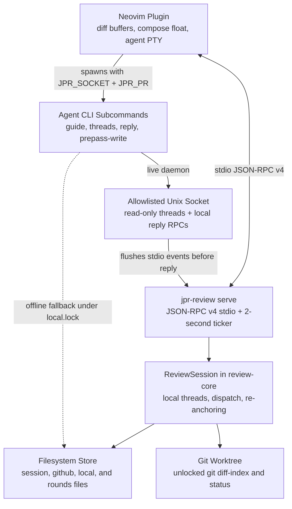
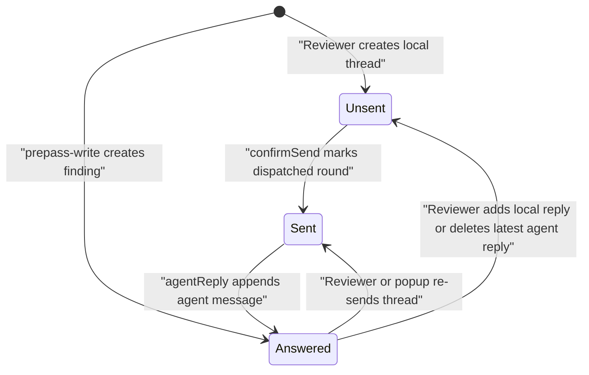
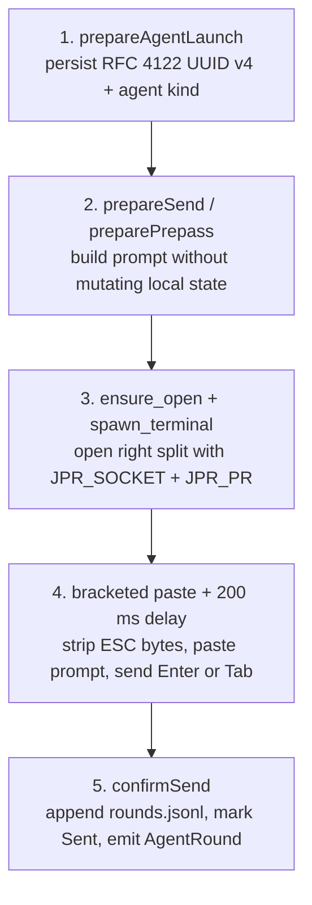

# Local review threads and interactive agent loop

<small>

> <table border="0">
> <tr><th colspan="2">Files</th><th colspan="2">Lines</th></tr>
> <tr><td>Changed (total)</td><td>90</td><td>Insertions (+)</td><td>10,645</td></tr>
> <tr><td>Added</td><td>25</td><td>Deletions (-)</td><td>578</td></tr>
> <tr><td>Deleted</td><td>0</td><td>Net change</td><td>+10,067</td></tr>
> </table>

</small>

## 1. Purpose

Until now, every comment written inside a `jpr.nvim` review went straight to GitHub, so a reviewer who wanted a coding agent to investigate a question or edit code in the checked-out worktree<sup>G11</sup> had no private scratchpad, no way to run an interactive agent beside the diff, and no way to keep comment line anchors<sup>G2</sup> accurate once files changed on disk. This change adds local-only review threads alongside a two-phase agent loop and live worktree re-anchoring while leaving existing GitHub sync isolated.

This change:

- Stores local review threads and agent round<sup>G1</sup> logs separately from GitHub state, with one-keystroke promotion<sup>G10</sup> into GitHub drafts (§4).
- Dispatches selected local threads<sup>G8</sup> or a pre-pass<sup>G9</sup> prompt to a right-hand Claude Code or Codex terminal split (§5).
- Exposes an allowlisted Unix socket from the engine daemon so agent CLI commands reply live or fall back offline (§6).
- Shifts local comment line anchors<sup>G2</sup> and reloads open Neovim diff buffers as files change on disk (§7).
- Adds destination toggles, delivery badges, promotion<sup>G10</sup> prompts, and the agent split inside Neovim (§8).

## 2. Background technical context

```text
crates/
├── review-model/
│   ├── thread              (changed)
│   └── agent               (new)
├── review-store-fs/
│   ├── FsStore             (changed)
│   └── lock                (new)
├── review-core/
│   ├── ReviewSession       (changed)
│   └── reanchor            (new)
├── review-workspace-git/
│   └── GitWorkspace        (changed)
├── review-rpc/
│   ├── server              (changed)
│   └── socket              (new)
└── jpr-review/
    └── socket_client       (new)
lua/jpr/
├── agent                   (new)
├── comments/
│   └── compose             (changed)
└── views/
    └── threads             (changed)
```

<small>

| Unit | What it is |
| --- | --- |
| `thread` | The `Thread` and `Anchor` structs in `review-model`, now carrying `origin`, `agent` state, and `promoted_to`. |
| `agent` (`review-model`) | Pure data types for `AgentKind`, launch plans, round logs, and pre-pass<sup>G9</sup> findings shared across crates. |
| `FsStore` | Reads and writes per-PR state across `session.json`, `github.json`, `local.json`, and `rounds.jsonl`. |
| `lock` | Exclusive `local.lock` file guard serializing offline CLI writes when no engine daemon owns the session. |
| `ReviewSession` | The stateful PR review coordinator handling local threads<sup>G8</sup>, two-phase dispatch, promotion<sup>G10</sup>, and re-anchoring<sup>G2</sup>. |
| `reanchor` | Extracts source line snapshots and searches updated file text to shift local line and range anchors<sup>G2</sup>. |
| `GitWorkspace` | Reads working-tree files and changed paths with `GIT_OPTIONAL_LOCKS=0` so polling never blocks `git commit`. |
| `server` | Hosts the stdio JSON-RPC engine loop and the background ticker multiplexing GitHub sync, retry, and disk watch. |
| `socket` | Accepts Unix domain socket connections from agent CLI tools for four allowlisted methods. |
| `socket_client` | Connects CLI subcommands (`threads`, `reply`, `prepass-write`) to the daemon socket or falls back to `FsStore`. |
| `agent` (`lua/jpr`) | Manages the right-hand Neovim terminal split, prompt bracketed pasting<sup>G3</sup>, and submit timing for `claude` or `codex`. |
| `compose` | Runs the floating markdown editor used to write, toggle destination, edit, or promote<sup>G10</sup> review comments. |
| `views/threads` | Renders thread signs and virtual lines in diff buffers and tracks local anchor<sup>G2</sup> extmarks<sup>G6</sup> across edits. |

</small>

## 3. Shape of the solution

Five runtime boundaries divide responsibility cleanly: Neovim owns buffers, extmarks<sup>G6</sup>, and the interactive terminal PTY; `jpr-review serve` owns the single in-memory session, the background ticker, and the Unix domain socket; `review-core` owns local thread<sup>G8</sup> state, prompt formatting, and re-anchoring<sup>G2</sup>; `review-store-fs` isolates `local.json` and `rounds.jsonl` behind `local.lock`; and `jpr-review` agent subcommands route from the agent shell back into the live session or locked disk store.



> *Every live agent mutation flows through the daemon socket so the engine updates its in-memory session and flushes stdio notifications to Neovim before the CLI command exits.*
>
> **Diagram key**
>
> | | |
> | --- | --- |
> | **PTY** | Pseudo-terminal running `claude` or `codex` inside a Neovim split. |
> | **JSON-RPC v4** | Protocol version 4 adding local origin, agent dispatch, anchor<sup>G2</sup>, and file-watch messages. |
> | **JPR_SOCKET** | Environment variable pointing the agent shell to the active daemon socket. |
> | **JPR_PR** | Environment variable carrying the pull request number to CLI subcommands. |
> | **local.lock** | Exclusive `O_CREAT \| O_EXCL` lock file serializing offline CLI mutations. |

Because GitHub synchronization periodically replaces forge<sup>G7</sup>-owned threads with remote GraphQL thread lists, splitting local threads<sup>G8</sup> and round history out of `github.json` prevents background syncs from dropping local discussions or mixing agent commands with GitHub mutations.

## 4. Local threads, split storage, and GitHub promotion

### 4.1 Local threads persist in `local.json` and `rounds.jsonl` so GitHub sync never overwrites them

Mixing local questions with queued or published GitHub threads in a single file risks leaking private agent questions onto a pull request or losing local state whenever a full GitHub sync rebuilds `github.json`. Every `Thread` now carries `origin: Origin` (`Github` or `Local`), optional `agent: Option<AgentThreadState>`, and optional `promoted_to: Option<String>` (`crates/review-model/src/thread.rs`). Alongside `viewed.json`, `FsStore` splits session and thread persistence across `session.json` (`SESSION_VERSION = 3` adding `socket`, `agentSessionId`, and `agentKind` while still decoding v1 and v2 records), `github.json` (`GITHUB_VERSION = 2`), `local.json` (`LOCAL_VERSION = 1` storing `nextLocalId`, `nextRound`, and `loc-*` threads), and append-only `rounds.jsonl` (`crates/review-store-fs/src/lib.rs`, `format.rs`). During forge<sup>G7</sup> refresh, `sync.rs` keeps every `Origin::Local` thread alongside freshly parsed `Origin::Github` threads (`crates/review-forge-github/src/graphql.rs`) before `split_and_save_threads` partitions them back into their respective files.



> *A local thread's<sup>G8</sup> delivery state<sup>G5</sup> tracks who spoke last and whether a round confirmed delivery, independent of whether `promoted_to` links it to a GitHub draft.*
>
> **Diagram key**
>
> | | |
> | --- | --- |
> | **Unsent** | Open local thread<sup>G8</sup> whose latest message is waiting for `:Jpr send`. |
> | **Sent** | Pasted to the agent terminal in a confirmed round and waiting for `jpr-review reply`. |
> | **Answered** | Latest message on the thread came from `agentReply` or `prepass-write`. |

Deleting messages inside local threads<sup>G8</sup> re-evaluates `AgentThreadState` (`crates/review-core/src/session/local.rs`): if the remaining trailing message is not viewer-authored, state stays `Answered`; if it is viewer-authored and state was `Answered`, it reverts to `Unsent`.

### 4.2 Offline CLI writes serialize through `O_CREAT | O_EXCL` `local.lock` without unsafe OS calls

When no `jpr-review serve` daemon is running, offline CLI commands mutate `local.json` through `FsStore::mutate_local_locked`, backed by `crates/review-store-fs/src/lock.rs`. To keep the crate free of `unsafe` OS `flock` or `fcntl` calls, `with_local_lock` uses `OpenOptions::create_new(true)` (`O_CREAT | O_EXCL`, mode `0o600`), polling every 15 ms up to a 5-second timeout. If `local.lock` is older than 30 seconds (`STALE_LOCK_AGE`), a contender acquires a secondary `local.lock.evict` guard before unlinking the stale file, and `LockGuard` keeps the original file descriptor open and checks `(dev, ino)` equality in `Drop` so a resumed stale holder never unlinks a successor's lock.

### 4.3 Promoting a local thread clones its anchor to GitHub and remaps temporary IDs after sync

Pressing `p` in the thread popup or conversation view invokes `promoteThread`, handled by `ReviewSession::promote_thread` (`crates/review-core/src/session/local.rs`). Promotion<sup>G10</sup> clones the local thread's<sup>G8</sup> anchor<sup>G2</sup>, clears any disk `snapshot` (since GitHub anchors reference the PR diff rather than working-tree snapshots), calls `create_github_thread_entry` to create a draft or PR comment, and records `local_thread.promoted_to = Some(github_thread.id)`. When offline queuing assigns an optimistic `tmp-*` ID during promotion and a later sync replays `CreateReviewThread` or `CreateConversationComment` against GitHub, `crates/review-core/src/session/comments/queue/mod.rs` rewrites matching `promoted_to` fields from the temporary ID to the real `PRRT_*` or `IC_*` ID.

Whenever deleting a message empties its target thread (whether an un-synced `tmp-*` draft, a published/draft `PRRT_*` or `IC_*` thread deleted online, an offline-queued `DeleteMessage`, or replay reconciliation), `remove_message_from_threads` (`crates/review-core/src/session/comments/queue/prune.rs`) clears matching `promoted_to` links via `clear_promoted_to_target` and `save_and_announce_threads` persists the updated `local.json` state so the local thread<sup>G8</sup> can be promoted<sup>G10</sup> again.

## 5. Two-phase agent dispatch and terminal delivery

Sending local questions to an interactive TUI agent cannot be an atomic single RPC because spawning the terminal, pasting multi-line text, or dispatching the trailing newline can fail in Neovim after the RPC returns. Splitting prompt preparation from round confirmation keeps failed spawns from burning round numbers or marking threads `Sent`.

### 5.1 Prompt preparation, bracketed paste, and delayed submit run before `confirmSend` marks threads `Sent`



> *State transitions happen only in step 5 after Neovim confirms that both the bracketed paste<sup>G3</sup> and submit keystroke reached a live terminal job.*
>
> **Diagram key**
>
> | | |
> | --- | --- |
> | **UUID v4** | Deterministic per-PR session identifier stored in `session.json` for Claude or Codex resumption. |
> | **JPR_SOCKET** | Environment variable passing the daemon socket path to the spawned agent shell. |
> | **JPR_PR** | Environment variable passing the active pull request number to agent CLI calls. |
> | **ESC** | Raw escape byte (`\x1b`) stripped from comment text before wrapping in bracketed-paste markers. |

| Step / RPC | Actor | Persistent effect |
| --- | --- | --- |
| `prepareAgentLaunch` | Engine (`session/agent_loop.rs`) | Writes `agentSessionId` + `agentKind` to `session.json` |
| `prepareSend` / `preparePrepass` | Engine (`session/agent_loop.rs`) | None (read-only prompt construction) |
| `confirmSend` | Engine (`session/agent_loop.rs`) | Appends `rounds.jsonl`; marks local threads<sup>G8</sup> `Sent` |

#### Step 1. `prepareAgentLaunch`

When `:Jpr agent`, `:Jpr send`, or `:Jpr prepass` needs a terminal (`lua/jpr/agent.lua`), Neovim requests `prepareAgentLaunch`. If `session.json` already stores a matching `agentKind` and non-empty `agentSessionId`, `ReviewSession::prepare_agent_launch` returns `isResume: true` with that UUID; otherwise it increments `next_local_id`, derives a deterministic RFC 4122 version 4 UUID via `build_uuid_v4_from_seed` (`splitmix64` mixing PR number, clock timestamp, and counter in `crates/review-core/src/agent.rs`), persists it to `session.json`, and returns `isResume: false`.

#### Step 2. `prepareSend` and `preparePrepass`

`prepareSend` collects either one targeted open local thread<sup>G8</sup> (for popup or conversation `s`, allowing re-send even when `Answered`) or every open `Unsent` thread whose trailing message is viewer-authored (`select_dispatchable_threads` in `crates/review-core/src/agent.rs`). It formats a numbered prompt instructing the agent to run `jpr-review guide` first and answer each item via `jpr-review reply <thread-id> --body "..."`, returning `AgentDispatch` with candidate `round = next_round.max(1)` without altering `local.json`. `preparePrepass` similarly builds a pre-pass<sup>G9</sup> prompt targeting `jpr-review prepass-write` against `pr.base_sha`.

#### Step 3. `ensure_open` and `spawn_terminal`

Neovim queues callbacks while a launch RPC is in flight (`agent_pending_callbacks`), creates a 56-column right-hand split tagged `jpr_side = true`, and starts `claude` or `codex` via `vim.fn.jobstart` with `cwd = session.worktree` and `env = { JPR_SOCKET, JPR_PR }`.

#### Step 4. Bracketed paste and delayed submit

`M.deliver_dispatch` (`lua/jpr/agent.lua`) strips every raw `ESC` (`\x1b`) byte from the prompt so untrusted comment text cannot inject terminal control sequences, wraps the payload in `\x1b[200~...\x1b[201~`, sends it via `vim.fn.chansend`, and waits `submitDelayMs` (`200` ms) before sending `\r` (`SubmitKey::Enter` for Claude Code) or `\t` (`SubmitKey::Tab` for Codex).

#### Step 5. `confirmSend`

Only if `chansend` of the submit key succeeds does Neovim call `confirmSend`. `ReviewSession::confirm_send` checks that `round >= next_round` and `thread_ids` matches `AgentRoundKind`, appends the `AgentRound` line to `rounds.jsonl`, updates matching local threads<sup>G8</sup> to `AgentThreadState::Sent { round }`, increments `next_round`, writes `local.json`, and emits `ThreadsChanged` and `AgentRound`.

### 5.2 Aborted terminal spawns leave every local thread `Unsent` and `next_round` unchanged

Because `prepareSend` never writes `local.json` or `rounds.jsonl`, aborting in Neovim before `confirmSend` (for instance, if `claude` is missing from `PATH`, the job exited, or the tab closed during the 200 ms delay) leaves every thread `Unsent` and `next_round` untouched. If `split_and_save_threads` fails inside `confirmSend` after `append_round`, `confirm_send` restores `previous_threads` and `previous_local` in memory before returning the error.

### 5.3 Claude session resumption stats the disk transcript file before passing `--resume`

For Codex, `create_launch_argv_from_plan` passes `{ codex_cmd, "resume", sessionId }` whenever `isResume` is true. For Claude Code, a saved `agentSessionId` in `session.json` may predate any saved Claude conversation if the engine stored the UUID during an earlier failed spawn; passing `--resume` when no session log exists causes Claude Code to exit with an error. `M.has_claude_transcript` therefore replaces non-alphanumeric/non-hyphen path characters in `worktree` with `-` and stats `~/.claude/projects/<slug>/<sessionId>.jsonl`, passing `--resume <id>` only when that file exists and `--session-id <id>` otherwise.

## 6. Allowlisted Unix socket server and CLI fallback routing

### 6.1 The daemon socket accepts four local-only methods and flushes Neovim events before replying

An agent running in the terminal split needs fast access to local threads<sup>G8</sup>, PR metadata, and live UI updates when it posts replies, yet exposing the full stdio RPC surface over a socket would let a prompt-injected shell command publish drafts or mutate GitHub directly. Meanwhile, long `$XDG_STATE_HOME` paths on macOS exceed the kernel's 104-byte `SUN_LEN` path ceiling for Unix sockets.

To solve both constraints, `jpr-review serve` (`crates/jpr-review/src/commands/serve.rs`) computes `<state_dir>/s.sock` and falls back to `<temp_dir>/jpr-<pid>-<fnv1a>/s.sock` (or `/tmp/jpr-<pid>-<fnv1a>/s.sock`) whenever the candidate exceeds `MAX_UNIX_SOCKET_BYTES = 96`. Before binding, it checks both any path recorded in `session.json` and the new candidate for a live listener, then `SocketServer::start` (`crates/review-rpc/src/socket.rs`) creates missing parent directories with mode `0o700` (and tightens existing non-shared parent directories without following symlinks), removes stale disconnected socket files (refusing symlinks or regular files), binds the socket with mode `0o600`, and serves up to `MAX_CONCURRENT_CLIENTS = 64` clients with 1 MiB bounded line reads, 5-second idle / 15-second total timeouts (`crates/review-rpc/src/socket/io.rs`). Only four methods are permitted by `is_socket_method_allowed`:

- `snapshot` (read-only PR and session metadata)
- `threads` (read-only merged or `--local` threads)
- `agentReply` (appends `AgentThreadState::Answered` reply to a `loc-*` thread, rejecting `PRRT_`, `IC_`, `PRRC_`, `tmp-`, and any known GitHub thread ID)
- `prepassWrite` (creates batch `Answered` local threads<sup>G8</sup>)

Every handled socket request flushes pending session events (such as `ThreadsChanged`) to Neovim over stdout via `write_events` before sending the JSON-RPC reply to the socket client, so Neovim begins redrawing before `jpr-review reply` exits.

### 6.2 Agent CLI commands probe the explicit socket, environment socket, and `session.json` before locking disk

Agent CLI commands (`guide`, `threads`, `reply`, `prepass-write`) route through `execute_via_socket_or_store` (`crates/jpr-review/src/commands/socket_client.rs`) in four ordered steps:

1. Explicit `--socket <path>` connects directly and fails loudly if unreachable.
2. `$JPR_SOCKET` connects and falls through on `NotFound` or `ConnectionRefused`.
3. `FsStore` for `(pr, repo)` (inferred from `--pr` or, when `--repo` is not explicitly given, `$JPR_PR`, and `--repo` / `git remote get-url origin` with `GIT_*` env vars scrubbed) checks `session.json`'s stored `socket` if different from step 2.
4. When no daemon responds, `reply` and `prepass-write` mutate `local.json` directly under `local.lock` (`guide` prints the embedded contract without needing a session).

Both `prepassWrite` and `promoteThread` validate file targets through `validate_anchor_file` (`crates/review-core/src/reanchor.rs`): `normalize_prepass_anchor` checks safe relative paths (rejecting empty paths, leading `/`, `\`, `\0`, `.`, `..`, and `.git` segments) and positive line bounds, and then `ReviewSession::prepass_write` (plus the offline `write_findings_to_store` fallback whenever `snapshot.files` is populated) calls `validate_anchor_file` so `AnchorKind::Pr` notes succeed while file or line anchors<sup>G2</sup> outside the pull request's changed files (`saved.files`) are rejected.

## 7. Live re-anchoring and unlocked worktree watching

### 7.1 Buffer extmarks on save and 2-second unlocked git polling update local anchors across edits

Once a coding agent or reviewer edits the checked-out worktree<sup>G11</sup>, lines inserted above a local comment shift the commented code downward, leaving stale line numbers in `local.json` and stale diff views in Neovim until manual sync. Local `RIGHT`-side `line` and `range` threads capture exact source lines into `anchor.snapshot` at creation (`create_local_thread` and `prepass-write`), and two complementary paths keep those bounds current (`crates/review-core/src/session/worktree_watch.rs`, `crates/review-core/src/reanchor.rs`):

- **Interactive editor edits (`BufWritePost`):** When Neovim draws threads (`lua/jpr/views/threads.lua`), it places a shadow extmark<sup>G6</sup> in namespace `jpr-local-anchors` (`right_gravity = true`, `end_right_gravity = true`) for every open `RIGHT`-side local line/range thread. On `BufWritePost` (`lua/jpr/views/diff/init.lua`), `collect_shifted_local_anchors` reports any changed spans via `updateLocalAnchors`, updating `start`, `end`, `kind`, and refreshing `snapshot` from disk.
- **External disk edits (2-second ticker):** `review-rpc/src/server/ticker.rs` replaces the single sync poller with a combined wake interval (`min(poll_every, retry_every, watch_every)`, where `serve.rs` sets `watch_every = 2s`). On each watch tick, `poll_worktree_files` gathers candidate paths from PR files, local thread<sup>G8</sup> files, prior digests, and `GitWorkspace::list_changed_files_since(&merge_base)`, which invokes `git diff-index` and `git status --porcelain=v1 -z` with `GIT_OPTIONAL_LOCKS=0` (`crates/review-workspace-git/src/process.rs`) so polling never blocks a concurrent `git commit`. It hashes up to 4 MiB plus total byte length via FNV-1a (`hash_bounded_file_bytes`), diffs digests, emits `FilesChanged` (triggering Neovim `silent! checktime`, diff redraw, and stream refresh), and re-anchors<sup>G2</sup> any local thread on changed paths before emitting `ThreadsChanged`.

### 7.2 Worked re-anchoring trace in `reanchor_thread_in_text`

**File: `crates/review-core/src/reanchor.rs`**

```rust {3-10,11-15}
pub fn reanchor_thread_in_text(thread: &mut Thread, updated_text: &str) -> bool {
    ...
    let matched_start = find_closest_window(&file_lines, &target_lines, current_start, false)
        .or_else(|| {
            if snapshot.trim().is_empty() {
                None
            } else {
                find_closest_window(&file_lines, &target_lines, current_start, true)
            }
        });
    let Some(new_start_index) = matched_start else {
        let was_outdated = thread.outdated;
        thread.outdated = true;
        return !was_outdated;
    };
    ...
}
```

The highlighted `find_closest_window` call tries exact line equality (`false`) before falling back to trimmed equality (`true`, skipped when `snapshot` is whitespace-only), and the highlighted `None` branch sets `outdated = true` without shifting coordinates.

Suppose a local thread<sup>G8</sup> anchors<sup>G2</sup> to lines `10..=11` with snapshot<sup>G4</sup> `"let ok = check();\nreturn ok;"`. First, the agent inserts 4 import lines at the top of the file and re-indents line 14 by 4 spaces:

1. `target_lines` splits into `["let ok = check();", "return ok;"]` and `current_start` is `10`.
2. Pass 1 (`use_trimmed = false`) scans every 2-line slice of `file_lines`; none equals `target_lines` byte-for-byte because of the extra leading spaces.
3. Since `snapshot.trim()` is non-empty, pass 2 (`use_trimmed = true`) compares `.trim()` per line, matches indices `(13, 14)` (1-based lines `14..=15`), breaks any repeated-block ties by `start.abs_diff(preferred_index)` against `preferred_index = 9`, updates `start = 14`, `end = 15`, and clears `outdated = false`.
4. If the agent later deletes `check()` entirely, both passes return `None`, setting `thread.outdated = true` while preserving lines `14..=15`.

## 8. Interface changes

Live terminal screenshots could not be captured because this review ran in a headless workspace without an interactive GUI terminal emulator or live pull request checkout. Instead, the ASCII diagrams below reflect the exact strings built by `lua/jpr/comments/compose.lua`, `lua/jpr/render/panel.lua`, `lua/jpr/render/threads.lua`, and `lua/jpr/agent.lua`.

```text
╭───────────────── [Local → agent] src/lock.rs:58 ─────────────────╮
│ Why 5s lock timeout here instead of failing immediately?         │
│                                                                  │
╰ <C-s> save · <C-g> flip dest · <M-s> other dest · <C-g>s suggest · q cancel ╯
```

Pressing `<C-g>` toggles `compose_destination` (remembered across comments in the session) between `[Local → agent]` and `[GitHub draft]` / `[GitHub comment]`, while `<M-s>` submits directly to the opposite destination without flipping state.

```text
#42 Add local comment loop                                         ╭─ Agent split (width 56) ─╮
viewed 3/7 · threads 4 · drafts 1 · local unsent 1                 │ $ claude --session-id …  │
synced 12s ago                                                     │ > jpr-review reply loc-1 │
                                                                   │                          │
src/lock.rs  58 │ let guard = acquire_lock(…)?; ◆ @you: Why 5s… [local · unsent]
             59 │                                  @you: ...    [local · sent #1]
             60 │                                  @agent: ...  [local · answered] [promoted]

Key: ◆ = open local thread sign in diff gutter; right pane runs claude or codex in a 56-column split.
```

Open local threads<sup>G8</sup> take sign `◆` under `JprThreadLocal` (`DiagnosticHint`), ranked behind `JprThreadFailed` (`!`) and `JprThreadDraft` (`✎`) and ahead of published threads (`💬`). In the thread popup and conversation view, `p` opens `[Promote → GitHub]` to turn a local thread into a GitHub draft/comment, and `s` sends or re-sends that single open local thread.

`M.open_edit(session, message, thread)` (`lua/jpr/comments/compose.lua`) forwards `thread.anchor` to `open_editor` whenever `thread` provides an anchor<sup>G2</sup> table, so `<C-g>s` suggestion-block insertion works when editing existing line and range comments as well as when composing new comments.

## 9. Decisions

- **`FsStore` saves local threads<sup>G8</sup> and round logs in `local.json` and `rounds.jsonl` instead of inside `github.json`.** Keeping local dialogue out of `github.json` prevents GitHub syncs from resolving merge conflicts against remote GraphQL thread lists and lets offline CLI fallbacks lock only `local.lock`. Reversible via schema migration, at the cost of updating `promoted_to` across files when queued IDs remap.
- **The daemon exposes a four-method allowlisted Unix socket with an `O_CREAT | O_EXCL` `local.lock` fallback instead of exposing full stdio RPC or OS `flock`.** Restricting socket RPCs stops prompt-injected agent commands from publishing GitHub drafts while still flushing `ThreadsChanged` to Neovim before CLI exit; `O_CREAT | O_EXCL` with `.evict` and `(dev, ino)` checking avoids `unsafe` Rust code at the cost of a 30-second stale threshold if a holder suspends mid-write. Reversible if a future local daemon requires cross-platform advisory locking or additional local-only RPCs.
- **Neovim splits agent dispatch into read-only `prepareSend`, bracketed paste<sup>G3</sup>, and `confirmSend` instead of marking threads `Sent` during prompt preparation.** Separating preparation from confirmation ensures failed terminal spawns or closed tabs never skip round numbers or mark comments `Sent`. Reversible without touching storage if Neovim gains synchronous terminal delivery confirmation.
- **The engine assigns a deterministic RFC 4122 UUID v4 per PR and Neovim stats `~/.claude/projects/<slug>/<id>.jsonl` before passing `--resume` instead of trusting `session.json` alone.** Checking disk avoids Claude Code crashes when `session.json` records a UUID from an aborted first spawn. Reversible if Claude Code adds an idempotent `--resume-or-create` flag; assumes Claude Code retains its `<slug>/<uuid>.jsonl` layout.
- **Local anchor<sup>G2</sup> tracking combines Neovim buffer extmarks<sup>G6</sup> on save with a 2-second `GIT_OPTIONAL_LOCKS=0` poll instead of adding native OS file-watcher dependencies.** Polling reuses the existing server ticker and avoids colliding with manual `git commit` runs, trading up to 2 seconds of disk notification lag. Reversible behind `review-rpc`'s ticker loop if instant external change detection becomes necessary.

## 10. Deliberately not handled

- Live diffing against uncommitted worktree<sup>G11</sup> edits when computing diff hunk coordinates for PR files (`GitHub` threads remain anchored<sup>G2</sup> to the PR diff view; only `RIGHT`-side local `line` and `range` threads shift against working-tree disk files).
- Full PR pre-pass<sup>G9</sup> automatic execution on `:Jpr open`: pre-pass runs only when explicitly invoked via `:Jpr prepass`.
- File-system event daemons (`inotify` / `FSEvents`): polling runs every 2 seconds inside the existing server ticker rather than adding native watcher dependencies.
- Windows named pipes or native `flock`: Unix domain sockets and `(dev, ino)` lock checks target Unix systems (`#[cfg(not(unix))]` uses non-socket fallback / token comparison).

<div style="page-break-before: always"></div>

## Appendix A. Manual testing

<small>

1. Verify the workspace builds, passes all Rust and headless Neovim tests, and passes lints:

   ```sh
   just check
   ```

2. Verify the embedded agent contract prints cleanly:

   ```sh
   cargo run -p jpr-review -- guide
   ```

3. Open an active PR branch in Neovim with `:Jpr open`, navigate to a changed line, press `gc` to open the compose window, and press `<C-g>` to confirm the title flips between `[GitHub draft]` and `[Local → agent]`. Submit a local comment and confirm the line shows `◆` with `[local · unsent]` and the panel header shows `local unsent 1`.

4. Launch the interactive agent with `:Jpr agent` and send the comment with `:Jpr send` (or `s` inside `gt` popup). Verify:
   - Before: thread shows `[local · unsent]` and no agent split is open.
   - After: a 56-column right-hand split starts `claude` or `codex`, pastes the prompt inside bracketed-paste escapes, submits after 200 ms, and updates the thread badge to `[local · sent #1]`.

5. Inside the agent terminal (or a shell inheriting `JPR_SOCKET` and `JPR_PR`), inspect threads and reply to `loc-1`, then verify the GitHub safety check refuses a `PRRT_` identifier:

   ```sh
   jpr-review threads --local
   jpr-review reply loc-1 --body "Checked; keeping early return."
   jpr-review reply PRRT_kwDOFake --body "Should be rejected"
   ```

   Confirm `loc-1` updates immediately in Neovim to `[local · answered]` and the `PRRT_` call exits non-zero.

6. Insert three lines above `loc-1`'s anchored<sup>G2</sup> code in the worktree<sup>G11</sup> file from another shell (or edit and `:write` in Neovim). Confirm within 2 seconds (or on save) that open buffers reload, `loc-1` shifts down by three lines, and deleting the anchored lines marks `loc-1` as `[outdated]`.

7. Open the popup on `loc-1` (`gt`) and press `p` to open `[Promote → GitHub]`, submit, and verify a GitHub draft comment is created and `loc-1` gains `[promoted]`.

8. Test batch pre-pass<sup>G9</sup> creation against a file on disk:

   ```sh
   jpr-review prepass-write <<'EOF'
   [{"anchor":{"file":"README.md","kind":"line","side":"RIGHT","start":1,"end":1},"body":"[nit] Check header wording"}]
   EOF
   ```

   Confirm a new `loc-*` thread appears immediately with `[local · answered]`.

</small>

<div style="page-break-before: always"></div>

## Appendix B. Glossary

<small>

| Term | Meaning |
| --- | --- |
| **G1** Agent round (agent rounds) | A numbered prompt dispatch (`#1`, `#2`, and so on) sent from Neovim to the coding agent terminal and logged in `rounds.jsonl` once confirmed. |
| **G2** Anchor | The attachment point for a comment on a pull request: a single line, a line range, a whole file, or the top-level PR conversation. |
| **G3** Bracketed paste | Wrapping prompt text in `\x1b[200~` and `\x1b[201~` escape markers so the receiving agent CLI reads multi-line text as a single paste without executing intermediate newlines. |
| **G4** Code snapshot (snapshot) | The exact working-tree lines saved onto an anchor<sup>G2</sup> when a local line or range comment is created, used to find those lines again after edits shift line numbers. |
| **G5** Delivery state | Whether a local thread<sup>G8</sup> is `Unsent` (queued for `:Jpr send`), `Sent` (delivered in a numbered agent round<sup>G1</sup>), or `Answered` (last reply came from an agent). |
| **G6** Extmark | A Neovim buffer marker attached to a line span that shifts automatically as lines are edited above it inside an open editor buffer. |
| **G7** Forge | The remote GitHub service holding pull requests, review threads, and pending review drafts. |
| **G8** Local thread (local threads) | A review thread stored only on this machine (`loc-*`) in `local.json` for private agent dialogue and pre-pass<sup>G9</sup> notes, kept off GitHub unless promoted<sup>G10</sup>. |
| **G9** Pre-pass | An agent-driven review pass (`:Jpr prepass`) that inspects the pull request diff in the worktree<sup>G11</sup> and writes findings into `local.json` as answered local threads<sup>G8</sup>. |
| **G10** Promote (promotion, promoted) | Copying a local thread<sup>G8</sup> into a new GitHub draft comment (or published PR comment) and saving the resulting remote or queued ID in `promoted_to`. |
| **G11** Worktree | The checked-out local git working directory for a pull request where both the reviewer and the agent read and modify files. |

</small>
