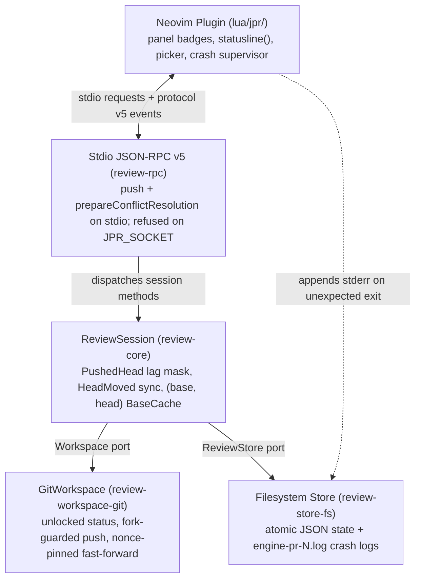
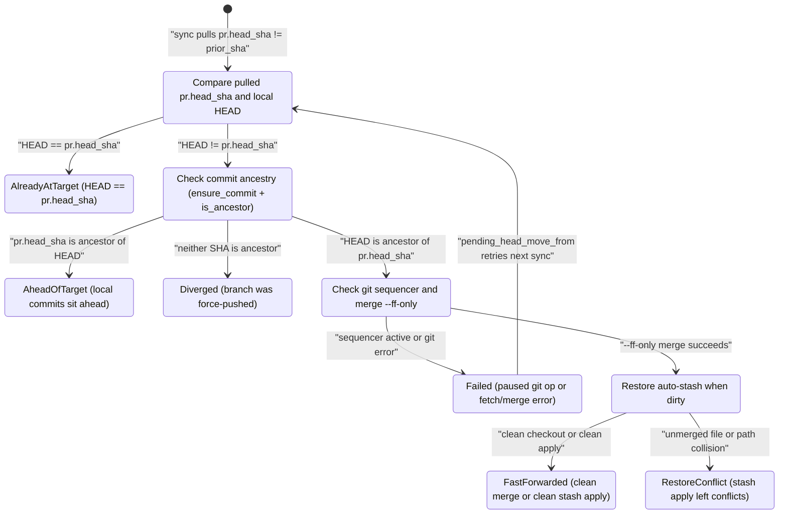
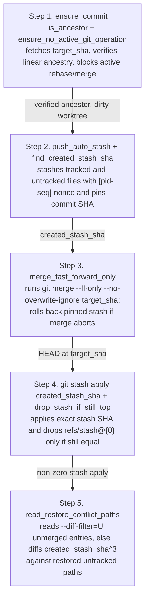
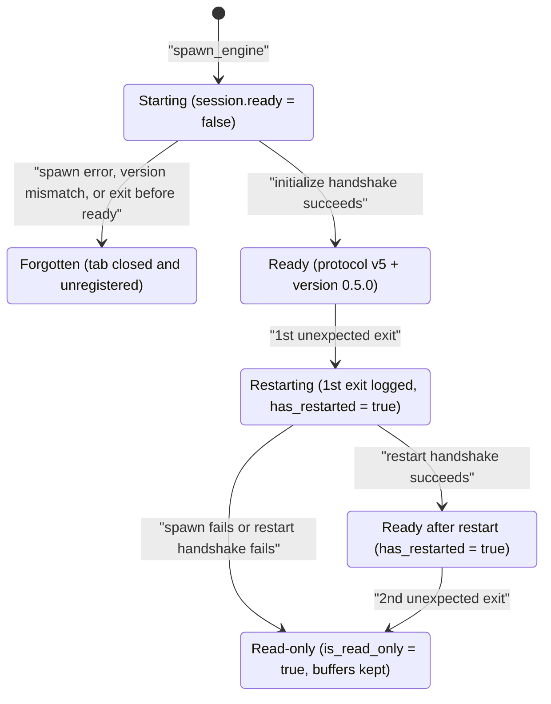

# Worktree git awareness, branch-safe push, fast-forward sync, and crash recovery

<small>

> <table border="0">
> <tr><th colspan="2">Files</th><th colspan="2">Lines</th></tr>
> <tr><td>Changed (total)</td><td>92</td><td>Insertions (+)</td><td>8,237</td></tr>
> <tr><td>Added</td><td>28</td><td>Deletions (-)</td><td>2,501</td></tr>
> <tr><td>Deleted</td><td>0</td><td>Net change</td><td>+5,736</td></tr>
> </table>

</small>

## 1. Purpose

Reviewing a pull request alongside a local coding agent turns the checked-out directory into an active workspace, yet `jpr.nvim` previously treated that checkout as static after `:Jpr open`. Reviewers had no indicator in the panel or statusline when local files were dirty or when commits stood ahead of or behind GitHub, publishing an agent's commit required leaving Neovim to construct an explicit `git push` refspec because `gh pr checkout` creates a local `pr-<n>` branch, incoming remote commits left the local checkout behind `headSha`, and an unexpected engine exit either tore down open review buffers or left stale processes behind.

This change:

- Shows live git status, modified-file markers, and local-thread counts in the review panel and statusline, and adds branch-safe `:Jpr push` (§4).
- Fast-forwards behind checkouts around uncommitted edits when a pull request's remote branch advances, with editor or coding-agent conflict resolution (§5).
- Verifies engine and plugin versions on startup, restarts a crashed review engine once, and preserves open buffers in `[read-only]` mode on repeat failure (§6).

## 2. Background technical context

```text
crates/
├── review-model/src/view                  (changed)
├── review-core/src/session/ReviewSession  (changed)
├── review-workspace-git/src/GitWorkspace  (changed)
├── review-store-fs/src/FsStore            (changed)
└── review-rpc/src/server                  (changed)
lua/jpr/session/                           (changed)
```

<small>

| Unit | What it is |
| --- | --- |
| `view` | Read models and notifications (`SessionView`, `FileRow`, `WorktreeStatus`, `PushResult`, `Event`) returned to Neovim. |
| `ReviewSession` | Coordinates one pull request behind `ports` (`Forge`, `Workspace`, `ReviewStore`) and shifts comment anchors via `reanchor`. |
| `GitWorkspace` | Runs non-interactive `git` commands inside the checked-out pull request directory to implement `Workspace`. |
| `FsStore` | Atomically reads and writes per-PR state (`session.json`, `github.json`, `local.json`, `viewed.json`, `rounds.jsonl`). |
| `server` | Hosts `jpr-review serve`'s stdio JSON-RPC v5 request loop and 2-second watch ticker alongside the `socket` listener. |
| `session` | Owns one Neovim review tab, formatting `render/panel`, dispatching `agent` rounds, and supervising engine exits. |

</small>

## 3. Shape of the solution

To support active git editing without violating the workspace dependency rule<sup>G3</sup>, git inspection and mutation live inside `review-workspace-git`, session state transitions and diff cache invalidation live inside `review-core`, protocol v5 exposes two stdio-only requests in `review-rpc`, and `lua/jpr/` renders view badges and supervises the child process. The three strands connect through `SessionView`: `:Jpr push` (§4) and remote `headSha` fast-forwarding (§5) both update git `HEAD` and `WorktreeStatus`, while startup handshakes and crash supervision (§6) govern the stdio JSON-RPC v5 connection that carries those updates to Neovim.



> *Every git mutation (`push` and `fast_forward_to`) enters through stdio JSON-RPC v5 rather than the agent's `JPR_SOCKET`, keeping remote pushes and branch updates under Neovim's control.*
>
> **Diagram key**
>
> | | |
> | --- | --- |
> | **JPR_SOCKET** | Allowlisted Unix domain socket exported to the coding-agent terminal for read-only thread queries and local replies. |
> | **PushedHead** | In-memory record of a newly pushed commit SHA held until GitHub's GraphQL `headRefOid` catches up. |
> | **BaseCache** | Cached merge-base commit, rename table, and base blobs inside `ReviewSession`. |

## 4. Tracking local git state and pushing commits to the pull request branch

### 4.1 Unlocked git status polling populates `SessionView.worktreeStatus` and per-file badges

The first strand begins by giving reviewers live visibility into uncommitted edits and local commits without blocking manual `git` commands in a terminal. `GitWorkspace::worktree_status` (`crates/review-workspace-git/src/status.rs`) runs `git status --porcelain=v1 -z --untracked-files=all` and `git rev-list --left-right --count <remote_head_sha>...HEAD` (falling back to `@{upstream}...HEAD` when the remote commit is not yet fetched locally) with `GIT_OPTIONAL_LOCKS=0` so background status checks never contend for `.git/index.lock`.

`presenter::session_view` (`crates/review-core/src/presenter.rs`) attaches the resulting `WorktreeStatus` (`isDirty`, `ahead`, `behind`, and safe repository-relative `modifiedPaths`) to `SessionView` and computes two new fields on each `FileRow`: `is_modified` (membership in a `BTreeSet` built from `modified_paths`) and `local_threads` (the count of `Origin::Local` threads on that path, while `threads` remains the combined GitHub plus local count). On every 2-second watch tick in `ReviewSession::poll_worktree_files` (`crates/review-core/src/session/worktree_watch.rs`), when file content digests have not changed since the last tick, `poll_worktree_status_change` compares the live `WorktreeStatus` against `last_worktree_status` and emits `Event::WorktreeStatusChanged` only on a transition (for example right after the reviewer runs `git commit` or `git reset`, which changes `ahead` and `isDirty` without altering working-tree file bytes). Every view-carrying `Event` updates `last_worktree_status` inside `ReviewSession::publish`, preventing duplicate status events after `Synced` or `FilesChanged`.

### 4.2 `push_head_to_pr_branch` validates refspecs and blocks misconfigured fork pushes

Once the status poll shows a local commit ahead of GitHub, this strand needs a way to publish that commit from a checkout whose local branch name rarely matches the pull request branch: `gh pr checkout <n> -b pr-<n>` names the local branch `pr-<n>` rather than the pull request's `headRef`, and custom worktree commands often check out a detached `HEAD`. `push_head_to_pr_branch` (`crates/review-workspace-git/src/push.rs`) always pushes an explicit `HEAD:refs/heads/<head_ref>` refspec, and resolves the target remote differently for same-repository versus cross-repository pull requests<sup>G2</sup> (`PullRequest.is_cross_repository`, now requested via `PR_FIELDS` in `crates/review-forge-github/src/pr.rs` and persisted in `StoredPullRequest`).

**File: `crates/review-workspace-git/src/push.rs`**

```rust {5-9,10-18,19-23}
fn get_cross_repo_branch_from_config<'a>(
    config: &'a BranchPushConfig,
    default_merge_ref: &str,
) -> Result<(&'a str, String, String)> {
    let Some(local_branch) = config.local_branch.as_deref() else {
        bail!(
            "refusing to push cross-repository (fork) pull request from detached HEAD: check out the fork branch with explicit remote tracking configured"
        );
    };
    let Some(remote) = config
        .push_remote
        .as_ref()
        .or(config.branch_remote.as_ref())
    else {
        bail!(
            "refusing to push cross-repository (fork) pull request: branch {local_branch:?} has no configured fork remote"
        );
    };
    if config.push_remote.is_none() && config.merge_ref.is_none() {
        bail!(
            "refusing to push cross-repository (fork) pull request: branch {local_branch:?} has no configured upstream merge ref"
        );
    }
    ...
}
```

For a same-repository pull request, a detached `HEAD` or a branch without `branch.<local>.pushRemote` / `branch.<local>.remote` defaults to `origin`, and only fails if `branch.<local>.merge` is explicitly set to a different branch than `refs/heads/<head_ref>` (catching checkouts where the user switched onto `main`). For a cross-repository pull request<sup>G2</sup> (`is_cross_repository == true`), falling back to `origin` would push the contributor's branch onto the upstream base repository whenever the reviewer holds upstream write permissions. The highlighted checks in `get_cross_repo_branch_from_config` therefore require a checked-out local branch, an explicit `pushRemote` or `remote`, and an upstream `merge` ref whenever `pushRemote` is unset; `verify_cross_repo_push_urls` then inspects every `git remote get-url --push --all -- <remote>` entry, parses SSH, SCP-like, HTTP(S), and `git://` URLs into `(owner, repo)`, and aborts if any push URL matches `pr.owner/pr.repo` case-insensitively. Before spawning `git push --porcelain -- <remote> HEAD:refs/heads/<head_ref>`, `validate_push_target` and `is_safe_branch_ref` reject leading `-` flags, control/whitespace bytes, `..`, `@{`, `.lock` suffixes, and non-`refs/heads/` targets.

### 4.3 `ReviewSession::push` remembers the pushed commit in memory so GitHub GraphQL lag does not show unpushed commits

Still in the push strand, after `GitWorkspace::push_head` updates the remote branch, the session coordinator must reconcile `SessionView` even when GitHub's GraphQL endpoint lags behind git or fails transiently. `ReviewSession::push` (`crates/review-core/src/session/push.rs`) validates `WorktreeStatus` before touching the network and separates git push success from the follow-up forge<sup>G4</sup> refresh.

**File: `crates/review-core/src/session/push.rs`**

```rust {6-9,17-26}
impl ReviewSession {
    pub fn push(&mut self) -> Result<PushResult> {
        ...
        validate_push_status(&status, &local_head_sha, &effective_remote_sha)?;
        let head_sha = self.ports.workspace.push_head(&pr)?;
        self.pushed_head = Some(PushedHead {
            base_pr_head_sha: pr.head_sha,
            pushed_sha: head_sha.clone(),
        });
        match self.sync() {
            Ok(view) => Ok(PushResult {
                is_pushed: true,
                head_sha,
                sync_error: None,
                view,
            }),
            Err(error) => {
                let view = self.view();
                self.last_worktree_status = Some(view.worktree_status.clone());
                Ok(PushResult {
                    is_pushed: true,
                    head_sha,
                    sync_error: Some(format!("{error:#}")),
                    view,
                })
            }
        }
    }
}
```

`validate_push_status` refuses three states with specific guidance before `push_head` runs: `ahead == 0 && behind > 0` tells the reviewer to run `:Jpr sync` first; `ahead == 0 && local_head_sha == effective_remote_sha && is_dirty` tells them to commit their changes first rather than inventing an automatic commit; and a clean up-to-date `HEAD` reports `nothing to push`. Once `push_head` succeeds, two post-push timing hazards remain: GitHub's GraphQL `headRefOid` often lags behind `git push` by one or two seconds, and `self.sync()` can fail transiently if `gh` times out. Recording the highlighted `PushedHead { base_pr_head_sha, pushed_sha }` makes `effective_remote_head_sha()` (`crates/review-core/src/session/mod.rs`) compare `HEAD` against `pushed_sha` instead of the stale `pr.head_sha` until `reconcile_pulled_state` sees `pr.head_sha` move away from `base_pr_head_sha`, preventing `worktreeStatus` from flashing `↑1 ↓0` right after a push. Catching `Err(error)` from `self.sync()` in the highlighted match arm returns `PushResult { is_pushed: true, sync_error: Some(..), .. }` instead of an RPC error, so Neovim prints `jpr: pushed <short-sha>` followed by a `jpr: pushed, but GitHub resync failed: ...` warning rather than claiming the push itself failed.

## 5. Fast-forwarding the local checkout when the pull request branch advances on GitHub

### 5.1 `apply_pull` reconciles remote `headSha` transitions and retries failed fast-forwards

Whereas §4 publishes commits going out from the local checkout, the second strand handles commits arriving on GitHub while a review is open. Whenever `ReviewSession::apply_pull` (`crates/review-core/src/session/sync.rs`) observes that the pulled `pr.head_sha` differs from the previously synced commit, it reconciles the local git checkout before publishing `Event::Synced`.



> *Only `Failed` retains `pending_head_move_from`; `AheadOfTarget`, `Diverged`, `FastForwarded`, `RestoreConflict`, and `AlreadyAtTarget` settle the transition and emit `Event::HeadMoved` once.*
>
> **Diagram key**
>
> | | |
> | --- | --- |
> | **prior_sha** | Either `pending_head_move_from` from an earlier failed move or the previous `saved.session.pr.head_sha`. |
> | **pending_head_move_from** | In-memory `ReviewSession` field holding `prior_sha` across syncs until `fast_forward_to` succeeds or settles. |

If `reconcile_pulled_state` saves the new `pr.head_sha` into `session.json` and the subsequent `fast_forward_to` call fails (for instance because `git fetch` timed out offline or a manual `git rebase` was paused in the worktree), naive comparison on the next `:Jpr sync` would see `saved.session.pr.head_sha == pulled.head_sha` and never retry the fast-forward. `ReviewSession` closes that gap with `pending_head_move_from: Option<String>`: `apply_pull` records `Some(prior_sha)` before calling `reconcile_pulled_state` and clears it in `handle_head_moved` only when `summary.outcome != HeadMoveOutcome::Failed`. When local `HEAD` is `AheadOfTarget` (the reviewer has unpushed local commits on top of the remote commit) or `Diverged` (the PR branch was force-pushed), `fast_forward_worktree` leaves `HEAD` and working-tree files untouched and emits `Event::HeadMoved` so Neovim notifies the reviewer without rewriting local history.

### 5.2 `fast_forward_worktree` pins stashes by commit SHA so sibling worktrees and untracked collisions cannot lose edits

When §5.1 determines that local `HEAD` sits behind the new remote commit, this five-step pipeline advances the checkout without assuming exclusive access to git's stash stack or tracked-only local edits. Updating a dirty linked worktree<sup>G6</sup> with `git stash pop` fails on two git behaviors that reviewers routinely assume are per-worktree or index-tracked: linked worktrees share a single repository-wide `$GIT_COMMON_DIR/refs/stash`, and when a stash created with `--include-untracked` collides with a newly added file in `target_sha`, `git stash apply` aborts before merging tracked files and leaves zero unmerged index entries (`git diff --diff-filter=U` is empty). `fast_forward_worktree` (`crates/review-workspace-git/src/fast_forward/mod.rs` and `stash.rs`) runs five ordered steps to handle both behaviors.



> *Pinning `created_stash_sha` in Step 2 decouples Steps 3 through 5 from `refs/stash@{0}`, so concurrent stashes in sibling worktrees cannot redirect apply, rollback, or conflict inspection.*
>
> **Diagram key**
>
> | | |
> | --- | --- |
> | **[pid-seq]** | Per-process monotonic marker (`[<process-id>-<counter>]`) embedded in the stash commit message to identify the exact stash commit. |
> | **created_stash_sha^3** | Third parent of a `--include-untracked` git stash commit, holding the tree of stashed untracked files. |

#### Step 1. `ensure_commit`, `is_ancestor`, and `ensure_no_active_git_operation`

Validates `target_sha` as a 40- or 64-character hex OID, fetches `target_sha` from `origin` when missing locally, verifies linear ancestry (`HEAD` is an ancestor of `target_sha`), and resolves all seven git sequencer<sup>G5</sup> paths (`rebase-merge`, `rebase-apply`, `MERGE_HEAD`, `CHERRY_PICK_HEAD`, `REVERT_HEAD`, `BISECT_LOG`, `sequencer`) via `git rev-parse --git-path` (required because linked worktrees<sup>G6</sup> store sequencer state under `$GIT_DIR` rather than `.git/`). It produces the verified `(previous_sha, is_dirty)` precondition consumed by Step 2 or Step 3; without it, stashing during a paused rebase or merge would sweep half-resolved state into a stash commit. Step 1 must run first before any working-tree mutation; clean worktrees skip Step 2 and jump directly to Step 3, while `AheadOfTarget` and `Diverged` branches exit early without touching disk.

#### Step 2. `push_auto_stash` and `find_created_stash_sha`

Formats a per-process monotonic marker `[<pid>-<seq>]`, runs `git -c user.name=jpr-review -c user.email=jpr-review@localhost stash push --include-untracked -m "jpr-review auto-stash before fast-forward [<pid>-<seq>]"`, and inspects `refs/stash` plus up to 16 reflog entries (`git log -g`) to match both first parent `previous_sha` and `[<pid>-<seq>]`. It produces `created_stash_sha` for Steps 3, 4, and 5; without inline `user.name`/`user.email` stashing fails on CI or fresh machines, and without SHA resolution a concurrent stash in another worktree shifts `refs/stash@{0}`. Step 2 depends on Step 1 proving no git sequencer<sup>G5</sup> is active and must precede Step 3 so dirty files leave the working tree before `HEAD` moves. Gitignored files are deliberately not stashed (`--all` is omitted) so build directories such as `target/` are never copied into git object storage.

#### Step 3. `merge_fast_forward_only`

Runs `git merge --ff-only --no-overwrite-ignore <target_sha>` to advance `HEAD` and the working tree to `target_sha`, producing the updated checkout against which Step 4 re-applies `created_stash_sha`. Without `--no-overwrite-ignore`, `git merge` silently overwrites untracked gitignored files (such as `.env` or local fixtures) whenever `target_sha` newly tracks those paths. Step 3 must follow Step 2 on dirty worktrees, and if `merge_fast_forward_only` aborts, `stash_fast_forward_and_restore` calls `rollback_auto_stash(dir, &created_stash_sha)` to restore the stashed edits onto `previous_sha` before returning `Failed`. It deliberately refuses non-linear merges (`--ff-only`) so sync never creates merge commits.

#### Step 4. `git stash apply <created_stash_sha>` and `drop_stash_if_still_top`

Applies the exact `created_stash_sha` commit onto the fast-forwarded `HEAD` and passes a zero exit status to `drop_stash_if_still_top` (returning `FastForwarded`) or a non-zero exit status to Step 5. Without SHA-guarded dropping (`refs/stash == created_stash_sha`), finishing a fast-forward after a sibling worktree pushed a newer stash would drop the sibling's `refs/stash@{0}` entry. Step 4 must follow Step 3's `HEAD` advance, and deliberately never drops the stash entry when `git stash apply` exits non-zero so the reviewer or coding agent can inspect `git stash` during conflict resolution.

#### Step 5. `read_restore_conflict_paths`

Inspects the post-apply worktree and `<created_stash_sha>^3` after a non-zero `git stash apply`, returning the sorted `Vec<String>` of conflicted paths to `restore_auto_stash_after_fast_forward` (which yields `FastForwardOutcome::RestoreConflict` when non-empty and errors out, mapping to `HeadMoveOutcome::Failed`, when empty so an unexpected `stash apply` failure is never mislabeled as a clean fast-forward). Step 5 must run immediately after Step 4's failed apply, and deliberately excludes paths that `git stash apply` already restored without conflict as untracked files:

| Failure mode | How git leaves the worktree | How `read_restore_conflict_paths` detects conflicted paths |
| --- | --- | --- |
| Content conflict in a tracked file | Writes `<<<<<<<` conflict markers into the file and records unmerged stages in the index | `git diff --name-only --diff-filter=U -z` returns the unmerged paths |
| Untracked file in `<stash>^3` collides with a path added by `target_sha` | Aborts before writing conflict markers; index has zero unmerged entries | Lists `<created_stash_sha>^3` via `git ls-tree`, subtracts restored `??` paths from `git status --porcelain=v1 -z`, and keeps paths where `has_worktree_path_collision` finds an existing file or non-directory parent |

**File: `crates/review-workspace-git/src/fast_forward/stash.rs`**

```rust {5-12,15-20}
fn read_colliding_stash_untracked_paths(
    dir: &Path,
    created_stash_sha: &str,
) -> Result<Vec<String>> {
    let untracked_tree = format!("{created_stash_sha}^3");
    let Ok(stash_untracked_output) = run_bytes_unlocked(
        "git",
        &["ls-tree", "-r", "--name-only", "-z", &untracked_tree],
        dir,
    ) else {
        return Ok(Vec::new());
    };
    ...
    let restored_untracked = parse_untracked_porcelain_z_paths(&status_output);
    let colliding_paths = parse_nul_paths(&stash_untracked_output)
        .into_iter()
        .filter(|path| !restored_untracked.contains(path))
        .filter(|path| has_worktree_path_collision(dir, path))
        .collect();
    Ok(collect_safe_sorted_paths(colliding_paths))
}
```

In `read_colliding_stash_untracked_paths`, `parse_untracked_porcelain_z_paths` (`crates/review-workspace-git/src/git_output.rs`) advances past rename and copy source records so a renamed file whose old path began with `?? ` is never misclassified as an untracked porcelain entry, and `has_worktree_path_collision` checks both direct path existence and non-directory ancestors (catching file-versus-directory collisions).

#### Sibling worktrees sharing `refs/stash` cannot redirect stash apply, rollback, or drop

Steps 2, 3, and 4 establish cross-worktree isolation without locking sibling checkouts. Because Step 2 resolves `created_stash_sha` by matching both `previous_sha` (`<stash>^1`) and the per-process `[<pid>-<seq>]` marker across `git log -g refs/stash`, a concurrent stash in another linked worktree<sup>G6</sup> cannot masquerade as this session's stash; Steps 3 and 4 pass `created_stash_sha` by value to `rollback_auto_stash` and `git stash apply`, and `drop_stash_if_still_top` leaves `refs/stash` untouched whenever a newer stash sits at `refs/stash@{0}` (leaving at most an unreferenced or non-top stash entry rather than deleting another worktree's changes).

#### Untracked-file collisions surface as `RestoreConflict` without losing the stash entry

Steps 4 and 5 guarantee that stashed untracked files colliding with incoming remote files report exact paths while preserving all stashed edits in `created_stash_sha`. To trace one traversal with concrete values: suppose the worktree is at `1111111` with a tracked edit in `src/lib.rs` and an untracked scratch file `scratch.txt`, and `:Jpr sync` pulls `head_sha = 2222222`, where a teammate committed a tracked `scratch.txt`. Step 1 fetches `2222222` and confirms `1111111` is its ancestor with no active git sequencer<sup>G5</sup> files. Step 2 stashes both files with marker `[48210-1]` and resolves `created_stash_sha = 9999999` (whose `9999999^1 == 1111111` and `9999999^3` contains `scratch.txt`). Step 3 fast-forwards `HEAD` to `2222222`, writing the teammate's `scratch.txt` to disk. Step 4 runs `git stash apply 9999999`, which exits `1` (`scratch.txt already exists, no checkout`) without creating unmerged index entries and without dropping `9999999`. Step 5 sees `--diff-filter=U` is empty, reads `scratch.txt` from `9999999^3`, sees `restored_untracked` is empty while `scratch.txt` exists on disk, and returns `vec!["scratch.txt"]` so `restore_auto_stash_after_fast_forward` produces `FastForwardOutcome::RestoreConflict { previous_sha: "1111111", head_sha: "2222222", conflicted_paths: ["scratch.txt"] }`.

### 5.3 Post-move sync skips re-anchoring conflicted files and routes stash conflicts to the editor or coding agent

Once `fast_forward_to` returns `AlreadyAtTarget`, `FastForwarded`, or `RestoreConflict` in §5.2, `ReviewSession` reconciles local review threads and notifies Neovim. `reanchor_after_head_move` (`crates/review-core/src/session/sync.rs`) computes changed file digests and re-anchors<sup>G8</sup> `Origin::Local` threads while excluding `summary.conflicted_paths`: re-anchoring a file while `<<<<<<<` conflict markers sit in it (or while stashed edits remain unapplied after an untracked collision) would prematurely mark local threads<sup>G7</sup> `[outdated]`. Once the reviewer or agent resolves those files on disk, the 2-second `poll_worktree_files` watch tick sees their digests change and re-anchors them against the resolved text (and if persisting updated thread slices fails in `poll_worktree_files`, `worktree_watch.rs` now restores the previous `self.threads` vector before returning the error).

When `Event::HeadMoved` arrives in Neovim with `outcome = "restoreConflict"`, `prompt_conflict_resolution` (`lua/jpr/session/events.lua`) filters `conflictedPaths` through `collect_safe_worktree_paths` (rejecting control characters, traversal outside `session.worktree`, and `.git` segments, matching `validate_safe_relative_path` in `crates/review-core/src/reanchor.rs`, which also rejects Unicode line separators and bidirectional override characters `\u{202A}..=\u{202E}` and `\u{2066}..=\u{2069}`) and prompts with `Resolve myself` or `Ask agent to resolve`. Choosing `Ask agent to resolve` calls `prepareConflictResolution` (`crates/review-core/src/session/agent_loop.rs`, stdio-only in protocol v5), which rejects paths containing backticks (preventing markdown code-span breakout in the prompt), builds an `AgentRoundKind::Conflict` agent round<sup>G1</sup> via `build_conflict_prompt_from_paths`, pastes the prompt into the right-hand agent terminal split, and logs a `"conflict"` entry in `rounds.jsonl` on `confirmSend`.

### 5.4 `BaseCache` keys on both `base_sha` and `head_sha` so local `HEAD` moves refresh merge-bases and renames

Moving local `HEAD` via `:Jpr push` (§4) or fast-forward sync (§5.2) also affects how `ReviewSession` computes per-file diffs against the pull request's base branch.

#### The Problem

`BaseCache` (`crates/review-core/src/session/diffs.rs`) previously invalidated its cached `merge_base` commit, rename map, and base-side file blobs only when `pr.base_sha` changed on GitHub. Whenever a pull request branch merged new commits from `main` without `pr.base_sha` changing yet in GitHub's API (or when the reviewer committed a local merge with `main`), `git merge-base <base_sha> HEAD` and the rename map between that merge-base and `HEAD` changed while `BaseCache` kept serving the older merge-base and rename table.

#### The Solution

`prepare_base` now reads `self.ports.workspace.head_commit()?` and keys `BaseCache` on both `base_sha` and `head_sha`.

**File: `crates/review-core/src/session/diffs.rs`**

```rust {7-12}
impl ReviewSession {
    ...
    pub(super) fn prepare_base(&mut self) -> Result<()> {
        let base_sha = self.synced_pr()?.base_sha.clone();
        ...
        let head_sha = self.ports.workspace.head_commit()?;
        if !self.base_cache.merge_base.is_empty()
            && self.base_cache.base_sha == base_sha
            && self.base_cache.head_sha == head_sha
        {
            return Ok(());
        }
        let merge_base = self.ports.workspace.merge_base(&base_sha)?;
        ...
    }
}
```

Any local commit, branch switch, or fast-forward changes `head_sha` immediately on disk, causing the highlighted guard in `prepare_base` to recompute `merge_base`, reload `Workspace::renames(&merge_base)`, and clear cached base blobs on the very next `openFile` or `stream` diff request.

## 6. Supervising the review engine across version mismatches and unexpected exits

### 6.1 Startup handshakes verify protocol v5 and release version `0.5.0`, and mid-review crashes restart at most once

Independent of the git status and branch-sync strands above, the third strand governs the stdio lifecycle between Neovim and the `jpr-review serve` child process. In `lua/jpr/session/init.lua`, `build_handshake_error_from_result` now verifies both `result.protocolVersion == 5` and `result.version == jpr().VERSION` (`"0.5.0"` in `lua/jpr/init.lua` and `Cargo.toml`, allowing `"test"` for headless fixtures), failing fast on startup with `run ./install.sh from the plugin checkout` when a user updates the Lua plugin without reinstalling the Rust binary.

Once `handshake` sets `session.ready = true`, unexpected engine exits follow the bounded recovery state machine in `lua/jpr/session/crash.lua`:



> *Startup failures tear down the tab immediately (`Forgotten`), whereas failures after `session.ready` restart once and then freeze the tab in `Read-only` so open diff buffers and compose drafts survive.*

<div style="page-break-before: always"></div>

**File: `lua/jpr/session/crash.lua`**

```lua {2-4,7-17}
function M.handle_unexpected_exit(session, exit_code, stderr, callbacks)
    if session.closing or session.is_read_only or vim.v.exiting ~= vim.NIL or vim.v.dying > 0 then
        return
    end
    ...
    local log_path = M.append_crash_log(session.number, exit_code, stderr)
    if not session.has_restarted then
        session.has_restarted = true
        session.client = nil
        jpr().warn(("the review engine for PR #%d exited (code %s); restarting once (log: %s)"):format(session.number, tostring(exit_code), log_path))
        local did_spawn = callbacks.spawn(session)
        if not did_spawn then
            M.transition_to_read_only(session, exit_code, log_path)
        end
        return
    end
    M.transition_to_read_only(session, exit_code, log_path)
end
```

Because `jpr-review serve` writes viewed marks, queued GitHub operations, and local threads<sup>G7</sup> atomically on every mutation (backed by multi-threaded stress and `0700`/`0600` permission tests in `crates/review-store-fs/src/concurrency_tests.rs`), a single transient crash recovers without losing session state when `callbacks.spawn(session)` starts a fresh daemon, reloads the store snapshot, and runs `sync`. Before restarting, `append_crash_log` appends an ISO-8601 UTC header and `stderr` to `stdpath("state")/jpr/engine-pr-<n>.log` inside a `0700` directory with `0600` file permissions, and `build_clean_text_from_raw` strips newlines and ASCII control bytes from any engine stderr or RPC message before passing it to `vim.notify`. In `lua/jpr/session/init.lua`, `spawn_engine` binds a lexical `spawned_client` into both `on_notification` and `on_exit`, so a late exit callback from the first crashed child process can never clobber the newly spawned replacement client.

### 6.2 Read-only mode blocks RPC mutations across every view while keeping cached buffers browsable

When the single restart in §6.1 also fails (or exits a second time), the session supervisor keeps the review tab usable for reading while blocking every action that requires a live engine. `transition_to_read_only` sets `session.is_read_only = true` and `session.view.isReadOnly = true` and re-renders the panel (`lua/jpr/views/panel.lua` also stamps `isReadOnly = true` onto any view table passed to `panel.render` while `session.is_read_only` holds). Rather than closing the tab and destroying the reviewer's window layout or unsaved edits, read-only mode<sup>G9</sup> enforces a split between local buffer navigation and engine mutations:

- `session.request` and `sync_session` (`lua/jpr/session/init.lua`, `commands.lua`) short-circuit with `PR #<n> is in read-only mode after an engine crash; run :Jpr close and :Jpr open <n>`.
- `compose.lua`, `popup.lua`, and `conversation.lua` check `session.is_read_only` before opening the comment editor, toggling reactions or resolved state, promoting or sending local threads<sup>G7</sup>, or deleting/retrying comments, so a reviewer never types a draft comment into a floating window only to have submission fail.
- Opening an already-cached `jpr://conversation/<n>` buffer (`has_cached_buffer` in `lua/jpr/views/conversation.lua`), jumping between already-open diff buffers, and scrolling the stream view continue to work offline, while `stream.refresh`, `conversation.refresh`, and `toggle_all_session_views` skip RPC refetches on read-only sessions.

## 7. Interface changes

Across all three strands, the user-visible changes appear in four terminal Neovim surfaces: the left review panel, `require("jpr").statusline()`, the stash-conflict picker, and the right-hand coding-agent terminal split. Live screenshots are blocked because `jpr.nvim` is a terminal-only Neovim plugin with no browser UI and this workspace has no GUI terminal window.

```text
╭─ Review panel (left split, width 36) ──╮  ╭─ Statusline: require("jpr").statusline() ─╮
│ #42 Polish worktree git UX             │  │ PR #42 · dirty ↑1 · 3/5 viewed · 1 local  │
│ [A] dirty · ↑1 ↓0 · viewed 3/5 ·       │  ╰───────────────────────────────────────────╯
│     threads 4 · local unsent 1         │
│ synced 8s ago                          │  ╭─ Read-only header after 2nd engine crash ─╮
│                                        │  │ [B] [read-only] · dirty · ↑1 ↓0 ·         │
│ PR Conversation (2)                    │  │     viewed 3/5 · threads 4                │
│ ▾ crates/review-core/src               │  ╰───────────────────────────────────────────╯
│   ✓ [C] ✎ presenter.rs   +18 -3 [D][2 · 1L]
│     session/push.rs      +66 -0    [1L]│
│   ● session/sync.rs      +98 -12   [1] │
╰────────────────────────────────────────╯

Key:
  [A] Worktree status prefix on counts line (`dirty` and `↑<ahead> ↓<behind>`, hidden when clean and 0/0).
  [B] `[read-only]` prefix shown in both the panel counts line and `statusline()` after a second engine crash.
  [C] `✎` (`JprModified`, linked to `Special`) marks PR files with uncommitted worktree edits.
  [D] Per-file thread badge: `[2]` GitHub only, `[1L]` local only, `[2 · 1L]` GitHub + local threads.
```

`lua/jpr/render/statusline.lua` formats `require("jpr").statusline()` in $O(1)$ time purely from in-memory `session.view` tables (omitting zero `↑0`/`↓0` counters individually to stay compact, returning `""` when `jpr.session` is unloaded or the current tab has no review, and `PR #42 · Loading…` before the initial snapshot arrives), so statusline plugins such as `lualine.nvim` never spawn `git` subprocesses or block redraws.

```text
╭─ vim.ui.select on HeadMoved (restoreConflict) ─────╮  ╭─ Agent split (right, width 56) ─╮
│ PR #42 fast-forwarded with conflicts in 2 file(s): │  │ $ claude --resume <uuid>        │
│ > 1. Resolve myself                                │  │ > PR #42 (acme/jpr)             │
│   2. Ask agent to resolve                          │  │   fast-forwarded to `2222222`   │
╰────────────────────────────────────────────────────╯  │   and restoring stashed local   │
                                                        │   edits conflicted in:          │
Key:                                                    │   - `scratch.txt`               │
  1. Opens the first safe conflicted file in the main   │   - `src/lib.rs`                │
     editor window beside the review panel.             ╰─────────────────────────────────╯
  2. Calls `prepareConflictResolution` and pastes the conflict prompt into the agent split.
```

## 8. Decisions

Five design choices across the three strands traded automation or retries against repository safety and editor responsiveness:

- **`:Jpr push` pushes `HEAD:refs/heads/<head_ref>` without auto-committing dirty files, and requires an explicit non-base remote on cross-repository pull requests<sup>G2</sup>.** Plain `git push` fails or targets the wrong branch when `gh pr checkout` names the local branch `pr-<n>` or leaves `HEAD` detached; auto-committing dirty edits would invent commit messages and staging boundaries behind the reviewer's back; and defaulting to `origin` on `isCrossRepository` pull requests would push a contributor's branch into the base repository when the reviewer has write access. Revisit if reviewers ask for an opt-in `--force-with-lease` flow after local rebases.
- **Dirty fast-forwards pin stashes by parent SHA and `[<pid>-<seq>]` nonce, merge with `--ff-only --no-overwrite-ignore`, and leave `AheadOfTarget` and `Diverged` checkouts untouched.** Naive `git stash pop` can pop a sibling worktree's stash from the shared `$GIT_COMMON_DIR/refs/stash` stack or drop local edits on conflict, omitting `--no-overwrite-ignore` silently overwrites untracked gitignored files when remote commits add those paths, and resetting or rebasing `AheadOfTarget` / `Diverged` branches would rewrite local commits without consent. Revisit if reviewers want an explicit command to reset a diverged checkout onto a force-pushed PR branch.
- **`ReviewSession::push` stores `PushedHead` in memory and returns non-fatal `syncError` inside `PushResult` instead of failing the RPC when post-push GitHub sync lags or fails.** Treating a post-push `gh` failure as a failed `push` RPC misleads the reviewer into thinking `origin` rejected the commit, and comparing `HEAD` against a lagging GraphQL `headRefOid` leaves a stale `↑1 ↓0` badge until the next poll. Revisit only if forge<sup>G4</sup> push and PR read endpoints become strongly consistent.
- **Mid-review engine crashes restart once (`has_restarted`) and fall back to read-only mode<sup>G9</sup> instead of looping restarts or closing the tab.** Retrying unconditionally on a deterministic panic or newer store schema spins a CPU core and floods notifications, whereas tearing down the tab on a second exit discards open diff buffers and unsaved edits. Revisit if reviewers want an in-place `:Jpr reconnect` subcommand that clears `is_read_only` without closing the tab.
- **`require("jpr").statusline()` reads only in-memory Lua tables instead of invoking `git` or JSON-RPC.** Neovim evaluates `statusline` expressions synchronously on cursor movement and window redraws, so shelling out to `git status` or awaiting an RPC would introduce input latency while the engine's 2-second unlocked poll already keeps `session.view.worktreeStatus` current. Revisit never needed unless Neovim statuslines stop running on the UI redraw path.

## 9. Deliberately not handled

Four adjacent git and recovery workflows remain outside this change so history rewrites and remote access stay explicit:

- Automatic staging, commit message generation, or `--force-with-lease` pushing from `:Jpr push`: commits and force-pushes remain explicit `git` operations in the terminal or coding agent.
- Automatic rebase or hard reset when a pull request branch is force-pushed (`HeadMoveOutcome::Diverged`) or when local commits sit ahead of the remote branch (`HeadMoveOutcome::AheadOfTarget`).
- Exposing `push` or `prepareConflictResolution` over `JPR_SOCKET` or as standalone CLI subcommands: both operations stay restricted to Neovim's stdio channel so prompt-injected coding agents cannot push to remotes or trigger agent dispatches.
- In-place recovery out of read-only mode<sup>G9</sup> without `:Jpr close` and `:Jpr open <n>`.

<div style="page-break-before: always"></div>

## Appendix A. Manual testing

<small>

1. Run the workspace formatting, clippy, Rust test, and headless Neovim Lua test suite from the checkout root:

   ```sh
   just check
   ```

2. Build and install the `0.5.0` `jpr-review` binary onto `PATH` (defaults to `~/.local/bin/jpr-review`) so its version matches `lua/jpr/init.lua`:

   ```sh
   ./install.sh
   ```

3. Start Neovim with this plugin checkout on `runtimepath` and open an open pull request in your repository:

   ```vim
   :Jpr open <pr-number>
   ```

4. Inspect the review panel counts line and evaluate the statusline helper:

   ```vim
   :lua print(require("jpr").statusline())
   ```

   - Confirm a clean checkout at `headSha` displays `viewed <x>/<y> · threads <n>` in the panel and `PR #<n> · <x>/<y> viewed` in `statusline()`, with no `dirty` or `↑`/`↓` noise.
   - Modify one changed PR file on disk without committing, wait 2 seconds (or `:write`), and confirm `dirty · ↑0 ↓0` appears in the panel counts line, `✎` highlights beside that file row, and `dirty` appears in `statusline()`.
   - Add a local comment (`gc`, toggle to `[Local → agent]` with `<C-g>`, `<C-s>`) on a file that already has a GitHub comment and confirm the file row badge reads `[1 · 1L]`.

5. Exercise `:Jpr push` guards and commit publishing:
   - Run `:Jpr push` while dirty with zero local commits ahead:
     - **Before this change:** `:Jpr push` did not exist, and running `git push` in a `gh pr checkout` worktree failed unless given `HEAD:refs/heads/<pr-branch>`.
     - **Now:** `:Jpr push` refuses with `nothing committed to push: commit your changes before running :Jpr push`.
   - Commit the edit in a terminal (`git commit -am "test push"`), wait up to 2 seconds for the panel to show `↑1 ↓0`, then run:

   ```vim
   :Jpr push
   ```

   - Confirm `jpr: pushed <short-sha>` appears and `↑1 ↓0` clears immediately without flashing back if GitHub's GraphQL response lags.

6. Exercise remote `headSha` fast-forwarding and stash-restore conflict handling:
   - Keep an uncommitted edit in one file of the review worktree, push a non-overlapping commit to the PR branch from a second clone, and run `:Jpr sync`.
     - **Before this change:** `session.json` updated `headSha` while the local git worktree remained on the older commit.
     - **Now:** `jpr: PR #<n> fast-forwarded (<old> -> <new>)` appears, `HEAD` advances to the new commit, and your uncommitted edit remains intact on disk.
   - Edit a line locally without committing, push a conflicting edit to that same line from a second clone, and run `:Jpr sync`. Confirm the `PR #<n> fast-forwarded with conflicts in 1 file(s):` menu opens offering **Resolve myself** and **Ask agent to resolve**.

7. Fork-push URL refusal, nonce-pinned sibling-worktree stash races, and double-crash read-only transitions have deterministic automated coverage; run their targeted suites directly:

   ```sh
   cargo test -p review-workspace-git
   ```

   ```sh
   ./scripts/test-lua.sh
   ```

</small>

<div style="page-break-before: always"></div>

## Appendix B. Glossary

<small>

| Term | Meaning |
| --- | --- |
| **G1** Agent round | One prompt sent from Neovim into the coding-agent terminal split (for local comments, an automated pre-pass, or stash merge conflicts) and logged in `rounds.jsonl`. |
| **G2** Cross-repository pull request (fork pull request) | A pull request whose source branch lives in a contributor's fork rather than in the target base repository. GitHub reports this flag as `isCrossRepository`. |
| **G3** Dependency rule | The Cargo workspace rule keeping `review-model`, `review-diff`, and `review-core` free of filesystem, network, git CLI, and Neovim dependencies so core session logic runs deterministically in memory. |
| **G4** Forge | The remote code-hosting service holding pull requests, review comments, and commit metadata (`GitHub` via the `gh` CLI in production). |
| **G5** Git sequencer | Git's multi-step command machinery (`rebase`, `merge`, `cherry-pick`, `revert`, `bisect`), which writes in-progress state files under `.git/` while paused for user input. |
| **G6** Linked worktree | An extra working directory attached to a git repository via `git worktree add`, sharing object storage and `refs/stash` with sibling checkouts while keeping its own `HEAD` and index. |
| **G7** Local thread | A review comment thread stored only in local session state (`Origin::Local`) for private notes or coding-agent prompts, invisible on GitHub unless promoted. |
| **G8** Re-anchor (re-anchoring) | Updating a local thread's<sup>G7</sup> line numbers when its file changes on disk by matching saved source-line text, or marking the thread `[outdated]` when those lines disappear. |
| **G9** Read-only mode | A degraded session state (`[read-only]`) entered after a second unexpected engine exit, keeping open diff and conversation buffers readable while blocking actions that require the Rust daemon. |

</small>
