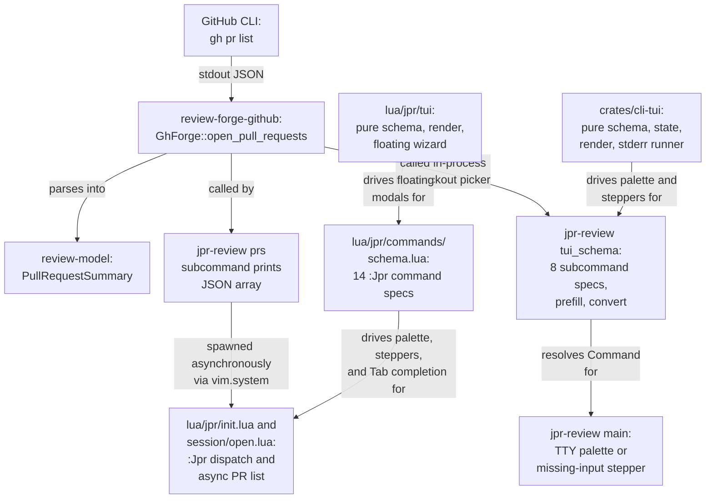
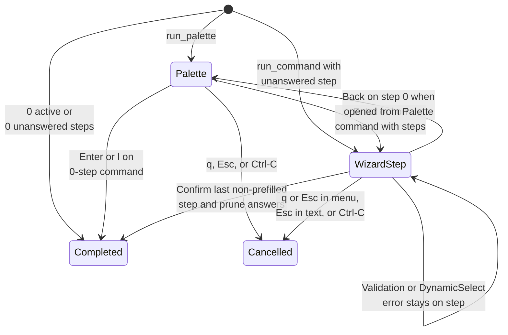
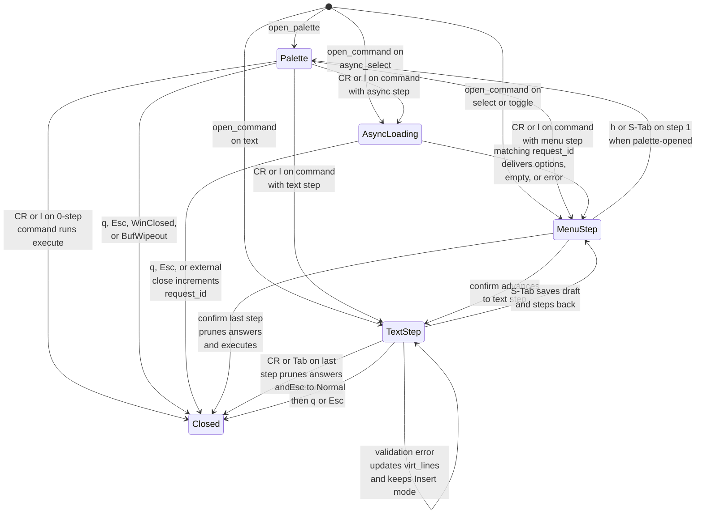

# Command Palette and Schema-to-TUI for `jpr-review` and `:Jpr`

<small>

> <table border="0">
> <tr><th colspan="2">Files</th><th colspan="2">Lines</th></tr>
> <tr><td>Changed (total)</td><td>74</td><td>Insertions (+)</td><td>9,674</td></tr>
> <tr><td>Added</td><td>51</td><td>Deletions (-)</td><td>216</td></tr>
> <tr><td>Deleted</td><td>0</td><td>Net change</td><td>+9,458</td></tr>
> </table>

</small>

## 1. Purpose

Reviewers using `jpr-review` in a terminal or `:Jpr` inside Neovim previously had to recall exact subcommand names, flag spellings, and pull request numbers before starting or driving a review. Running bare `jpr-review` exited with a usage error even on an interactive terminal, running bare `:Jpr` failed because Neovim required at least one subcommand token, and `:Jpr open` forced the reviewer to look up a pull request number or URL manually before opening a review tab.

This change:

- Adds a CLI subcommand to fetch compact open pull request metadata from GitHub as JSON (§4).
- Adds a reusable Rust terminal library for interactive command menus and branching step-by-step prompts (§5).
- Wires all eight CLI subcommands to the terminal menu and steppers<sup>G9</sup> on interactive terminals while keeping non-TTY flag parity (§6).
- Adds a reusable Neovim floating modal engine for command menus, asynchronous option pickers, and text inputs (§7).
- Registers all fourteen Neovim review subcommands in one schema, adding a bare command menu, an open-PR picker, and explicit argument parity (§8).

## 2. Background technical context

```text
crates/
├── review-model/                    (changed)
├── review-forge-github/             (changed)
├── cli-tui/                         (new)
└── jpr-review/src/
    ├── main.rs                      (changed)
    ├── commands/                    (changed)
    └── tui_schema/                  (new)
plugin/
└── jpr.lua                          (changed)
lua/jpr/
├── init.lua                         (changed)
├── tui/                             (new)
├── commands/
│   └── schema.lua                   (new)
├── session/                         (changed)
└── agent.lua                        (changed)
```

<small>

| Unit | What it is |
| --- | --- |
| `review-model` | Core pull request, diff, and thread data models shared across Rust crates. Holds the new `PullRequestSummary` type. |
| `review-forge-github` | Wraps the GitHub CLI (`gh`) through `GhForge` to read pull requests and threads. Parses `gh pr list` JSON into `PullRequestSummary` values. |
| `cli-tui` | Reusable Rust terminal palette and stepper<sup>G9</sup> crate kept outside `crates/review-*`. Renders frames to stderr and drives pure state machines. |
| `main.rs` | Binary entrypoint for `jpr-review` that parses flags and detects interactive TTYs. Routes into `cli-tui` or directly into `commands`. |
| `commands` | Implements all eight `jpr-review` subcommands and `socket_client::SocketOverride` fallback between a live daemon socket and on-disk `FsStore`. |
| `tui_schema` | Declares `cli-tui` command specs for `jpr-review`, prefills partial flags and environment variables, and converts answers back to `Command`. |
| `jpr.lua` | Neovim plugin bootstrap registering `:Jpr` and `<Plug>(jpr-*)` mappings before lazy-loading `lua/jpr/init.lua`. |
| `init.lua` | Top-level Neovim plugin dispatcher for `:Jpr`, command-line `<Tab>` completion, and runtime TUI context building. |
| `tui` | Reusable Neovim floating modal engine split into pure `schema.lua`, pure `render.lua`, and modal controllers under `wizard/`. |
| `schema.lua` | Declarative schema<sup>G3</sup> for all 14 `:Jpr` subcommands, shared by the floating palette, steppers<sup>G9</sup>, and argument completion. |
| `session` | Manages per-tab Neovim review sessions, including `open.lua` (async PR listing and checkout) and `commands.lua` (view and agent actions). |
| `agent.lua` | Controls the right-hand coding-agent terminal split (`claude` or `codex`) and tracks which provider is running. |

</small>

## 3. Shape of the solution

This section sets out the cross-cutting architecture connecting the five strands above before each strand goes into its mechanisms. Both frontends now follow the same three-layer pattern: a data source for open pull requests (`jpr-review prs`), a generic declarative UI engine (`crates/cli-tui` in Rust and `lua/jpr/tui/` in Neovim), and a domain adapter that maps every command and option into that engine (`crates/jpr-review/src/tui_schema/` and `lua/jpr/commands/schema.lua`). The two UI engines are independent implementations that share the same interaction model (human-readable labels paired with `[<id>]`, hover-only helper text<sup>G6</sup>, discriminant-first<sup>G4</sup> `when` branching, fixed-point answer pruning<sup>G5</sup>, and Neovim-style modal keybindings), while sharing the open pull request JSON contract produced by `jpr-review prs`.



> *`crates/cli-tui` sits beside `jpr-review` at the frontend layer so `crates/review-model` and `crates/review-forge-github` stay free of terminal UI dependencies. Both interactive PR pickers reuse `PullRequestSummary`: Rust calls `GhForge::open_pull_requests` in-process, while Neovim spawns `jpr-review prs` asynchronously.*

The five strands build on each other in order: §4 adds the `PullRequestSummary` data contract that both pickers consume; §5 builds the reusable Rust `cli-tui` crate; §6 binds `jpr-review`'s eight subcommands to `cli-tui`; §7 builds the parallel Lua floating TUI engine; and §8 registers all fourteen `:Jpr` subcommands in Neovim and wires the async `:Jpr open` picker and direct argument parity.

## 4. Open pull request listing feeds both interactive pickers from GitHub

This section covers the first strand: how the review engine fetches compact open pull request metadata from GitHub without introducing UI dependencies into generic crates.

### 4.1 `PullRequestSummary` and `parse_pr_list` normalize GitHub CLI output and missing authors

To keep interactive PR pickers fast and decoupled from full GraphQL review snapshots, `crates/review-model/src/pr.rs` defines `PullRequestSummary` with six camelCase-serialized fields: `number`, `title`, `author`, `headRef`, `isDraft`, and `updatedAt`. `crates/review-forge-github/src/pr.rs` pairs this type with `PR_LIST_FIELDS` (`"number,title,author,headRefName,isDraft,updatedAt"`) and `parse_pr_list`, which validates every required field and falls back to `"ghost"` whenever GitHub omits `/author/login` for a deleted account.

**File: `crates/review-forge-github/src/pr.rs`**

```rust {7-12}
fn parse_pr_summary(value: &Value) -> Result<PullRequestSummary> {
    ...
    let updated_at = value["updatedAt"]
        .as_str()
        .map(str::to_owned)
        .context("gh pr list item did not report /updatedAt")?;
    let author = value
        .pointer("/author/login")
        .and_then(Value::as_str)
        .filter(|login| !login.is_empty())
        .unwrap_or("ghost")
        .to_owned();
    Ok(PullRequestSummary {
        number,
        title,
        author,
        head_ref,
        is_draft,
        updated_at,
    })
}
```

Because deleted GitHub accounts serialize as `"author": null` or an empty login in `gh pr list` JSON, the highlighted fallback prevents a single pull request authored by a deleted account from breaking the entire picker list. All other fields (`number`, `title`, `headRefName`, `isDraft`, `updatedAt`) fail loudly with field-specific context if missing so schema drift in `gh` output is surfaced rather than silently dropped.

### 4.2 `GhForge::open_pull_requests` and `jpr-review prs` enforce positive limits and stdout JSON

`GhForge::open_pull_requests` in `crates/review-forge-github/src/lib.rs` guards `limit == 0` with an explicit error before invoking `gh pr list --state open --limit <limit> --json <PR_LIST_FIELDS>` (adding `--repo <owner/name>` only when pinned). On the CLI surface, `crates/jpr-review/src/cli.rs` enforces `clap::value_parser!(u32).range(1..)` with default `50`, and `crates/jpr-review/src/commands/prs.rs` validates any explicit `--repo` with `commands::parse_repo` before calling `GhForge::open_pull_requests` and printing the serialized JSON array to stdout (with narration sent to stderr via `commands::narrate`). This keeps the repository's stdout-is-data invariant intact so Neovim and scripts can decode stdout directly.

## 5. `crates/cli-tui` builds terminal menus and steppers from declarative command schemas outside `crates/review-*`

This section covers the second strand: the reusable Rust palette and stepper<sup>G9</sup> library that drives terminal interactivity while preserving the workspace's dependency boundary. Generic engine crates (`crates/review-*`) never depend on terminal UI libraries, so `crates/cli-tui` lives as a sibling frontend crate that only `crates/jpr-review` depends on. Internally, `cli-tui` isolates three pure layers (`schema`, `state`, `render`) from one thin I/O shell (`runner`), so schema validation, key transitions, branch pruning, and ANSI wrapping all run deterministically in unit tests without a PTY.

### 5.1 Declarative command schemas validate required fields upfront and prune answers from inactive conditional steps

Every command in `crates/cli-tui/src/schema/mod.rs` is described by a `CommandSpec` (`id`, `label`, `help`, `steps`) whose `StepSpec` entries carry a `StepKind` (`Select`, `DynamicSelect`, `Toggle`, or `Text`), an optional `DefaultProvider`, an optional `WhenPredicate`, and an optional `ValueValidator`. Both `run_palette` and `run_command` call `validate_command_specs` before enabling terminal raw mode, rejecting empty IDs/labels/help text, duplicate command or step IDs, empty static select option lists, or blank toggle labels so broken schemas fail with a clear error before touching the terminal.

When a user changes an earlier discriminant step (such as switching a toggle from enabled to disabled), downstream answers from the abandoned branch must be dropped before command execution. A single filter pass over `get_active_steps_from_command` is insufficient when `when` predicates form a chain where step B depends on step A and step C depends on step B: dropping B on the first pass leaves C present unless pruning iterates.

**File: `crates/cli-tui/src/schema/active.rs`**

```rust {5-15}
pub fn prune_inactive_answers(command: &CommandSpec, answers: &Answers) -> Answers {
    let mut pruned = answers.clone();
    // Iterate to a fixed point so dropping an inactive intermediate step also
    // prunes downstream steps whose `when` predicate depended on it.
    loop {
        let active_step_ids: BTreeSet<&str> = get_active_steps_from_command(command, &pruned)
            .into_iter()
            .map(|step| step.id.as_str())
            .collect();
        let previous_len = pruned.len();
        pruned.retain(|step_id, _| active_step_ids.contains(step_id.as_str()));
        if pruned.len() == previous_len {
            return pruned;
        }
    }
}
```

Consider a three-step command where step `enable_custom` (`when: None`) gates step `mode` (`when: enable_custom == "true"`), which in turn gates step `template` (`when: mode == "shell"`). Suppose `answers` holds `{ enable_custom: "false", mode: "shell", template: "wt pr {n}" }`:

1. Iteration 1 computes active steps under `pruned`: `enable_custom` is active, `mode` is inactive because `enable_custom != "true"`, and `template` still appears active because `mode` is still `"shell"` in `pruned`. Retaining active IDs drops `mode`, shrinking `pruned` from 3 keys to 2 (`{ enable_custom: "false", template: "wt pr {n}" }`).
2. Iteration 2 recomputes active steps under the 2-key map: now `mode` is absent, so `template`'s predicate returns `false`. Retaining active IDs drops `template`, shrinking `pruned` from 2 keys to 1 (`{ enable_custom: "false" }`).
3. Iteration 3 sees `pruned.len() == previous_len` (1 == 1) and returns `{ enable_custom: "false" }`. Because each non-terminating iteration strictly reduces the finite map size, the loop terminates in at most `answers.len() + 1` passes and never mutates the caller's `answers`.

### 5.2 `WizardState` skips prefilled steps on forward navigation and preserves drafts when stepping back

`WizardState` in `crates/cli-tui/src/state/wizard/mod.rs` tracks both `answers` and a `prefilled_keys` set populated from the `initial_answers` supplied by the caller. On construction, `WizardState::new` positions `step_index` on the first active step missing from `initial_answers`, and loads its options or prefilled text buffer (placing `cursor_char_index` at the end of the Unicode character sequence).



> *Prefilled steps<sup>G7</sup> are skipped when advancing forward so partial CLI invocations ask only for missing values, while stepping back removes the target step from `prefilled_keys` so the user can inspect and edit a previously prefilled choice.*
>
> **Diagram key**
>
> | | |
> | --- | --- |
> | **prefilled_keys** | Step IDs already answered via initial flags or environment variables before the stepper<sup>G9</sup> opened. |
> | **DynamicSelect** | A menu step whose options are fetched from a loader callback upon step entry. |

Two invariants keep back-and-forth navigation predictable:

1. **Draft preservation on back:** Before decrementing `step_index`, `step_back` calls `save_current_draft`, storing the current text buffer or highlighted menu option in `answers`. Returning forward to that step later restores the user's in-progress edit instead of resetting to the default.
2. **Unicode-safe cursor editing:** `crates/cli-tui/src/state/wizard/input.rs` stores `cursor_char_index` in Unicode scalar values and converts to UTF-8 byte offsets via `char_to_byte_index` on every insert, backspace, or delete, preventing panics on multi-byte characters.

### 5.3 Pure frame rendering and `RawModeGuard` keep stdout free of UI output and erase soft-wrapped rows without residue

`crates/cli-tui/src/render/` renders complete `\n`-delimited frames from immutable state, width, and `is_color_enabled` (`stderr().is_terminal() && NO_COLOR` unset). When `is_color_enabled` is `false`, zero ANSI escape sequences are emitted. Helper text<sup>G6</sup> is emitted strictly underneath the currently selected palette command or menu option (`append_wrapped_help`), wrapped to the available column budget (`wrap_text` splits overlong words into width-bounded character chunks so narrow terminals never overflow).

In `crates/cli-tui/src/runner/terminal.rs`, `RawModeGuard` enables raw mode, hides the cursor, writes every frame exclusively to stderr, and guarantees cursor restoration and raw-mode teardown in `Drop` even on error or panic. Because a single logical line containing ANSI SGR color codes or long labels can wrap across multiple visual rows on a narrow terminal, `RawModeGuard::render_frame` tracks exact visual height rather than logical newline count:

**File: `crates/cli-tui/src/runner/terminal.rs`**

```rust {8-12}
impl RawModeGuard {
    pub(super) fn render_frame(&mut self, frame: &str, columns: usize) -> Result<()> {
        let mut stderr = std::io::stderr();
        clear_previous_frame(&mut stderr, self.rendered_lines)
            .context("clearing previous TUI frame on stderr")?;
        self.rendered_lines = 0;

        for line in frame.split('\n') {
            write!(stderr, "{line}\r\n").context("writing TUI frame line to stderr")?;
            let visual_rows = count_visual_rows(line, columns);
            self.rendered_lines = self.rendered_lines.saturating_add(visual_rows);
        }
        stderr.flush().context("flushing TUI frame to stderr")?;
        Ok(())
    }
}
```

`count_visual_rows` strips ANSI CSI sequences (`\x1b[...@-~`) before computing `visible_chars.div_ceil(columns.max(1)).max(1)`. Without ANSI stripping, SGR escape bytes would inflate the computed row count and move the cursor too far up on the next redraw, overwriting prior shell output; without ceiling division, soft-wrapped lines would leave ghost lines below the frame.

## 6. `jpr-review` binds all eight subcommands to `cli-tui` while preserving non-TTY dispatch and `$JPR_SOCKET` fallback

This section covers the third strand: how `crates/jpr-review` maps its clap command surface onto `cli-tui` without regressing pipes, CI scripts, or coding-agent shells.

### 6.1 `main.rs` separates TTY interactive flows from non-TTY usage and flag dispatch

`crates/jpr-review/src/cli.rs` changes `Cli.command` from `Command` to `Option<Command>` so bare `jpr-review` parses without a missing-subcommand error. `crates/jpr-review/src/main.rs` then splits execution along two axes: whether a subcommand was provided, and whether `cli_tui::is_interactive_terminal()` (`stdin().is_terminal() && stderr().is_terminal()`) is true.

- **Bare invocation, non-TTY:** Prints `Cli::command().render_help()` to stderr and exits with code `2` (`USAGE_EXIT_CODE`), matching clap's traditional missing-subcommand exit status so scripts and CI never hang.
- **Bare invocation, TTY:** Builds all eight specs via `tui_schema::build_command_specs()`, runs `cli_tui::run_palette("jpr-review Commands", &specs)`, converts `PaletteOutcome::Completed` via `tui_schema::answers_to_command`, and dispatches through `commands::run_command`. `PaletteOutcome::Cancelled` exits with code `0`.
- **Subcommand with missing required inputs, TTY:** Calls `tui_schema::initial_answers_for_missing_inputs(command)`. When `Some((command_id, initial_answers))` is returned, runs `cli_tui::run_command(spec, initial_answers)`, applies answers via `tui_schema::apply_answers_to_command`, and executes the resolved command.
- **Subcommand with all required inputs, or non-TTY:** Skips `cli-tui` entirely and runs `commands::run_command` directly, preserving line-prompt/non-TTY error behavior in `prompt.rs` and keeping `serve`'s JSON-RPC stdin untouched.

### 6.2 `tui_schema` defines all eight subcommands by asking mode choices before conditional steps

`crates/jpr-review/src/tui_schema/specs.rs` and `steps.rs` register every clap subcommand (`prs`, `checkout`, `threads`, `reply`, `prepass-write`, `state-path`, `serve`, `guide`), enforced by a clap-parity test in `crates/jpr-review/src/tui_schema/tests/specs.rs` that asserts the set of `CommandSpec` IDs matches every `Cli::command().get_subcommands()` name.

Key branching pipelines:
- **`checkout`:** Step 1 (`source`: `list` vs `manual`, default `list`) gates either Step 2 (`pr`: `DynamicSelect` calling `GhForge::open_pull_requests(50)` via `load_open_pull_request_options`) or `pr_manual` (`Text` validated with `commands::parse_pr_number`). Next, `custom_repo` (`Toggle`) gates `repo`, and `custom_worktree` (`Toggle`, defaulting to `"true"` when `$JPR_WORKTREE_CMD` is non-empty) gates `worktree_cmd` (prefilled from `$JPR_WORKTREE_CMD`).
- **Agent commands (`threads`, `reply`, `prepass-write`):** Share `create_target_steps()`, where `target_mode` (`socket` vs `pr`, defaulting to `socket` when `$JPR_SOCKET` is non-empty) gates either `socket` (prefilled from `$JPR_SOCKET`) or `pr` + optional `repo`. When the user passes `--repo` explicitly, `get_agent_pr_default_from_answers` clears the `$JPR_PR` default so an ambient PR number from another repository is never substituted.
- **`guide`:** Declares zero steps and completes immediately upon selection from the palette.

### 6.3 Prefilling from `$JPR_SOCKET` clears unchanged paths so stale sockets still fall back to `FsStore`

Inside a Neovim coding-agent terminal, `$JPR_SOCKET` is exported so commands like `jpr-review reply` can talk to the live daemon socket, while falling back to on-disk `FsStore` if that socket is stale (`SocketOverride::Env` in `crates/jpr-review/src/commands/socket_client.rs`). By contrast, an explicit `--socket <PATH>` flag maps to `SocketOverride::Explicit`, which must fail loudly if the socket refuses connections.

When a user runs `jpr-review reply` interactively (omitting `thread_id` and `body`) while `$JPR_SOCKET` is set, `prefill_target_answers` in `crates/jpr-review/src/tui_schema/prefill.rs` prefills `target_mode = "socket"` and `socket = $JPR_SOCKET` so the wizard<sup>G9</sup> skips the target steps and jumps straight to `thread_id`. If conversion left `Command::Reply { socket: Some($JPR_SOCKET), ... }` populated, `commands::get_socket_override_from_cli` would misclassify that ambient socket<sup>G1</sup> as `SocketOverride::Explicit` and break stale-socket fallback<sup>G8</sup>.

**File: `crates/jpr-review/src/tui_schema/convert.rs`**

```rust {7-12}
pub(super) fn apply_answers_to_command_with_env(
    original: &Command,
    answers: &Answers,
    env_socket: Option<&str>,
) -> Result<Command> {
    let mut resolved = answers_to_command(command_id_for_command(original), answers)?;
    if !has_ambient_socket_origin(original) {
        return Ok(resolved);
    }
    if let Some(ambient_socket) = env_socket {
        clear_matching_ambient_socket(&mut resolved, ambient_socket);
    }
    Ok(resolved)
}
```

Because `has_ambient_socket_origin(original)` is true only when `original` had `socket: None`, `pr: None`, and `repo: None`, `clear_matching_ambient_socket` clears `resolved.socket` back to `None` if and only if the final socket path still matches `$JPR_SOCKET`. If the user stepped back and typed a different socket path, `clear_matching_ambient_socket` leaves the edited path as `Some(...)` so it is honored as `SocketOverride::Explicit`; if they kept the ambient default, clearing it back to `None` lets `commands::run_command` re-read `$JPR_SOCKET` as `SocketOverride::Env`.

## 7. `lua/jpr/tui/` provides a reusable floating palette and stepper engine in Neovim

This section covers the fourth strand: the Neovim Lua TUI subsystem that mirrors `crates/cli-tui`'s declarative schema<sup>G3</sup> and interaction model using centered floating windows. Like the Rust crate, it splits pure logic (`schema.lua`, `render.lua`) from Neovim window and autocmd side effects (`wizard/`).

### 7.1 Pure Lua modules validate schemas, prune abandoned branches, and place helper text under the active row

`lua/jpr/tui/schema.lua` validates command lists (`validate_command_specs`), resolves active steps (`get_active_steps_from_command`), evaluates static or function defaults (`get_default_value_from_step`), constructs shared two-option toggle lists (`create_toggle_options_from_step` using native booleans `false`/`true`), and runs fixed-point `prune_inactive_answers` identical in convergence logic to Rust's `prune_inactive_answers` (§5.1).

`lua/jpr/tui/render.lua` constructs pure layout tables (`{ lines, highlights, cursor_line, item_for_line }`) with zero Neovim window calls:
- **Display-width wrapping:** `wrap_text` uses `vim.fn.strchars`, `vim.fn.strcharpart`, and `vim.fn.strdisplaywidth` so multi-byte and wide characters wrap accurately within the modal width.
- **Hover-only helper lines and cursor mapping:** Both `create_palette_layout_from_commands` and `create_step_layout_from_state` emit indented `JprMuted` helper lines only underneath the currently selected item, recording `layout.item_for_line[row] = item_index` for both the primary row and its wrapped helper rows. Commands with `requires_session = true` render their label in `JprMuted` when `context.has_session` is false.
- **Text step virtual lines:** `create_virt_lines_from_text_step` formats wrapped step help and optional `JprError` validation messages into virtual lines above<sup>G10</sup> line 1 (`virt_lines_above = true`), keeping buffer line 1 exclusively for the user's editable text.

### 7.2 Floating modal controllers manage Normal and Insert transitions and discard stale async responses

`lua/jpr/tui/wizard/` splits the modal controller across five small modules: `init.lua` (state lifecycle, step transitions, `origin_win` capture/restoration, `WinClosed`/`BufWipeout` guards, `CursorMoved` hover sync), `palette.lua` (palette painting and Normal-mode keymaps), `step_menu.lua` (select/toggle/async_select rendering, keymaps, and async loader), `step_text.lua` (Insert-mode editable text window), and `window.lua` (clamped centered float geometry, extmarks, and safe buffer/window teardown).



> *Every transition, close, or external window wipeout increments `active_request_id`, preventing superseded async callbacks from mutating a newer step or closed modal.*
>
> **Diagram key**
>
> | | |
> | --- | --- |
> | **CR / S-Tab** | Enter (`<CR>`) confirms a selection or text input; Shift-Tab (`<S-Tab>`) steps backward. |
> | **request_id** | Monotonic token (`active_request_id`) compared before applying an `async_select` callback. |
> | **virt_lines** | Non-editable extmarks anchored above line 1 of a text modal for help and validation errors. |
> | **WinClosed / BufWipeout** | Neovim autocmds firing when a floating window or scratch buffer is closed externally. |

Four Neovim-specific details prevent subtle UI bugs:

1. **Preserving `false` toggle drafts on step back:** In Lua, testing `if draft_value then` would silently drop a `false` toggle value. `step_menu.lua` passes an explicit boolean `has_draft` flag to `step_back_from_step(state, step, draft_value, has_draft)` in `lua/jpr/tui/wizard/init.lua`, storing `false` in `state.answers[step.id]` whenever an option is selected while skipping draft storage if the user steps back during `is_loading` or an empty option list.
2. **Insert-mode continuity across text steps and validation errors:** When moving from one `text` step to another, `open_current_step` calls `detach_current_window(state, false)` (without `stopinsert`) before `step_text.open`, and `ensure_text_insert_mode` schedules `startinsert!` only if `controller.is_active(state)` and `vim.api.nvim_get_current_win() == target_win` still hold on the next tick. On validation failure, `step_text.lua` updates `virt_lines` in place via `window.paint_text_virt_lines` and keeps Insert mode active so the user can fix their input immediately.
3. **Fast-event and stale-callback safety in `async_select`:** `start_async_step_load` captures `request_id = controller.increment_request_id()` and a per-call `is_settled` boolean:

**File: `lua/jpr/tui/wizard/step_menu.lua`**

```lua {2-18}
local function start_async_step_load(controller, state, step)
    local request_id = controller.increment_request_id()
    local is_settled = false
    local function on_loaded(loaded_options, error_message, empty_message)
        if is_settled then
            return false
        end
        is_settled = true
        if vim.in_fast_event() then
            local is_matching = controller.is_request_matching(state, step.id, request_id)
            vim.schedule(function()
                apply_async_loaded_result(
                    controller, state, step, request_id,
                    loaded_options, error_message, empty_message
                )
            end)
            return is_matching
        end
        return apply_async_loaded_result(
            controller, state, step, request_id,
            loaded_options, error_message, empty_message
        )
    end
    ...
end
```

If a loader invokes `on_loaded` from a libuv fast-event callback, `vim.in_fast_event()` defers buffer/window mutations through `vim.schedule`, where `apply_async_loaded_result` re-checks `controller.is_current_request(state, step.id, request_id)` (verifying both the request ID and `M.is_open()`). Returning `is_matching` / `is_applied` lets callers such as the empty open-PR handler avoid emitting a stale `jpr.info(...)` notification if the user already pressed `h` or `Esc`.

4. **External close cleanup and focus restoration:** `register_cleanup_guards` attaches one-shot `BufWipeout` and `WinClosed` autocmds so closing the float via `:q`, `:bdelete`, or another plugin's window command clears `active_state`, increments `active_request_id`, stops Insert mode if active, deletes the scratch buffer, and schedules `restore_origin_window(origin_win)` only if `active_state` is still `nil` (so a replacement modal opened immediately afterward does not lose focus).

## 8. Neovim registers all 14 `:Jpr` subcommands in one schema with an async PR picker and argument parity

This section covers the fifth strand: how `lua/jpr/commands/schema.lua`, `lua/jpr/init.lua`, `lua/jpr/session/open.lua`, `lua/jpr/session/commands.lua`, `lua/jpr/agent.lua`, and `plugin/jpr.lua` connect the Lua TUI engine to the user-facing `:Jpr` command.

### 8.1 One schema drives bare `:Jpr`, interactive steppers, and `:Jpr <subcommand> <Tab>` completion

`plugin/jpr.lua` changes `:Jpr` from `nargs = "+"` to `nargs = "*"`. In `lua/jpr/init.lua`, `M.subcommands` is derived directly from `require("jpr.commands.schema").list_command_ids()`, which enumerates all 14 subcommands (`open`, `sync`, `toggle`, `stream`, `comment`, `suggest`, `expand`, `conversation`, `submit`, `push`, `agent`, `send`, `prepass`, `close`). Running bare `:Jpr` constructs runtime context (`build_tui_context` capturing `cmd_opts`, `has_session`, `is_agent_open`, `has_live_agent`, and `is_cursor_on_diff_line`) and calls `wizard.open_palette(commands, context)`.

Four commands define interactive steps in `lua/jpr/commands/schema.lua`, while the remaining ten are zero-step actions that execute immediately on selection:

| Subcommand | Interactive step(s) | Smart default / `when` rule | Direct non-interactive syntax |
| --- | --- | --- | --- |
| `open` | `source` (`list`/`manual`) -> `pr` (`async_select`) or `pr_input` (`text`) | Defaults to `list`; `:Jpr open` starts on `pr` with `source = "list"` prefilled | `:Jpr open <number\|#number\|URL>` |
| `toggle` | `mode` (`unified`/`split`) | Preselects the opposite of `view_mode.get()` | `:Jpr toggle [unified\|split]` |
| `comment` | `kind` (`line`/`file`/`suggest`) | Preselects `line` when `context.is_on_diff_line`, else `file` | `:Jpr comment [line\|file\|suggest]` |
| `agent` | `provider` (`claude`/`codex`) | Step shown only when `not (is_agent_open or has_live_agent)`; defaults to `config.agent` | `:Jpr agent [claude\|codex]` |

`M.subcommand_arg_completions(subcommand)` in `lua/jpr/commands/schema.lua` derives third-token command-line completions directly from single-step `select` specs (`toggle`, `comment`, `agent`). `M.complete(arglead, cmdline)` in `lua/jpr/init.lua` slices from the `Jpr` command token (handling ranges such as `:'<,'>Jpr`) and returns subcommand or option completions, while `dispatch_validated_arg` validates direct arguments against the same list so interactive choices, `<Tab>` completions, and direct CLI-style arguments stay locked together.

### 8.2 `:Jpr open` fetches open pull requests asynchronously and `:Jpr agent` tracks the running provider

To keep `lua/jpr/session/init.lua` focused on session lifecycle, PR checkout (`checkout_args`, `parse_checkout`, `open`) was moved into `lua/jpr/session/open.lua` alongside two new helpers attached onto `jpr.session`:
- `session.list_open_prs(on_result, on_error)` verifies the bundled `jpr-review` binary is executable, runs `{ binary_path, "prs" }` asynchronously via `vim.system`, sanitizes stderr via `crash.build_clean_text_from_raw` on failure, and validates that decoded JSON is a list (`vim.islist`).
- `session.open_tab_numbers()` scans valid tabs in `session.by_tab` so `lua/jpr/commands/schema.lua` can tag open PRs with `[open]` alongside `[draft]` badges and `@author · headRef · updated YYYY-MM-DD` hover help.

Running `:Jpr open` without an argument calls `wizard.open_command(open_spec, { source = "list" }, context, { start_step_id = "pr" })`, jumping directly into the async PR list while keeping Step 1 reachable via `h` (including when the repository has zero open PRs or `gh` fails) so the reviewer can switch to manual PR number or URL input.

For `:Jpr agent [claude|codex]`, `lua/jpr/agent.lua` records the launched provider on `session.agent.kind` and exposes `is_open(session)` and `has_live_agent(session)`. When no live agent exists, passing `agent_kind` passes `{ agent = selected_agent }` to `prepareAgentLaunch` and spawns that provider; when a live agent already exists (even if its split window is hidden), `:Jpr agent` from the palette skips the provider step and toggles or focuses the existing split, while an explicit `:Jpr agent codex` against a running `claude` agent informs the user to close the running panel before switching providers and focuses it rather than silently hiding it.

## 9. Interface changes

Live screenshots are blocked because `jpr-nvim` is a terminal-only CLI and Neovim plugin with no browser UI and this headless environment has no GUI terminal emulator. The ASCII wireframes below reproduce the exact layouts built by `crates/cli-tui/src/render/` and `lua/jpr/tui/render.lua`.

### 9.1 CLI Command Palette and interactive stepper (`jpr-review` on a TTY)

```text
jpr-review Commands

▸ List Open Pull Requests  [prs]
    Lists open pull requests in a repository as a JSON array.
  Check Out Pull Request  [checkout]
  List Review Threads  [threads]
  Reply to Local Thread  [reply]
  Write Pre-Pass Findings  [prepass-write]
  Show Review State Path  [state-path]
  Run Review Engine Daemon  [serve]
  Print Agent Review Guide  [guide]

[j/k] move  [Enter/l] select  [q/Esc] close

----------------------------------------------------------------------------
Step 2 of 4 · Open Pull Request  ● ● ○ ○
Select the open pull request to check out into a review worktree.

▸ #42  Add OAuth flow  [draft]
    @alice · feat/oauth
  #39  Fix diff anchor drift

[j/k] move  [h] back  [Enter/l] next  [q/Esc] close

----------------------------------------------------------------------------
Step 2 of 2 · Repository  ● ●
Enter the GitHub repository in owner/name format.
Error: expected the repository as owner/name, got "not-a-repo"

> not-a-repo█

[Enter/Tab] run  [S-Tab] back  [Esc] cancel

Key:
  ▸            Selected row prefix (cyan bold when color enabled)
  [id]/[draft] Muted command ID tag / yellow warning draft badge
  ● / ○        Completed-or-current vs remaining progress dots
  4-space line Indented dim helper text shown ONLY under the selected row
  █            Reverse-video cursor cell on text inputs
```

### 9.2 Neovim floating Command Palette and `:Jpr open` steppers

```text
╭─────────────────────── Jpr Commands ───────────────────────╮
│ ▸ Open Pull Request  [open]                                │
│     Pick an open pull request or enter a PR number or URL  │
│     to start reviewing.                                    │
│   Sync with GitHub  [sync]                (dim if no PR)   │
│   Switch Diff View  [toggle]              (dim if no PR)   │
│   ... (14 subcommands total)                               │
│                                                            │
│ [j/k] move  [Enter/l] select  [q/Esc] close                │
╰────────────────────────────────────────────────────────────╯

╭─────────────────── Open Pull Request ──────────────────────╮
│ Step 2 of 2 · Select Open Pull Request  ● ●                │
│ Choose an open pull request from this repository to open   │
│ in a review tab.                                           │
│                                                            │
│ ▸ #42  Add OAuth flow  [draft] [open]                      │
│     @alice · feat/oauth · updated 2026-11-23               │
│   #39  Fix diff anchor drift                               │
│                                                            │
│ [j/k] move  [h] back  [Enter/l] run  [q/Esc] close         │
╰────────────────────────────────────────────────────────────╯

╭──────────── Step 2 of 2 · Pull Request Number or URL ──────╮
│ Enter a pull request number, #number, or GitHub PR URL.    │ <- virt_lines_above
│                                                            │ <- virt_lines_above
│ Enter a PR number, #number, or GitHub PR URL.  (JprError)  │ <- on invalid submit
│                                                            │ <- virt_lines_above
│ 42█                                                        │ <- editable buffer line 1
╰──────── [Enter/Tab] run  [S-Tab] back  [Esc] normal/cancel ╯

Key:
  [draft] / [open] Muted badges; [open] marks PRs already active in a Neovim tab
  virt_lines_above Non-editable extmark lines above line 1 so Insert mode edits line 1 only
  (dim if no PR)   Commands with requires_session = true highlighted with JprMuted when idle
```

## 10. Decisions

- **`crates/cli-tui` lives as a separate workspace crate outside `crates/review-*` instead of inside `review-core` or inline in `jpr-review`.** Putting TUI code in `review-core` would pull `crossterm` into the generic review engine and violate the repository's binding dependency rule, while inlining it in `jpr-review` would couple generic palette/wizard<sup>G9</sup> state machines to `jpr-review`'s domain subcommands. Revisit if the CLI later needs a full-screen `ratatui` review app or if `cli-tui` is extracted into an external crate.
- **Both frontends generate palettes, steppers<sup>G9</sup>, and completions from one declarative schema<sup>G3</sup> per frontend rather than hand-coding per-command prompts.** Hand-coded prompts drift from CLI flags and Neovim subcommands over time, whereas a single schema per frontend enables automated parity tests (`crates/jpr-review/src/tui_schema/tests/specs.rs` and `tests/lua/palette_and_open_picker_spec/palette.lua`). Revisit if a command needs non-linear multi-field editing where steps cannot be ordered discriminant-first<sup>G4</sup>.
- **`cli-tui` renders inline to stderr using an ANSI-aware visual-row counter instead of entering the terminal alternate screen buffer.** Inline stderr rendering preserves stdout strictly for machine-readable JSON output and leaves shell scrollback intact after command completion. Revisit if an interactive picker regularly exceeds terminal height and requires an internal scrolling viewport.
- **`apply_answers_to_command` clears an unchanged ambient `$JPR_SOCKET` back to `None` instead of emitting `Some(path)`.** Leaving `Some(path)` on the resolved `Command` would cause `commands::get_socket_override_from_cli` to classify an ambient socket<sup>G1</sup> as `SocketOverride::Explicit` and disable stale-socket fallback<sup>G8</sup> to `FsStore`. Revisit if `Command` itself stores a dedicated `SocketOrigin` enum distinguishing CLI flags from environment defaults.
- **Neovim text steps render help and errors via `virt_lines_above` on a single-line modifiable buffer rather than calling `vim.ui.input` or mixing editable rows into menu buffers.** Using a dedicated single-line float keeps `<Tab>`/`<S-Tab>` step navigation, Insert-mode continuity on validation errors, and centered rounded modal styling consistent across every step kind. Revisit if Neovim introduces native multi-widget floating form APIs.
- **Neovim `async_select` guards late responses with a monotonic `active_request_id` and `is_settled` flag instead of killing child processes on abort.** Request-ID gating eliminates callback races across `vim.in_fast_event()` and rapid `h`/`Esc` navigation with simple deterministic state, without risking signal/teardown edge cases on `vim.system` handles. Revisit if slow network loaders need explicit `SystemObj:kill()` cancellation to avoid extra background `gh` processes.

## 11. Deliberately not handled

- **Interactive fuzzy search or filtering inside palettes and PR pickers:** Palettes hold 8 CLI commands or 14 Neovim commands and PR pickers cap at 50 open PRs; linear navigation (`j`/`k`, `gg`/`G`) is sufficient for now without adding a search-input mode inside Normal-mode menus.
- **Scrolling viewports for terminal heights shorter than a menu:** `cli-tui` renders every option line inline on stderr without vertical viewport paging.
- **Cross-repository override inside `:Jpr open`'s async PR picker:** `list_open_prs` queries the current Neovim working directory's repository; opening a pull request from another repository uses the manual step (`Enter PR Number or URL`) with a full GitHub PR URL.
- **Interactive prompting for `jpr-review serve` when driven non-interactively:** `serve` reads JSON-RPC from stdin, so non-TTY invocations remain flag-only; only selecting `serve` from the interactive TTY Command Palette<sup>G2</sup> walks through its `pr`, `repo`, and `poll` steps.
- **Explicit child-process termination when closing `:Jpr open` while `jpr-review prs` is still running:** Late callbacks are ignored via `active_request_id`, while the short-lived `jpr-review prs` child exits naturally.

## 12. Open questions

1. In `docs/decisions.md` (under `Declarative command schemas drive interactive TUI palettes and steppers`), the prose still references pre-refactor file paths `lua/jpr/tui/wizard.lua`, `lua/jpr/tui/wizard_window.lua`, and `crates/jpr-review/src/tui_schema/tests.rs` instead of the split directories `lua/jpr/tui/wizard/` and `crates/jpr-review/src/tui_schema/tests/`. Should we update those three path references in `docs/decisions.md` before merging?
2. Should `crates/cli-tui/src/runner/keys.rs` map two-key `gg` in addition to single-key `g` for `KeyAction::First`, or is single-key `g` (matching `G` for last) preferred in the terminal palette while Neovim binds `gg`?

<div style="page-break-before: always"></div>

## Appendix A. Manual testing

<small>

1. Verify formatting, clippy lints, all Rust unit/integration tests, and all headless Neovim Lua specs pass from a clean checkout:

   ```sh
   just check
   ```

2. Verify bare `jpr-review` on a non-interactive stream prints clap usage to stderr and exits with code 2 without opening a TUI:

   ```sh
   cargo run -p jpr-review < /dev/null
   echo "exit=$?"
   ```

   - **Before this change:** bare `jpr-review` exited with code 2 on both TTY and non-TTY streams.
   - **Now:** non-TTY streams still exit with code 2 and print help, while interactive TTYs launch the Command Palette<sup>G2</sup>.

3. In a GitHub-backed git repository with an authenticated `gh` session, verify `jpr-review prs` prints compact JSON to stdout:

   ```sh
   cargo run -p jpr-review -- prs --limit 10
   ```

   Confirm stdout is a valid JSON array where each element carries `number`, `title`, `author`, `headRef`, `isDraft`, and `updatedAt`.

4. Launch the interactive CLI Command Palette<sup>G2</sup> on a real TTY:

   ```sh
   cargo run -p jpr-review
   ```

   - Move through commands with `j`/`k` and `g`/`G` and confirm 1-sentence dim helper text<sup>G6</sup> appears only underneath the highlighted command.
   - Press `Enter` or `l` on **Check Out Pull Request** `[checkout]`, confirm Step 1 (**Pull Request Selection**) opens with progress dots, press `h` to return to **jpr-review Commands**, and press `q` or `Esc` to exit with code 0 and a visible terminal cursor.

5. Launch a CLI subcommand with a missing required flag on a real TTY:

   ```sh
   cargo run -p jpr-review -- state-path --pr 7
   ```

   - Confirm Step 1 (`pr`) is skipped and Step 2 (**Repository**) opens immediately.
   - Type an invalid repository and press `Enter`:

     > not-a-repo

   - Confirm an inline red validation error appears and advancing is blocked. Press `Esc` to cancel and exit with code 0.

6. Open Neovim with the plugin on `runtimepath` inside a GitHub checkout:

   ```sh
   nvim --cmd "set rtp+=."
   ```

   - Run bare `:Jpr` and confirm the centered floating **Jpr Commands** modal opens in Normal mode listing all 14 subcommands with `[<id>]` tags, dimmed labels for session-only commands when no review is open, and hover-only helper text<sup>G6</sup> underneath the active row.
   - Select **Open Pull Request** `[open]`, choose **Enter PR Number or URL**, confirm Insert mode activates automatically, type an invalid value, press `<CR>` to verify inline `JprError` virtual lines keep Insert mode active, press `<S-Tab>` to return to Step 1, then press `<Esc>` and `q` to close and restore focus to the original window.

7. Run `:Jpr open` with no argument in Neovim:

   - Confirm Step 1 is skipped and Step 2 (**Select Open Pull Request**) opens with `Loading...` followed by the open PR list (showing `[draft]` and `[open]` badges where applicable) or an empty-state message explaining that `h` switches to manual entry.
   - Test command-line `<Tab>` completion on `:Jpr toggle `, `:Jpr comment `, and `:Jpr agent ` and confirm they offer `unified`/`split`, `line`/`file`/`suggest`, and `claude`/`codex` respectively.

</small>

<div style="page-break-before: always"></div>

## Appendix B. Glossary

<small>

| Term | Meaning |
| --- | --- |
| **G1** Ambient socket | A daemon socket path inherited from the `$JPR_SOCKET` environment variable inside a coding-agent terminal rather than passed with `--socket`. When an ambient socket is stale, `jpr-review` falls back to on-disk storage instead of failing. |
| **G2** Command Palette | An interactive menu opened by running bare `jpr-review` on a terminal or bare `:Jpr` in Neovim. It lists every available command with its `[<id>]` tag and launches either an immediate action or a multi-step prompt. |
| **G3** Declarative command schema (declarative schema) | A data definition listing a frontend's commands, step types, defaults, conditional predicates, and validators. Both the Rust and Neovim engines build menus, prompts, and completions from this definition instead of hand-coding each prompt. |
| **G4** Discriminant-first | A step ordering where a command asks for a mode or source choice first, then displays follow-up steps whose conditional predicate matches that choice. |
| **G5** Fixed-point answer pruning | Repeatedly removing stored answers whose conditional step is no longer active until a pass drops nothing, so changing an earlier choice also clears downstream steps that depended on an intermediate step. |
| **G6** Hover-only helper text (helper text) | A short wrapped description shown strictly underneath the currently highlighted menu item and hidden for all other rows so menus stay compact. |
| **G7** Prefilled step | A prompt step whose value was already supplied by partial command-line flags or environment variables before the prompt opened. Forward navigation skips prefilled steps while stepping backward unlocks them for editing. |
| **G8** Stale-socket fallback | Behavior where `jpr-review` reads and writes local review state on disk (`FsStore`) if an ambient `$JPR_SOCKET` refuses connections, whereas an explicit `--socket` flag fails immediately. |
| **G9** Stepper (wizard) | A linear multi-step interactive prompt that collects only the missing required inputs for a command, skipping prefilled steps<sup>G7</sup> and pruning abandoned branch answers before execution. |
| **G10** Virtual lines above | Non-editable Neovim extmark lines rendered above buffer line 1 (`virt_lines_above = true`) to hold prompt instructions and validation errors while keeping line 1 purely for user input. |

</small>
