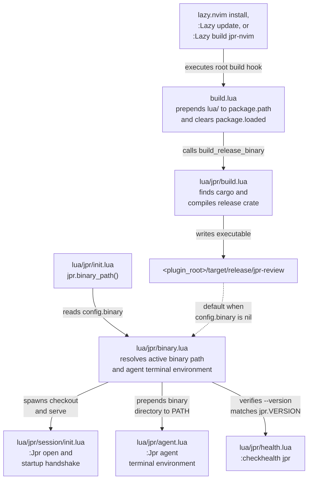

# Building and Resolving the Bundled jpr-review Binary Through lazy.nvim

<small>

> <table border="0">
> <tr><th colspan="2">Files</th><th colspan="2">Lines</th></tr>
> <tr><td>Changed (total)</td><td>14</td><td>Insertions (+)</td><td>805</td></tr>
> <tr><td>Added</td><td>5</td><td>Deletions (-)</td><td>159</td></tr>
> <tr><td>Deleted</td><td>1</td><td>Net change</td><td>+646</td></tr>
> </table>

</small>

## 1. Purpose

Installing `jpr.nvim` previously required cloning the repository by hand, running a shell installer in a terminal to compile and copy the `jpr-review` Rust binary into a user `PATH` directory, and pointing lazy.nvim<sup>G4</sup> at that local clone. Adding `jpr.nvim` directly to lazy.nvim from GitHub left the Rust review engine<sup>G5</sup> unbuilt, and updating the plugin checkout without re-running the shell installer left the installed `jpr-review` binary on the previous release until `:Jpr open` aborted when the Neovim plugin's release version no longer matched the binary's version.

This change:

- Compiles the release review engine<sup>G5</sup> automatically inside the plugin checkout during lazy.nvim<sup>G4</sup> installs, updates, and manual rebuilds.
- Launches pull request checkouts and review sessions from that bundled binary<sup>G1</sup> by default while keeping explicit binary overrides working.
- Places the bundled binary<sup>G1</sup> directory first on the `PATH` of coding-agent terminals<sup>G3</sup> opened from a review tab.
- Adds a Neovim checkhealth<sup>G2</sup> report that verifies the Neovim version, the compiled binary version, Git, GitHub CLI authentication, and Cargo.
- Removes the manual shell installer script and updates startup error messages to point users to the lazy.nvim<sup>G4</sup> rebuild command.

## 2. Background technical context

```text
crates/
└── jpr-review/
lua/jpr/
├── agent.lua          (changed)
└── session/
    ├── crash.lua
    └── init.lua       (changed)
```

<small>

| Unit | What it is |
| --- | --- |
| `crates/jpr-review/` | The Rust command-line binary and JSON-RPC server that checks out pull requests, serves review state to Neovim, and handles CLI subcommands from coding-agent terminals<sup>G3</sup>. |
| `lua/jpr/agent.lua` | Opens the right-hand interactive Claude Code or Codex coding-agent terminal<sup>G3</sup> split inside the pull request worktree<sup>G6</sup> so the agent can read and answer review comments. |
| `lua/jpr/session/crash.lua` | Sanitizes control bytes and terminal escape sequences before untrusted or filesystem text is shown in Neovim notifications and checkhealth<sup>G2</sup> output. |
| `lua/jpr/session/init.lua` | Coordinates one pull request review tab in Neovim, invoking `jpr-review checkout` and `jpr-review serve` and enforcing protocol and release-version lockstep at startup. |

</small>

## 3. Shape of the solution

To eliminate the manual shell installer while keeping the Lua plugin and Rust review engine<sup>G5</sup> on matching versions, compilation and binary discovery now operate directly inside the plugin checkout. When lazy.nvim<sup>G4</sup> installs `jpr-nvim`, runs `:Lazy update`, or runs `:Lazy build jpr-nvim`, it executes root `build.lua`. Because `build.lua` runs before `setup()` on a fresh install and runs inside an already-open Neovim session during `:Lazy update`, it prepends `<plugin_root>/lua` to `package.path` and clears `package.loaded["jpr.build"]` and `package.loaded["jpr.binary"]` so updated build code executes instead of cached tables from the previous version.

`lua/jpr/build.lua` (`jpr.build`) locates an executable `cargo` binary across `PATH`, `$CARGO_HOME/bin`, and `~/.cargo/bin` so GUI Neovim apps launched outside a login shell still find a `rustup` toolchain. It then prepends `cargo`'s parent directory to the child environment's `PATH` (so `cargo` can also spawn `rustc`), runs `cargo build --release -p jpr-review` with `cwd = plugin_root` via `vim.system` without altering Neovim's global working directory, and verifies that the bundled binary<sup>G1</sup> `<plugin_root>/target/release/jpr-review` (`.exe` on Windows) exists and is executable.

**File: `lua/jpr/build.lua`**

```lua {4-8,13-15}
local function is_lazy_async_running()
    local running_thread, is_main_thread = coroutine.running()
    local lazy_async = package.loaded["lazy.async"]
    return running_thread ~= nil
        and not is_main_thread
        and type(lazy_async) == "table"
        and type(lazy_async.running) == "function"
        and lazy_async.running() ~= nil
end
...
function M.build_release_binary(plugin_root, options)
    ...
    if is_lazy_async_running() then
        coroutine.yield("Building jpr-review (cargo build --release)...")
    end
    ...
end
```

lazy.nvim<sup>G4</sup> runs `build.lua` inside its internal `lazy.async` coroutine scheduler, where yielding a string updates the plugin manager's status line and resumes on the next tick. Calling `coroutine.yield` whenever `coroutine.running()` is non-main would break a caller that wraps `build.lua` in a plain Lua coroutine (`coroutine.wrap`), because that caller receives the progress string as the return value and leaves compilation suspended before `cargo` starts. Checking `lazy_async.running() ~= nil` restricts the yield to lazy.nvim's scheduler while letting synchronous `-l build.lua` and plain coroutine callers run straight through.

At runtime, `jpr.defaults.binary` defaults to `nil`, and `jpr.binary_path()` delegates to `lua/jpr/binary.lua` (`jpr.binary`), returning the bundled binary<sup>G1</sup> `<plugin_root>/target/release/jpr-review` unless the user passed a non-empty `setup({ binary = ... })` override. `lua/jpr/session/init.lua` uses `jpr.binary_path()` for both `jpr-review checkout` and `jpr-review serve`, sanitizing the path through `crash.build_clean_text_from_raw` and directing the user to `:Lazy build jpr-nvim` when the binary is missing or fails the version handshake. When `:Jpr agent` spawns a coding-agent terminal<sup>G3</sup> in the pull request worktree<sup>G6</sup>, `jpr.binary.create_agent_env_from_session` prepends `<plugin_root>/target/release` to the terminal's `PATH` alongside the review session's Unix socket path (`JPR_SOCKET`) and pull request number (`JPR_PR`), so bare `jpr-review` commands issued by the coding agent run the bundled binary without requiring `~/.local/bin` installation. Finally, `lua/jpr/health.lua` implements `:checkhealth jpr`, checking Neovim `>= 0.11`, executing `<binary> --version` with a 3-second timeout to verify lockstep with `jpr.VERSION`, and checking `git`, `gh` (plus `gh auth status`), and `cargo`.



> *Build-time compilation writes `<plugin_root>/target/release/jpr-review`, and every runtime caller resolves that same path through `lua/jpr/binary.lua` unless `config.binary` overrides it.*
>
> **Diagram key**
>
> | | |
> | --- | --- |
> | **package.path** | Lua's module search path; `build.lua` prepends `<plugin_root>/lua` before requiring plugin modules. |
> | **package.loaded** | Lua's in-memory cache of already-loaded modules, cleared in `build.lua` so `:Lazy update` runs newly pulled code. |
> | **config.binary** | Optional `require("jpr").setup({ binary = ... })` override path or command name; `nil` selects the bundled binary<sup>G1</sup>. |
> | **jpr.VERSION** | Release version constant (`"0.5.0"`) in `lua/jpr/init.lua` that the compiled `jpr-review` binary must match. |
> | **PATH** | Executable search path passed to child processes. |

Interface change:

Live screenshots are blocked because `jpr.nvim` runs inside terminal Neovim with no web interface and this headless environment has no GUI terminal window. Users gain a `:checkhealth jpr` checkhealth<sup>G2</sup> report buffer and `:Lazy build jpr-nvim` remediation hints whenever the bundled binary<sup>G1</sup> is missing or out of date:

```text
======================================================================
jpr:                                                               [A]
- OK Neovim 0.11.0
- OK jpr-review 0.5.0 (/.../jpr-nvim/target/release/jpr-review)    [B]
- OK git found: /usr/bin/git
- OK gh found: /opt/homebrew/bin/gh
- OK gh is authenticated
- OK cargo found: /.../.cargo/bin/cargo                            [C]

----------------------------------------------------------------------
jpr (when binary is missing or version-mismatched):
- ERROR version mismatch: plugin is 0.5.0 and /.../jpr-review is   [D]
  0.4.0; run :Lazy build jpr-nvim

Key:
  [A] Health section started by `vim.health.start("jpr")` in `lua/jpr/health.lua`.
  [B] Bundled binary path and release version verified against `jpr.VERSION`.
  [C] `cargo` discovered across `PATH`, `$CARGO_HOME/bin`, and `~/.cargo/bin`.
  [D] Actionable rebuild command shown both in `:checkhealth jpr` and `:Jpr open`.
```

Decisions:

- **Root `build.lua` compiles `jpr-review` locally from Cargo source during plugin install and update.** Downloading prebuilt release archives from GitHub Releases was rejected to avoid maintaining cross-platform release pipelines and checksum verification for a developer plugin whose audience can install Rust via `rustup`.
- **The compiled binary stays at `<plugin_root>/target/release/jpr-review` and is exposed to `:Jpr agent` coding-agent terminals<sup>G3</sup> by prepending its directory to `PATH`.** Copying the executable into `~/.local/bin` or `~/.cargo/bin` was rejected so plugin artifacts stay inside lazy.nvim's<sup>G4</sup> directory and an older global `jpr-review` binary cannot shadow the plugin's version inside `:Jpr agent`.
- **The release builder yields progress messages only when lazy.nvim's<sup>G4</sup> async scheduler owns the running coroutine, and `build.lua` clears cached build modules before running.** Yielding inside every non-main Lua coroutine or reusing `package.loaded` was rejected because plain coroutine callers treat a yielded string as an early return and `:Lazy update` would otherwise run pre-update Lua modules.

Not handled:

- Plugin managers that do not execute Neovim's root `build.lua` hook require configuring `nvim --headless -u NONE -i NONE -l build.lua` as an explicit post-install hook.
- Interactive coding-agent shells started outside `:Jpr agent` do not receive `<plugin_root>/target/release` on their shell `PATH` unless the user adds it or installs `jpr-review` separately.
- Compilation waits synchronously on `vim.system(...):wait()` inside `build.lua`, which blocks the Neovim event loop while `cargo build --release` finishes after `lazy.async` renders the progress status.

<div style="page-break-before: always"></div>

## Appendix A. Manual testing

<small>

1. From a checkout of this branch with Neovim `>= 0.11`, `git`, `gh`, and a Rust toolchain installed, remove any existing release binary so the build starts clean:

   ```sh
   rm -f target/release/jpr-review
   ```

2. Execute root `build.lua` in a clean headless Neovim without user configuration:

   ```sh
   nvim --headless -u NONE -i NONE -l build.lua
   ```

   - **Before this change:** no `build.lua` existed, and users had to run `./install.sh` manually outside Neovim to build and copy `jpr-review` into `~/.local/bin`.
   - **Now:** `build.lua` compiles `target/release/jpr-review` inside the checkout and exits with status `0`.

3. Confirm the bundled binary<sup>G1</sup> exists inside `target/release/` and reports the matching version (`0.5.0`):

   ```sh
   ./target/release/jpr-review --version
   ```

4. Run `:checkhealth jpr` in headless Neovim with the checkout added to `runtimepath` and print the rendered checkhealth<sup>G2</sup> buffer, confirming zero `ERROR` lines and `OK jpr-review 0.5.0`:

   ```sh
   nvim --headless --cmd "set rtp+=." -c "lua require('jpr').setup({})" -c "checkhealth jpr" -c "lua print(table.concat(vim.api.nvim_buf_get_lines(0, 0, -1, false), '\n'))" -c "qall!"
   ```

5. Override `binary` with a nonexistent path and invoke `:Jpr open 1` to confirm startup remediation names `:Lazy build jpr-nvim` instead of `./install.sh`:

   ```sh
   nvim --headless --cmd "set rtp+=." -c "lua require('jpr').setup({ binary = '/nonexistent/jpr-review' })" -c "Jpr open 1" -c "qall!"
   ```

6. Run the automated spec file covering `build.lua` coroutine behavior, `cargo` fallback discovery, `:Jpr agent` coding-agent terminal<sup>G3</sup> `PATH` propagation, and `:checkhealth jpr`:

   ```sh
   nvim --headless -u NONE -i NONE -l tests/lua/build_and_binary_spec.lua
   ```

</small>

<div style="page-break-before: always"></div>

## Appendix B. Glossary

<small>

| Term | Meaning |
| --- | --- |
| **G1** Bundled binary | The `jpr-review` executable compiled at `<plugin_root>/target/release/jpr-review` (`.exe` on Windows) inside the plugin's own checkout directory rather than installed globally in `~/.local/bin` or `~/.cargo/bin`. |
| **G2** Checkhealth | Neovim's built-in `:checkhealth` diagnostic command, which runs `lua/jpr/health.lua` when invoked as `:checkhealth jpr` and prints `OK`, `WARN`, and `ERROR` lines in a scratch buffer. |
| **G3** Coding-agent terminal | The interactive Claude Code or Codex terminal split opened by `:Jpr agent` inside the pull request worktree<sup>G6</sup> so an AI coding agent can read and reply to review comments through the `jpr-review` CLI. |
| **G4** lazy.nvim | A Neovim plugin manager that clones plugin repositories and automatically executes a plugin's root `build.lua` file on install, `:Lazy update`, and `:Lazy build <plugin>`. |
| **G5** Review engine | The `jpr-review` Rust process (`crates/jpr-review/`) that fetches GitHub pull request state, computes diffs, and serves JSON-RPC requests to the Neovim Lua frontend over stdio. |
| **G6** Worktree | A separate Git working directory created for one pull request by `git worktree` (or a configured `worktree_cmd`) so reviewing a pull request does not disturb the user's main checkout. |

</small>
