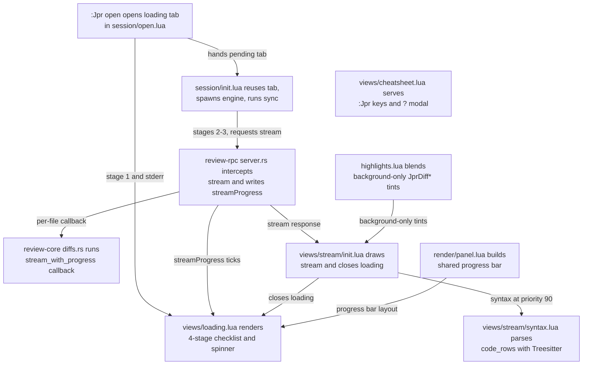
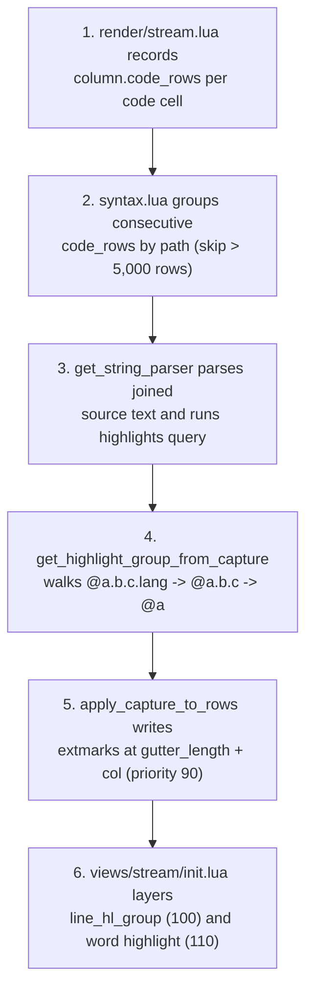

# Review UX Polish and Live 4-Stage Loading Progress (0.5.2)

<small>

> <table border="0">
> <tr><th colspan="2">Files</th><th colspan="2">Lines</th></tr>
> <tr><td>Changed (total)</td><td>47</td><td>Insertions (+)</td><td>3,306</td></tr>
> <tr><td>Added</td><td>10</td><td>Deletions (-)</td><td>729</td></tr>
> <tr><td>Deleted</td><td>0</td><td>Net change</td><td>+2,577</td></tr>
> </table>

</small>

## 1. Purpose

When a reviewer ran `:Jpr open` on a pull request, Neovim waited silently until the worktree checkout finished, the review engine started, GitHub synced, and the full diff stream<sup>G3</sup> returned, leaving no indication of what was running and no way to cancel mid-checkout. Once open, diff highlights linked directly to Neovim's global `DiffAdd` and `DiffDelete` groups, which washed out syntax foreground colors on high-contrast colorschemes and left multi-file diff streams without syntax highlighting. Reviewers also had no built-in way to look up active keybindings, no visual progress bar for reviewed files in the PR sidebar panel<sup>G8</sup>, no `o` open shortcut beside `<CR>` in the panel, and only the leading `>` marker highlighted when moving through the Command Palette<sup>G2</sup> and steppers<sup>G9</sup>.

This change:

- Shows a live 4-stage loading tab<sup>G5</sup> immediately on `:Jpr open`, with live progress and cancellation until the diff stream<sup>G3</sup> renders (§4).
- Replaces global diff links with soft background-only diff tints<sup>G1</sup> and restores per-file Treesitter syntax highlighting in stream buffers (§5).
- Adds a floating keyboard shortcuts cheatsheet (`:Jpr keys` and `?`), a sidebar progress bar and `o` shortcut, and full-label palette hover highlighting (§6).

## 2. Background technical context

```text
crates/
├── review-core/src/session/
│   └── diffs.rs                     (changed)
└── review-rpc/src/
    └── server.rs                    (changed)
lua/jpr/
├── highlights.lua                   (new)
├── commands/schema.lua              (changed)
├── render/                          (changed)
├── session/                         (changed)
├── tui/render.lua                   (changed)
└── views/
    ├── cheatsheet.lua               (new)
    ├── diff/init.lua                (changed)
    ├── loading.lua                  (new)
    ├── main_window.lua
    └── stream/                      (changed)
```

<small>

| Unit | What it is |
| --- | --- |
| `diffs.rs` | Computes per-file and whole-PR diffs in `ReviewSession`, called by `review-rpc` via `stream_with_progress`. |
| `server.rs` | Handles stdio JSON-RPC requests and intercepts `stream` to emit `streamProgress` notifications before the reply. |
| `highlights.lua` | Defines semantic highlight links and blended background-only diff tints<sup>G1</sup>, refreshing managed diff highlights<sup>G6</sup> on `ColorScheme`. |
| `schema.lua` | Declares all 15 `:Jpr` subcommands for the Command Palette<sup>G2</sup>, steppers<sup>G9</sup>, and completion, adding session-free `keys`. |
| `render/` | Pure renderers for the PR sidebar panel<sup>G8</sup> (`panel.lua`, shared progress bar) and diff stream<sup>G3</sup> (`stream.lua`, `code_rows`). |
| `session/` | Manages per-tab review lifecycles (`open.lua`, `init.lua`, `commands.lua`, `events.lua`), pending checkouts<sup>G7</sup>, and `streamProgress`. |
| `tui/render.lua` | Pure renderer for the Command Palette<sup>G2</sup> and steppers<sup>G9</sup>, highlighting the full hovered row label in `JprTitle`. |
| `cheatsheet.lua` | Centered scrollable float listing active shortcuts from `config.keys`, opened by `:Jpr keys` and `?`. |
| `diff/init.lua` | Manages per-file unified overlays and split `:diffthis` windows, isolating split colors via winhighlight<sup>G10</sup> and echoing loading status. |
| `loading.lua` | Renders the 4-stage loading buffer<sup>G5</sup> with a 100ms `uv` spinner timer until replaced by the diff stream<sup>G3</sup>. |
| `main_window.lua` | Unchanged helper separating `jpr` side windows from the main window; `release_windows` lets `loading.lua` wipe safely. |
| `stream/` | Displays the multi-file diff stream<sup>G3</sup> (`init.lua`, `navigation.lua`, `syntax.lua`), layering Treesitter extmarks at extmark priority<sup>G4</sup> 90. |

</small>

## 3. Shape of the solution

This section outlines how the three strands fit into the Rust engine and the Neovim plugin before each strand examines its own mechanisms. The change keeps every review rule and file diff inside Rust (`crates/review-core` and `crates/review-rpc`) while adding three UX layers in Lua: a live loading lifecycle wired across `session/` and `views/loading.lua`, a color-blending and per-file Treesitter rendering pipeline across `highlights.lua`, `views/diff/init.lua`, and `views/stream/`, and discoverability polish across `views/cheatsheet.lua`, `render/panel.lua`, and `tui/render.lua`. The only module shared across strands is `lua/jpr/render/panel.lua`, whose pure progress bar renderer drives both the PR sidebar panel<sup>G8</sup> (§6) and stage 4 of the loading buffer<sup>G5</sup> (§4); the diff-tint/syntax pipeline (§5) and the cheatsheet/palette polish (§6) are independent of the loading lifecycle.



> *`review-core` stays UI-free by accepting a plain callback, while `review-rpc` converts each callback tick into a `streamProgress` notification on stdio. `render/panel.lua` shares its pure progress bar layout with `views/loading.lua`; `views/cheatsheet.lua` and `highlights.lua` operate independently of the loading pipeline.*

The three strands are ordered from cross-process protocol changes down to pure Lua UI polish: §4 establishes the protocol v6 `streamProgress` notification and the 4-stage loading tab<sup>G5</sup> lifecycle; §5 explains how background-only diff tints<sup>G1</sup> compose with per-file Treesitter syntax extmarks; and §6 covers the floating keyboard shortcuts cheatsheet, shared sidebar progress bar, panel `o` shortcut, and Command Palette<sup>G2</sup> hover highlight.

## 4. `:Jpr open` shows live 4-stage startup progress and per-file diff ticks

This section covers the first strand: how `:Jpr open` gives immediate progress feedback from checkout through diff computation while letting the reviewer cancel cleanly at any point before startup finishes.

### 4.1 `stream_with_progress` and `streamProgress` emit per-file progress on stdio without changing `review_model::Event`

This subsection explains how the Rust engine streams per-file diff progress to Neovim during a `stream` request. Previously, `ReviewSession::stream` computed every file diff before serializing a single `StreamView` response, leaving Neovim with no bytes on stdout until the entire pull request finished diffing.

Instead of adding a transient progress variant to `review_model::Event` (which models persisted session state transitions over the broadcast channel), `crates/review-core/src/session/diffs.rs` adds `ReviewSession::stream_with_progress` taking a plain `FnMut(usize, usize, &str)` callback, and delegates `ReviewSession::stream` to it with an empty closure.

**File: `crates/review-core/src/session/diffs.rs`**

```rust {14-16,26}
impl ReviewSession {
    ...
    pub fn stream_with_progress<F>(
        &mut self,
        mode: ViewMode,
        mut on_progress: F,
    ) -> Result<StreamView>
    where
        F: FnMut(usize, usize, &str),
    {
        self.prepare_base()?;
        let files = self.saved.files.clone();
        let total = files.len();
        if total > 0 {
            on_progress(0, total, "");
        }
        let mut inputs = Vec::with_capacity(total);
        for (index, file) in files.into_iter().enumerate() {
            let path = file.path.clone();
            ...
            inputs.push(StreamInput {
                file,
                content,
                threads,
            });
            on_progress(index + 1, total, &path);
        }
        Ok(create_stream_view_from_inputs(&inputs, mode))
    }
}
```

When the pull request has at least one changed file, the highlighted pre-loop call fires `(0, total, "")` so Neovim can immediately display the denominator `0/N files (0%)`, and the highlighted per-file call fires `(index + 1, total, &path)` after each file's base and disk text are read. Pull requests with zero changed files emit no progress ticks.

In `crates/review-rpc/src/server.rs`, `answer_single_request` intercepts `request.method == "stream"` and calls `handle_stream_with_progress`, which locks `session`, invokes `stream_with_progress`, and writes each `streamProgress` JSON-RPC notification straight to the stdio `writer` before the final `stream` response is sent.

**File: `crates/review-rpc/src/server.rs`**

```rust {8-23}
fn handle_stream_with_progress<W: Write>(
    session: &Mutex<ReviewSession>,
    params: &Value,
    writer: &Mutex<W>,
) -> Result<Result<Value, RpcError>> {
    ...
    let mut write_error: Option<anyhow::Error> = None;
    let stream_result = guard.stream_with_progress(mode, |completed, total, path| {
        if write_error.is_some() {
            return;
        }
        let progress = notification(
            "streamProgress",
            json!({ "completed": completed, "total": total, "path": path }),
        );
        if let Err(error) = write_line(writer, &progress) {
            write_error = Some(error);
        }
    });
    drop(guard);
    if let Some(error) = write_error {
        return Err(error);
    }
    Ok(engine_result_to_rpc(stream_result).and_then(|stream| to_value(&stream)))
}
```

Because a `FnMut` closure cannot propagate `anyhow::Error` directly through `stream_with_progress`, `handle_stream_with_progress` captures the first I/O failure in `write_error`, stops writing further ticks, drops the session mutex guard, and returns `Err(error)` to terminate the broken stdio pipe cleanly. Because `streamProgress` is a new top-level JSON-RPC notification outside the `event` envelope, `PROTOCOL_VERSION` bumps from `5` to `6` in lockstep across `crates/review-rpc/src/protocol.rs` and `lua/jpr/rpc.lua`, paired with the workspace and plugin release bump from `0.5.1` to `0.5.2` in `Cargo.toml` and `lua/jpr/init.lua`.

### 4.2 `:Jpr open` tracks pending checkouts separately from `session.by_tab` and drives a 4-stage loading lifecycle

```mermaid
stateDiagram-v2
    [*] --> Stage1_Checkout: ":Jpr open creates loading tab"
    Stage1_Checkout --> Canceled: ":Jpr close, TabClosed, spawn error, or checkout failure"
    Stage1_Checkout --> Stage2_Engine: "checkout JSON parsed; session.start reuses tab"
    Stage2_Engine --> Stage3_Sync: "initialize handshake succeeds"
    Stage2_Engine --> Closed: "directory change, panel, spawn, or handshake fails"
    Stage3_Sync --> Stage4_Diffs: "session.show calls stream.show"
    Stage3_Sync --> Closed: "sync error or syncFailed event"
    Stage4_Diffs --> Stage4_Diffs: "streamProgress updates progress bar"
    Stage4_Diffs --> Closed: "stream.draw places stream, stream errors, or forget()"
    Canceled --> [*]
    Closed --> [*]
```

This subsection explains how the Neovim plugin orchestrates the four startup stages and ensures a canceled or failed checkout never leaks a tab, process, or timer. The key structural rule is that a pending checkout<sup>G7</sup> is never registered in `session.by_tab`: `lua/jpr/session/open.lua` tracks it in a module-local `pending_by_number` table until `session.start(info, pending_session)` spawns the engine. Keeping unstarted tabs out of `session.by_tab` ensures commands that read `session.current()` never act on an unspawned engine, while still letting a duplicate `:Jpr open <n>` focus the loading tab<sup>G5</sup> and `:Jpr close` or `:tabclose` cancel it.



> *Every cancellation or error path exits through `cancel_pending_checkout` (before engine spawn) or `loading.close` (after engine spawn), stopping the `uv` spinner timer and preventing any late callback from opening a session after its tab closed.*

#### Step 1. `open_pull_request` and `create_stderr_collector` (`lua/jpr/session/open.lua`)

When `:Jpr open <number>` does not match an active tab in `session.by_tab` or an active entry in `pending_by_number`, `open_pull_request` creates a new tab (`tabnew`), stores `pending_session = { number = number, repo = repo, tab = tab }` in `pending_by_number[number]`, and opens the loading buffer<sup>G5</sup> at stage 1 with detail `"Looking up pull request #<n>..."`. It wipes the unnamed empty buffer `tabnew` made so no stray buffer remains unlisted, and registers a `TabClosed` autocmd (`jpr-pending-open`) that cancels any pending checkout<sup>G7</sup> whose tab closes.

While `vim.system` runs `jpr-review checkout`, `create_stderr_collector` accumulates raw chunks for error reporting and buffers partial lines across chunk boundaries, sanitizing each line through `crash.build_clean_text_from_raw` and scheduling `loading.update(pending_session, { detail = latest_line })` only if `pending_by_number[number] == pending_session`. Without that identity guard, a late stderr callback from a canceled checkout could overwrite a newer checkout's loading buffer<sup>G5</sup>.

#### Step 2. `cancel_pending_checkout` and `on_checkout_exit` (`lua/jpr/session/open.lua`, `lua/jpr/session/commands.lua`)

If the reviewer runs `:Jpr close` (handled by `close_pending_tab` in `lua/jpr/session/commands.lua` before `run_with_current` reports no active session) or closes the tab with `:tabclose`, `cancel_pending_checkout` clears `pending_by_number[pending.number]`, sets `pending.is_canceled = true`, sends SIGTERM (`process:kill(15)`) to the checkout child process, and calls `loading.close(pending)`. When `on_checkout_exit` fires on the main loop, it checks `pending_session.is_canceled`, `was_active`, and `vim.api.nvim_tabpage_is_valid(pending_session.tab)` before parsing stdout or calling `session.start`. On a non-zero exit code or invalid stdout JSON, it closes the loading buffer<sup>G5</sup>, closes the tab if it is not the last tab, and reports the error.

#### Step 3. `prepare_session_tab` and `handshake` (`lua/jpr/session/init.lua`)

When checkout succeeds, `session.start(info, pending_session)` reuses the loading tab<sup>G5</sup> rather than opening a second one, switches back to `session.tab` if the reviewer moved to another tab during checkout, sets the tab-local directory with `tcd`, and advances the loading buffer to stage 2 (`Starting review engine`, clearing the stage-1 stderr detail). Direct callers and tests that invoke `session.start(info)` without a `pending_session` remain supported: `prepare_session_tab` opens a fresh tab and starts the loading buffer at stage 2 directly.

To avoid flashing `"Loading pull request…"` in the PR sidebar panel<sup>G8</sup> while GitHub syncs, `prepare_session_tab` seeds `session.view` with `{ pr = { number = info.number, title = info.title } }` whenever `info.title` is non-empty. Two guards prevent that pre-seeded `pr` table from triggering premature stream loads or redundant diff redraws:

**File: `lua/jpr/session/init.lua`**

```lua {6-8,15-24,27-29}
function M.have_commits_changed(previous_view, view)
    local previous_pr, current_pr = previous_view and previous_view.pr, view.pr
    if not previous_pr or not current_pr then
        return false
    end
    if previous_pr.headSha == nil and previous_pr.baseSha == nil then
        return false
    end
    return previous_pr.headSha ~= current_pr.headSha or previous_pr.baseSha ~= current_pr.baseSha
end

function M.show(session, view)
    ...
    local previous_view = session.view
    local has_synced_pr = type(view.pr) == "table"
    if
        not has_synced_pr
        and previous_view
        and type(previous_view.pr) == "table"
        and previous_view.pr.headSha == nil
        and previous_view.pr.baseSha == nil
    then
        view = vim.tbl_extend("force", view, { pr = previous_view.pr })
    end
    session.view = view
    panel.render(session, view)
    if not has_synced_pr or session.is_read_only then
        return
    end
    ...
end
```

Once `initialize` succeeds, `handshake` sets `session.ready = true`, advances the loading buffer<sup>G5</sup> to stage 3 (`Syncing with GitHub`), and sends `snapshot` and `sync`. If `snapshot` returns an unsynced view (`view.pr == nil`), `has_synced_pr` is `false`, so `M.show` preserves the pre-seeded title for the panel and returns before opening the diff stream<sup>G3</sup>. When `sync` arrives with real `headSha` and `baseSha` values, `have_commits_changed` sees that `previous_pr` had nil SHAs and returns `false`, avoiding a redundant `diff.redraw_all`.

#### Step 4. `stream.show`, `handle_stream_progress`, and `loading.close` (`lua/jpr/views/stream/init.lua`, `lua/jpr/session/events.lua`, `lua/jpr/views/loading.lua`)

Once `sync` delivers the synced view, `session.show` calls `stream.show(session, { only_if_free = true })`, advancing the loading buffer<sup>G5</sup> to stage 4 (`Computing diffs`). As each `streamProgress` notification arrives in `lua/jpr/session/events.lua`, `handle_stream_progress` clamps `completed` into `[0, total]` and chooses between two outputs:

- While `session.loading` is active, it calls `loading.update(session, { stage = 4, progress = { completed, total, path } })`, drawing a 20-cell progress bar and sanitized file path under stage 4.
- After `session.loading` has closed (such as on a later `:Jpr stream` or `:Jpr toggle`), it echoes a muted status line `jpr: Computing diffs X/Y (Z%) <path>` through `vim.api.nvim_echo`.

When the `stream` response arrives, `views/stream/init.lua:is_free` treats `loading.is_loading_buffer(session, buf)` as free so `stream.draw` replaces the loading buffer<sup>G5</sup> with the diff stream<sup>G3</sup> instead of leaving it behind as a user file. `stream.draw` then calls `loading.close(session)`. Inside `loading.close`, `main_window.release_windows(record.buf)` swaps any window still showing the loading buffer onto a scratch buffer before deleting `record.buf`, so closing on `syncFailed`, a `stream` error, or a user-occupied window never closes the main window or tab.

### 4.3 `views/loading.lua` isolates its `uv` spinner timer from closed or hidden buffers

This subsection explains how `lua/jpr/views/loading.lua` prevents timer leaks while animating the active stage spinner. `M.open` starts a 100ms `vim.uv.new_timer()` repeating timer that cycles through ten Braille spinner frames. Three guards keep that timer from firing against closed or hidden buffers:

1. A `BufWipeout` autocmd on the loading buffer<sup>G5</sup> stops and closes the timer and clears `session.loading` if anything wipes the buffer outside `M.close`.
2. Every timer tick checks `session.loading ~= record or not vim.api.nvim_buf_is_valid(record.buf)` to stop immediately on mismatch, and skips re-rendering when `#vim.fn.win_findbuf(record.buf) == 0` (buffer hidden off-screen).
3. `forget(session)` in `lua/jpr/session/init.lua` calls `close_optional_view("jpr.views.loading", session)` so session teardown always stops the timer even if the stream never arrived.

## 5. Blended background-only diff tints preserve syntax contrast in file diffs and stream buffers

This section covers the second strand: how diff backgrounds adapt across dark and light colorschemes without washing out syntax foreground colors, and how multi-file stream buffers regain per-file Treesitter highlighting.

### 5.1 `lua/jpr/highlights.lua` blends background-only `JprDiff*` tints and preserves user overrides across `ColorScheme` events

This subsection explains how `jpr` computes diff highlight groups and keeps them synchronized with colorscheme changes. Previously, `lua/jpr/init.lua` defined highlights inline and linked `JprDiffAdd` and `JprDiffDelete` directly to global `DiffAdd` and `DiffDelete`, which vary widely across colorschemes and frequently set `fg`, obscuring syntax foreground colors.

Highlight definitions now live in `lua/jpr/highlights.lua`. Semantic UI groups (`JprTitle`, `JprMuted`, `JprViewed`, `JprThread*`, and others) remain `default = true` links, while the four diff groups (`JprDiffAdd`, `JprDiffAddText`, `JprDiffDelete`, `JprDiffDeleteText`) are computed as background-only diff tints<sup>G1</sup> (explicitly omitting `fg`) blended onto the active colorscheme's `Normal.bg`.

**File: `lua/jpr/highlights.lua`**

```lua {5-8,14,16}
function M.blend_rgb(base_rgb, tint_rgb, alpha)
    local base_red, base_green, base_blue = rgb_to_channels(base_rgb)
    local tint_red, tint_green, tint_blue = rgb_to_channels(tint_rgb)
    local base_weight = 1 - alpha
    local red = clamp_channel(math.floor(base_red * base_weight + tint_red * alpha + 0.5))
    local green = clamp_channel(math.floor(base_green * base_weight + tint_green * alpha + 0.5))
    local blue = clamp_channel(math.floor(base_blue * base_weight + tint_blue * alpha + 0.5))
    return red * 0x10000 + green * 0x100 + blue
end

function M.is_dark_background(normal_bg, background_option)
    if type(normal_bg) == "number" then
        local red, green, blue = rgb_to_channels(normal_bg)
        return (0.2126 * red + 0.7152 * green + 0.0722 * blue) < 128
    end
    return background_option ~= "light"
end
```

Dark versus light classification uses Rec. 709 relative luminance (`0.2126 * R + 0.7152 * G + 0.0722 * B < 128`) [1] when `Normal.bg` is numeric, falling back to `vim.o.background ~= "light"` and preset dark or light fallback RGB tables when `Normal.bg` is `nil` (for example on transparent terminals). Line backgrounds use a softer alpha (`0.14` dark/light add, `0.14` dark and `0.12` light delete), and inline word-diff spans double that alpha (`0.28` and `0.24`) so edited tokens stand out inside a changed line.

**Worked example.** On a dark theme with `Normal.bg = 0x1e1e2e` (`R = 30, G = 30, B = 46`), relative luminance is `0.2126*30 + 0.7152*30 + 0.0722*46 = 31.16 < 128`, selecting `DARK_TINTS` (`add = 0x3fb950`, `R = 63, G = 185, B = 80`, `add_alpha = 0.14`). Channel blending computes `R = floor(30*0.86 + 63*0.14 + 0.5) = 35` (`0x23`), `G = floor(30*0.86 + 185*0.14 + 0.5) = 52` (`0x34`), `B = floor(46*0.86 + 80*0.14 + 0.5) = 51` (`0x33`), producing `JprDiffAdd = { bg = 0x233433 }` with no `fg`.

To re-blend diff tints when the reviewer runs `:colorscheme` without overwriting explicit user overrides, `apply_diff_highlights` records the last RGB value it applied in `last_applied_diff_bg[group_name]` to identify managed diff highlights<sup>G6</sup>.

```mermaid
stateDiagram-v2
    [*] --> Unset
    Unset --> Managed: "apply_diff_highlights writes default=true<br/>and records last_applied_diff_bg[group]"
    Unset --> UserOverridden: "user sets custom highlight before setup;<br/>default=true leaves it untouched"
    Managed --> Managed: "ColorScheme fires; current highlight still has<br/>link==nil, fg==nil, bg==previous_bg -> default=false"
    Managed --> UserOverridden: "user sets custom fg, bg, or link;<br/>should_update_diff_highlight returns false"
    UserOverridden --> UserOverridden: "ColorScheme fires; default=true<br/>preserves user override and clears tracking"
```

> *`should_update_diff_highlight` verifies that a group still matches `link == nil`, `fg == nil`, and `bg == previous_bg`. Only a managed diff highlight<sup>G6</sup> receives `default = false` on `ColorScheme`.*

### 5.2 Split file diffs isolate `JprDiff*` through window-local `winhighlight` and echo `fileDiff` loading status

This subsection explains how split-mode file diffs apply `jpr`'s blended diff tints without mutating global Neovim highlight groups. In split diff mode (`lua/jpr/views/diff/init.lua`), `:diffthis` highlights differences using `DiffAdd`, `DiffChange`, `DiffDelete`, and `DiffText`. Mutating those global groups would alter every non-jpr diff window in Neovim. Instead, `M.open_base` saves the main window's local winhighlight<sup>G10</sup> in `session.diff.splits[win].saved_winhighlight` and applies `SPLIT_DIFF_WINHIGHLIGHT` (`DiffAdd:JprDiffAdd,DiffChange:JprDiffAdd,DiffDelete:JprDiffDelete,DiffText:JprDiffAddText`) to both `base_win` and `win` via `build_split_winhighlight_from_existing`. That helper preserves unrelated mappings (such as `Normal` or `CursorLine`) while replacing only the four diff keys, and `M.clear` restores `base_split.saved_winhighlight or ""` right after `:diffoff`.

In addition, `M.apply` now echoes `jpr: Loading diff for <path>...` in `JprMuted` when sending `fileDiff` and clears the echo line (`nvim_echo({ { "" } }, false, {})`) in both the success and error callbacks when `is_current(session, win, record)` still holds, giving immediate feedback when opening individual large files.

### 5.3 Per-file Treesitter string parsing restores syntax colors in stream buffers beneath diff extmarks

This subsection explains how stream buffers recover authentic Treesitter syntax colors across multiple languages in one buffer. A stream buffer<sup>G3</sup> (`jpr-stream`) interleaves hunks from arbitrary languages and prepends a line-number and sign gutter to every code row (`"          1 + "` in unified mode or `"    1 + "` in split mode), so Neovim cannot attach a single buffer-level Treesitter parser.

**The structural fact.** Stream syntax highlighting does not compete with diff highlighting for the same attribute: syntax extmarks run at extmark priority<sup>G4</sup> `90` (setting foreground colors), diff line backgrounds run at priority `100` (`line_hl_group`, background-only), and word-diff highlights run at priority `110` (`hl_group`, background-only). Because Neovim composites extmark attributes across priorities whenever higher-priority groups omit `fg`, the syntax foreground at `90` remains visible over the diff backgrounds at `100` and `110`.



> *Every step degrades without raising: if a file exceeds 5,000 rows, has an unrecognized filetype, lacks an installed parser, or lacks a `highlights` query, `highlight_file_group` returns early and the file renders with plain diff tints.*

#### Step 1. `record_code_row` (`lua/jpr/render/stream.lua`)

Inside `add_unified_row` and `add_split_cell`, after appending a code line and its word-diff spans, `record_code_row` appends `{ line = #column.lines - 1, path = path, gutter_length = #gutter, text = cell.text }` to `column.code_rows`. File headers, hunk headers, thread rows, and split filler lines are deliberately excluded so the parsed string contains only source code; without this exclusion, diff headers and filler lines would corrupt Treesitter parses.

#### Step 2. `group_code_rows_by_path` and `MAX_FILE_ROWS` guard (`lua/jpr/views/stream/syntax.lua`)

`M.apply(buf, column)` clears its dedicated `jpr-stream-syntax` namespace (leaving `jpr-stream`'s diff and thread extmarks intact) and groups consecutive entries of `column.code_rows` by `path`. Any group with `0` rows or more than `5000` rows (`MAX_FILE_ROWS`) is skipped to bound synchronous parse latency on huge generated diffs. This step depends on Step 1 having recorded clean per-row `path` and `text` entries.

#### Step 3. `get_language_from_path` and `parse_file_root` (`lua/jpr/views/stream/syntax.lua`)

`get_language_from_path` maps `file_group.path` to a Neovim filetype via `pcall(vim.filetype.match, { filename = path })`, then resolves its Treesitter language via `pcall(vim.treesitter.language.get_lang, filetype)` (falling back to the filetype string). `parse_file_root` joins each row's `entry.text` with `"\n"` and parses it with `pcall(vim.treesitter.get_string_parser, source, language)` and `parser:parse()`. Because each group is parsed independently, a missing parser for one file never blocks syntax highlighting for other files in the same diff stream<sup>G3</sup>.

#### Step 4. `get_highlight_group_from_capture` and `apply_capture_to_rows` (`lua/jpr/views/stream/syntax.lua`)

For each capture returned by `query:iter_captures(root, source, 0, -1)`, captures in `IGNORED_CAPTURES` (`spell`, `nospell`, `conceal`) or starting with `_` are skipped because they are metadata rather than syntax colors. Remaining captures resolve through a dot-prefix fallback chain cached per file group (storing `false` on misses so `vim.fn.hlexists` is queried at most once per capture name):

**File: `lua/jpr/views/stream/syntax.lua`**

```lua {6-19}
function M.get_highlight_group_from_capture(capture_name, language, has_highlight_group)
    if type(capture_name) ~= "string" or capture_name == "" or capture_name:sub(1, 1) == "_" then
        return nil
    end
    local check_exists = has_highlight_group or default_highlight_exists
    if type(language) == "string" and language ~= "" then
        local language_group = ("@%s.%s"):format(capture_name, language)
        if check_exists(language_group) then
            return language_group
        end
    end
    local prefix = capture_name
    while prefix and prefix ~= "" do
        local group_name = "@" .. prefix
        if check_exists(group_name) then
            return group_name
        end
        prefix = prefix:match("^(.+)%.[^.]+$")
    end
    return nil
end
```

`apply_capture_to_rows` maps each capture's `(start_row, start_col, end_row, end_col)` in the joined string back to buffer coordinates by indexing `rows[row_index + 1]`, clamping columns into `[0, #entry.text]`, and shifting both columns by `entry.gutter_length` before placing extmarks at `SYNTAX_PRIORITY = 90`.

**Worked example.** Suppose `src/lib.rs` has one added unified row at 0-based buffer line `7` with gutter `"          1 + "` (`gutter_length = 14` bytes) and `text = "fn main() {}"`. `parse_file_root` parses `"fn main() {}"` as `"rust"`, and the `highlights` query emits capture `"keyword.function"` over `(0, 0)` to `(0, 2)`. `get_highlight_group_from_capture` probes `@keyword.function.rust`, then `@keyword.function`, then `@keyword`, returning the first group defined by the active colorscheme. `apply_capture_to_rows` writes an extmark on buffer line `7`, columns `14..16`, at priority `90`. In `lua/jpr/views/stream/init.lua:M.fill`, `JprDiffAdd` sits on line `7` as `line_hl_group` at priority `100` (background-only), and any word-diff highlight sits at priority `110` (background-only), so `"fn"` renders with keyword foreground over the blended green diff background.

### 5.3.1 Why extmark composition preserves both syntax foreground and diff background

`M.fill` in `lua/jpr/views/stream/init.lua` writes `line_hl_group` at extmark priority<sup>G4</sup> `100`, word-diff spans at priority `110`, and calls `syntax.apply(buf, column)`, which writes into a separate namespace (`jpr-stream-syntax`) at priority `90`. Separate namespaces prevent `M.fill` and `syntax.apply` from clearing each other's marks, while keeping all `JprDiff*` groups background-only guarantees that priorities `100` and `110` supply only `bg` attributes and never mask the `fg` attributes supplied at priority `90`.

## 6. Discoverability additions across the cheatsheet, sidebar panel, and Command Palette

This section covers the third strand: three UI discoverability additions that are independent of the diff-tint pipeline, with the pure progress bar helper in `lua/jpr/render/panel.lua` shared with the loading buffer<sup>G5</sup> in §4.

### 6.1 `:Jpr keys` and `?` open a config-aware floating cheatsheet without overriding `?` in code buffers

This subsection explains how reviewers inspect active `jpr` shortcuts from anywhere without breaking Vim's backward search in editable files. `lua/jpr/views/cheatsheet.lua` separates pure layout generation (`M.create_layout_from_config(config)`) from floating window management (`M.open`, `M.close`, `M.is_open`). The layout renders four sections: **PR Sidebar Panel<sup>G8</sup>**, **Diff & Stream Views**, **Comments, Threads & Submit** (with subheadings for Compose, Thread Popup, PR Conversation, and Submit Review Modal), and **Command Palette<sup>G2</sup> & Steppers<sup>G9</sup>**.

Instead of hardcoding default keybindings in **Diff & Stream Views**, `create_diff_section_from_keys` reads live entries from `jpr.config.keys` (`comment`, `suggest_comment`, `file_comment`, `thread_popup`, `next_thread`, `prev_thread`). When a user disables a key by setting it to `false` or `""` in `setup({ keys = { ... } })`, the row prints `(disabled)` in `JprMuted` instead of `JprHunk`.

`M.open` is idempotent: when the cheatsheet float is already open, it refreshes its lines and centered geometry in place (picking up `setup()` updates or terminal resizes) and focuses it; otherwise it opens a centered rounded floating window (`jpr-cheatsheet`) with `q`, `<Esc>`, and `?` mapped to `M.close`, plus `BufWipeout` and `WinClosed` autocmds so external window closes clear `active_state`.

To preserve the repository's Schema-to-TUI invariant, `lua/jpr/commands/schema.lua` registers `keys` (`label = "Keyboard Shortcuts"`, `requires_session = false`) as the 15th `:Jpr` subcommand, and `lua/jpr/init.lua` dispatches `:Jpr keys` without requiring an open session (rejecting extra arguments). Buffer-local `?` bindings are installed only in read-only `jpr` UI buffers: `lua/jpr/views/panel.lua`, `lua/jpr/views/stream/navigation.lua`, and `lua/jpr/views/conversation.lua`. Editable diff and base buffers deliberately keep Vim's native `?` backward search untouched.

### 6.2 Shared reviewed-file progress bar, panel `o` shortcut, and full-label palette hover highlight

This subsection covers the remaining panel and Command Palette<sup>G2</sup> ergonomics. `lua/jpr/render/panel.lua` adds two pure helpers shared between the PR sidebar panel<sup>G8</sup> and stage 4 of `lua/jpr/views/loading.lua`:

**File: `lua/jpr/render/panel.lua`**

```lua {8-12,20-23}
function M.create_progress_bar_from_counts(viewed_count, total_count, bar_width, unit_label)
    local width = math.max(1, math.floor(tonumber(bar_width) or DEFAULT_PROGRESS_BAR_WIDTH))
    local safe_total = math.max(0, math.floor(tonumber(total_count) or 0))
    local clamped_viewed = math.max(0, math.min(math.floor(tonumber(viewed_count) or 0), safe_total))
    local percent = safe_total > 0 and math.floor((clamped_viewed * 100) / safe_total + 0.5) or 0
    local filled_cells = 0
    if safe_total > 0 then
        if clamped_viewed == safe_total then
            filled_cells = width
        elseif clamped_viewed > 0 then
            filled_cells = math.max(0, math.min(width, math.floor((clamped_viewed * width) / safe_total + 0.5)))
        end
    end
    local filled = PROGRESS_FILLED_CELL:rep(filled_cells)
    local unfilled = PROGRESS_UNFILLED_CELL:rep(width - filled_cells)
    ...
    local text = filled .. unfilled .. "  " .. counter
    return {
        text = text,
        filled_bytes = #filled,
        unfilled_bytes = #unfilled,
        counter_start = #filled + #unfilled + 2,
        is_complete = safe_total > 0 and clamped_viewed == safe_total,
    }
end
```

Because `█` and `░` are 3-byte UTF-8 characters, returning `filled_bytes`, `unfilled_bytes`, and `counter_start` in bytes lets `M.append_progress_bar_highlights` place extmark column offsets accurately at any `col_offset` (`0` in the PR sidebar panel<sup>G8</sup>, `#DETAIL_INDENT = 5` in the loading buffer<sup>G5</sup>). The counter highlights in `JprTitle` while incomplete and switches to `JprViewed` once `is_complete` is true. In `M.build`, the progress bar renders immediately below the pull request title and above the review counts.

Two focused ergonomic changes complete this strand:

- `lua/jpr/views/panel.lua` binds `o` alongside `<CR>` to `M.open_file_under_cursor(session)`, matching file-tree conventions for opening either the **Conversation** row or a changed file.
- `lua/jpr/tui/render.lua` updates `append_palette_command` and `append_step_option` so a hovered row highlights `0 .. (#prefix + #label)` in `JprTitle` instead of only `0 .. #prefix`, and uses `elseif` on `command.requires_session and not has_session` so a hovered session-gated command is not overwritten by `JprMuted` while selected.

## 7. Interface changes

This section shows the four changed Neovim UI surfaces. Live terminal screenshots are blocked because `jpr-nvim` is a headless-tested Neovim plugin with no web canvas or GUI terminal capture harness available in this environment; the ASCII wireframes below represent each changed buffer and floating window.

**1. 4-stage loading buffer<sup>G5</sup> (`jpr-loading`, stage 4 active)**

```text
  #42 Polish review UX and loading progress

  ✓  1/4  Checking out worktree
  ✓  2/4  Starting review engine
  ✓  3/4  Syncing with GitHub
  ⠋  4/4  Computing diffs...
     ████████░░░░░░░░░░░░  8/20 files (40%)
     lua/jpr/views/loading.lua

  Close this tab or run :Jpr close to cancel.

Key:
  ✓   Completed stage icon (JprViewed), followed by muted label (JprMuted)
  ⠋   Active stage Braille spinner cycling every 100ms (JprTitle)
  ○   Pending stage icon (JprMuted, shown on stages after active stage)
  █░  20-cell shared progress bar (JprViewed / JprMuted / JprTitle)
```

**2. PR sidebar panel<sup>G8</sup> (`jpr-panel`)**

```text
#42 Polish review UX and loading progress
████████░░░░░░░░  2/4 (50%)
2/4 viewed · 3 threads
synced 12s ago

  💬 Conversation [1]
  lua/
    jpr/
      ✓ highlights.lua  +152 -0
      ○ views/loading.lua  +264 -0

Key:
  ████████░░░░░░░░  16-cell reviewed-file progress bar directly under PR title
  2/4 (50%)         Counter in JprTitle (switches to JprViewed at 100%)
  <CR> / o          Open Conversation or file under cursor; ? opens cheatsheet
```

**3. Keyboard shortcuts cheatsheet (`jpr-cheatsheet` floating window)**

```text
╭───────────── Jpr · Keyboard Shortcuts ─────────────╮
│PR Sidebar Panel                                    │
│  <CR> / o            Open file or PR conversation  │
│  v                   Toggle file viewed            │
│  ?                   Show keyboard shortcuts       │
│                                                    │
│Diff & Stream Views                                 │
│  gc                  New draft comment (Normal...) │
│  (disabled)          New file-level comment        │
│  ...                                               │
╰────────── [j/k] scroll  [q/Esc/?] close ───────────╯

Key:
  Section headings  JprTitle; subheadings in JprAuthor
  Active key text   JprHunk; disabled config.keys entries render "(disabled)" in JprMuted
```

**4. Command Palette<sup>G2</sup> hovered row (`lua/jpr/tui/render.lua`)**

```text
  Open Pull Request  [open]
> Keyboard Shortcuts  [keys]
    Show all keyboard shortcuts for navigating reviews, comments, panels, and menus.

Key:
  > Keyboard Shortcuts  Entire prefix + label highlighted in JprTitle (previously only "> ")
  [keys]                Command ID badge remains in JprMuted
```

## 8. Decisions

- **Emit `streamProgress` directly from `review-rpc` via a pure Rust callback on `ReviewSession::stream_with_progress` rather than adding a progress variant to `review_model::Event`.** Rejected: publishing per-file ticks on the shared `Event` broadcast channel. Why: `Event` carries persisted session state transitions; keeping progress as a per-request `FnMut` callback keeps `crates/review-*` free of UI/transport concerns and avoids flooding event consumers with transient ticks. Revisit if a second frontend needs progress over a shared event bus or if streams switch to incremental chunked rendering.
- **Compute background-only diff tints<sup>G1</sup> blended from `Normal.bg` with managed-override tracking, and apply split-diff highlights via window-local winhighlight<sup>G10</sup>.** Rejected: linking `JprDiff*` to global `DiffAdd`/`DiffDelete` or mutating global `DiffAdd`. Why: global diff groups vary unpredictably across colorschemes and often specify `fg` (washing out syntax contrast), while mutating global `DiffAdd` leaks into non-jpr diff windows. Revisit if Neovim introduces native alpha-blended highlight layers.
- **Restore diff stream<sup>G3</sup> syntax highlighting by parsing each file's `code_rows` with `vim.treesitter.get_string_parser` at extmark priority<sup>G4</sup> 90 with a 5,000-row cap.** Rejected: attaching a buffer-wide Treesitter parser or regex syntax definitions. Why: a stream buffer interleaves arbitrary languages with diff gutters prepended to each line, which breaks buffer-wide parsers; per-file string parsing respects gutters and degrades safely when parsers are absent or files are huge. Revisit if multi-hundred-file PRs need viewport-only lazy syntax highlighting.
- **Bind `?` to the cheatsheet only in read-only `jpr` UI buffers (panel, stream, conversation), leaving editable diff buffers untouched.** Rejected: adding `?` to `bind_buffer_keys`. Why: `?` is Vim's built-in backward search in editable code files, and `:Jpr keys` plus the Command Palette<sup>G2</sup> remain accessible everywhere. Revisit if users ask for a configurable `keys.cheatsheet` option.
- **Track pending checkouts<sup>G7</sup> in `open.lua`'s `pending_by_number` table and pass `pending_session` optionally into `session.start(info, pending_session)` rather than inserting unstarted tabs into `session.by_tab`.** Rejected: putting half-initialized sessions into `session.by_tab`. Why: keeping `by_tab` strictly for tabs with a panel and engine preserves `session.current()` invariants for all review commands, while the optional second argument keeps direct `session.start(info)` callers and tests working unchanged. Revisit if multiple concurrent pre-start stages need a unified session state machine.

## 9. Deliberately not handled

This section lists the capabilities intentionally left outside this change so reviewers do not spend time looking for them.

- **Incremental chunked stream rendering:** `stream` still returns the complete `StreamView` once all files finish; `streamProgress` only reports progress while waiting.
- **Viewport-only lazy Treesitter highlighting:** files exceeding 5,000 stream rows (`MAX_FILE_ROWS`) skip syntax parsing rather than parsing visible viewport slices.
- **Socket-client `streamProgress` forwarding:** `streamProgress` notifications are emitted only on stdio `stream` requests, not over the auxiliary Unix domain socket.
- **User-configurable `?` binding in code buffers:** `?` is fixed to read-only `jpr` UI buffers and is not exposed under `config.keys`.

## 10. Sources

[1] ITU-R, "Parameter values for the HDTV standards for production and international programme exchange (Rec. ITU-R BT.709-6)", International Telecommunication Union, June 2015. https://www.itu.int/rec/R-REC-BT.709

<div style="page-break-before: always"></div>

## Appendix A. Manual testing

<small>

1. Build the updated `0.5.2` release binary and run the full Rust and Lua verification suite:

   ```sh
   cargo build --release -p jpr-review
   ```

   ```sh
   just check
   ```

2. Launch Neovim with this repository on `runtimepath` and open the Command Palette<sup>G2</sup> with `:Jpr`:

   ```sh
   nvim --cmd "set rtp+=."
   ```

3. Press `j` and `k` inside the **Command Palette<sup>G2</sup>** and verify the hovered row highlight:
   - **Before this change:** only the leading `>` marker highlighted in `JprTitle`, leaving the command label unhighlighted (or muted for session-gated commands).
   - **Now:** both `>` and the full hovered command label highlight in `JprTitle`.

4. Select **Keyboard Shortcuts** (`[keys]`) from the **Command Palette<sup>G2</sup>** (or run `:Jpr keys` directly without an open PR session):
   - Confirm the centered floating modal **Jpr · Keyboard Shortcuts** opens with sections **PR Sidebar Panel<sup>G8</sup>**, **Diff & Stream Views**, **Comments, Threads & Submit**, and **Command Palette<sup>G2</sup> & Steppers<sup>G9</sup>**.
   - Scroll with `j`/`k` and close with `q`, `<Esc>`, or `?`.

5. Open an open pull request in this repository with `:Jpr open <number>`:
   - **Before this change:** Neovim showed no feedback until `jpr-review checkout`, engine startup, GitHub sync, and full diff computation all finished.
   - **Now:** a new tab opens immediately showing the 4-stage loading buffer<sup>G5</sup> (`1/4 Checking out worktree` with live stderr detail, `2/4 Starting review engine`, `3/4 Syncing with GitHub`, `4/4 Computing diffs` with a live `X/Y files (Z%)` progress bar), then hands off seamlessly to the diff stream<sup>G3</sup> once rendered.

6. While a slow checkout is still in stage 1 on another pull request, run `:Jpr close` (or `:tabclose`):
   - Confirm the loading tab<sup>G5</sup> closes and the background checkout process is canceled without opening a stray review tab later.

7. Inspect diff tints, split diff isolation, and stream Treesitter syntax in the opened PR tab:
   - In the stream buffer<sup>G3</sup>, confirm added and removed lines carry soft background tints while code tokens retain per-file Treesitter foreground colors.
   - Press `o` on a file row and on the **Conversation** row in the left **PR Sidebar Panel<sup>G8</sup>** and confirm it opens the file or conversation identically to `<CR>`.
   - Verify the `████████░░░░░░░░  X/Y (Z%)` progress bar appears directly below the PR title in the sidebar panel<sup>G8</sup> and updates when toggling viewed status with `v`.
   - Run `:Jpr toggle split` and verify both split diff windows use soft `JprDiff*` backgrounds; switch colorschemes (for example `:colorscheme habamax` then `:colorscheme shine`) and confirm the diff backgrounds re-blend automatically without mutating global `DiffAdd`.
   - Press `?` inside the sidebar panel<sup>G8</sup>, the diff stream<sup>G3</sup> buffer, and the **Conversation** buffer to confirm the cheatsheet opens; switch to an editable code file buffer and confirm `?` still opens Vim backward search.

8. Exercise the unit and integration tests for the Rust progress protocol and Lua modules directly if running headless:

   ```sh
   cargo test -p review-rpc --test serve stream_emits_stream_progress_notifications_in_order_before_the_response
   ```

   ```sh
   ./scripts/test-lua.sh
   ```

</small>

<div style="page-break-before: always"></div>

## Appendix B. Glossary

<small>

| Term | Meaning |
| --- | --- |
| **G1** Background-only diff tint | A `jpr` diff highlight group (`JprDiffAdd`, `JprDiffAddText`, `JprDiffDelete`, or `JprDiffDeleteText`) that sets only a background color blended onto the colorscheme's `Normal.bg` and leaves foreground color unset so syntax colors show through. |
| **G2** Command Palette | The floating Neovim menu opened by bare `:Jpr` that lists every registered subcommand with human-readable labels, `[id]` tags, and hover-only helper text. |
| **G3** Diff stream (stream buffer) | The single scrollable Neovim buffer (or pair of scroll-bound buffers in split mode) that stacks diff hunks for every changed file in a pull request beside the sidebar panel<sup>G8</sup>. |
| **G4** Extmark priority | Neovim's numeric layering order for buffer extmarks (`90` for stream Treesitter syntax, `100` for diff line backgrounds, and `110` for word-diff highlights), allowing higher-priority background tints to composite without hiding lower-priority syntax foregrounds. |
| **G5** Loading buffer (loading tab) | The temporary `jpr-loading` Neovim buffer opened immediately by `:Jpr open` to display the four startup stages, live checkout output, and per-file diff progress until the diff stream<sup>G3</sup> draws. |
| **G6** Managed diff highlight | A `JprDiff*` highlight group whose current Neovim definition still matches the RGB background `jpr` last wrote, signaling that `jpr` may re-blend it automatically on `ColorScheme` without overwriting a user override. |
| **G7** Pending checkout | An in-flight `jpr-review checkout` process tracked by pull request number in `lua/jpr/session/open.lua` before a review engine starts, kept separate from `session.by_tab` so live-session commands never run against it. |
| **G8** PR sidebar panel (sidebar panel) | The left-hand Neovim window in a review tab showing the pull request title, reviewed-file progress bar, sync status, conversation row, and changed file tree. |
| **G9** Stepper | A multi-step floating prompt launched from the Command Palette<sup>G2</sup> or a partial `:Jpr` command to collect missing options or selections interactively. |
| **G10** Winhighlight | Neovim's window-local highlight remapping option, used on split diff windows to redirect `DiffAdd`, `DiffChange`, `DiffDelete`, and `DiffText` to `JprDiff*` without mutating global diff highlight groups. |

</small>
