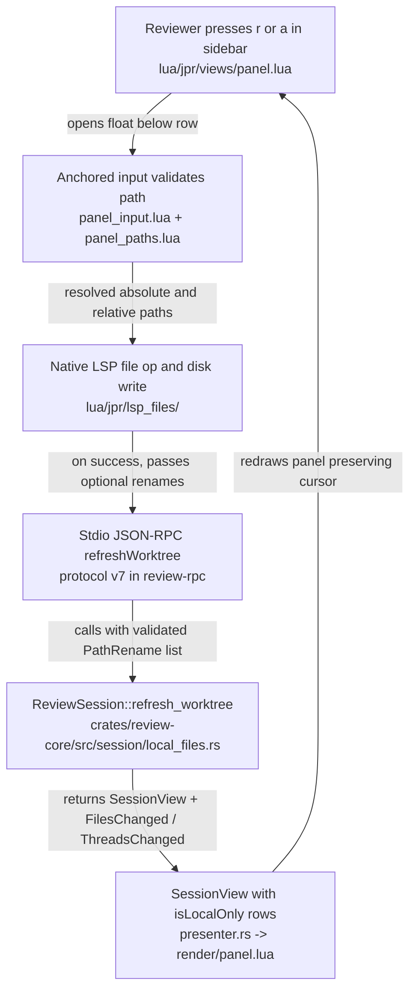
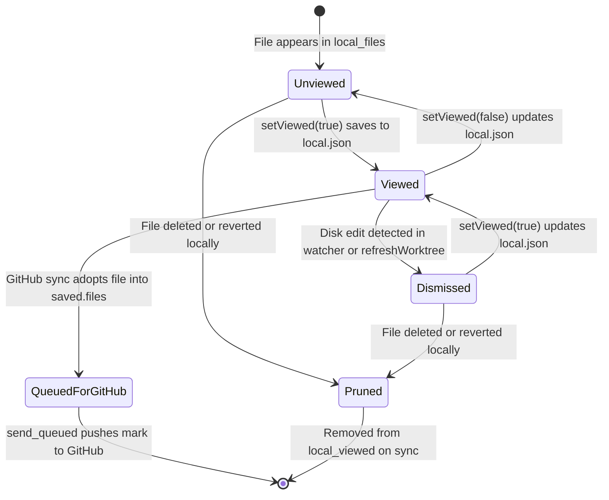
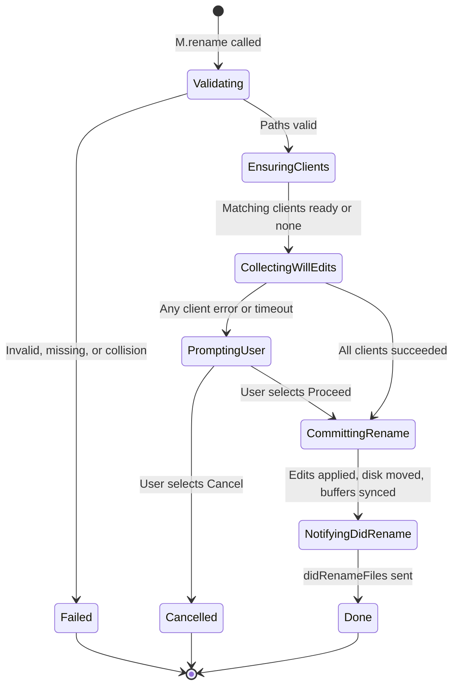

# Sidebar Collapsible Menu, Local Worktree Files, and Native LSP File Operations (0.6.0)

<small>

> <table border="0">
> <tr><th colspan="2">Files</th><th colspan="2">Lines</th></tr>
> <tr><td>Changed (total)</td><td>54</td><td>Insertions (+)</td><td>4,248</td></tr>
> <tr><td>Added</td><td>17</td><td>Deletions (-)</td><td>770</td></tr>
> <tr><td>Deleted</td><td>0</td><td>Net change</td><td>+3,478</td></tr>
> </table>

</small>

## 1. Purpose

While reviewing a pull request in Neovim, the left pull-request sidebar behaved like a plain text buffer: cursor motion wandered into non-selectable header lines and horizontally off-screen, directories could not collapse, and reviewers had no way to create, rename, or move files from the sidebar without leaving Neovim or breaking language-server imports. At the same time, any file created or renamed locally in the checked-out worktree remained invisible to the sidebar, diffs, viewed marks, and local agent threads until it was pushed to GitHub.

This change:

- Merges unpushed worktree files into the review session with local viewed<sup>G2</sup> tracking, origin<sup>G5</sup>-split comment rules, and immediate rename refresh (§4).
- Turns the Neovim pull-request sidebar into a vertical-only collapsible directory menu with an anchored inline path input and local-only compose lock (§5).
- Adds self-contained native Neovim language-server file rename and create operations that update imports before changing disk (§6).

## 2. Background technical context

```text
crates/
├── review-model/src/
│   └── view.rs                           (changed)
├── review-core/src/
│   ├── ports/store.rs                    (changed)
│   ├── presenter.rs                      (changed)
│   └── session/
│       ├── mod.rs                        (changed)
│       ├── local_files.rs                (new)
│       ├── diffs.rs                      (changed)
│       ├── comments/helpers.rs           (changed)
│       ├── viewed.rs                     (changed)
│       ├── sync.rs                       (changed)
│       └── worktree_watch.rs             (changed)
└── review-rpc/src/
    ├── protocol.rs                       (changed)
    ├── params.rs                         (changed)
    └── server.rs                         (changed)
lua/jpr/
├── render/panel.lua                      (changed)
├── views/
│   ├── panel.lua                         (changed)
│   ├── panel_paths.lua                   (new)
│   └── panel_input.lua                   (new)
├── lsp_files/                            (new)
├── comments/compose.lua                  (changed)
└── session/commands.lua                  (changed)
```

<small>

| Unit | What it is |
| --- | --- |
| `view.rs` | Shared read-model structs sent from the Rust review engine to Neovim, including `SessionView` and `FileRow`. |
| `store.rs` | Persistence types saved to disk per pull request, including `LocalStoreState` for `local.json`. |
| `presenter.rs` | Pure projection that builds `SessionView` (file rows, directory tree, and counters) from session state. |
| `session/mod.rs` | `ReviewSession`, the stateful Rust review engine holding pull-request files, threads, diffs, and worktree caches. |
| `local_files.rs` | Merges worktree changes since the pull request's merge base<sup>G4</sup> into `ReviewSession` and executes `refresh_worktree`. |
| `diffs.rs` | Computes unified and split diffs against the merge base<sup>G4</sup> for files in the review session. |
| `comments/helpers.rs` | Validates comment anchors and creates GitHub or local thread entries inside `ReviewSession`. |
| `viewed.rs` | Handles `setViewed` requests, updating GitHub or the offline queue for pull-request files and `local.json` for local-only files<sup>G3</sup>. |
| `sync.rs` | Reconciles incoming GitHub pull-request snapshots with local threads, offline queues, and worktree files. |
| `worktree_watch.rs` | Polls the worktree every two seconds for file digest changes, reanchoring local threads and broadcasting updates. |
| `protocol.rs` | JSON-RPC framing and `PROTOCOL_VERSION`, negotiated during the `hello` handshake with Neovim. |
| `params.rs` | Parses and validates JSON-RPC method parameters before dispatching to `ReviewSession`. |
| `server.rs` | Stdio JSON-RPC dispatch loop serving requests from the Neovim plugin. |
| `render/panel.lua` | Pure Lua renderer that converts `SessionView` into sidebar lines, highlight spans, and selectable row metadata. |
| `views/panel.lua` | Manages the left sidebar window, keymaps, vertical cursor clamping, and collapsed directory state. |
| `views/panel_paths.lua` | Pure path resolver that turns inline sidebar input into validated, worktree-bounded paths. |
| `views/panel_input.lua` | Anchored rounded floating input box opened by `r` and `a` in the sidebar. |
| `lsp_files/` | Native `vim.lsp` file-operations subsystem (`init.lua`, `clients.lua`, `buffers.lua`) for rename and create. |
| `comments/compose.lua` | Floating markdown editor for creating, replying to, editing, and promoting review comments. |
| `session/commands.lua` | Wires `:Jpr` session actions and JSON-RPC request helpers onto `jpr.session`. |

</small>

## 3. Shape of the solution

This section maps how the three strands connect from a reviewer's keystroke in Neovim down to the Rust review engine and back to the sidebar. All three strands serve one end-to-end workflow: pressing `r` (rename/move) or `a` (create) in the collapsible sidebar validates the target path in Lua (§5), runs native language-server file operations and disk updates in Lua (§6), and then calls the engine's new `refreshWorktree` RPC so the Rust core migrates local threads, merges unpushed files, and returns an updated `SessionView` (§4).



> *File mutations and language-server import updates stay in Neovim's Lua layer, while file-list merging, viewed state, comment rules, and local-thread migration stay frontend-neutral in `review-core`.*

## 4. Local worktree files merge into the review session with isolated viewed and comment rules

This strand belongs to the Rust review engine and JSON-RPC protocol. It answers how files created or modified locally in the worktree appear in the pull-request panel, diffs, and local agent workflow without breaking GitHub-backed operations before the reviewer pushes.

### 4.1 `effective_files` merges worktree changes since `merge_base` behind `FileRow.isLocalOnly`

Previously, `ReviewSession` read only `saved.files` (the list returned by GitHub). Any new file created in the worktree or renamed to a new path stayed invisible until pushed and re-synced.

`crates/review-core/src/session/local_files.rs` computes `ReviewSession::local_files` by calling `Workspace::list_changed_files_since(&merge_base)` and excluding every path already present in `saved.files`. `ReviewSession::effective_files()` then returns all pull-request files tagged `is_local_only = false` followed by all local-only files<sup>G3</sup> tagged `is_local_only = true`. `presenter::session_view` copies that flag onto `FileRow.is_local_only` (`isLocalOnly` in JSON, defaulting to `false` via `#[serde(default)]`), and `diffs.rs` uses `effective_files()` and `has_effective_file()` so both single-file diffs and the full diff stream include unpushed files.

To avoid re-diffing unchanged local files on every two-second watcher tick, `build_local_changed_file` hashes up to `MAX_DIFF_BYTES` of the file on disk and caches `(additions, deletions)` in `ReviewSession::local_file_counts` keyed by `(path, disk_digest)`. Binary files and files exceeding `MAX_DIFF_BYTES` return `(0, 0)` counts without allocating a full diff.

### 4.2 Comment validation splits by origin so local threads work on unpushed files while GitHub writes stay blocked

A reviewer working with an interactive coding agent needs to leave local notes on newly created files before pushing, while attempting to submit a GitHub draft comment or suggestion on an unpushed file would fail at the GitHub API.

**File: `crates/review-core/src/session/comments/helpers.rs`**

```rust {2,13-15,19,26-28}
impl ReviewSession {
    pub(in super::super) fn validate_github_anchor_file(&self, anchor: &Anchor) -> Result<()> {
        if anchor.kind == AnchorKind::Pr {
            return Ok(());
        }
        let path = anchor
            .file
            .as_deref()
            .context("code comment anchor requires a file path")?;
        if self.saved.files.iter().any(|file| file.path == path) {
            return Ok(());
        }
        if self.is_local_only_file(path) {
            bail!("Push this file to GitHub before adding GitHub comments");
        }
        bail!("{path} is not a file this pull request changes");
    }

    pub(in super::super) fn validate_local_anchor_file(&self, anchor: &Anchor) -> Result<()> {
        if anchor.kind == AnchorKind::Pr {
            return Ok(());
        }
        let path = anchor
            .file
            .as_deref()
            .context("code comment anchor requires a file path")?;
        if self.has_effective_file(path) {
            return Ok(());
        }
        bail!("{path} is not a file this pull request changes");
    }
}
```

The highlighted split separates callers by destination: `create_github_thread_entry`, `promote_thread`, and `suggest_from_edit` (`submit.rs`) call `validate_github_anchor_file`, which refuses any local-only file<sup>G3</sup> with an actionable error. `add_local_comment` (`local.rs`) and `record_prepass_finding` (`agent_loop.rs`) call `validate_local_anchor_file`, which accepts any file in `effective_files()`.

### 4.3 Local-only `viewed` state persists in `local.json` and promotes to GitHub on sync

GitHub's `markFileAsViewed` mutation only accepts files in the remote pull request. Storing local-only viewed marks in `registry.queued_viewed` would leave them permanently stuck as "waiting for GitHub" and repeatedly fail on sync. Instead, `LocalStoreState` (`crates/review-core/src/ports/store.rs`) adds `local_viewed: BTreeMap<String, ViewedState>` with `#[serde(default)]` so existing v1 `local.json` files deserialize without migration.



> *Local-only viewed marks never call GitHub until a subsequent sync adopts the file into `saved.files`, at which point `promote_adopted_local_viewed` moves `Viewed` entries into `queued_viewed` and triggers `send_queued`.*

When `ReviewSession::set_viewed` (`crates/review-core/src/session/viewed.rs`) receives a path in `saved.files`, it keeps the existing GitHub mutation and offline queue path. When the path exists only in `local_files`, it writes directly to `saved.local.local_viewed` and persists `local.json`. Both `poll_worktree_files` (`worktree_watch.rs`) and `refresh_worktree` (`local_files.rs`) call `dismiss_edited_local_viewed`, transitioning a local-only `Viewed` file to `Dismissed` when its on-disk content digest changes.

On startup, `poll_worktree_files` calls `announce_initial_local_files` on its first tick so pre-existing unpushed worktree files are immediately broadcast via `Event::FilesChanged` without waiting for a subsequent edit.

### 4.4 `refreshWorktree` migrates local thread anchors and `local_viewed` across renames (protocol v7)

Waiting up to two seconds for the worktree watcher<sup>G6</sup> after a sidebar rename feels sluggish, and the watcher cannot distinguish a rename from a delete-plus-create when migrating local review threads. `PROTOCOL_VERSION` advances from `6` to `7` (`crates/review-rpc/src/protocol.rs` and `lua/jpr/rpc.lua`), adding the stdio-only `refreshWorktree` RPC accepting optional `{ renames: [{ oldPath, newPath }] }`.

**File: `crates/review-core/src/session/local_files.rs`**

```rust {5-7}
pub fn rewrite_renamed_path(path: &str, rename: &PathRename) -> Option<String> {
    if path == rename.old_path {
        return Some(rename.new_path.clone());
    }
    let suffix = path
        .strip_prefix(rename.old_path.as_str())
        .and_then(|rest| rest.strip_prefix('/'))?;
    Some(format!("{}/{suffix}", rename.new_path))
}
```

The highlighted `strip_prefix('/')` check enforces a strict directory boundary. Without it, renaming `src/foo` to `src/bar` would corrupt a sibling directory `src/foobar/a.rs` into `src/barbar/a.rs`.

**Worked example:** Suppose `renames = [{ oldPath: "src/foo", newPath: "src/bar" }]` and the session holds two local threads and one `local_viewed` entry:

| Input path | `rewrite_renamed_path` result | Why |
| --- | --- | --- |
| `src/foo` | `Some("src/bar")` | Exact match on `old_path`. |
| `src/foo/sub/a.rs` | `Some("src/bar/sub/a.rs")` | Starts with `src/foo/` boundary. |
| `src/foobar/a.rs` | `None` | Next character after `src/foo` is `b`, not `/`. |

Inside `ReviewSession::refresh_worktree`, the engine validates every rename path with `validate_safe_relative_path`, migrates `Origin::Local` thread anchors and `local_viewed` keys (leaving GitHub threads untouched because GitHub owns their remote paths), invalidates `base_cache` rename mappings and `local_file_counts`, recomputes `local_files` and disk digests, dismisses `local_viewed` only for paths that existed in `previous_digests` and changed content (not freshly created files), reanchors affected local threads, and broadcasts `ThreadsChanged`, `FilesChanged`, or `WorktreeStatusChanged`.

## 5. The PR sidebar operates as a vertical-only collapsible directory menu with an anchored inline input box

This strand belongs to the Neovim Lua frontend. It answers how the sidebar prevents stray cursor motion, collapses directories, resolves inline rename/create paths, and locks comment compose on local-only files<sup>G3</sup>.

### 5.1 Panel rendering emits row metadata and vertical cursor clamping keeps selection on items

`lua/jpr/render/panel.lua` extends `M.build(view, now, opts)` to accept `{ collapsed_dirs = table }` and return `rows` (keyed by 1-based line number with `kind = "conversation" | "dir" | "file"`, `path`, `depth`, `parent_dir`, and `is_collapsed`) alongside `selectable_lines`. Directory rows render `▾ <name>/` when expanded and `▸ <name>/ (<count>)` when collapsed, where `count_descendant_files` counts hidden file descendants while `render_tree_rows` skips all subsequent tree entries with `row.depth > skip_depth`. File rows with `file.isLocalOnly == true` append `[local]` highlighted with `JprThreadLocal`.

`lua/jpr/views/panel.lua` turns the sidebar window into a vertical-only menu:

- `HORIZONTAL_NOOP_KEYS` maps `0`, `^`, `$`, `w`, `W`, `b`, `B`, `e`, `E`, `ge`, `gE`, `f`, `F`, `t`, `T`, `;`, and `,` to `<Nop>`, and `style_window` sets `sidescrolloff = 0`.
- A buffer-local `CursorMoved` autocmd runs `clamp_cursor`, snapping column to `0` and moving any cursor that lands on a non-selectable header or blank line onto the nearest line in `selectable_lines` (guarded by `panel.is_clamping` to prevent recursion).
- `j`/`k`/`<Down>`/`<Up>` step across `selectable_lines` with `vim.v.count1`; `gg`/`<Home>` and `G`/`<End>` jump to the first and last selectable item.
- `h`/`<Left>` collapses an expanded directory or jumps to `row.parent_dir`; `l`/`<Right>` expands a collapsed directory, steps into the first child of an expanded directory, or opens a file/conversation; `<CR>` toggles directories or opens items; `o` expands a collapsed directory or opens a file/conversation.
- `M.render` preserves the cursor on the same item path (and kind) across redraws, defaulting to `conversation_line` on initial open.

### 5.2 Three-mode inline path resolution keeps rename and create targets inside the worktree

When a reviewer presses `r` or `a` in the sidebar, they may want to rename a file in place (`new.lua`), move it relative to its folder (`../shared/new.lua`), or move it to an arbitrary path from the repository root (`lua/jpr/new.lua`). `lua/jpr/views/panel_paths.lua` implements this as a pure module with no Neovim window side effects.

**File: `lua/jpr/views/panel_paths.lua`**

```lua {2-8}
local function detect_path_mode(body)
    if body:sub(1, 2) == "./" or body:sub(1, 3) == "../" or body == "." or body == ".." then
        return "current_dir"
    end
    if body:find("/", 1, true) ~= nil then
        return "project_root"
    end
    return "same_dir"
end
```

The highlighted branching defines the three input modes: explicit `./` or `../` resolves against `context.current_dir`, any other input containing `/` resolves from the worktree root, and a bare name with no slash resolves in `context.current_dir`.

**Worked example:** Suppose the worktree root is `repo/` and the cursor is on file `src/views/panel.lua` (`current_dir = "src/views"`):

| Raw input | Detected mode | Resolved `relative_path` | `is_directory` | Hint or error |
| --- | --- | --- | --- | --- |
| `sidebar.lua` | `same_dir` | `src/views/sidebar.lua` | `false` | `-> src/views/sidebar.lua` |
| `./sub/x.lua` | `current_dir` | `src/views/sub/x.lua` | `false` | `Path is relative to current directory -> src/views/sub/x.lua` |
| `../util/x.lua` | `current_dir` | `src/util/x.lua` | `false` | `Path is relative to current directory -> src/util/x.lua` |
| `crates/app/a.rs` | `project_root` | `crates/app/a.rs` | `false` | `Path is relative to project root -> crates/app/a.rs` |
| `helpers/` (create) | `same_dir` | `src/views/helpers` | `true` | `-> src/views/helpers` |
| `../../../etc/passwd` | `current_dir` | rejected | n/a | `Path escapes the worktree root` |
| `.git/hooks/pre` | `project_root` | rejected | n/a | `Path cannot target .git` |

After normalizing `..` segments on a stack, `resolve_input_from_context` also checks `diff_view.name_to_relative_path(worktree_clean, absolute_path)` so symlink escapes cannot bypass lexical segment checks, rejects moving a directory inside itself, and rejects trailing `/` when renaming a regular file.

### 5.3 Anchored floating input (`panel_input.lua`) and local-only compose lock (`compose.lua`)

`lua/jpr/views/panel_input.lua` opens a rounded floating window (`border = "rounded"`, `relative = "win"`, `win = panel.win`) directly below the hovered sidebar row, flipping above (`anchor = "SW"`) when `rel_row + 4 > win_height`. On `TextChangedI` and `TextChanged`, `paint_virt_lines` renders the live resolution hint (or validation error in `JprError`) as a virtual line below the input and resizes the float height to match. `<CR>` validates and invokes `on_confirm(resolved)`; `q` or `<Esc>` in Normal mode, `BufLeave`, or `WinClosed` closes the float and restores panel focus when appropriate.

Both `start_rename` and `start_create` guard against `session.is_read_only` before opening the float. On success, `start_rename` calls `jpr.session.refresh_worktree(session, { { oldPath = ..., newPath = ... } })`; `start_create` calls `jpr.session.refresh_worktree(session, nil)` and opens newly created regular files in the main window via `main_window.edit`.

In `lua/jpr/comments/compose.lua`, `is_local_only_anchor` looks up `anchor.file` in `session.view.files`. When `file.isLocalOnly == true`, `M.open_new` forces `origin = "local"`, sets `allow_destination_toggle = false` (so `<C-g>` and `<M-s>` are not bound), and displays the footer ` <C-s> save · local only (unpushed file) · q cancel `. This matches the Rust engine's origin<sup>G5</sup> split so the reviewer never composes a GitHub draft on an unpushed file only to have submission rejected.

## 6. Native Neovim LSP file operations coordinate import updates before mutating disk

This strand belongs to `lua/jpr/lsp_files/` (`init.lua`, `clients.lua`, `buffers.lua`). The structural fact that shapes this pipeline is that **the filesystem rename does not happen first**: Neovim's `lsp_files.rename` collects every `workspace/willRenameFiles` `WorkspaceEdit` from matching language servers while the old path still exists on disk, pauses for user confirmation if any server fails or times out, applies the collected edits before moving the file on disk, and only then renames open buffers, autosaves clean edited buffers, and emits `workspace/didRenameFiles`.



> *Disk mutation occurs only inside `CommittingRename`, after all `workspace/willRenameFiles` responses settle or the user explicitly chooses to proceed despite an LSP error.*

### 6.1 The five steps of `M.rename` in execution order

#### Step 1. `validate_rename_paths`

Checks that source and destination differ, that `old_abs` exists via `vim.uv.fs_lstat`, that a directory is not being moved inside itself, and that `new_abs` does not collide with an unrelated entry. It returns `{ is_directory, is_case_only }`. Without this check, a case-only rename on APFS (where `fs_lstat(new_abs)` returns the same `dev` and `ino` as `old_abs`) would be rejected as "Destination already exists". This step runs first so invalid paths never wake language servers.

#### Step 2. `clients.ensure_rename_clients`

Finds active clients in `vim.lsp.get_clients()` whose `server_capabilities.workspace.fileOperations.willRename` glob filters and workspace roots cover `old_abs` or `new_abs`. For regular files, if no matching client is attached yet and `lsp_attach_timeout_ms > 0` (default `3000` ms), it loads `old_abs` into an unlisted temporary buffer (`buflisted = false`) and calls `vim.wait(attach_timeout_ms, ..., 50)` so a cold-start language server can attach. Without this step, renaming a file directly from the sidebar before opening any buffer of that language would silently skip import updates. Directories deliberately skip cold-start attach<sup>G1</sup> because `bufload` cannot attach a language server to a directory path.

#### Step 3. `clients.collect_will_edits`

Sends synchronous `client:request_sync("workspace/willRenameFiles", params, op_timeout)` (default `30000` ms) to each matching client, separating valid `WorkspaceEdit` results into `collected_edits` and timeouts or RPC errors into `failures` without applying any edits yet. Without separating collection from application, a failure on the second client would leave the first client's edits already applied. If `#failures > 0`, `M.rename` warns via `jpr.warn` and opens `vim.ui.select` offering `Proceed with rename without full LSP import updates` or `Cancel rename`.

#### Step 4. `complete_rename` (`buffers` + `perform_fs_rename`)

Takes a dirty snapshot of every loaded file buffer (`buffers.create_dirty_snapshot()`), applies `collected_edits` via `vim.lsp.util.apply_workspace_edit`, captures `vim.uv.fs_realpath(old_abs)` before moving, executes `perform_fs_rename`, updates open buffer names with `buffers.rename_open_buffers`, autosaves only buffers that were clean prior to the edit with `buffers.autosave_edited_buffers`, and deletes any cold-start temporary buffer if still unmodified. Applying edits before `fs_rename` ensures `WorkspaceEdit`s referencing `oldUri` still resolve against the existing file; capturing `old_real` before `fs_rename` ensures buffers opened through a symlink (such as `/var` vs `/private/var` on macOS) still match after the path moves.

#### Step 5. `clients.notify_did_op`

Sends `workspace/didRenameFiles` notifications (wrapped in `pcall`) to all clients matching `didRename`, then invokes `on_done(true, nil)` so `panel_input.lua` triggers `session.refresh_worktree`.

`M.create` follows the lighter creation variant: directories call `vim.fn.mkdir(target_abs, "p")` and skip LSP file operations (regular files only); regular files collect `workspace/willCreateFiles` edits (warning and proceeding on failure rather than blocking creation), create the empty file, apply edits, autosave clean edited buffers, and notify `workspace/didCreateFiles`.

### 6.2 Guarantee: LSP failures never leave partial disk renames behind

Because `collect_will_edits` gathers all responses before `complete_rename` runs, any timeout or RPC error halts before `apply_workspace_edit` or `perform_fs_rename` executes. Choosing **Cancel rename** cleans up the temporary cold-start buffer and leaves disk and open buffers completely unchanged.

### 6.3 Guarantee: Case-only renames succeed atomically on case-insensitive filesystems

**File: `lua/jpr/lsp_files/init.lua`**

```lua {7-16}
local function perform_fs_rename(old_abs, new_abs, is_case_only)
    vim.fn.mkdir(vim.fs.dirname(new_abs), "p")
    if not is_case_only then
        local ok, rename_err = vim.uv.fs_rename(old_abs, new_abs)
        return ok ~= nil, rename_err
    end
    local temp_abs = ("%s.jpr-rename-tmp-%d"):format(old_abs, vim.uv.hrtime())
    local step1_ok, step1_err = vim.uv.fs_rename(old_abs, temp_abs)
    if not step1_ok then
        return false, step1_err
    end
    local step2_ok, step2_err = vim.uv.fs_rename(temp_abs, new_abs)
    if not step2_ok then
        vim.uv.fs_rename(temp_abs, old_abs)
        return false, step2_err
    end
    return true, nil
end
```

When `validate_rename_paths` detects `is_same_fs_entry(old_stat, new_stat)` with equal lowercased paths, `perform_fs_rename` renames `Foo.lua` to `Foo.lua.jpr-rename-tmp-<hrtime>` and then to `foo.lua`. If the second rename fails, it rolls back `temp_abs` to `old_abs` before returning the error.

### 6.4 Guarantee: LSP import edits autosave clean buffers without overwriting unsaved user edits

`buffers.create_dirty_snapshot` records `pre_dirty[buf]` and `pre_tick[buf]` for every valid file buffer before `apply_collected_edits`. Afterwards, `buffers.autosave_edited_buffers` checks `curr_tick ~= prev_tick` (or `prev_tick == nil` for buffers newly loaded by `apply_workspace_edit`): clean buffers receive `silent update`, while pre-dirty buffers are left unsaved with a `jpr.warn` message so unsaved work is never silently written to disk.

When `buffers.rename_open_buffers` updates a renamed file's buffer name via `nvim_buf_set_name`, `clear_unloaded_target_buffer` first deletes any stale unloaded, unmodified buffer already holding `target_path` (which would otherwise cause Neovim `E95: Buffer with this name already exists`). Clean loaded buffers then run `silent edit!` so Neovim refreshes filetype and LSP attachment for the new name.

## 7. Interface changes

This plugin renders inside a Neovim terminal UI and tests run in headless Neovim with no graphical browser or window-capture environment available, so the changed terminal surfaces are shown as ASCII wireframes.

### 7.1 Collapsible PR sidebar with `[local]` badges and anchored inline input

```text
+--------------------------------------------+
| #42 Add sidebar menu                       |  <- header (non-selectable; cursor
| ████░░░░░░░░░░░░  1/4 (25%)                |     clamps below to Conversation)
| dirty · ↑1 ↓0 · viewed 1/4 · threads 2     |
| synced 12s ago                             |
|                                            |
|   💬 Conversation [1]                      |  <- selectable_lines[1]
| ▸ crates/ (2)                              |  <- collapsed dir with file count
| ▾ lua/                                     |  <- expanded dir
|   ▾ jpr/                                   |
|     ✓ panel.lua  +28 -4 [1]                |
|       helper.lua  +14 -0 [local]           |  <- local-only worktree file
| +----------------------------------------+ |
| | Rename · helper.lua                    | |  <- anchored float below row
| | ../utils/helper.lua                    | |  <- editable input line
| | Path is relative to current directory  | |  <- virt_line hint (or JprError)
| | -> lua/utils/helper.lua                | |
| +----------------------------------------+ |
+--------------------------------------------+
```

### 7.2 Comment compose footer locked on unpushed `[local]` files

```text
+------------------------------------------------------------+
|         [Local -> agent] lua/jpr/helper.lua:12             |
|                                                            |
| Check edge case when path has trailing slash.              |
|                                                            |
|        <C-s> save · local only (unpushed file) · q cancel  |
+------------------------------------------------------------+
```

When a comment is opened on a file with `isLocalOnly == true`, the title is fixed to `[Local -> agent]`, `<C-g>` and `<M-s>` destination toggles are disabled, and the footer explains why the comment is local only.

## 8. Decisions

- **Implement native `vim.lsp` file operations inside `lua/jpr/lsp_files/` rather than requiring a third-party plugin.** The rejected alternative was delegating to `nvim-lsp-file-operations` or `oil.nvim`. Requiring an external plugin breaks out-of-the-box sidebar renames for reviewers who do not install it and gives no control over atomic error prompts or dirty-aware autosave. Revisit if Neovim ships a built-in high-level `vim.lsp.fs` rename/create helper with cold-start attach<sup>G1</sup> and failure confirmation.
- **Pause and prompt the reviewer before renaming on disk whenever any `workspace/willRenameFiles` server errors or times out.** The rejected alternative was logging a warning and renaming anyway. Mutating disk after a partial or timed-out `willRenameFiles` call leaves broken imports across the repository that are harder to unwind than cancelling before the move. Revisit if reviewers find a single slow server too disruptive and want a per-server ignore list.
- **Merge local-only worktree files inside `review-core` rather than splicing them into the panel in Lua.** The rejected alternative was listing `git status` files in Lua and appending them to `render/panel.lua`. Merging in Rust keeps diffs, viewed marks, line counts, and origin<sup>G5</sup>-split comment validation frontend-neutral for any future TUI. Revisit only if `review-core` stops owning session file lists.
- **Allow local threads on unpushed files while blocking GitHub comments, promotion, and `suggestFromEdit` until pushed.** The rejected alternative was blocking all comments on local-only files<sup>G3</sup>. Reviewers creating files alongside a coding agent need to attach local instructions immediately, whereas GitHub mutations cannot succeed until the file exists in the remote pull request. Revisit if GitHub adds an API for commenting on unpushed local files (not applicable today).
- **Keep `refreshWorktree` on the stdio JSON-RPC server only and out of the agent Unix socket.** The rejected alternative was exposing `refreshWorktree` on both transports. Interactive agents mutate files directly on disk and are already picked up by the two-second watcher without needing rename-hint parameters, whereas sidebar `r` and `a` need immediate UI refresh and explicit `{ oldPath, newPath }` pairs. Revisit if an agent tool needs synchronous rename migration before reading `threads`.

## 9. Deliberately not handled

- **Sidebar delete (`d`) and `workspace/willDeleteFiles`.** Destructive file deletion carries higher risk and undo expectations than create/rename; it is deferred to a follow-up track.
- **Undo of disk renames.** Once `perform_fs_rename` succeeds, reverting the move requires renaming the file back or running `git checkout`.
- **Non-`file://` LSP URI schemes.** `matches_glob_filter` in `lua/jpr/lsp_files/clients.lua` ignores filters whose `scheme` is set to anything other than `"file"`.
- **LSP `willCreateFiles` / `didCreateFiles` for empty directories.** `lsp_files.create` creates directories with `vim.fn.mkdir(..., "p")` and invokes LSP file-creation hooks only for regular files.

<div style="page-break-before: always"></div>

## Appendix A. Manual testing

<small>

1. Build the 0.6.0 `jpr-review` binary and run the full Rust and Lua verification suite:

   ```sh
   just check
   ```

   Expect formatting, clippy, all Rust workspace tests, and all Lua headless specs to pass with zero errors.

2. Open a pull request in Neovim with `:Jpr open <pr-number>`.
   - **Before this change:** the sidebar cursor could move onto header lines and horizontally across file names, and directories had no collapse indicators.
   - **Now:** the cursor starts on **Conversation**, `0` / `$` / `w` / `b` do not move horizontally, and directory rows show `▾ <dir>/`.

3. Move to a directory row with `j` / `k`, press `h` or `<CR>` to collapse it, verify it renders `▸ <dir>/ (<count>)` and hides its children, then press `l` or `<CR>` to expand it again.

4. On any file or directory row, press `a` to open the anchored floating input box and type:

   > scratch/new_helper.lua

   Confirm the virtual hint reads `Path is relative to project root -> scratch/new_helper.lua`, press `<CR>`, and verify `scratch/new_helper.lua` is created on disk, opens in the main window, and appears immediately in the sidebar with `[local]`.

5. In the sidebar on `scratch/new_helper.lua`, press `v` to mark it viewed (confirming `✓` appears without a GitHub sync error). Open a comment compose window on a line in that file and confirm the footer reads `<C-s> save · local only (unpushed file) · q cancel` and `<C-g>` does not switch to GitHub.

6. Back in the sidebar on `scratch/new_helper.lua`, press `r`, type:

   > renamed_helper.lua

   and press `<CR>`. Verify the file moves to `scratch/renamed_helper.lua`, its open buffer updates to the new path, attached language servers receive `workspace/willRenameFiles` and `workspace/didRenameFiles`, and any local comment thread migrates to `scratch/renamed_helper.lua`.

7. Remove the temporary `scratch/` directory when finished testing.

</small>

<div style="page-break-before: always"></div>

## Appendix B. Glossary

<small>

| Term | Meaning |
| --- | --- |
| **G1** Cold-start attach | Loading a file into an unlisted temporary Neovim buffer and waiting briefly for a matching language server to attach before sending `workspace/willRenameFiles`, used when the reviewer renames a file from the sidebar without having opened it first. |
| **G2** Local viewed | Viewed state (`Unviewed`, `Viewed`, `Dismissed`) for local-only files<sup>G3</sup>, persisted in `local.json` (`local_viewed`) instead of GitHub's offline viewed queue (`queued_viewed`). |
| **G3** Local-only file | A file modified or created in the local worktree since the pull request's merge base<sup>G4</sup> that does not yet exist in GitHub's pull-request file list (`isLocalOnly: true` on `FileRow`, shown with `[local]` in the sidebar). |
| **G4** Merge base | The common ancestor commit between the pull request's base branch and head branch, used by `review-core` to compute both diffs and local-only worktree changes. |
| **G5** Origin | Whether a review thread belongs to the local coding-agent workflow (`local`) or to GitHub (`github`). |
| **G6** Worktree watcher | The background two-second poller (`worktree_watch.rs`) in `review-core` that hashes changed files on disk to reanchor local threads and detect edits. |

</small>
