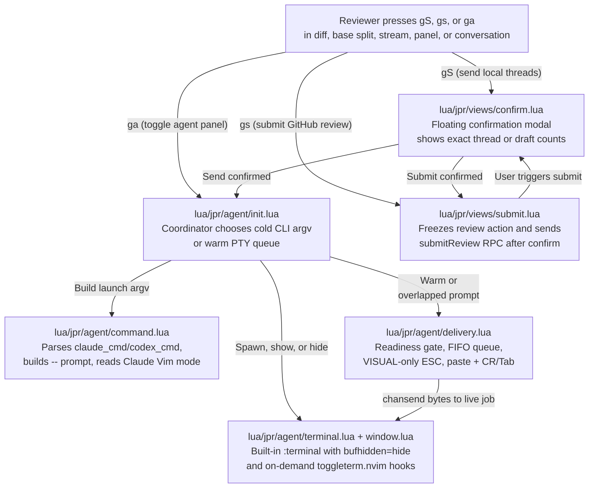
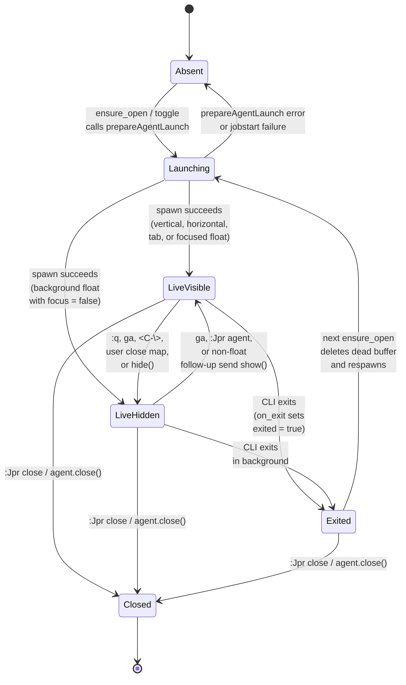
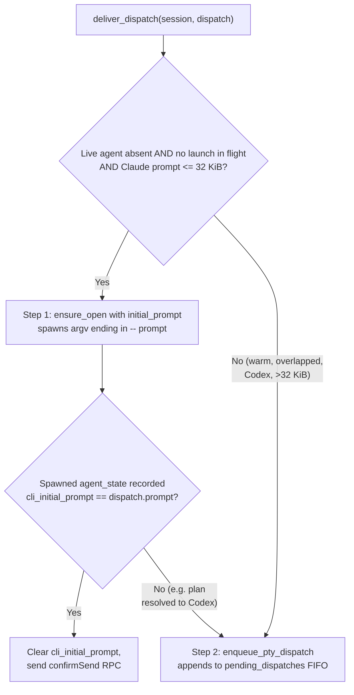
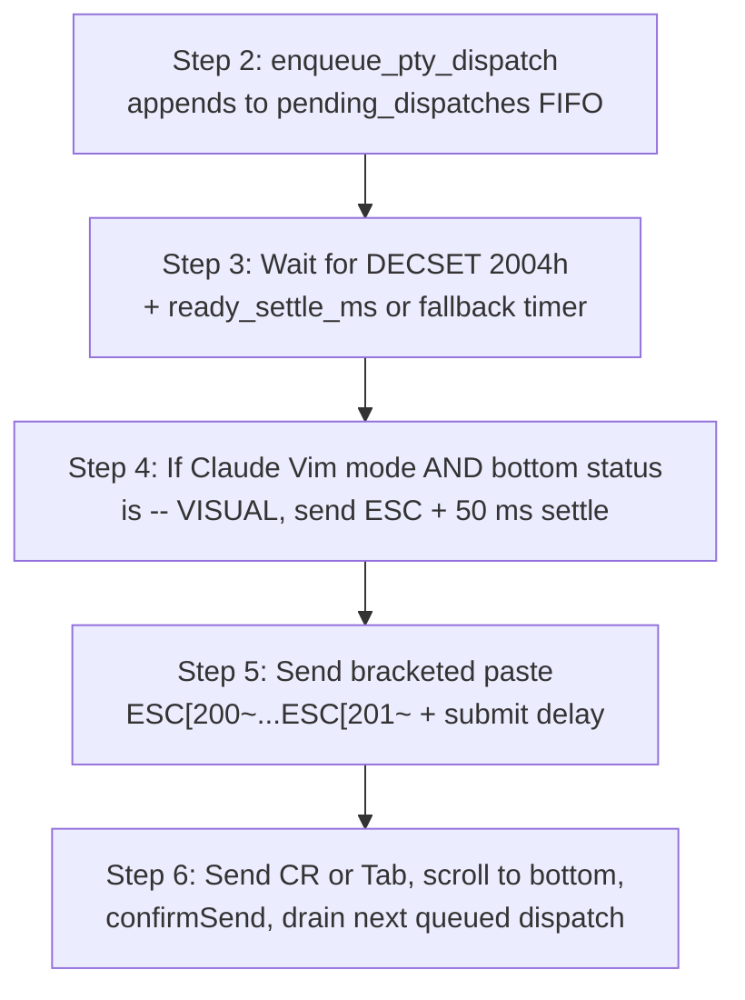
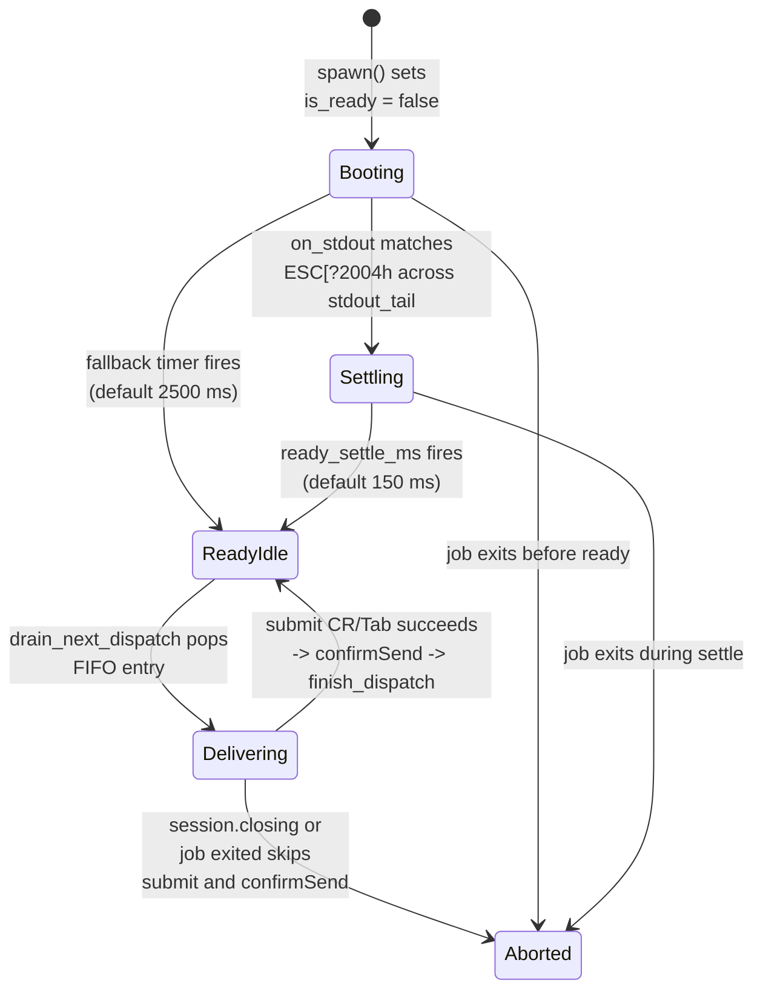
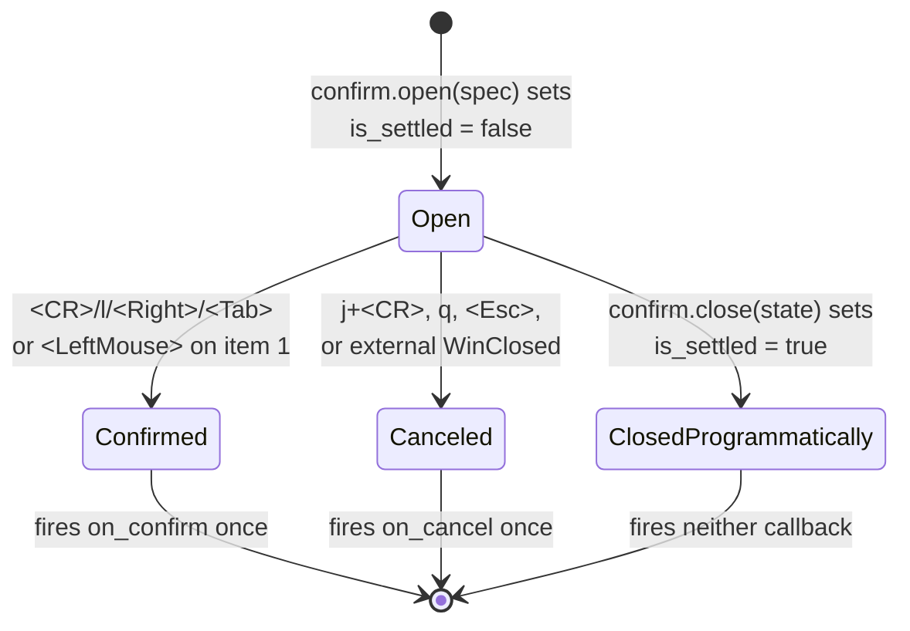

# Agent terminal integration, auto-submit delivery, and confirmed review shortcuts

<small>

> <table border="0">
> <tr><th colspan="2">Files</th><th colspan="2">Lines</th></tr>
> <tr><td>Changed (total)</td><td>25</td><td>Insertions (+)</td><td>2,891</td></tr>
> <tr><td>Added</td><td>11</td><td>Deletions (-)</td><td>509</td></tr>
> <tr><td>Deleted</td><td>1</td><td>Net change</td><td>+2,382</td></tr>
> </table>

</small>

## 1. Purpose

When a reviewer dispatched local review comments to Claude Code inside Neovim, the plugin opened a narrow 56-column terminal split, pasted the prompt straight into the terminal before Claude Code finished starting up (with only a 200 ms delay before sending Enter), and left prompts unsubmitted until the reviewer focused the terminal and pressed Enter manually. Closing that split risked losing track of the live agent process and never inherited an installed terminal plugin's keymaps or shading, and there were no direct review-wide keyboard shortcuts for sending local comments to the agent, opening GitHub review submission, or hiding and re-showing the agent panel<sup>G1</sup> while continuing to read diffs.

This change:

- Replaces the narrow agent split<sup>G1</sup> with a wider built-in Neovim terminal that hides without stopping the agent and keeps user `toggleterm.nvim` mappings and shading (§4).
- Auto-submits both fresh and follow-up agent prompts reliably, including when Claude Code runs with Vim keybindings enabled (§5).
- Adds review-wide shortcuts to confirm sending local comments or submitting a GitHub review, and to toggle the agent panel<sup>G1</sup> without quitting (§6).

## 2. Background technical context

```text
plugin/
└── jpr.lua              (changed)
lua/jpr/
├── init.lua             (changed)
├── agent/               (new)
├── session/
│   ├── init.lua
│   └── commands.lua     (changed)
├── tui/wizard/
│   └── window.lua
└── views/
    ├── cheatsheet.lua   (changed)
    ├── confirm.lua      (new)
    ├── conversation.lua (changed)
    ├── diff/
    ├── panel.lua        (changed)
    ├── stream/
    └── submit.lua       (changed)
```

<small>

| Unit | What it is |
| --- | --- |
| `plugin/jpr.lua` | Neovim startup file defining the `:Jpr` command and `<Plug>(jpr-*)` targets before the plugin loads. Buffer shortcuts in `lua/jpr/init.lua` point at these targets. |
| `lua/jpr/init.lua` | Plugin root module (`jpr`) storing `setup()` options for agent commands, layout, and keymaps. Dispatches `:Jpr` commands and binds shortcuts via `bind_buffer_keys` and `bind_session_keys`. |
| `agent/` | Five-module coding-agent package (replacing `lua/jpr/agent.lua`) that runs Claude Code or Codex in a Neovim terminal and submits prompts. Invoked by `session/commands.lua` and `gS` / `ga`. |
| `session/init.lua` | Per-tab review session<sup>G15</sup> store (`by_tab`) tracking one pull-request or local review, its worktree, and its live agent (`session.agent`). Calls the unchanged Rust `jpr-review` engine via `jpr.rpc`. |
| `session/commands.lua` | User-facing `:Jpr` session actions (`:Jpr agent`, `:Jpr send`, `:Jpr prepass`, `:Jpr sync`, `:Jpr close`) on `jpr.session`. Resolves the active session before calling `agent/` or the engine. |
| `tui/wizard/window.lua` | Shared centered floating-window helper used by the Command Palette, auth prompt, and confirmation modals. Pairs with `tui/render.lua` (`wrap_text`) to clamp geometry and paint lines. |
| `views/cheatsheet.lua` | Scrollable floating shortcuts reference opened by `:Jpr keys` or `?` from read-only review buffers. Reads active bindings from `lua/jpr/init.lua`'s `config.keys`. |
| `views/confirm.lua` | Reusable centered floating confirmation modal built on `tui/wizard/window.lua` with keyboard and `<LeftMouse>` selection and single-fire callbacks. Gates both `gS` and `gs`. |
| `views/conversation.lua` | Main-window buffer (`jpr://conversation/<n>`) listing top-level pull-request conversation comments beside the sidebar panel<sup>G16</sup>. Calls `bind_session_keys` so review-wide shortcuts work there. |
| `views/diff/` | Single-file diff view drawing unified overlays<sup>G19</sup> or split `jpr://base/...` buffers for changed files. Calls `bind_buffer_keys` on text diffs and skips keybinding on binary diff buffers. |
| `views/panel.lua` | Left-hand pull-request sidebar listing changed files, viewed progress, and the conversation entry. Calls `bind_session_keys` so review-wide shortcuts work from the sidebar. |
| `views/stream/` | All-files diff stream<sup>G7</sup> buffer (`jpr://stream/<n>`) shown in unified or split layout beside the sidebar panel<sup>G16</sup>. Calls `bind_buffer_keys` so diff and session shortcuts work across the stream. |
| `views/submit.lua` | Centered floating **Submit Review** modal (`:Jpr submit` / `gs`) for choosing `Comment`, `Approve`, or `Request changes`, inspecting drafts, and editing a summary. Sends `submitReview` via `session/init.lua` after confirmation. |

</small>

## 3. Shape of the solution

This change keeps the Rust review engine and JSON-RPC protocol unchanged (`PROTOCOL_VERSION` stays `9`) and restructures only the Neovim Lua frontend around three connected strands: terminal lifecycle management (§4), prompt delivery (§5), and confirmed review-wide shortcuts (§6).



> *All three strands stay inside the Lua frontend: `confirm.lua` gates both outgoing actions (`gS` and `gs`), while the replaced `lua/jpr/agent.lua` splits into five modules under `lua/jpr/agent/`.*
>
> **Diagram key**
>
> | | |
> | --- | --- |
> | **cold CLI argv** | Passing a fresh Claude prompt on the command line (`-- <prompt>`) at spawn time. |
> | **warm PTY queue** | FIFO queue that writes follow-up, overlapped, Codex, or oversized (> 32 KiB) prompts into the live terminal via `chansend` once ready. |
> | **bufhidden=hide** | Neovim buffer option that detaches the window on close without wiping the buffer or stopping its process. |
> | **readiness gate<sup>G14</sup>** | Waits for `\27[?2004h` (or a fallback timer) before writing queued prompts into the terminal. |
> | **VISUAL-only ESC** | Sends `<Esc>` before pasting only when Claude Code's bottom status bar shows `-- VISUAL`. |
> | **CR / Tab** | Trailing submit key written after bracketed paste<sup>G2</sup> (`\r` for Claude, `\t` for Codex). |

Strands §4 and §5 form the coding-agent stack: §4 owns the terminal buffer, window geometry, and optional `toggleterm.nvim` loading, and §5 layers cold-start CLI delivery<sup>G5</sup> and serialized warm PTY delivery<sup>G20</sup> on top of that live terminal. Strand §6 sits above both, supplying the shared confirmation modal used by `gS` (sending local review threads<sup>G11</sup> to the agent) and `gs` (publishing a GitHub review) plus the review-wide keymaps and cheatsheet<sup>G4</sup> entries.

## 4. The coding agent runs in a built-in Neovim terminal that hides without stopping the process and keeps toggleterm.nvim user mappings

This section covers the first strand: how `jpr.agent` launches a configurable agent command inside Neovim's built-in `:terminal`, inherits `toggleterm.nvim` mappings and shading without breaking `:ToggleTerm`, and hides across splits, floats, and breakout tabs<sup>G3</sup> without terminating the running process.

### 4.1 Spawning Neovim's built-in `:terminal` keeps user `TermOpen` keymaps and `toggleterm.nvim` shading without breaking `:ToggleTerm`

#### The Problem

Spawning the agent panel<sup>G1</sup> through `toggleterm.nvim`'s custom-terminal API (`toggleterm.terminal.Terminal:new({ hidden = true })`) would break a user's ordinary `:ToggleTerm` workflow (for example `<leader>t`) and lose track of terminals launched with long prompts. Upstream `toggleterm/ui.lua` scans every tabpage in `find_open_windows()` for buffers carrying `filetype == "toggleterm"` or `vim.b[buf].toggle_number` without excluding `hidden = true` terminals (where `hidden = true` only means excluded from `toggleterm`'s numbered toggle pool, not off-screen). Whenever that custom split is open, `:ToggleTerm` treats it as an open toggleterm window and turns into a silent no-op. In addition, `toggleterm` embeds its terminal ID at the end of the command-derived buffer name (`;#toggleterm#<id>`), and Neovim's `termopen` truncates buffer names at 4095 bytes, stripping the suffix whenever a cold-start<sup>G5</sup> prompt exceeds 4 KiB so `toggleterm` can no longer identify or toggle that terminal.

#### The Solution

`lua/jpr/agent/terminal.lua` spawns Neovim's built-in `:terminal` directly via `vim.fn.jobstart(argv, { term = true })` and never sets `filetype = "toggleterm"` or `vim.b[buf].toggle_number`. Before spawning, `ensure_toggleterm_hooks` checks whether `toggleterm.nvim` is registered under `lazy.nvim` and lazily loads it once (unless disabled via `setup({ agent_load_toggleterm = false })`). Running `toggleterm.nvim`'s `lazy.nvim` `config` hook registers any user-defined `TermOpen` (`pattern = "*"`) mappings (such as window navigation `<C-w>h/j/k/l`, close keys, or `:tab split`) so they fire automatically when the built-in terminal opens. After opening the window, `apply_toggleterm_window_hooks` reads `toggleterm.config` only when `agent_load_toggleterm ~= false` and `package.loaded["toggleterm"] ~= nil`, applies `toggleterm.ui.hl_term()` shading when `shade_terminals` is enabled, and maps `toggleterm`'s `open_mapping` (for example `<C-\>`) buffer-locally to hide the agent panel<sup>G1</sup>.

**File: `lua/jpr/agent/terminal.lua`**

```lua {2,7,13,15}
local function apply_toggleterm_window_hooks(config, buf, win, on_toggle_hide)
    if (type(config) == "table" and config.agent_load_toggleterm == false) or package.loaded["toggleterm"] == nil then
        return
    end
    local has_toggleterm_config, toggleterm_config = pcall(require, "toggleterm.config")
    ...
    if toggleterm_config.get("shade_terminals") then
        local has_toggleterm_ui, toggleterm_ui = pcall(require, "toggleterm.ui")
        if has_toggleterm_ui and type(toggleterm_ui.hl_term) == "function" then
            pcall(toggleterm_ui.hl_term, { window = win, id = "JprAgent" })
        end
    end
    local open_mapping = toggleterm_config.get("open_mapping")
    if type(open_mapping) == "string" and open_mapping ~= "" and type(on_toggle_hide) == "function" then
        vim.keymap.set({ "t", "n" }, open_mapping, function()
            if vim.fn.mode(1):sub(1, 1) == "t" then
                pcall(vim.cmd, "stopinsert")
            end
            on_toggle_hide()
        end, { buffer = buf, nowait = true, silent = true, desc = "Hide Jpr coding agent panel" })
    end
end
```

The highlighted guard at the top prevents `require("toggleterm.config")` from loading `toggleterm` off `runtimepath` when a user explicitly disables integration with `agent_load_toggleterm = false`. Because `jpr` never registers its buffer with `toggleterm`'s terminal list, `:ToggleTerm` continues managing the user's own shells independently.

### 4.2 `jpr.agent.command` parses wrapper scripts, flags, and quoted arguments into launch argv lists

To let reviewers point `jpr` at personal wrappers such as `claude_cmd = "cl"` or flag-bearing commands such as `"cl --model opus"`, `lua/jpr/agent/command.lua` replaces raw single-string command passing with `parse_command_argv(command_spec, fallback)`.

`parse_command_argv` accepts three input forms: an argv array (`{ "cl", "--fast" }`), a string tokenized by `split_shell_tokens` with single- and double-quote support (`"cl --tag 'a b' \"c d\""`), or a blank/`nil` value that falls back to `"claude"` or `"codex"`. Using the launch plan<sup>G10</sup> (`AgentLaunchPlan`) returned by the Rust engine's `prepareAgentLaunch` RPC (`kind`, `sessionId`, `isResume`, and `socket`), `create_launch_argv_from_plan` then appends session flags when `sessionId` is present: for Claude, `--resume <sessionId>` when `plan.isResume == true` and `has_claude_transcript` finds `<sessionId>.jsonl` under `~/.claude/projects/<slug>/` (where `<slug>` replaces non-alphanumeric, non-hyphen characters in the worktree path with `-`), otherwise `--session-id <sessionId>` so fresh sessions start cleanly; for Codex, `resume <sessionId>` only when `plan.isResume == true`.

### 4.3 Closing the agent terminal window hides the buffer instead of stopping the running CLI process

Once the terminal spawns with the configured command from §4.2, `lua/jpr/agent/terminal.lua` separates hiding the window from terminating the agent. Every agent terminal buffer sets `vim.bo[buf].bufhidden = "hide"` before and after `jobstart`, so closing the window via Neovim commands (`:q`, `<C-w>c`), `jpr-nvim` toggles (`ga`, `:Jpr agent`, or a hooked `toggleterm` `open_mapping` such as `<C-\>`), or user `TermOpen` close mappings (such as `<C-q>` or `<M-q>`) detaches only the window while leaving the buffer and running CLI process alive.



> *Closing an agent window moves the terminal from `LiveVisible` to `LiveHidden` without stopping the job; only CLI exit or `:Jpr close` terminates the process and wipes the buffer.*
>
> **Diagram key**
>
> | | |
> | --- | --- |
> | **ensure_open** | Spawns the agent terminal if absent or exited, or reattaches the live hidden buffer. |
> | **prepareAgentLaunch** | Rust engine RPC returning the launch plan<sup>G10</sup> (agent kind, session ID, resume flag, and Unix socket path). |
> | **ga** | Review-wide Normal-mode shortcut toggling the agent panel<sup>G1</sup>. |
> | **`<C-\>`** | Example `toggleterm.nvim` `open_mapping` rebound buffer-locally to hide the agent panel<sup>G1</sup>. |

Window layout and sizing live in `lua/jpr/agent/window.lua` so geometry decisions stay separate from process lifecycle:

- **Vertical split (default):** `resolve_vertical_width` computes `math.min(math.max(60, math.floor(columns * 0.4)), math.max(20, columns - 20))` when `agent_width` is `nil` (for example, 64 columns on a 160-column screen, 60 on 120 columns, and 50 on a narrow 70-column screen), or clamps an explicit `agent_width` to `math.max(20, columns - 10)`. Both vertical and horizontal splits switch to `session.tab` first before opening, and `start_terminal_job` runs `jobstart` inside `vim.api.nvim_win_call(win, ...)` so an autocmd changing focus cannot attach the terminal to the wrong window.
- **Float and tab layouts:** `agent_direction = "float"` opens a centered rounded float (80% width, 75% height) with a dynamic footer derived from `config.keys.toggle_agent`, or launches hidden in the background via `nvim_buf_call` when `focus = false` (such as when `gS` sends local review threads<sup>G11</sup> without moving cursor focus away from the diff). `agent_direction = "tab"` opens the buffer in a dedicated tabpage.

### 4.4 Toggling the agent panel (`ga` / `:Jpr agent`) finds the right window and review session even after moving the split into its own tab with `:tab split`

When a reviewer opens the agent in a dedicated tab (`agent_direction = "tab"`) or moves an existing split into a breakout tab<sup>G3</sup> via `:tab split` (for example through a user `TermOpen` mapping), two windows in two different tabs can display the same `agent_state.buf`, and the breakout tab is not registered in `session.by_tab`.

Two lookups in `session/commands.lua` and `agent/terminal.lua` resolve the active session and window without losing the live job:

1. `lua/jpr/session/commands.lua` adds `find_agent_session(session_mod)` for `:Jpr agent`, checking `session_mod.current()` first and then scanning `session_mod.by_tab` for a review session<sup>G15</sup> whose `session.agent.buf` matches the current buffer. In addition, `terminal.lua` binds `config.keys.toggle_agent` (`ga`) buffer-locally in Terminal-Normal mode<sup>G18</sup> on `agent_state.buf`.
2. `find_agent_window(agent_state)` in `lua/jpr/agent/terminal.lua` searches in strict priority order: (a) `nvim_get_current_win()` if it displays `agent_state.buf`, (b) any valid window in the current tabpage displaying `agent_state.buf`, (c) `agent_state.win` if valid and displaying `agent_state.buf`, (d) any remaining window from `vim.fn.win_findbuf(agent_state.buf)`, and (e) a still-valid `agent_state.win` fallback so if the reviewer switched that split to another buffer (for example with `:e` or `:bnext`), `show()` puts `agent_state.buf` back into `agent_state.win` via `nvim_win_set_buf` instead of opening a duplicate split.

**Worked example:** Suppose the agent runs in vertical split `win1` inside `session.tab` (Tab 1), and the reviewer runs `:tab split`, creating `win2` in Tab 2 displaying the same `agent_state.buf`. While focused in `win2` (Tab 2), pressing `ga` invokes `M.toggle(session)`. `find_agent_window` checks `nvim_get_current_win()` (`win2`), matches `agent_state.buf`, and returns `win2` rather than `win1`. `terminal.hide` sees `win2` is the only window in Tab 2 (`win_tab ~= session.tab`), closes `win2` (closing Tab 2), updates `agent_state.win` to the remaining `win1`, attaches a one-shot `WinClosed` autocmd on `win1` (so closing `win1` later updates `agent_state.win` to any remaining window or `nil`), switches back to `session.tab`, and keeps the agent process running uninterrupted.

## 5. Fresh Claude launches receive their first prompt on the command line, and already-running terminals submit queued prompts once ready

This section follows directly from §4: once the terminal lifecycle is in place, `jpr.agent.init` and `jpr.agent.delivery` ensure that every sent prompt auto-submits without startup race conditions, byte interleaving, or Vim-mode input loss.

### 5.1 Fresh Claude Code launches take the initial prompt via `-- <prompt>`, while follow-up, in-flight, Codex, and over-32-KiB prompts queue for PTY delivery

A newly spawned Claude Code process takes hundreds of milliseconds to initialize Ink<sup>G9</sup> (its terminal UI framework) and enable bracketed paste<sup>G2</sup> mode, so writing bytes immediately after `jobstart` drops or corrupts the first prompt. Passing the initial prompt directly on the command line via `-- <prompt>` eliminates that startup race for fresh Claude launches, so readiness-gated<sup>G14</sup> warm PTY delivery<sup>G20</sup> is only required when reusing an already-running (or already-launching) terminal, running Codex, or sending prompts larger than 32 KiB.



> *Cold-start CLI delivery<sup>G5</sup> verifies `agent_state.cli_initial_prompt == dispatch.prompt` before skipping PTY paste, preventing silent prompt loss if a launch coalesced or changed provider.*
>
> **Diagram key**
>
> | | |
> | --- | --- |
> | **cli_initial_prompt** | Field stamped on `agent_state` only when the spawned argv actually carried `-- <prompt>`. |
> | **confirmSend** | Rust engine RPC that marks sent local threads `sent` and appends the round to `rounds.jsonl`. |

#### Step 1. `M.deliver_dispatch` and `spawn_agent_terminal` (`lua/jpr/agent/init.lua`)

`M.deliver_dispatch` checks three conditions before selecting cold-start CLI delivery<sup>G5</sup>: no live agent exists (`not terminal.has_live_agent(session)`), no `prepareAgentLaunch` request is already in flight (`session.agent_pending_callbacks == nil`, the queue of callbacks waiting on an in-progress launch), and `command.can_use_cli_initial_prompt(target_kind, dispatch.prompt)` passes (where `target_kind` comes from `dispatch.profile.kind` or `config.agent`, requiring `kind == "claude"` and `1 <= #prompt <= 32768`). When selected, `create_launch_argv_from_plan` appends `{ "--", initial_prompt }` directly to the `argv` passed to `vim.fn.jobstart(argv, { term = true })`, which avoids shell expansion and prevents prompts starting with `-` from being parsed as CLI flags. `spawn_agent_terminal` stamps `agent_state.cli_initial_prompt = opts.initial_prompt` only when `can_use_cli_initial_prompt(kind, opts.initial_prompt)` still holds for the engine's resolved `launch_plan.kind` (for instance, if the launch plan<sup>G10</sup> resolved to Codex instead of Claude, `cli_initial_prompt` stays `nil` and `deliver_dispatch` falls back to Step 2).

Without the `session.agent_pending_callbacks == nil` check and the `cli_initial_prompt` verification, pressing `ga` and immediately pressing `gS` while `prepareAgentLaunch` is still in flight (an overlapped dispatch<sup>G12</sup>) coalesces both callbacks onto the bare `ga` launch, drops `initial_prompt`, and still calls `confirmSend` (marking local threads `sent` even though Claude never received them). With both checks, an overlapped dispatch falls through cleanly to Step 2 (`enqueue_pty_dispatch`).



> *Queued warm dispatches pass through readiness detection, `VISUAL`-only `<Esc>`, sanitized bracketed paste<sup>G2</sup>, and a separate submit write before draining the next FIFO entry.*
>
> **Diagram key**
>
> | | |
> | --- | --- |
> | **DECSET 2004h<sup>G6</sup>** | Terminal escape sequence (`\27[?2004h`) emitted by the CLI once bracketed paste<sup>G2</sup> mode is enabled. |
> | **ready_settle_ms** | Post-readiness pause (default 150 ms) before writing the first queued prompt. |
> | **ESC[200~...ESC[201~** | Bracketed-paste start and end markers wrapping sanitized prompt text. |
> | **CR / Tab** | Trailing submit key written after the paste settles (`\r` for Claude, `\t` for Codex). |
> | **confirmSend** | Rust engine RPC that marks sent local threads `sent` and appends the round to `rounds.jsonl`. |

#### Step 2. `M.enqueue_pty_dispatch` (`lua/jpr/agent/delivery.lua`)

Every warm dispatch<sup>G20</sup>, overlapped dispatch<sup>G12</sup>, Codex dispatch, or oversized prompt (`> 32 KiB`) is pushed onto `agent_state.pending_dispatches` in FIFO order and triggers `drain_next_dispatch(agent_state)`. No bytes are written until both `agent_state.is_ready == true` and `agent_state.is_delivering == false`.

#### Step 3. `M.on_stdout` and `M.start_ready_fallback_timer` (`lua/jpr/agent/delivery.lua`)

`on_stdout` scans incoming PTY chunks concatenated with a 7-byte rolling `agent_state.stdout_tail` (`#"\27[?2004h" - 1`) for DECSET 2004h<sup>G6</sup> bracketed-paste enablement (`\27[?2004h`), handling sequences split across PTY read boundaries. When matched, `mark_ready_and_flush` sets `agent_state.ready_scheduled = true` and waits `agent_ready_settle_ms` (default 150 ms, giving Claude Code's Ink<sup>G9</sup> input handler time to finish mounting after enabling bracketed paste<sup>G2</sup>) before setting `agent_state.is_ready = true` and calling `drain_next_dispatch`. If a CLI or test fixture never emits `\27[?2004h`, `start_ready_fallback_timer` waits `config.agent_ready_timeout_ms` (default 2500 ms) and promotes `is_ready = true` so dispatches never stall forever.

Keeping `is_ready = false` until the 150 ms mount-settle timer fires guarantees that a second dispatch arriving during that settle window queues behind the first instead of jumping ahead out of order.

#### Step 4. `M.is_buffer_in_visual_mode` (`lua/jpr/agent/delivery.lua`)

Before pasting into a warm Claude terminal, `deliver_entry` checks `agent_state.kind == "claude" and command.is_claude_vim_mode_enabled() and M.is_buffer_in_visual_mode(agent_state.buf)`. `is_claude_vim_mode_enabled` reads `$CLAUDE_CONFIG_DIR/settings.json` (or `~/.claude/settings.json`) and checks `editorMode == "vim"`. `is_buffer_in_visual_mode` scans `math.max(vim.o.lines + 30, 120)` trailing rows bottom-up across up to 6 non-empty lines (looking back over at least 120 rows because Neovim pads terminal buffers with blank lines to fill the window height): it returns `false` immediately upon seeing `-- NORMAL --` or `-- INSERT --`, and returns `true` only if `-- VISUAL` appears below them.

**File: `lua/jpr/agent/delivery.lua`**

```lua {7,15-20}
function M.is_buffer_in_visual_mode(buf)
    if not buf or not vim.api.nvim_buf_is_valid(buf) then
        return false
    end
    local total_lines = vim.api.nvim_buf_line_count(buf)
    ...
    local lookback_rows = math.max((vim.o.lines or 40) + 30, 120)
    local start_row = math.max(0, total_lines - lookback_rows)
    local lines = vim.api.nvim_buf_get_lines(buf, start_row, total_lines, false)
    local seen_non_empty = 0
    for index = #lines, 1, -1 do
        local trimmed = vim.trim(lines[index] or "")
        if trimmed ~= "" then
            seen_non_empty = seen_non_empty + 1
            if trimmed:find("-- NORMAL --", 1, true) ~= nil or trimmed:find("-- INSERT --", 1, true) ~= nil then
                return false
            end
            if trimmed:find("-- VISUAL", 1, true) ~= nil then
                return true
            end
            if seen_non_empty >= STATUS_LOOKBACK_NON_EMPTY_LINES then
                break
            end
        end
    end
    return false
end
```

Only when `is_buffer_in_visual_mode` returns `true` does `deliver_entry` write `\27` (`<Esc>`) and wait 50 ms before Step 5. Claude Code 2.1.x Vim mode accepts bracketed paste<sup>G2</sup> and `<CR>` in both `INSERT` and `NORMAL` modes, whereas sending `<Esc>` in `NORMAL` mode can clear or cancel pending input.

#### Step 5. `paste_and_submit` (`lua/jpr/agent/delivery.lua`)

`build_bracketed_paste_from_prompt` strips any raw `\27` bytes from the prompt so untrusted review text cannot inject terminal escape sequences, then wraps the payload in `\27[200~` and `\27[201~`. After writing the paste block, `paste_and_submit` waits `resolve_submit_delay_ms` (at least 350 ms for Claude, 200 ms for Codex, or `config.agent_submit_delay_ms` when set), re-checks `is_active_target(session, agent_state)` (confirming the review session<sup>G15</sup> is not closing, `session.agent` still points to this terminal, and the job is still alive), and writes the submit byte from the Rust engine's `dispatch.profile` (`\r` for Claude, `\t` when `dispatch.profile.submitKey == "tab"`, as for Codex) in a separate `chansend` call.

#### Step 6. `finish_dispatch` (`lua/jpr/agent/delivery.lua`)

Only after the submit write succeeds does `paste_and_submit` scroll the agent terminal window to the bottom, invoke `on_submitted` (which calls `confirmSend`), and run `finish_dispatch` to clear `is_delivering` and call `drain_next_dispatch` for the next queued entry in `pending_dispatches`.



> *`is_delivering` serializes warm dispatches strictly one at a time, and `is_ready` stays `false` throughout `Settling` so concurrent arrivals never bypass the FIFO queue.*
>
> **Diagram key**
>
> | | |
> | --- | --- |
> | **ESC[?2004h** | DECSET 2004h<sup>G6</sup> sequence enabling bracketed paste<sup>G2</sup> mode once the CLI is ready. |
> | **stdout_tail** | Rolling 7-byte buffer matching `ESC[?2004h` across split PTY read chunks. |
> | **ready_settle_ms** | Post-readiness delay (default 150 ms) before `is_ready` becomes `true`. |
> | **CR / Tab** | Trailing submit key written after bracketed paste<sup>G2</sup> (`\r` for Claude, `\t` for Codex). |
> | **confirmSend** | Rust engine RPC marking dispatched local threads `sent`. |

### 5.2 Why back-to-back follow-up prompts never interleave bytes in the agent terminal

Strict FIFO serialization holds because Step 2 queues every warm dispatch<sup>G20</sup> in `pending_dispatches`, Step 3 keeps `is_ready = false` until the 150 ms mount-settle delay completes, and Step 6 holds `is_delivering = true` until after the trailing submit key has been written and `finish_dispatch` runs.

**Worked example:** Suppose `First` is queued while the agent is booting. `\27[?2004h` arrives on `on_stdout`, starting the 150 ms settle timer (`ready_scheduled = true`, `is_ready = false`). 10 ms later, `Second` arrives via `enqueue_pty_dispatch`: because `is_ready` is still `false`, `Second` appends behind `First` in `pending_dispatches`. Once 150 ms elapses, `is_ready` becomes `true`, `drain_next_dispatch` pops `First` (`is_delivering = true`), writes `\27[200~First\27[201~`, waits the submit delay, writes `\r`, confirms `First`, clears `is_delivering`, and only then pops `Second` to write `\27[200~Second\27[201~` followed by `\r`.

### 5.3 Why pasting into Claude Code in `NORMAL` mode never sends a stray `<Esc>`

Input safety in Vim `NORMAL` mode holds because Step 4 gates `\27` on `is_claude_vim_mode_enabled()` and `is_buffer_in_visual_mode()`, whose bottom-up scan across at least 120 trailing rows returns `false` on the first `-- NORMAL --` or `-- INSERT --` status line before ever inspecting higher lines.

**Worked example:** On a 75-row vertical split where Claude sits at row 20 with `-- VISUAL --` followed by 50 blank lines, the 120-row lookback reaches row 20 and returns `true`, sending `\27` + 50 ms before pasting. Conversely, if Claude's diff discussion prints `"Diff mentions -- VISUAL -- in a comment"` two lines above its active `-- NORMAL --` prompt bar, the bottom-up scan hits `-- NORMAL --` first, short-circuits to `false`, and sends only bracketed paste<sup>G2</sup> + `\r` with zero `<Esc>` bytes.

## 6. Review-wide shortcuts confirm sending comments and submitting reviews and toggle the coding-agent terminal

Building on the agent toggle and prompt delivery paths in §4 and §5, this third strand adds the shared confirmation modal (`lua/jpr/views/confirm.lua`) and binds the review-wide `gS`, `gs`, and `ga` shortcuts across text review buffers.

### 6.1 A shared confirmation modal gates both sending local threads to the agent (`gS`) and submitting a GitHub review (`gs`) with single-fire callbacks

`lua/jpr/views/confirm.lua` builds a centered rounded floating dialog using `jpr.tui.wizard.window` and `jpr.tui.render.wrap_text` so it matches the existing Command Palette and auth modal visually and behaviorally.



> *The single-fire `is_settled` flag ensures external `WinClosed` cancellation never fires twice and programmatic teardown (`confirm.close`) never triggers `on_cancel`.*
>
> **Diagram key**
>
> | | |
> | --- | --- |
> | **item 1** | The default Confirm action row; item 2 is Cancel. |
> | **external WinClosed** | Closing the modal float outside its own keys (for example via `:q`). |
> | **is_settled** | Single-fire guard preventing duplicate or teardown callback invocations. |

- **`gS` / `:Jpr send` (`lua/jpr/agent/init.lua`):** `M.send` runs `prepareSend`, notifies an error without opening a modal when no unsent local threads exist (or `"nothing to send to the agent"` if the returned prompt is empty), and otherwise opens **Send to Coding Agent** showing `"Send N local review thread(s) to Claude?"` (or `"Codex"`) plus up to 5 bullet preview anchors<sup>G13</sup> (file path and line range, such as `src/auth.rs:L42`) extracted by `command.extract_prompt_preview_items(dispatch.prompt, 5)` (with `"... and K more"` when truncated). Canceling leaves local threads `unsent` and never spawns an agent; confirming dispatches the prompt while keeping cursor focus in the review buffer in Normal mode.
- **`gs` / `:Jpr submit` (`lua/jpr/views/submit.lua`):** Pressing `<C-s>` or `<CR>` on a non-draft<sup>G8</sup> row in **Submit Review** (pressing `<CR>` on a draft row jumps to that draft comment instead) opens **Confirm GitHub Review Submission** stating the exact review action (`Comment`, `Approve`, or `Request changes`), draft comment count, and whether a summary body is attached.

### 6.2 `Submit Review` freezes the chosen review action and summary and blocks edits while its confirmation dialog is open

#### The Problem

If a reviewer switches window focus back to **Submit Review** while **Confirm GitHub Review Submission** is still open and presses `2` (`APPROVE`) or `e` (open summary editor), reading live `state.event` inside `execute_submit_review` would publish `APPROVE` to GitHub even though the confirmation modal said `Submit Comment review`.

#### The Solution

`select_event` and `open_summary_editor` in `lua/jpr/views/submit.lua` both return early whenever `state.in_flight` (a `submitReview` RPC is already running) or `confirm.is_open(state.confirm)` is true. Additionally, `submit_review` snapshots both `local confirmed_event = state.event` and `local body = table.concat(state.body_lines or {}, "\n")` before calling `confirm.open` and passes both explicitly to `execute_submit_review(session, state, confirmed_event, body)`. Closing **Submit Review** via `M.close` or `BufWipeout` calls `close_confirm(state)` so both floats tear down together without firing `submitReview`.

### 6.3 Review-wide shortcuts (`gS`, `gs`, `ga`) bind across all text review buffers and reflect `setup({ keys = ... })` overrides in `:Jpr keys`

`plugin/jpr.lua` registers three new `<Plug>` targets: `<Plug>(jpr-send-agent)`, `<Plug>(jpr-submit-review)`, and `<Plug>(jpr-toggle-agent)`. `lua/jpr/init.lua` adds `M.bind_session_keys(buf)` and invokes it from `M.bind_buffer_keys(buf)` (covering checked-out worktree diff buffers, read-only `jpr://base/...` split base buffers<sup>G17</sup>, and the diff stream<sup>G7</sup>), while `lua/jpr/views/panel.lua` and `lua/jpr/views/conversation.lua` call `jpr.bind_session_keys(buf)` directly so `gS`, `gs`, and `ga` work in every text review buffer (binary diff buffers are deliberately excluded; see §9). Setting any entry in `setup({ keys = { ... } })` to a custom key string or `false` updates both the buffer mappings and the **Review Session<sup>G15</sup> & Agent** section in `lua/jpr/views/cheatsheet.lua` (`:Jpr keys` / `?`).

## 7. Interface changes

Screenshot capture is blocked because `jpr-nvim` is a terminal UI plugin running inside Neovim with no browser frontend; the wireframes below show each changed or newly named surface.

```text
╭───────────── Send to Coding Agent ─────────────╮
│ Send 2 local review threads to Claude?         │
│                                                │
│   • src/auth.rs:L42                            │
│   • src/session.rs:L108-115                    │
│                                                │
│ ▸ Send 2 Threads to Claude  [send]             │
│     Auto-submit threads to the Claude terminal │
│     while keeping focus here.                  │
│   Cancel  [cancel]                             │
│                                                │
│ [j/k] move  [Enter/Click] select  [q/Esc] cancel│
╰────────────────────────────────────────────────╯

Key:
  ▸      Selected option (highlighted with JprTitle); indented dim help shows only on hover.
  •      Preview anchor lines extracted from the prepared prompt (capped at 5 + remainder).
```

```text
╭────────────────────────────── Submit Review ──────────────────────────────╮
│ Review Action (press 1/2/3):                                              │
│   [ ] 1. Comment                                                          │
│   [x] 2. Approve                                                          │
│   [ ] 3. Request changes                                                  │
│                                                                           │
│ Pending Drafts (2):                                                       │
│   • src/auth.rs:42: Check token expiry                                    │
│   • PR: Add rollout note                                                  │
│                                                                           │
│ Summary Body (press e to edit):                                           │
│   Looks good with two small notes                                         │
│                                                                           │
│ [1/2/3] action  [e] summary  [<CR>] open draft / submit  [<C-s>] submit   │
│ [q] cancel                                                                │
╰───────────────────────────────────────────────────────────────────────────╯
                       │ <C-s> or <CR> on non-draft row
                       ▼
╭──────── Confirm GitHub Review Submission ────────╮
│ Submit Approve review with 2 draft comments      │
│ and a summary to GitHub?                         │
│                                                  │
│ ▸ Submit to GitHub  [submit]                     │
│     Publish this review and its pending draft    │
│     comments on GitHub.                          │
│   Cancel  [cancel]                               │
│                                                  │
│ [j/k] move  [Enter/Click] select  [q/Esc] cancel │
╰──────────────────────────────────────────────────╯

Key:
  Pressing <CR> on a bulleted draft row jumps to that draft; pressing <C-s> or <CR>
  elsewhere opens the confirmation float. Keys 1/2/3 and e are blocked while it is open.
```

```text
┌──────────┬──────────────────────────┬────────────────────────────┐
│ PR Panel │ Diff / Stream (~60%)     │ Agent :terminal (~40%)     │
│ (left)   │ cursor stays here in     │ cl --session-id <id> -- .. │
│          │ Normal mode on gS        │ (bufhidden = "hide")       │
│          │                          │ :q / ga / <C-\> hides      │
│          │                          │ without quitting Claude    │
└──────────┴──────────────────────────┴────────────────────────────┘

╭─────────────────── Jpr · Claude ───────────────────╮
│  > Reviewing 2 local threads...                    │
│                                                    │
│  -- NORMAL --                                      │
╰────────── :q / ga hide without quitting ───────────╯

Key:
  Top:    Default vertical split; width is max(60, floor(columns * 0.4)), clamped to columns - 20.
  Bottom: Floating layout (agent_direction = "float", 80% x 75%); footer reflects keys.toggle_agent.
```

```text
╭──────────────────── Jpr · Keyboard Shortcuts ────────────────────╮
│ ...                                                              │
│ Review Session & Agent                                           │
│   gS                  Send local threads to agent (confirms)     │
│   gs                  Submit GitHub review (confirms)            │
│   ga                  Toggle coding agent panel (hides without   │
│                       quitting)                                  │
│   :q / <C-q> / <M-q>  Hide agent terminal window without         │
│                       quitting                                   │
╰──────────────────────────────────────────────────────────────────╯

Key:
  gS, gs, and ga reflect live setup({ keys = ... }) overrides (shown as (disabled)
  when set to false).
  :q is built-in Neovim; <C-q>/<M-q> note common user TermOpen close keys that also hide safely.
```

## 8. Decisions

- **Run the agent in Neovim's built-in `:terminal` and lazily load `toggleterm.nvim` only for user `TermOpen` keymaps, shading, and hide mapping, rather than creating a `toggleterm.terminal.Terminal:new({ hidden = true })` instance.** Direct `Terminal:new` breaks `:ToggleTerm` across tabs because upstream `toggleterm/ui.lua` `find_open_windows()` does not filter out `hidden = true` instances, and `termopen` truncates command buffer names at 4095 bytes (dropping `;#toggleterm#<id>`). Revisit if upstream `toggleterm.nvim` isolates hidden custom terminals from `find_open_windows()` and stops encoding terminal IDs at the end of raw argv buffer names.
- **Pass the first prompt to a newly launched Claude Code process via `-- <prompt>` (up to 32 KiB) and send follow-up or larger prompts over the terminal PTY once ready, rather than pasting every prompt into the PTY or running headless `claude -p`.** Pure PTY paste races Claude Code's Ink<sup>G9</sup> startup on fresh launches, whereas headless `claude -p` sacrifices the interactive terminal where reviewers follow along and reply. Revisit if Claude Code adds a structured IPC channel for submitting prompts into a live interactive TUI session.
- **Send `<Esc>` before pasting into an already-running Claude Code terminal only when its bottom status bar shows `-- VISUAL` rather than `-- NORMAL --` or `-- INSERT --`, instead of sending `<Esc>` unconditionally.** Claude Code 2.1.x Vim mode accepts bracketed paste<sup>G2</sup> and `<CR>` in both `INSERT` and `NORMAL` modes, while an unconditional `<Esc>` in `NORMAL` mode can clear or cancel pending input. Revisit if a future Claude Code release requires switching out of `NORMAL` mode before bracketed paste or `<CR>` submission.
- **Require confirmation dialogs on both `gS` (send local threads to the agent) and `gs` (submit a GitHub review), and keep cursor focus in the active review buffer on `gS`, rather than dispatching silently or switching focus into Terminal-Insert mode<sup>G18</sup>.** Silent dispatch risks publishing an unintended GitHub review or spending an unwanted agent turn from a single accidental keypress, and stealing focus interrupts reading the diff while Claude works. Revisit if reviewers ask for a `setup()` option to bypass confirmation or auto-focus the agent on send.
- **Keep the Rust engine and JSON-RPC protocol unchanged (`PROTOCOL_VERSION = 9`) instead of adding new RPC fields.** Existing v9 RPCs (`prepareAgentLaunch`, `prepareSend`, `confirmSend`, `submitPreview`, `submitReview`) already supply every session ID, thread count, prompt string, and draft<sup>G8</sup> count needed on the Lua side. Revisit only if multi-frontend agent delivery orchestration moves into the Rust engine.

## 9. Deliberately not handled

- **Backslash escape unescaping in `split_shell_tokens`:** `claude_cmd` / `codex_cmd` strings support single and double quotes (`"cl --tag 'a b'"`), and callers needing literal backslashes or complex paths can pass an argv table (`{ "/path/with spaces/cl", "--fast" }`).
- **Lazy-loading `toggleterm.nvim` for plugin managers other than `lazy.nvim`:** `ensure_toggleterm_hooks` targets `lazy.nvim`; eager `pack/*/start` installs already populate `package.loaded["toggleterm"]` and automatically receive shading and `open_mapping` hooks.
- **Review-wide shortcuts on binary diff buffers:** Binary diff buffers intentionally return early before binding diff-buffer keys in `lua/jpr/views/diff/init.lua`; the sidebar panel<sup>G16</sup>, diff stream<sup>G7</sup>, and PR conversation buffers still provide `gS`, `gs`, and `ga`.
- **User-specific agent wrapper configuration:** Setting custom `claude_cmd` or `codex_cmd` wrappers (such as `"cl"`) stays in each user's own Neovim `setup()` configuration rather than in plugin defaults.

## 10. Open questions

1. Should the timing overrides (`agent_submit_delay_ms`, `agent_ready_settle_ms`, `agent_ready_timeout_ms`) stay undocumented internal/test tuning knobs, or should they be documented alongside `agent_direction` and `agent_width` in `README.md`?
2. Should `split_shell_tokens` in `lua/jpr/agent/command.lua` also unescape backslash-escaped spaces (such as `My\ Dir/cl`) for users who paste shell-escaped paths as a single string instead of quoting or passing an argv list?

<div style="page-break-before: always"></div>

## Appendix A. Manual testing

<small>

1. From the repository root, run the full verification suite (Rust formatting, clippy, Rust tests, and all headless Neovim Lua specs):

   ```sh
   just check
   ```

   Confirm the command exits `0` with `agent_command_spec: ok`, `agent_delivery_spec: ok`, `agent_terminal_spec: ok`, `agent_spec: ok`, `confirm_view_spec: ok`, `session_shortcuts_spec: ok`, `submit_view_spec: ok`, and `cheatsheet_spec: ok`.

2. To run only the targeted specs for this change:

   ```sh
   for spec in confirm_view_spec agent_command_spec agent_terminal_spec agent_delivery_spec agent_spec session_shortcuts_spec submit_view_spec cheatsheet_spec; do
     nvim --headless -u NONE -i NONE -l "tests/lua/${spec}.lua"
   done
   ```

3. Open Neovim inside a git repository with an open pull request (or run `:Jpr local`) with `claude_cmd` configured in `setup()` (for example `claude_cmd = "cl"` or default `"claude"`).
4. In a diff buffer, create a local review comment<sup>G11</sup> (`gc`, press `<C-g>` to switch target to `local`, type a note, and save with `<C-s>`).
5. Press `gS` in Normal mode from the diff buffer, sidebar panel<sup>G16</sup>, diff stream<sup>G7</sup>, or PR conversation.
   - **Before this change:** `gS` had no binding; reviewers had to run `:Jpr send` or choose **Send Local Threads to Agent** from the `:Jpr` command palette, which dispatched without confirmation.
   - **Now:** **Send to Coding Agent** opens showing the exact local thread<sup>G11</sup> count and preview anchors<sup>G13</sup>. Press `q` to cancel and confirm no agent terminal opens and the thread remains `unsent`.
6. Press `gS` again and press `<CR>` on **Send 1 Thread to Claude**.
   - **Before this change:** A 56-column split opened and the prompt sat unsubmitted in Claude's input box until the user focused the terminal and pressed Enter manually.
   - **Now:** A ~40% right-hand `:terminal` split opens (inheriting `toggleterm.nvim` shading and `TermOpen` maps when installed), cursor focus remains in the review buffer in Normal mode, and Claude starts executing the prompt automatically.
7. Focus the agent terminal and close its window with `:q` (or press `ga` in Terminal-Normal mode<sup>G18</sup>, `toggleterm`'s configured `open_mapping` such as `<C-\>`, or any user `TermOpen` close mapping such as `<C-q>` or `<M-q>`). Then press `ga` from any review buffer.
   - **Before this change:** There was no `ga` shortcut and closing the terminal window risked losing track of the running session.
   - **Now:** The window hides while Claude keeps working in the background, and pressing `ga` reattaches the exact same live terminal buffer and process.
8. Break the agent split<sup>G1</sup> into its own tab by running `:tab split` (or a user terminal mapping for `:tab split`), then press `ga` or run `:Jpr agent` from inside that breakout tab<sup>G3</sup>. Confirm the breakout tab closes cleanly and focus returns to the review tab without stopping Claude.
9. With Claude already running and in Vim mode (`-- NORMAL --` or `-- VISUAL --`), add a second local comment and press `gS` then `<CR>`. Confirm the prompt pastes and auto-submits cleanly without clearing input in `NORMAL` mode.
10. Press `gs` from any review buffer, select a review action (`2` or `3`, or `1` after adding a draft comment<sup>G8</sup> or pressing `e` to enter a summary), and press `<C-s>`. Confirm **Confirm GitHub Review Submission** states the exact action, draft count, and summary status, and verify pressing `q` cancels without publishing to GitHub.
11. Press `?` in the sidebar panel<sup>G16</sup>, diff stream<sup>G7</sup>, or PR conversation (or run `:Jpr keys`) and confirm **Review Session<sup>G15</sup> & Agent** displays `gS`, `gs`, `ga`, and the hide-without-quitting keys.

</small>

<div style="page-break-before: always"></div>

## Appendix B. Glossary

<small>

| Term | Meaning |
| --- | --- |
| **G1** Agent panel (agent split) | The Neovim terminal window that runs Claude Code or Codex beside the reviewer's diffs. It defaults to a right-hand vertical split and can also open horizontally, as a floating window, or in its own tab. |
| **G2** Bracketed paste (bracketed paste mode) | A terminal mode that wraps pasted text between escape markers (`\27[200~` and `\27[201~`) so a CLI treats the entire block as pasted input instead of typed keystrokes. Interactive CLIs turn it on by printing `\27[?2004h` once their input box is ready. |
| **G3** Breakout tab | A separate Neovim tabpage displaying the agent terminal buffer, created either by setting `agent_direction = "tab"` or by moving an existing agent split<sup>G1</sup> into its own tab with `:tab split`. |
| **G4** Cheatsheet | The scrollable floating keyboard shortcuts reference opened with `:Jpr keys` or `?` from read-only review buffers. It reads active bindings from `setup({ keys = ... })`, including the **Review Session<sup>G15</sup> & Agent** section. |
| **G5** Cold-start CLI delivery (cold-start) | Passing a reviewer's first prompt directly on the command line (`-- <prompt>`) when launching a new Claude Code process instead of pasting it into the terminal after startup. Used only when no live agent is running, no launch is in flight, and the prompt is at most 32 KiB. |
| **G6** DECSET 2004h | A terminal control sequence (`\27[?2004h`) that a CLI prints to stdout to enable bracketed paste<sup>G2</sup> mode. The plugin watches for this sequence to detect when an interactive agent is ready to accept pasted prompts. |
| **G7** Diff stream (stream) | The single scrollable Neovim buffer (`jpr://stream/<n>`) that displays every changed file's diff in the pull request beside the sidebar panel<sup>G16</sup>, in either unified or split layout. |
| **G8** Draft comment (draft) | A pending GitHub pull-request review comment saved in the review session<sup>G15</sup> that stays private until the reviewer publishes the review through **Submit Review** (`gs` / `:Jpr submit`). |
| **G9** Ink | The React-based terminal UI framework that Claude Code uses to render its interactive input box and status bar. Its startup initialization takes hundreds of milliseconds before pasted input is accepted reliably. |
| **G10** Launch plan | The JSON record (`AgentLaunchPlan`) returned by the Rust engine's `prepareAgentLaunch` RPC telling Neovim which agent CLI to run, which conversation session ID to start or resume, and which Unix socket path to expose to the agent. |
| **G11** Local review thread (local thread, local review comment) | A review comment thread stored only in local disk state for sending to a coding agent rather than publishing to GitHub. Each thread starts `unsent`, moves to `sent` after `confirmSend`, and becomes `answered` when the agent replies. |
| **G12** Overlapped dispatch | A prompt send (`gS` / `:Jpr send`) triggered while an earlier `prepareAgentLaunch` request for the same review session<sup>G15</sup> is still in flight, before the agent terminal process has finished spawning. |
| **G13** Preview anchor | A short file-and-line summary line (such as `src/auth.rs:L42`) extracted from a prepared agent prompt and shown as a bullet inside the **Send to Coding Agent** confirmation modal. |
| **G14** Readiness gate (readiness-gated) | The check in `lua/jpr/agent/delivery.lua` that holds queued terminal prompts until the agent prints `\27[?2004h` (plus a 150 ms settle delay) or a 2500 ms fallback timer expires, preventing early bytes from being dropped during CLI startup. |
| **G15** Review session | One open pull-request or local-worktree review bound to a single Neovim tabpage (stored in `session.by_tab`). It owns the Rust engine process, worktree path, open review buffers, and at most one coding-agent terminal (`session.agent`). |
| **G16** Sidebar panel (PR panel) | The left-hand Neovim split (`views/panel.lua`) listing the pull request's changed files, viewed-file progress, and the top-level conversation entry for the active review session<sup>G15</sup>. |
| **G17** Split base buffer (base split) | The read-only Neovim buffer (`jpr://base/...`) displaying a changed file's base-commit contents beside the checked-out worktree file when viewing diffs in split mode. |
| **G18** Terminal-Normal mode (Terminal-Insert mode) | Neovim's two input modes inside a `:terminal` window: in Terminal-Insert mode keystrokes go to the running CLI process, whereas in Terminal-Normal mode keystrokes control Neovim (allowing shortcuts such as `ga` or `:q`). |
| **G19** Unified overlay | The single-file diff layout that draws added-line tints, inline word-diff highlights, and removed-line virtual text directly on top of the checked-out worktree file buffer. |
| **G20** Warm PTY delivery (warm PTY auto-submit, warm dispatch) | Sending a prompt into a live agent terminal (already running, already launching, Codex, or oversized over 32 KiB) by writing bracketed-paste bytes over its pseudo-terminal (`chansend`), waiting a short settle delay, and then writing the submit key (`\r` for Claude or `\t` for Codex). |

</small>
