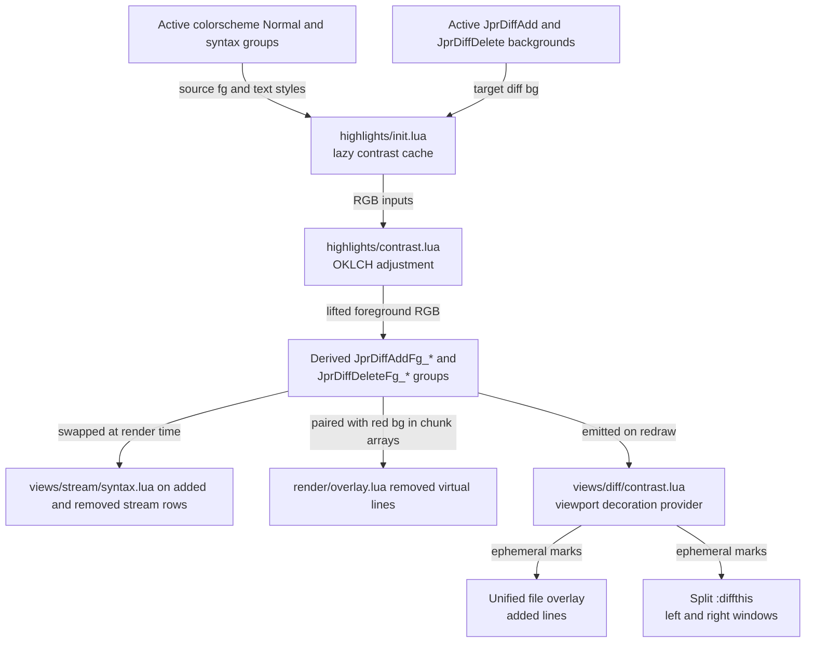
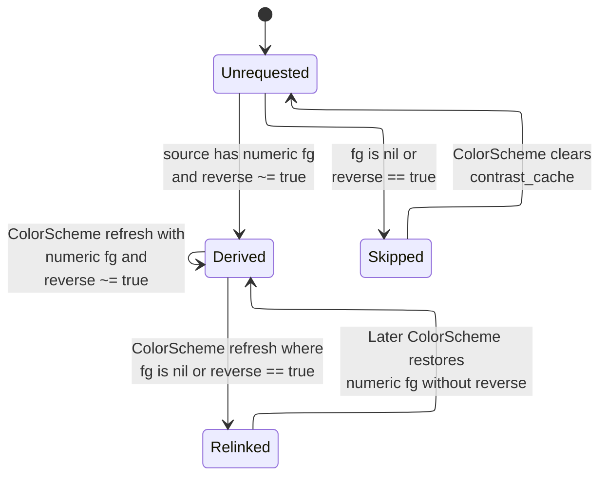
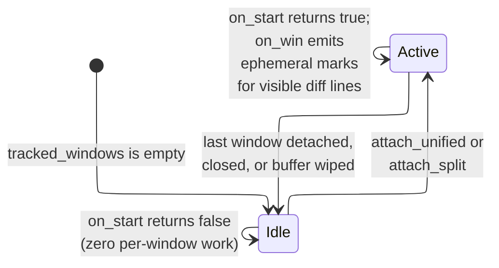

# Contrast-Aware Diff Foreground Highlighting

<small>

> <table border="0">
> <tr><th colspan="2">Files</th><th colspan="2">Lines</th></tr>
> <tr><td>Changed (total)</td><td>12</td><td>Insertions (+)</td><td>1,617</td></tr>
> <tr><td>Added</td><td>4</td><td>Deletions (-)</td><td>106</td></tr>
> <tr><td>Deleted</td><td>0</td><td>Net change</td><td>+1,511</td></tr>
> </table>

</small>

## 1. Purpose

Stronger green and red background tints on added and deleted diff lines made changed rows easier to spot, but reduced text legibility on those rows. Dim syntax tokens such as comments dropped close to background brightness, and same-hue tokens such as green strings on green added lines or red errors on red deleted lines blended into the background across both dark and light Neovim colorschemes.

This change:

- Computes higher-contrast foreground colors against green and red diff backgrounds while keeping each syntax color's hue fixed, updating automatically on colorscheme changes (§4).
- Applies higher-contrast syntax and plain-text foreground colors to added and removed rows in the diff stream<sup>G6</sup> while leaving context rows unchanged (§5).
- Raises text contrast on visible changed lines in unified file overlays<sup>G16</sup> and split diff windows<sup>G14</sup>, and syntax-highlights removed lines shown in unified overlays (§6).

## 2. Background technical context

```text
lua/jpr/
├── highlights/
│   ├── init.lua           (changed)
│   └── contrast.lua       (new)
├── render/
│   ├── overlay.lua        (changed)
│   └── stream.lua         (changed)
└── views/
    ├── diff/
    │   ├── init.lua       (changed)
    │   └── contrast.lua   (new)
    └── stream/
        ├── init.lua
        └── syntax.lua     (changed)
```

<small>

| Unit | What it is |
| --- | --- |
| `highlights/init.lua` | Defines `jpr`'s UI highlight groups<sup>G10</sup>, background-only diff tints, and lazy foreground contrast cache. `setup()`, review startup, and UI entry points call `define_highlights()`, and a `ColorScheme` autocommand refreshes its groups whenever the user switches colorschemes. |
| `highlights/contrast.lua` | Pure color-math module that adjusts a syntax foreground color for readability over a green or red diff background while keeping its hue fixed. Called only by `highlights/init.lua`. |
| `render/overlay.lua` | Pure formatter that converts one changed file's diff from the Rust engine into extmark<sup>G8</sup> placements and removed virtual lines<sup>G13</sup> for unified file overlays<sup>G16</sup>. Called by `views/diff/init.lua`. |
| `render/stream.lua` | Pure formatter that lays out every changed file from the Rust engine into one unified column or two aligned split columns for the scrolling diff stream<sup>G6</sup>. Returns the buffer lines, diff background placements, and per-line code records that `views/stream/init.lua` draws. |
| `views/diff/init.lua` | Turns any open changed-file buffer in a review tab into either an inline unified file overlay<sup>G16</sup> or a side-by-side split `:diffthis` view with a read-only base window. Calls `render/overlay.lua` to build unified overlays and attaches `views/diff/contrast.lua` to active diff windows. |
| `views/diff/contrast.lua` | Neovim decoration provider<sup>G4</sup> that lifts foreground contrast for visible diff lines inside active unified overlays and split diff windows<sup>G14</sup>. Also builds syntax highlight spans for removed virtual lines<sup>G13</sup> using `views/stream/syntax.lua` and `highlights/init.lua`. |
| `views/stream/init.lua` | Owns the scrolling diff stream<sup>G6</sup> buffers beside the review sidebar, writing the lines and the line-level (priority `100`) and changed-word (priority `110`) diff background extmarks<sup>G8</sup> built by `render/stream.lua`. Calls `views/stream/syntax.lua` after filling a buffer to paint syntax and contrast foregrounds beneath those backgrounds. |
| `views/stream/syntax.lua` | Applies per-file Treesitter<sup>G15</sup> syntax highlighting and contrast-lifted foreground groups to rendered diff stream<sup>G6</sup> buffers. Also exports its Treesitter line-parsing helper so `views/diff/contrast.lua` can highlight removed virtual lines<sup>G13</sup> the same way. |

</small>

## 3. Shape of the solution

All three diff rendering paths - the scrolling diff stream<sup>G6</sup>, removed virtual lines<sup>G13</sup> in unified overlays, and active unified or split diff windows<sup>G14</sup> - share one contrast-derivation layer while keeping the background-only diff highlight groups<sup>G10</sup> untouched. Neovim provides no render-time foreground brightness filter, so the plugin derives companion groups lazily from whatever colorscheme the user has loaded and attaches them at priorities that preserve syntax hierarchy, word-diff backgrounds<sup>G18</sup>, diagnostics, and search highlights.



> *One cached OKLCH<sup>G12</sup> contrast engine feeds all three diff rendering paths: the diff stream<sup>G6</sup> swaps highlight group<sup>G10</sup> names once at render time, removed virtual lines<sup>G13</sup> pair background and foreground groups in chunk<sup>G3</sup> arrays, and active file diff windows emit ephemeral marks<sup>G7</sup> strictly inside the visible viewport.*
>
> **Diagram key**
>
> | | |
> | --- | --- |
> | **fg / bg** | Foreground text color and background fill color of a Neovim highlight group<sup>G10</sup>. |
> | **OKLCH<sup>G12</sup>** | Perceptual color space separating lightness, chroma<sup>G2</sup>, and hue so contrast rises without shifting hue. |
> | **`JprDiffAdd` / `JprDiffDelete`** | Background-only diff highlight groups<sup>G10</sup> for green added and red deleted lines. |
> | **`JprDiffAddFg_*` / `JprDiffDeleteFg_*`** | Lazily derived foreground-only companion groups created per syntax group and diff kind. |
> | **decoration provider<sup>G4</sup>** | Neovim redraw hook (`nvim_set_decoration_provider`) that emits temporary marks only for visible rows. |
> | **ephemeral marks<sup>G7</sup>** | Redraw-only extmarks<sup>G8</sup> discarded automatically by Neovim after painting the current frame. |

The three strands depend on each other in order: §4 builds the color math and colorscheme-refreshed highlight cache, §5 wires that cache directly into the diff stream<sup>G6</sup> and extracts reusable Treesitter<sup>G15</sup> line-span collection, and §6 builds on both to cover unified overlays and split diff windows<sup>G14</sup> without scanning off-screen lines or stalling on minified files.

## 4. A shared foreground-contrast layer derives readable syntax highlight groups for any colorscheme

This strand provides the shared color engine and highlight-group cache that both the diff stream<sup>G6</sup> (§5) and file diff views (§6) call to obtain readable foreground groups for any active colorscheme.

### 4.1 Lifting syntax lightness in perceptual OKLCH space separates dim and same-hue tokens from diff backgrounds without shifting hue

To make syntax colors readable over tinted diff backgrounds without distorting a colorscheme's palette, `lua/jpr/highlights/contrast.lua` adjusts only lightness and clamps chroma<sup>G2</sup> only when needed to stay inside the sRGB gamut<sup>G9</sup>. Working in perceptual OKLCH<sup>G12</sup> separates a syntax color into lightness `L`, chroma `C`, and hue angle `H` [1]. Holding `H` fixed keeps each syntax token's hue recognizable, so green strings remain green and red keywords remain red instead of drifting toward yellow or magenta as they brighten.

**File: `lua/jpr/highlights/contrast.lua`**

```lua {5-8,10-13}
local function compute_target_lightness(fg_lightness, bg_lightness, bg_shift, same_hue, is_dark)
    local lift = bg_shift * 0.85 + 0.04 + 0.06 * same_hue
    local min_separation = 0.34 + 0.08 * same_hue
    if is_dark then
        local ceiling = math.max(0.96, fg_lightness)
        local headroom = math.max(0, 0.95 - fg_lightness)
        local lifted = fg_lightness + headroom * (1 - math.exp(-lift / math.max(0.08, headroom)))
        return math.min(ceiling, math.max(lifted, math.min(0.94, bg_lightness + min_separation)))
    end
    local floor = math.min(0.10, fg_lightness)
    local headroom = math.max(0, fg_lightness - 0.12)
    local darkened = fg_lightness - headroom * (1 - math.exp(-lift / math.max(0.08, headroom)))
    return math.max(floor, math.min(darkened, math.max(0.14, bg_lightness - min_separation)))
end
```

A raw WCAG 2.1<sup>G17</sup> ratio-preservation target [2] fails on tinted diff lines because the stronger word-diff background<sup>G18</sup> `JprDiffAddText` on a dark theme (`#31623f`, luminance `0.097`) has a physical maximum contrast of `7.12:1` against pure white; demanding a token's original contrast ratio against the editor background `Normal.bg` (`7:1` to `14:1`) would push bright syntax colors all the way to white (`C -> 0`). Instead, `compute_target_lightness` compensates for how far the diff background shifted lightness away from `Normal.bg` (`bg_shift = max(0, bg_lightness - original_background_lightness)` on dark themes, and `max(0, original_background_lightness - bg_lightness)` on light themes) using an exponential headroom curve that lifts dim tokens aggressively while compressing the shift for already-bright tokens. Anchoring `ceiling` to `math.max(0.96, fg_lightness)` on dark themes (and `floor` to `math.min(0.10, fg_lightness)` on light themes) prevents tokens already lighter than `0.96` or darker than `0.10`, such as `#ffffff`, `#f8f8f2`, and `#000000`, from being clamped back toward the background and losing contrast.

When both the syntax foreground and the diff background are chromatic (`chroma > 0.025`), `compute_hue_proximity` computes `same_hue` in `[0, 1]` from the angular distance between their hues, peaking at `1` at `0` degrees and tapering smoothly via cosine to `0` at `50` degrees or more, increasing both `lift` and `min_separation` for green-on-green and red-on-red tokens without shifting hue. If the lifted `(L, C, H)` lands outside the sRGB gamut<sup>G9</sup> `[0, 1]`, `M.oklch_to_rgb_clamped` runs a 10-step binary search on chroma<sup>G2</sup> in `[0, C]` at fixed `(L, H)` to keep the hue locked at maximum in-gamut colorfulness.

Worked example on `onedark` (`Normal.bg = #282c34`, dark theme) over `JprDiffAdd` (`#2e4e3b`) and `JprDiffDelete` (`#5a3539`):

| Token | Original RGB | Background | `same_hue` | Adjusted RGB | WCAG 2.1 contrast (before -> after) | Chroma (before -> after) |
| --- | --- | --- | --- | --- | --- | --- |
| Comment | `#5c6370` | `JprDiffAdd` | `0.00` | `#a1a9b7` | `1.53:1 -> 3.91:1` | `0.022 -> 0.022` |
| Normal | `#abb2bf` | `JprDiffAdd` | `0.00` | `#c8cfdd` | `4.34:1 -> 5.92:1` | `0.020 -> 0.020` |
| String (green) | `#98c379` | `JprDiffAdd` | `0.53` | `#b9e59a` | `4.59:1 -> 6.49:1` | `0.110 -> 0.110` |
| Error (red) | `#e06c75` | `JprDiffDelete` | `0.98` | `#ff9ea2` | `3.28:1 -> 5.32:1` | `0.145 -> 0.117` |

Tracing two rows through `compute_target_lightness` (with `Normal.bg` lightness `0.293`): for **Comment** (`fg_L = 0.498`, `bg_L = 0.393`, `bg_shift = 0.100`, `same_hue = 0.00`), the exponential curve gives `lifted = 0.608`, so the minimum separation floor `bg_L + 0.340 = 0.733` wins and produces `#a1a9b7`. For **Error** (`fg_L = 0.671`, `bg_L = 0.375`, `bg_shift = 0.083`, hue delta `4.1` degrees giving `same_hue = 0.98`), `lifted = 0.798` beats the boosted floor `0.794`, and `oklch_to_rgb_clamped` reduces chroma<sup>G2</sup> from `0.145` to `0.117` at fixed `(L, H)` to stay inside the sRGB gamut<sup>G9</sup> as `#ff9ea2`.

On light `github` (`Normal.bg = #fafafa`) over `JprDiffAdd` (`#c9e4ce`), green strings (`#116329`, `same_hue = 0.99`) darken to `#003a12` (`5.45:1 -> 9.59:1`) and comments (`#6e7781`) darken to `#515963` (`3.35:1 -> 5.23:1`). When `Normal.bg` is nil (transparent terminal), `adjust_fg_for_diff_bg` substitutes a default `Normal.bg` lightness of `0.25` (dark) or `0.96` (light) when computing `bg_shift`.

### 4.2 Companion foreground groups are created on first use and updated in place whenever the colorscheme changes

Once `lua/jpr/highlights/contrast.lua` computes an adjusted foreground color, `lua/jpr/highlights/init.lua` stores it as a derived group<sup>G5</sup> and keeps it synchronized across colorscheme switches. Moving `lua/jpr/highlights.lua` into `lua/jpr/highlights/init.lua` preserves `require("jpr.highlights")` and keeps the line and word-diff background<sup>G18</sup> groups (`JprDiffAdd`, `JprDiffAddText`, `JprDiffDelete`, `JprDiffDeleteText`) strictly background-only (`fg = nil`). Callers request `M.get_contrast_group(source_group, kind)` (`"add"` or `"delete"`), which creates a derived group on first use and caches it in `contrast_cache`.



> *Derived companion groups are created once per unique source highlight and diff kind, then updated in place on every `ColorScheme` event so open diff buffers never hold stale colors.*
>
> **Diagram key**
>
> | | |
> | --- | --- |
> | **`fg`** | Foreground color attribute of a Neovim highlight group<sup>G10</sup> (`~=` is Lua's not-equal operator). |
> | **`ColorScheme`** | Neovim event fired whenever the user or a plugin switches colorschemes. |
> | **`reverse`** | Neovim highlight attribute that swaps foreground and background colors; reversed sources are skipped. |
> | **`Relinked`** | Derived group<sup>G5</sup> linked back to its source (`{ link = entry.source }`) so existing marks fall back cleanly. |
> | **`contrast_cache`** | In-memory map from derived group<sup>G5</sup> name to derived name or `false`, rebuilt on every `ColorScheme` event (clearing skipped entries). |

`M.build_contrast_group_name` encodes every non-alphanumeric character in `source_group` as `_%02x` under prefix `JprDiffAddFg_` or `JprDiffDeleteFg_`, preventing collisions between punctuation-differing names such as `@a.b` and `@a_b`. Each derived group<sup>G5</sup> copies the 12 preserved non-background style attributes (`bold`, `italic`, `underline`, `undercurl`, `strikethrough`, `sp`, etc.), leaves `bg = nil`, and reads the active `JprDiffAdd.bg` or `JprDiffDelete.bg` so custom user diff overrides are honored automatically. When `define_highlights()` runs on `ColorScheme`, `refresh_contrast_highlights` hoists theme background resolution into one `create_theme_context()` call, recomputes every registered derived group in place, and relinks (`{ link = entry.source }`) any derived group whose source lost its `fg` or turned on `reverse` so existing extmarks<sup>G8</sup> in open diff buffers fall back cleanly to the source group instead of showing stale colors.

## 5. The diff stream paints contrast-lifted foreground groups once at render time on added and removed rows

This strand connects the highlight cache from §4 directly to rendered diff stream<sup>G6</sup> buffers so added and removed rows gain lifted contrast once at draw time with zero scroll-time callbacks.

In `lua/jpr/render/stream.lua`, `record_code_row` now records `change` (`"added"`, `"removed"`, or `"context"`) on each per-line code record (`column.code_rows`) passed to the syntax highlighter. In `lua/jpr/views/stream/syntax.lua`, `highlight_file_group` uses `change` in two passes while still skipping both passes on any file section with more than 5,000 code rows:

1. `apply_normal_fallbacks` runs before language lookup and paints `highlights.get_contrast_group("Normal", contrast_kind)` across the full rendered line (gutter plus code) at priority `85` on added and removed rows. Even files with unrecognized extensions receive lifted plain-text foregrounds without creating any Treesitter<sup>G15</sup> marks.
2. `apply_spans_to_rows` paints Treesitter<sup>G15</sup> captures from `M.collect_line_spans` at priority `90`, substituting `highlights.get_contrast_group(span.hl_group, contrast_kind)` on added and removed rows while leaving context rows on the colorscheme's original Treesitter `@capture` groups.

Because `JprDiffAdd`/`JprDiffDelete` (`priority = 100`) and the word-diff backgrounds<sup>G18</sup> `JprDiffAddText`/`JprDiffDeleteText` (`priority = 110`) remain background-only, Neovim merges the higher-priority diff backgrounds cleanly with the contrast-lifted foregrounds at priorities `85` and `90`. Because stream extmarks<sup>G8</sup> reference the derived group<sup>G5</sup> names, switching `:colorscheme` updates existing stream buffers automatically via §4.2 without re-parsing any file.

`M.get_language_from_filetype` and `M.collect_line_spans` (including Treesitter<sup>G15</sup> `#offset!` query directives that trim capture ranges via `vim.treesitter.get_range`) are exported from `lua/jpr/views/stream/syntax.lua` so the unified file overlay<sup>G16</sup> in §6 reuses the exact same Treesitter capture resolution.

## 6. Open file diff views apply derived contrast highlights across unified overlays and split diff windows

Unlike the rendered diff stream<sup>G6</sup> in §5, real file buffers in unified file overlays<sup>G16</sup> and split diff windows<sup>G14</sup> are highlighted by Neovim's own Treesitter<sup>G15</sup> highlighter, LSP semantic tokens<sup>G11</sup>, and legacy `:syntax`. This strand lifts foreground contrast on those real buffers strictly inside the visible viewport and adds syntax-highlighted contrast chunks<sup>G3</sup> to removed virtual lines<sup>G13</sup>.

### 6.1 A Neovim redraw hook paints temporary contrast highlights only for visible changed lines in active diff windows

To lift foreground contrast on real file buffers without scanning off-screen lines or drifting out of sync with unsaved edits, `lua/jpr/views/diff/contrast.lua` installs one Neovim decoration provider<sup>G4</sup> (`nvim_set_decoration_provider`) lazily on the first `attach_unified` or `attach_split` call, paired with `BufWipeout` and `WinClosed` cleanup autocommands on augroup<sup>G1</sup> `jpr-diff-contrast`.



> *When no `jpr` diff window is tracked, `on_start` returns `false` and the decoration provider<sup>G4</sup> performs zero per-window work across the rest of Neovim.*
>
> **Diagram key**
>
> | | |
> | --- | --- |
> | **`tracked_windows`** | Map of currently open `jpr` unified or split diff windows<sup>G14</sup> managed by the provider. |
> | **`attach_unified` / `attach_split`** | Functions that register a unified overlay<sup>G16</sup> or split diff window<sup>G14</sup> in `tracked_windows`. |
> | **`on_start` / `on_win`** | Redraw callbacks in Neovim's decoration provider<sup>G4</sup>; `on_start` gates the whole redraw pass and `on_win` marks one window's visible rows. |
> | **ephemeral marks<sup>G7</sup>** | Redraw-only extmarks<sup>G8</sup> (`ephemeral = true`) discarded automatically by Neovim after painting the frame. |

Inside `on_win(_, win, buf, topline, botline)`, the decoration provider<sup>G4</sup> returns `false` immediately for untracked windows, collects ephemeral mark<sup>G7</sup> specs for `[topline, botline]` via `M.collect_viewport_marks`, emits them with `ephemeral = true`, and returns `false` so Neovim skips per-line `on_line`/`on_range` callbacks. Visible diff rows are resolved differently per mode:

- **Unified overlay<sup>G16</sup>:** intersects `[topline, botline]` with `unified_lines_by_buf[buf]`, the map of 0-based added row numbers to `"add"` recorded during `diff_view.draw_overlay`. `prune_unreferenced_unified_buffer` retains `unified_lines_by_buf[buf]` while any other valid unified window still shows `buf`, and removes it once the last window detaches or the buffer wipes.
- **Split `:diffthis`:** Neovim evaluates `vim.fn.diff_hlID(lnum, col)` against the currently focused window rather than `win`, so `resolve_split_diff_kinds` wraps the lookup in `pcall(vim.api.nvim_win_call, win, ...)`, mapping `DiffAdd`, `DiffChange`, and `DiffText` to `"add"` and `DiffDelete` to `"delete"` because `SPLIT_DIFF_WINHIGHLIGHT` in `lua/jpr/views/diff/init.lua` remaps the first three to green `JprDiffAdd`/`JprDiffAddText` backgrounds and `DiffDelete` to the red `JprDiffDelete` background.

Every visible diff row exceeding `M.MAX_LINE_BYTES` (`1000`) is skipped completely (including the `Normal` fallback) to prevent stalls on minified files. Eligible rows receive ephemeral marks<sup>G7</sup> on a strict priority ladder aligned with Neovim's built-in `vim.hl.priorities`:

| Priority | Source | Effect |
| --- | --- | --- |
| `45` | `Normal` contrast fallback | Beats `Normal` base (`0`) while yielding to legacy regex `:syntax` (`50`), Treesitter<sup>G15</sup> (`100`), and LSP semantic tokens<sup>G11</sup> (`125`) |
| `115` | Treesitter<sup>G15</sup> contrast marks | Beats built-in Treesitter<sup>G15</sup> (`100`) while yielding to LSP semantic tokens<sup>G11</sup> (`125`) |
| `135` | LSP semantic-token contrast marks | Beats LSP semantic tokens<sup>G11</sup> (`125`) while yielding to diagnostics (`150`) and user/search marks (`200`) |

Two guards keep redraws accurate and non-blocking:

1. **Avoiding synchronous re-parses during async Treesitter<sup>G15</sup> highlighting:** `append_treesitter_marks` calls `tree:parse({ topline, botline + 1 })` only when Neovim's async highlighter is not already parsing (`not active_highlighter.parsing`) and the visible range is invalid (`not tree:is_valid(false, { topline, 0, botline + 1, 0 })`), preventing redraw stalls during background parses; it also skips nil trees and embedded-language child trees whose root range lies outside `[topline, botline]`.
2. **Clamping multi-line LSP semantic tokens<sup>G11</sup> to the visible viewport:** `append_lsp_marks` restricts `vim.api.nvim_get_namespaces()` to LSP namespaces (`semantic_tokens`, `nvim.lsp.*`, `vim.lsp.*`), queries `nvim_buf_get_extmarks` with `overlap = true` so multi-line tokens starting above `topline` are returned, and resets `start_col` to `0` when a token starts above `topline` and `end_col` to `botline`'s full byte length when it ends below `botline` (`append_clamped_span`), preventing an off-screen `end_col` from cutting off highlighting partway through the last visible line.

### 6.2 Deleted lines shown as virtual lines in unified overlays combine changed-word backgrounds and syntax colors in one sorted sweep

Because deleted lines no longer exist in the working file buffer, unified file overlays<sup>G16</sup> draw them as removed virtual lines<sup>G13</sup> (`virt_lines`) above or below their anchor line. `diff_view.draw_overlay` now passes `removed_fg_group` (the `Normal` delete-contrast fallback) and `diff_contrast.build_removed_syntax_by_block(buf, diff)` (per-block Treesitter<sup>G15</sup> spans already mapped to `JprDiffDeleteFg_*` derived groups<sup>G5</sup>) into `overlay.create_extmarks_from_diff`.

`build_removed_syntax_by_block` filters out removed lines exceeding `MAX_LINE_BYTES` (`1000`) before parsing and caps total parsed removed lines across all blocks at `MAX_REMOVED_SYNTAX_LINES` (`500`). Oversized lines and unknown filetypes still receive `removed_fg_group` without parsing.

**File: `lua/jpr/render/overlay.lua`**

```lua {2-4,10-12,14-17}
local function append_styled_removed_chunks(removed, opts, add_chunk)
    local boundaries = collect_sorted_boundaries(#removed.text, removed.words, opts.syntax_spans)
    local sorted_words = sort_words_by_start(removed.words)
    local sorted_spans = sort_syntax_spans(opts.syntax_spans)
    local word_index, span_index, active_spans = 1, 1, {}
    for index = 1, #boundaries - 1 do
        local segment_start = boundaries[index]
        local segment_end = boundaries[index + 1]
        if segment_end > segment_start then
            while word_index <= #sorted_words and sorted_words[word_index]["end"] <= segment_start do
                word_index = word_index + 1
            end
            ...
            local bg_group = is_changed_word and "JprDiffDeleteText" or "JprDiffDelete"
            local resolved_fg = pick_active_syntax_fg(active_spans, segment_start, opts.fg_group)
            local highlight = resolved_fg and { bg_group, resolved_fg } or bg_group
            add_chunk(removed.text:sub(segment_start + 1, segment_end), highlight)
        end
    end
end
```

When neither `opts.fg_group` nor `opts.syntax_spans` is passed, `M.removed_line_to_chunks` keeps its original word-only path unchanged. When either is present, `append_styled_removed_chunks` merges two sets of byte intervals on `removed.text`: changed-word ranges (`removed.words`, painted with `JprDiffDeleteText`) and contrast-lifted Treesitter<sup>G15</sup> syntax ranges (`opts.syntax_spans`). It collects every unique start and end offset, sorts boundaries, words, and spans in `O((W + S) log(W + S))` time, and makes one forward sweep across adjacent boundary pairs using a monotonic `word_index` and an `active_spans` list. On each segment, `pick_active_syntax_fg` drops expired spans and chooses the active span with the highest original Treesitter capture order (so an inner capture overrides an outer one and restores the outer one once it ends), falling back to `opts.fg_group` when no span is active, and emits a Neovim multi-group chunk<sup>G3</sup> `{ text, { bg_group, resolved_fg } }` that layers both highlight groups<sup>G10</sup> on the same text slice. For example, on `foo(bar, 1)` with changed word `[4, 7)` (`bar`) and nested syntax spans `Outer [0, 11)` (order `1`) and `Inner [4, 7)` (order `2`), the sorted boundaries `[0, 4, 7, 11]` produce three chunks: `("foo(", {JprDiffDelete, Outer})`, `("bar", {JprDiffDeleteText, Inner})`, and `(", 1)", {JprDiffDelete, Outer})`.

## 7. Interface changes

Screenshot capture is blocked because `jpr-nvim` is a headless-tested terminal Neovim plugin with no web UI or GUI capture harness in this environment.

```text
+------------------+---------------------------------------------------+
| Review Sidebar   | 1) Diff Stream (unified; split adds left base)    |
| ▾ src/           |   12  12   local keep = 1   [raw theme fg]        |
|   app.lua +2 -1  |   13     - local old = 7    [red bg + lifted fg]  |
|                  |       13 + local new = 42   [grn bg + lifted fg]  |
|                  |   ^gutter (line nums + +/-)                       |
|                  +---------------------------------------------------+
|                  | 2) Unified File Overlay (open file buffer)        |
|                  |   local old = 7   [virt_line: red bg + TS/Normal] |
|                  |   local new = 42  [buffer: grn bg + TS/LSP lift]  |
|                  +---------------------------------------------------+
|                  | 3) Split :diffthis (two side-by-side windows)     |
|                  |   Left (base_win)       | Right (working buffer)  |
|                  |   local old = 7 [lifted]| local new = 42 [lifted] |
+------------------+---------------------------------------------------+
Key:
  grn/red bg   JprDiffAdd / JprDiffDelete (word bg: JprDiffAddText / JprDiffDeleteText)
  lifted fg    Derived JprDiffAddFg_* / JprDiffDeleteFg_* companion foreground group
  TS / LSP     Treesitter (100 -> 115) and LSP semantic tokens (125 -> 135)
  Stream stack Normal(85) < TS(90) < LineBg(100) < WordBg(110)
  File stack   Normal(45) < :syntax(50) < TS(100) < ContrastTS(115)
               < LSP(125) < ContrastLSP(135) < Diagnostics(150) < User(200)
```

## 8. Decisions

- **Adjusting syntax foreground lightness in perceptual OKLCH<sup>G12</sup> space with diminishing lift near white or black and an extra boost within 50 degrees of the diff tint's hue was chosen over raw WCAG 2.1<sup>G17</sup> contrast-ratio matching and flat RGB brightness scaling.** Raw WCAG 2.1 matching against `JprDiffAddText` saturates bright tokens to white because the dark green word-diff background<sup>G18</sup> caps contrast at `7.12:1`, while flat RGB multiplication shifts hues and barely moves dark comments. Revisit if Neovim introduces a native per-cell contrast or blend highlight attribute.
- **Creating separate foreground-only derived groups<sup>G5</sup> (`JprDiffAddFg_*` / `JprDiffDeleteFg_*`) on first use for each syntax group was chosen over setting `fg` directly on `JprDiffAdd` / `JprDiffDelete`.** Setting `fg` on the diff line groups overrides syntax colors across Neovim, whereas derived foreground-only groups keep `JprDiff*` background-only and refresh automatically on `ColorScheme`. Revisit only if a future Neovim highlight flag allows relative foreground transforms directly on `JprDiff*`.
- **A Neovim redraw hook (decoration provider<sup>G4</sup>) that emits frame-only ephemeral marks<sup>G7</sup> only for visible changed lines in active `jpr` diff windows was chosen over per-column `vim.inspect_pos` and static full-buffer extmarks<sup>G8</sup>.** Calling `vim.inspect_pos` per character stutters during scroll, and static extmarks drift during unsaved edits and asynchronous `LspTokenUpdate` refreshes. Revisit if reviewers require per-token contrast lifting for legacy regex `:syntax` files that have no Treesitter<sup>G15</sup> parser.
- **Skipping diff lines over 1,000 bytes and capping removed virtual-line syntax parsing at 500 total lines, paired with a sorted-boundary highlight-chunk<sup>G3</sup> sweep, was chosen over unbounded parsing and quadratic chunk splitting.** Unbounded Treesitter<sup>G15</sup> parsing and quadratic chunk splitting stall Neovim for seconds on minified bundles; capped removed virtual lines<sup>G13</sup> still retain `Normal`-lifted foreground contrast, while oversized visible lines in active file diff viewports skip contrast lifting altogether. Revisit if a specific workflow needs syntax contrast on long generated single-line files.

## 9. Deliberately not handled

- **Per-token contrast lifting for legacy regex `:syntax`:** Files without a Treesitter<sup>G15</sup> parser keep their original `:syntax` tokens at priority `50`, while uncaptured plain text lifts at priority `45`.
- **User-configurable contrast strength in `setup()`:** Contrast adjustment adapts automatically to the active colorscheme and any custom `JprDiffAdd`/`JprDiffDelete` overrides without adding new config keys or CLI flags.
- **Minified lines over `1,000` bytes and removed virtual-line blocks past `500` total lines:** In active file diff viewports, visible lines over `1,000` bytes are skipped entirely (including the `Normal` fallback); in unified removed virtual lines<sup>G13</sup>, lines over `1,000` bytes or past the `500`-line parse cap skip Treesitter<sup>G15</sup> syntax parsing while retaining the `Normal` contrast-lifted foreground.

## 10. Sources

[1] B. Ottosson, "A perceptual color space for image processing," 2020. https://bottosson.github.io/posts/oklab/
[2] W3C, "Web Content Accessibility Guidelines (WCAG) 2.1 - Relative Luminance and Contrast Ratio," 2018. https://www.w3.org/TR/WCAG21/#dfn-contrast-ratio

<div style="page-break-before: always"></div>

## Appendix A. Manual testing

<small>

1. From the repository root, with at least one modified tracked file in the working tree (for example a temporary edit to a comment or string in a `.lua` file), launch Neovim with this repository on `runtimepath`:

   ```sh
   nvim --cmd 'set rtp+=.'
   ```

2. Inside Neovim, open a local review:

   ```vim
   :Jpr local
   ```

3. Inspect added (`+`) and removed (`-`) rows in the **diff stream<sup>G6</sup>** (both unified and split via `:Jpr toggle`):
   - **Before this change:** comments and same-hue tokens (green strings on `+` rows, red tokens on `-` rows) dimmed against the stronger green and red backgrounds.
   - **Now:** syntax hues remain recognizable while comments, plain text, and same-hue tokens lift cleanly off both line and changed-word backgrounds; context rows stay unchanged.
4. Open a changed file from the sidebar or diff stream<sup>G6</sup> (`<CR>`) in **unified file overlay<sup>G16</sup>** mode: confirm added lines show lifted Treesitter<sup>G15</sup> and LSP semantic-token foregrounds, and removed virtual lines<sup>G13</sup> above hunks display syntax-highlighted contrast-lifted text.
5. Run `:Jpr toggle` on the file to switch to **split `:diffthis`** mode: confirm both the left base window and right file window lift foreground contrast on changed lines while leaving equal lines unchanged.
6. Switch between dark and light colorschemes (for example `:colorscheme habamax` then `:set background=light | colorscheme shine`) while the diff stream<sup>G6</sup> and split diff windows<sup>G14</sup> remain open: confirm foreground contrast adapts automatically in place without stale colors.
7. Run the full Rust and Lua verification suite from the repository root and confirm every spec prints `ok`:

   ```sh
   just check
   ```

8. To verify the OKLCH<sup>G12</sup> math, stream syntax swapping, removed virtual-line chunk<sup>G3</sup> merging, and decoration provider<sup>G4</sup> priority ladder directly (including edge cases like minified lines over `1,000` bytes and multi-line LSP tokens that are tedious to trigger by hand), run each targeted Lua spec and confirm each prints `ok`:

   ```sh
   nvim --headless -u NONE -i NONE -l tests/lua/highlights_contrast_spec.lua
   ```

   ```sh
   nvim --headless -u NONE -i NONE -l tests/lua/stream_syntax_spec.lua
   ```

   ```sh
   nvim --headless -u NONE -i NONE -l tests/lua/overlay_render_spec.lua
   ```

   ```sh
   nvim --headless -u NONE -i NONE -l tests/lua/diff_contrast_spec.lua
   ```

</small>

<div style="page-break-before: always"></div>

## Appendix B. Glossary

<small>

| Term | Meaning |
| --- | --- |
| **G1** Augroup | A named Neovim autocommand group that lets a plugin clear and re-register its event handlers together without leaving duplicate callbacks behind. |
| **G2** Chroma | The perceived colorfulness axis (`C`) of a color in OKLCH<sup>G12</sup> space, starting at `0` for neutral gray. Keeping chroma above zero prevents brightened syntax tokens from washing out to white or gray. |
| **G3** Chunk | One `{ text, highlight }` slice inside a Neovim virtual line<sup>G13</sup> (`virt_lines`). Passing a two-element highlight list `{ bg_group, fg_group }` applies both highlight groups<sup>G10</sup> to the same text slice. |
| **G4** Decoration provider | A Neovim redraw hook registered via `nvim_set_decoration_provider` whose `on_start` and `on_win` callbacks paint temporary highlights for visible window ranges during each screen redraw. |
| **G5** Derived group (companion group) | A foreground-only highlight group<sup>G10</sup> (`JprDiffAddFg_*` or `JprDiffDeleteFg_*`) created on first use from an active syntax group so text stays legible over green or red diff backgrounds. It preserves text styles such as `bold` and `italic`, leaves `bg` unset, and updates in place on `ColorScheme` events. |
| **G6** Diff stream | The scrolling review buffer beside the review sidebar that displays every changed file's hunks in one unified column or two aligned split columns. |
| **G7** Ephemeral mark | A Neovim extmark<sup>G8</sup> created with `ephemeral = true` inside a decoration provider<sup>G4</sup> that exists only for the current redraw frame and is discarded automatically afterward, so it never drifts during edits. |
| **G8** Extmark | A Neovim buffer annotation (`nvim_buf_set_extmark`) that attaches highlight groups<sup>G10</sup>, virtual lines, or inline text to byte offsets with an explicit stacking priority. |
| **G9** Gamut | The finite set of colors a standard 24-bit sRGB display can reproduce (linear red, green, and blue channels within `[0, 1]`). Colors lifted outside it have their chroma<sup>G2</sup> binary-searched downward at fixed lightness and hue until they fit. |
| **G10** Highlight group | A named Neovim style entry (`Normal`, `@string`, `JprDiffAdd`) defining foreground color (`fg`), background color (`bg`), and text attributes (`bold`, `italic`, `reverse`). Leaving `fg` unset makes a group color only the background so lower-priority foreground groups show through. |
| **G11** LSP semantic token (semantic token) | A symbol highlight published by a language server into Neovim as an `@lsp.*` extmark<sup>G8</sup> at priority `125`, overriding Treesitter<sup>G15</sup> syntax highlights (`100`) with scope- and type-aware colors. |
| **G12** OKLCH | A perceptual cylindrical color space separating lightness (`L`), chroma<sup>G2</sup> (`C`), and hue angle (`H`). Adjusting `L` while holding `H` constant raises contrast without shifting green strings toward yellow or red tokens toward magenta. |
| **G13** Removed virtual line (virtual line) | A deleted line rendered inside a unified file overlay<sup>G16</sup> via Neovim's `virt_lines` extmark<sup>G8</sup> option above or below an anchor line, because deleted lines no longer exist in the working file buffer. |
| **G14** Split diff window | One side of a side-by-side Neovim `:diffthis` view pairing a read-only base window on the left with the working file buffer on the right. |
| **G15** Treesitter | Neovim's built-in incremental syntax parser and highlight-query engine, which maps syntax captures to `@capture` highlight groups<sup>G10</sup> at priority `100`. |
| **G16** Unified file overlay (unified overlay) | The review view that draws added-line tints, changed-word highlights, and removed virtual lines<sup>G13</sup> directly onto the real open file buffer via extmarks<sup>G8</sup>. |
| **G17** WCAG 2.1 (WCAG) | The Web Content Accessibility Guidelines 2.1 relative-luminance contrast ratio formula (ranging from `1:1` to `21:1`) used here to verify foreground legibility against diff backgrounds. |
| **G18** Word-diff background | The stronger inline highlight (`JprDiffAddText` or `JprDiffDeleteText`) painted behind specific changed words inside an added or deleted diff line. |

</small>
