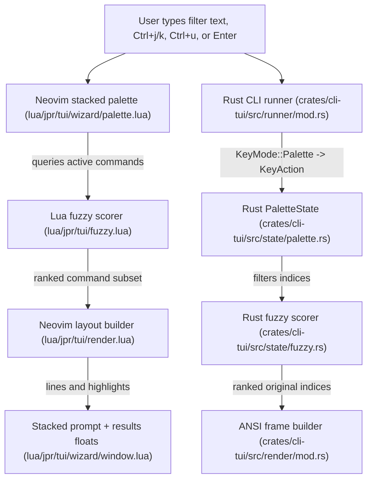
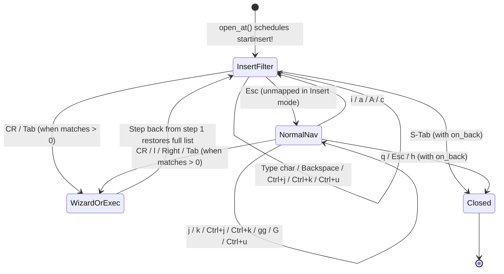

# Filterable Command Palette Walkthrough

<small>

> <table border="0">
> <tr><th colspan="2">Files</th><th colspan="2">Lines</th></tr>
> <tr><td>Changed (total)</td><td>26</td><td>Insertions (+)</td><td>1,269</td></tr>
> <tr><td>Added</td><td>3</td><td>Deletions (-)</td><td>191</td></tr>
> <tr><td>Deleted</td><td>0</td><td>Net change</td><td>+1,078</td></tr>
> </table>

</small>

## 1. Purpose

Opening the command palette in Neovim (`:Jpr` or `<leader>J`) or in the terminal (`jpr-review`) previously presented a static Normal-mode menu. With up to 16 commands available in an active pull request review session, reaching a command near the bottom required repeatedly pressing `j` or `k` instead of typing two or three letters to jump directly to it.

This change:

- Adds a shared deterministic fuzzy scorer in Lua and Rust that ranks commands by label and `[id]` (§4).
- Replaces the Neovim single-window command palette with a stacked two-window modal that opens in Insert mode and filters live as you type (§5).
- Adds live type-to-filter input, `Ctrl+j`/`Ctrl+k` list movement, and `Ctrl+u` full-line filter clearing to the Rust CLI `jpr-review` command palette (§6).
- Updates the in-editor keyboard shortcuts cheatsheet and repository documentation to reflect the new palette controls (§7).

## 2. Background technical context

The command palette exists in two separate frontends that follow the same declarative command schema invariant: a Neovim Lua plugin under `lua/jpr/` and a pure-Rust terminal UI crate under `crates/cli-tui/`.

```text
lua/jpr/
  commands/schema/init.lua     declares all 16 :Jpr commands and their steps
  tui/schema.lua               validates schemas and filters executable commands
  tui/render.lua               pure layout builder for palette and wizard buffers
  tui/wizard/
    init.lua                   modal lifecycle controller (open, close, step-back)
    window.lua                 floating window geometry, extmarks, and painting
    palette.lua                command palette keybindings and rendering loop
    step_text.lua              Insert-mode text wizard step pattern
  views/cheatsheet.lua         floating :Jpr keys shortcuts modal

crates/cli-tui/src/
  schema/mod.rs                CommandSpec and StepSpec definitions
  state/
    mod.rs                     KeyAction enum and state exports
    palette.rs                 pure top-level palette state machine
  runner/
    keys.rs                    crossterm KeyEvent to KeyAction translation
    mod.rs                     raw-mode terminal event loop
  render/
    mod.rs                     pure ANSI frame builder for render_palette
    wizard.rs                  wizard frame builder including format_text_input
```

| Module | Role before this change |
| --- | --- |
| `lua/jpr/tui/schema.lua` | Filters `:Jpr` commands down to the currently executable subset via `get_active_commands(commands, context)`. |
| `lua/jpr/tui/wizard/init.lua` | Tracks one active floating modal (`active_state`) with `buf` and `win`, closes it on `WinClosed`/`BufWipeout`, and restores focus to `origin_win`. |
| `lua/jpr/tui/wizard/step_text.lua` | Establishes the Neovim Insert-mode modal pattern: schedules `startinsert!` on open and leaves `<Esc>` unmapped in Insert mode so `<Esc>` drops to Normal mode before `q`/`<Esc>` closes. |
| `crates/cli-tui/src/runner/mod.rs` | Drives `PaletteState` and `WizardState` in a raw-mode stderr loop while keeping `cli-tui` free of Neovim or Lua dependencies. |

## 3. Shape of the solution

Both frontends split the command list into an unfiltered executable source list and a live filtered projection driven by the user's query string. The two implementations share the same scoring rules and tie-breaking order while staying independent at the dependency boundary: Lua drives Neovim floating windows, and `cli-tui` renders pure ANSI terminal frames.



> *Both frontends keep fuzzy scoring pure and separate from UI rendering so ranking stays identical and unit-testable without a live terminal or window manager.*

## 4. Shared deterministic fuzzy matching across Neovim and CLI

This strand establishes the scoring rules shared by `lua/jpr/tui/fuzzy.lua` and `crates/cli-tui/src/state/fuzzy.rs` so typing the same characters produces the same ranking in both Neovim and `jpr-review`.

### 4.1 Subsequence scoring and exact-id precedence

**File: `lua/jpr/tui/fuzzy.lua`**

```lua {1-9}
local function score_matched_character(haystack, matched_index, previous_match_index)
    local delta = BASE_MATCH_SCORE
    if matched_index == 1 then
        return delta + START_OF_TEXT_BONUS
    end
    if previous_match_index ~= nil and matched_index == previous_match_index + 1 then
        return delta + CONSECUTIVE_BONUS
    end
    if is_word_separator(haystack:byte(matched_index - 1)) then
        delta = delta + WORD_BOUNDARY_BONUS
    end
    if previous_match_index ~= nil then
        delta = delta - (matched_index - previous_match_index - 1)
    end
    return delta
end
```

Each matched character earns a base score of `10`, plus `20` at the start of the string, `15` when immediately following the previous match, or `12` when following a word separator (` `, `-`, `_`, `/`), minus `1` per skipped character between non-adjacent matches. Every command is scored against both `label` and `id` case-insensitively; if the query matches `id` verbatim, the `id` score adds `100` before taking `max(label_score, id_score)`.

Worked example for query `"open"` against three commands:

1. `Open Pull Request` `[open]`: `id` matches verbatim (`30 + 25 + 25 + 25 + 100 = 205`), `label` scores `105`; final score `205`.
2. `Open Stream View` `[stream]`: `label` matches at index 1 (`30 + 25 + 25 + 25 = 105`), `id` does not match; final score `105`.
3. `Open PR Conversation` `[conversation]`: `label` matches at index 1 (`105`), `id` does not match; final score `105`.

Sorting by descending score and ascending original schema index places `[open]` first, followed by `[stream]` and `[conversation]` in their original order. Empty or whitespace-only queries (`""`, `"   "`) bypass scoring and return all commands in original schema order, preserving the default palette ordering on open and after `<C-u>`.

## 5. Stacked two-window live-filterable command palette in Neovim

This strand covers how the Neovim `:Jpr` palette stays scrollable on small viewports while accepting live Insert-mode typing and preserving Neovim modal controls.

### 5.1 Two stacked floating windows instead of virtual lines

`window.create_palette_windows` opens a 1-line editable prompt buffer (`filetype = "jpr-tui-input"`, `modifiable = true`) directly above a read-only results buffer (`filetype = "jpr-tui"`, `cursorline = true`, `wrap = false`). `create_palette_stack_geometry` centers the combined height (`prompt_outer = 3` plus `results_height + 2`) inside `vim.o.lines`, clamping the results height so both windows remain visible on short viewports. `paint_palette_prompt_decorations` attaches an inline `> ` prefix and an end-of-line `"Type to filter commands..."` placeholder in `JprMuted` whenever line 1 is empty.

### 5.2 Insert-mode filtering, textlock safety, and modal lifecycle



> *Leaving `<Esc>` unmapped in Insert mode drops the user into Normal mode first; a second `<Esc>` or `q` closes both windows and restores focus to `origin_win`.*

Two Neovim-specific constraints shaped `lua/jpr/tui/wizard/palette.lua`:

- **Buffer attach under textlock:** Neovim's `nvim_buf_attach` `on_lines` callback fires synchronously during edits while textlock forbids calling `nvim_buf_set_lines` on any buffer (`E565`). `register_prompt_filter_autocmds` therefore schedules `sync_filter_from_prompt` from `on_lines`, also listens to `TextChangedI` and `TextChanged`, and runs `sync_filter_from_prompt` synchronously at the start of every navigation or confirm action so rapid typing followed immediately by `<CR>` always activates the latest filtered match.
- **Full-line `<C-u>` clearing and multiline paste folding:** Vim's built-in Insert-mode `<C-u>` stops deleting at the column where Insert mode began. Mapping `<C-u>` explicitly in both Insert and Normal modes to `clear_filter_input` replaces the entire prompt buffer with `{ "" }`, moves the cursor to `{ 1, 0 }`, and repaints the full executable command list. If a user pastes multiline text into the prompt, `read_single_line_query` folds all lines into one space-separated line via `render.to_single_line`.

When the user activates a multi-step command from a filtered view, `activate_palette_command` passes `state.all_commands` and the command's index in `state.all_commands` to `controller.open_command`, so stepping back from step 1 restores the full unfiltered palette with that command selected. In `lua/jpr/tui/wizard/init.lua`, `handle_external_close`, `detach_current_window`, and `M.is_open` track both `prompt_win`/`prompt_buf` and `win`/`buf` so closing either window externally tears down its sibling and restores `origin_win`.

## 6. Type-to-filter command palette in Rust `cli-tui`

This strand brings the same live fuzzy filtering and `Ctrl+j`/`Ctrl+k`/`Ctrl+u` shortcuts to the terminal `jpr-review` command palette while leaving wizard stepper steps untouched.

- **Dedicated palette key mode (`crates/cli-tui/src/runner/keys.rs`):** Replaces the boolean `is_text_input` flag with `KeyMode { Menu, Text, Palette }`. `KeyMode::Palette` maps `Ctrl+j`/`Down` to `KeyAction::Down`, `Ctrl+k`/`Up` to `KeyAction::Up`, `Ctrl+u` to `KeyAction::ClearLine`, `Enter`/`Tab` to `KeyAction::Confirm`, `Esc`/`Ctrl+c` to `KeyAction::Cancel`, cursor/delete keys to line editing, and unmodified printable characters (including `j`, `k`, `q`) to `KeyAction::Char`.
- **Filtered navigation over original indices (`crates/cli-tui/src/state/palette.rs`):** `PaletteState` stores `query`, `cursor_char_index`, and `selected_index`. Any edit to `query` resets `selected_index` to `0`; `Up`/`Down`/`First`/`Last` wrap within `filtered_command_indices(commands)`; and `Confirm` returns `PaletteAction::Selected(filtered_indices[self.selected_index])`, translating back to the original slice index for `runner/mod.rs`. Returning from a wizard step back to the palette calls `palette_state.clear_query()`.
- **Shared input line rendering (`crates/cli-tui/src/render/mod.rs`):** `render_palette` reuses `format_text_input` (promoted to `pub(super)` in `render/wizard.rs`) to draw `> <query>` with placeholder `"Type to filter commands..."` above the filtered command rows, renders `"  (no matching commands)"` when a non-blank query matches nothing, and updates the footer hints.

## 7. Interface changes

Browser screenshots are not applicable because this project is a Neovim plugin and terminal CLI with no web frontend. The ASCII wireframes below show the updated layouts.

Neovim stacked command palette (`:Jpr` or `<leader>J`):

```text
╭─────────────────────── Jpr Commands ───────────────────────╮
│ > diff                                                     │
╰────────────────────────────────────────────────────────────╯
╭────────────────────────────────────────────────────────────╮
│ ▸ Switch Diff View  [toggle]                               │
│     Choose between unified inline diffs and side-by-side   │
│     split diffs for review buffers.                        │
│   Open Stream View  [stream]                               │
│                                                            │
│ [type] filter  [C-j/k] move  [C-u] clear  [Enter] select … │
╰────────────────────────────────────────────────────────────╯
```

Rust CLI command palette (`jpr-review` on a TTY):

```text
jpr-review Commands
> chk

▸ Check Out Pull Request  [checkout]
    Checks out a pull request branch into a local worktree.

[type] filter  [Ctrl+j/k] move  [Ctrl+u] clear  [Enter] select  [Esc] close
```

`lua/jpr/views/cheatsheet.lua` (`:Jpr keys`) also adds explicit rows under **Command Palette & Steppers** for `Type (palette)`, `<C-j> / <C-k>`, and `<C-u>`.

## 8. Decisions

- **Use a stacked two-window floating modal in Neovim instead of a single window with virtual lines.** A single window rendering command rows as `virt_lines` below line 1 cannot scroll on short viewports and cannot highlight the hovered row with `cursorline`. Two stacked windows preserve native scrolling, `cursorline`, and buffer isolation at the cost of dual-window cleanup guards. Reverse only if Neovim adds scrollable virtual lines with native `cursorline` support.
- **Let `<Esc>` drop from Insert mode to Normal mode first in Neovim instead of closing immediately.** Closing on the first `<Esc>` would break Neovim modal muscle memory and diverge from `:Jpr` text wizard steps (`step_text.lua`). Keeping `<Esc>` -> Normal mode lets users press `j`/`k`/`gg`/`G`/`q`/`<Esc>` in Normal mode while still supporting `<C-j>`/`<C-k>`/`<C-u>`/`<CR>` directly in Insert mode. Reverse if users report wanting single-`<Esc>` dismissal.
- **Implement a small dependency-free subsequence scorer in both Lua and Rust instead of calling `vim.fn.matchfuzzy` or adding a Rust crate.** Keeping the scorer pure in both languages guarantees identical ranking across Neovim and CLI, avoids external dependencies, and keeps `lua/jpr/tui/fuzzy.lua` testable without editor state. Reverse if fuzzy matching expands to large file lists requiring C/SIMD speed.
- **Map `<C-u>` explicitly to clear the whole prompt buffer instead of relying on Vim's default Insert-mode `<C-u>`.** Vim's default Insert `<C-u>` stops at the column where Insert mode began, so exiting and re-entering Insert mode would leave earlier filter text behind. Explicit buffer clearing guarantees `<C-u>` always clears the entire filter input.

## 9. Deliberately not handled

- Wizard stepper menus (`select`, `toggle`, `async_select`) and long async pickers (`:Jpr open` PR list, repository picker) keep their existing Normal-mode navigation rather than adding type-to-filter.
- Direct Ex commands (`:Jpr <subcommand>`), command aliases (`review`, `self`), and CLI non-interactive flags are unchanged.

<div style="page-break-before: always"></div>

## Appendix A. Manual testing

<small>

1. From the repository root, run the full formatting, lint, Rust test, and Lua test suite:

   ```sh
   just check
   ```

   Confirm every Rust test and every `*_spec.lua` script passes with exit code 0.
2. Open Neovim inside the repository and run `:Jpr` (or press `<leader>J`). Confirm two stacked rounded floating windows appear: a 1-line prompt window (`> Type to filter commands...`) focused in Insert mode on top, and the executable command list below.
3. Type:

   > key

   Confirm **Keyboard Shortcuts** `[keys]` moves to the top of the results list with its helper text underneath.
4. Press `<Esc>` once. Confirm the palette remains open in Normal mode. Press `A` to re-enter Insert mode and press `<C-u>`. Confirm the entire `key` filter is cleared and all executable commands reappear.
5. While in Insert mode, press `<C-j>` and `<C-k>`. Confirm selection moves down and up through the command list and swaps the hover helper text.
6. Press `<Esc>` twice (or `<Esc>` then `q`). Confirm both floating windows close and focus returns to your original editor window.
7. In a terminal, launch the Rust CLI command palette:

   ```sh
   cargo run -p jpr-review
   ```

   Type `chk`, confirm **Check Out Pull Request** `[checkout]` is highlighted, press `Ctrl+u` to clear the filter, navigate with `Ctrl+j`/`Ctrl+k`, and press `Esc` to exit cleanly.

</small>

<div style="page-break-before: always"></div>

## Appendix B. Glossary

1. **Command Palette:** The top-level interactive menu opened by bare `:Jpr` (`<leader>J`) in Neovim or bare `jpr-review` on a TTY, listing available subcommands and launching their steppers.
2. **Executable-only pre-filtering:** Filtering `:Jpr` commands via `schema.get_active_commands` when the palette opens so only commands valid for the current tab, repository, and cursor view appear before fuzzy filtering runs.
3. **Stacked two-window modal:** Two vertically adjacent Neovim floating windows centered as one unit: a 1-line editable prompt buffer (`jpr-tui-input`) on top and a read-only scrollable results buffer (`jpr-tui`) below.
4. **Textlock:** Neovim's internal guard during buffer-change callbacks (`on_lines`) that raises `E565` if a callback synchronously mutates buffer lines.
5. **`KeyMode::Palette`:** The `cli-tui` key-translation mode that routes printable characters to the filter query, `Ctrl+j`/`Ctrl+k` to list movement, and `Ctrl+u` to `KeyAction::ClearLine`.
