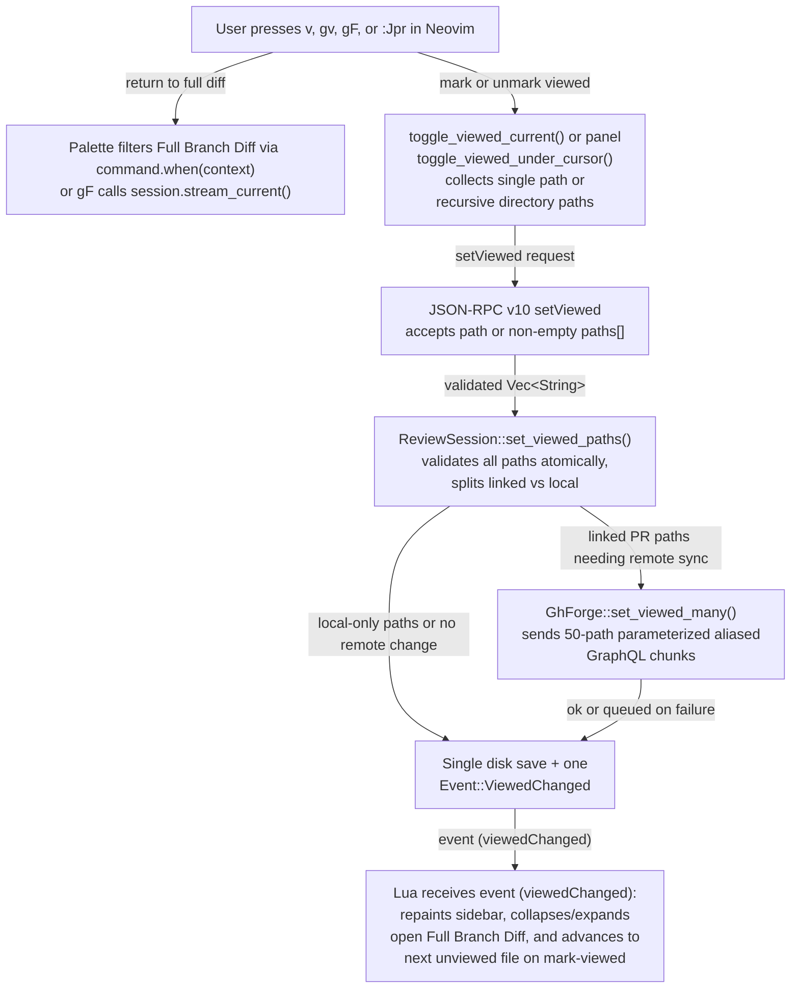
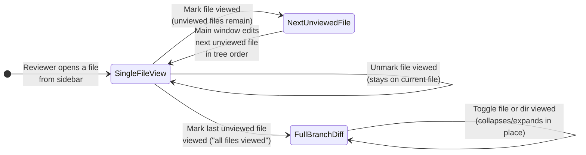

# Full Branch Diff Navigation, Single-Line Folds, and Recursive Viewed Toggling

<small>

> <table border="0">
> <tr><th colspan="2">Files</th><th colspan="2">Lines</th></tr>
> <tr><td>Changed (total)</td><td>42</td><td>Insertions (+)</td><td>1,257</td></tr>
> <tr><td>Added</td><td>0</td><td>Deletions (-)</td><td>80</td></tr>
> <tr><td>Deleted</td><td>0</td><td>Net change</td><td>+1,177</td></tr>
> </table>

</small>

## 1. Purpose

Reviewing a multi-file pull request in Neovim forced three interruptions: once a reviewer opened a single file from the sidebar<sup>G9</sup> there was no dedicated keymap or context-aware palette<sup>G2</sup> entry to return to the full branch diff<sup>G4</sup>; viewed files in the full branch diff left a second `+-- N lines` fold banner below every header; and marking a directory or an open file viewed required visiting files one by one in the sidebar and manually picking the next unviewed file.

This change:

- Batches multi-file viewed updates into one atomic request and remote sync so toggling a directory completes in a single round-trip (§4).
- Collapses viewed files in the full branch diff<sup>G4</sup> onto a single file header line while keeping `zo` in-place expansion (§5).
- Adds recursive directory viewed toggling in the sidebar<sup>G9</sup>, live full-diff collapse and expand updates, and automatic advancement to the next unviewed file (§6).
- Adds `gF`, `:Jpr full`, and a context-aware `Full Branch Diff` palette<sup>G2</sup> command to return to the full branch diff<sup>G4</sup>, plus `gv` to toggle viewed from any review buffer (§7).

## 2. Background technical context

```text
crates/
├── review-core/          (changed)
├── review-forge-github/  (changed)
└── review-rpc/           (changed)
lua/jpr/
├── init.lua              (changed)
├── rpc.lua               (changed)
├── commands/
│   └── schema.lua        (changed)
├── tui/                  (changed)
├── session/              (changed)
├── render/               (changed)
└── views/
    ├── stream/           (changed)
    ├── panel.lua         (changed)
    ├── diff/             (changed)
    └── main_window.lua
```

<small>

| Unit | What it is |
| --- | --- |
| `review-core` | The frontend-neutral Rust review engine that owns pull request and worktree<sup>G10</sup> state, viewed marks, and event broadcasts. Calls the `Forge` port to sync with GitHub and persists state through the store. |
| `review-forge-github` | The GitHub adapter for the `Forge` port. Runs `gh api graphql` queries and mutations to read pull requests and update viewed marks on GitHub. |
| `review-rpc` | The stdio JSON-RPC server running inside `jpr-review serve`. Translates Neovim requests (such as `setViewed`) into `ReviewSession` calls and pushes `event` notifications (such as `viewedChanged`) back to Neovim. |
| `jpr/init.lua` | The Neovim plugin entry point for `setup()`, default review keymaps, and `:Jpr` command dispatch. Builds the palette<sup>G2</sup> context passed to `tui` when the user opens `:Jpr`. |
| `rpc.lua` | The Neovim client for `review-rpc`. Sends JSON-RPC requests to `jpr-review serve`, verifies `PROTOCOL_VERSION`, and forwards `event` notifications to `session`. |
| `commands/schema.lua` | The declarative catalog of `:Jpr` commands and `COMMAND_ALIASES` (such as `full` resolving to `stream`). Read by `tui` to populate the command palette<sup>G2</sup>. |
| `tui` | The interactive `:Jpr` command palette<sup>G2</sup> and schema runner in Neovim. Filters commands with `command.when(context)` predicates and dispatches the selected command. |
| `session` | Tracks the active review tab's<sup>G8</sup> `SessionView` in Neovim and fans out engine `event` notifications to open views. Houses buffer-aware commands (`toggle_viewed_current`, `stream_current`) called by keymaps. |
| `render` | Pure Lua renderers that turn engine read models into buffer text and navigation metadata. Computes file fold ranges for `views/stream` and directory toggle paths and next-unviewed targets for `views/panel.lua`. |
| `views/stream` | The Full Branch Diff<sup>G4</sup> view showing all changed files in one continuous buffer (unified mode) or two aligned panes (split mode). Manages stream window fold options, `foldtext()`, split-synced fold toggles, and jumps between file headers. |
| `views/panel.lua` | The sidebar<sup>G9</sup> file tree view for a review tab<sup>G8</sup>. Handles `v` viewed toggles on files and directories and asks `views/main_window.lua` to open the next unviewed file. |
| `views/diff` | The single-file diff view (and its optional side-by-side base-revision split<sup>G1</sup> pane) for one changed file. Binds review keymaps such as `gF` and `gv` on diff buffers. |
| `views/main_window.lua` | Opens a chosen changed file in the review tab's<sup>G8</sup> main editor window. Called by `views/panel.lua` when selecting a file or advancing after marking one viewed. |

</small>

## 3. Shape of the solution

This change crosses every layer of the workspace while preserving the architecture boundary: review state mutations, path deduplication, and GitHub GraphQL batching live in Rust (`review-core`, `review-forge-github`, `review-rpc`), and Lua handles window layout, manual folds, keymaps, and palette<sup>G2</sup> filtering. Strand §4 provides the batched viewed-update engine that §6 uses for directory toggling, §5 independently fixes how collapsed viewed files render in the full branch diff<sup>G4</sup>, and §7 wires user-facing commands and keymaps onto all three.



> *Every viewed toggle flows through one atomic Rust engine entry point so a directory update persists once, batches GitHub GraphQL mutations in chunks of 50, and repaints both the sidebar<sup>G9</sup> and any open full branch diff<sup>G4</sup> view from a single `viewedChanged` event.*
>
> **Diagram key**
>
> | | |
> | --- | --- |
> | **linked PR paths<sup>G5</sup>** | Changed files tracked by a synced GitHub pull request, synced remotely via GraphQL. |
> | **local paths<sup>G6</sup>** | Worktree<sup>G10</sup>-only changed files recorded in `local.json` without calling GitHub. |
> | **viewedChanged** | JSON-RPC `event` notification carrying the refreshed `SessionView` after viewed marks change. |

Because this is a Neovim terminal plugin with no browser UI, screenshots are omitted and the changed collapsed-file presentation in the full branch diff<sup>G4</sup> is shown below as an ASCII wireframe:

```text
  Before (two lines per collapsed viewed file):
    ▸ ✓ src/a.rs  +12 -3
    +-- 18 lines: @@ -1,4 +1,13 @@ ...

  After (single header line only; zo expands body in place):
    ▸ ✓ src/a.rs  +12 -3
    ▾   src/b.rs  +4 -1
      @@ -1,3 +1,6 @@
      ...

  Key:
    ▸ / ▾   Collapsed (viewed) vs expanded (unviewed) file header
    ✓       File is marked viewed
    +N -M   Added and deleted line counts for that file
```

## 4. The Rust engine and protocol v10 apply multi-file viewed updates atomically in one batch

This strand solves the performance and consistency problem behind recursive directory viewed toggling: how to mark an entire directory of files viewed or unviewed without firing N sequential RPC calls, N disk writes, and N `gh api graphql` subprocesses.

### The Problem

Before this branch, `setViewed` accepted only a single `path` string, `ReviewSession::set_viewed` mutated one file and saved state to disk, and `GhForge::set_viewed` spawned one `gh api graphql` subprocess per file. Toggling a directory with 20 files from Lua would have emitted 20 `viewedChanged` events (causing 20 sidebar<sup>G9</sup> and stream<sup>G4</sup> repaints), performed 20 disk saves, and spawned 20 GitHub CLI processes.

### The Solution

`ReviewSession::set_viewed_paths` validates and deduplicates the full path list before mutating anything, partitions linked pull request files from local-only worktree<sup>G10</sup> files, batches remote sync into `Forge::set_viewed_many`, saves once, and emits one `Event::ViewedChanged`.

**File: `crates/review-core/src/session/viewed.rs`**

```rust {4-8}
impl ReviewSession {
    ...
    pub fn set_viewed_paths(&mut self, paths: &[String], viewed: bool) -> Result<SessionView> {
        let unique_paths = deduplicate_paths(paths)?;
        let (linked_paths, local_paths) = self.classify_viewed_paths(&unique_paths)?;
        let auth_message = self.apply_linked_viewed_paths(&linked_paths, viewed)?;
        self.apply_local_viewed_paths(&local_paths, viewed);
        let view = self.save_and_announce_viewed()?;
        ...
    }
}
```

Validating every path in `classify_viewed_paths` before `apply_linked_viewed_paths` guarantees atomicity: if any single path in a batch is not a changed file in the review, the call returns an error and mutates neither local state nor the forge<sup>G3</sup>. Existing single-file callers continue to work because `ReviewSession::set_viewed` now delegates directly to `set_viewed_paths(&[path.to_owned()], viewed)`.

To keep directory prefix matching consistent with the engine's domain rules (guarding against sibling directories with shared prefixes such as `src/a` versus `src/a-extra`), `crates/review-core/src/viewed.rs` exports `is_path_in_directory` (requiring an exact `"/"` segment boundary after trimming trailing slashes) and `collect_directory_toggle_paths` (returning all descendants to mark viewed when any descendant is `Unviewed` or `Dismissed`, or all descendants to unmark when every descendant is already `Viewed`). The Neovim sidebar<sup>G9</sup> currently evaluates the same rule in Lua (`lua/jpr/render/panel.lua`, §6) before sending `paths` over RPC, while `review-core` re-exports the Rust helpers for future CLI or engine callers.

On the GitHub forge<sup>G3</sup> side, `GhForge::set_viewed_many` chunks `paths` into slices of `BATCH_VIEWED_CHUNK_SIZE` (50) and sends one aliased GraphQL mutation per chunk built by `build_batch_viewed_mutation`.

**File: `crates/review-forge-github/src/graphql.rs`**

```rust {1,11-16}
pub const BATCH_VIEWED_CHUNK_SIZE: usize = 50;
pub fn build_batch_viewed_mutation(
    pr_node_id: &str,
    paths: &[String],
    viewed: bool,
) -> (String, Value) {
    ...
    let mut header = String::from("mutation($pr: ID!");
    ...
    for (index, path) in paths.iter().enumerate() {
        let _ = write!(header, ", $p{index}: String!");
        let _ = writeln!(
            body,
            "  f{index}: {field}(input: {{ pullRequestId: $pr, path: $p{index} }}) {{ clientMutationId }}"
        );
        variables.insert(format!("p{index}"), Value::String(path.clone()));
    }
    let query = format!("{header}) {{\n{body}}}");
    (query, Value::Object(variables))
}
```

Untrusted file paths from a pull request are never interpolated into the GraphQL query string: each path is bound strictly through a JSON variable (`$p0`, `$p1`, ...), preventing GraphQL injection even when a branch contains quotes, braces, or control characters in filenames. Inside `apply_linked_viewed_paths`, only linked files whose viewed state actually changed or that already have a pending queued mark<sup>G7</sup> are collected into `forge_paths` and sent to GitHub. If the forge<sup>G3</sup> call fails, every path in `forge_paths` is recorded in the persisted retry queue (`saved.registry.queued_viewed`) so the next sync retries them without losing the reviewer's local toggle.

Because `setViewed` now accepts either `{ path: string, viewed: bool }` or `{ paths: string[], viewed: bool }` (rejecting payloads that omit both, pass both, or pass an empty `paths` array via `get_viewed_paths_from_params` in `crates/review-rpc/src/params.rs`), `PROTOCOL_VERSION` in `crates/review-rpc/src/protocol.rs` and `PROTOCOL_VERSION` in `lua/jpr/rpc.lua` bump from `9` to `10`.

## 5. Collapsed viewed files in the full branch diff fold onto their header line

Independent of the batching changes in §4, this strand fixes how collapsed viewed files render inside the full branch diff<sup>G4</sup> buffer so a reviewer sees only the file header line with its `+/-` counts instead of a second `+-- N lines` fold banner.

### The Problem

Previously, `lua/jpr/render/stream.lua` created manual folds from `header_line + 1` to `body_end`. In Neovim, folding the body below the header left the header line visible on line 1 and Neovim's default fold banner (`+-- N lines: ...`) on line 2, doubling vertical clutter for every viewed file.

### The Solution

File folds now start on `header_line` itself (`first = header_line`, `last = body_end`, created only when `first_line < last_line` so header-only files without diff body lines stay as a single unfolded line), and `lua/jpr/views/stream/init.lua` sets three window-local options on stream<sup>G4</sup> windows: `foldminlines = 0` (so Neovim never refuses to close a short fold based on minimum line count), `foldtext = "v:lua.require('jpr.views.stream').foldtext()"` (to display the header line itself as the fold label), and `fillchars` with `fold: ` (replacing Neovim's default trailing `-` padding after the fold text with blank space while preserving all other user `fillchars` entries).

**File: `lua/jpr/views/stream/init.lua`**

```lua {1-4,10-17}
function M.foldtext()
    local line_text = vim.fn.getline(vim.v.foldstart)
    return { { vim.fn.strtrans(line_text), "JprFileHeader" } }
end
...
function M.restore_window_fold_options(win)
    if not win or not vim.api.nvim_win_is_valid(win) then
        return
    end
    local saved = vim.w[win].jpr_stream_fold_opts
    if type(saved) ~= "table" then
        return
    end
    vim.w[win].jpr_stream_fold_opts = nil
    for _, name in ipairs(STREAM_FOLD_OPTIONS) do
        vim.api.nvim_set_option_value(name, saved[name], { win = win, scope = "local" })
    end
end
```

Because `foldtext()` returns virtual text chunks containing `vim.fn.strtrans(line_text)` highlighted with `JprFileHeader`, untrusted filenames with control characters cannot break display rendering, and the collapsed fold renders as the exact single line `▸ ✓ path  +N -M`. When the user opens a normal file in the same main window, a `BufWinLeave` autocommand on the stream<sup>G4</sup> buffer calls `restore_window_fold_options(win)` synchronously so `foldtext`, `fillchars`, and `foldminlines` never leak onto regular code buffers.

Three navigation details were updated to match header-inclusive folds:
- **Side-by-side fold commands stay synchronized across both panes:** When the full branch diff<sup>G4</sup> is shown in split mode (base pane on the left, head pane in the main window), `M.toggle_fold(session, command)` intercepts `zo`, `zc`, and `za` and runs the fold command at the same line in both windows so the two panes stay aligned.
- **File jumps (`]f` and `[f`) still land on collapsed viewed headers:** Because folds now start on `header_line` (making `vim.fn.foldclosed(line) == line`), `jump` in `lua/jpr/views/stream/navigation.lua` now retains `kind == "files"` targets where `closed_start == line` instead of filtering out every line inside a closed fold, so `]f`/`[f` still step across collapsed viewed files while `]h`/`[h` and thread jumps continue skipping folded bodies.
- **Pressing `v` or `gv` in the full branch diff<sup>G4</sup> advances the cursor only when marking a file viewed:** `find_next_unviewed_file(layout, line)` scans the rendered stream's file-header table `layout.files` and wraps around from the top when marking a file viewed; unmarking (`viewed = false`) expands the file and keeps the cursor in place.

## 6. Toggling a directory marks all descendants in one batch, and marking a file viewed advances to the next unviewed file

With batched engine updates (§4) and single-line stream<sup>G4</sup> folds (§5) in place, this strand adds recursive directory toggling in the sidebar<sup>G9</sup>, live full-diff repaints, and automatic advancement to the next unviewed file whenever a reviewer finishes viewing a file.



> *Marking the currently open file viewed moves the reviewer forward to the next unviewed file (or back to the full branch diff<sup>G4</sup> when none remain), whereas unmarking a file keeps the reviewer on that file.*
>
> **Diagram key**
>
> | | |
> | --- | --- |
> | **SingleFileView** | Main editor window showing one changed file opened from the sidebar<sup>G9</sup>. |
> | **NextUnviewedFile** | First unviewed file after the current file in sidebar<sup>G9</sup> tree order, wrapping from the top. |
> | **FullBranchDiff** | The full branch diff<sup>G4</sup> view showing all changed files in one continuous scroll. |

### The Problem

Pressing `v` on a directory row in the sidebar<sup>G9</sup> did nothing, and marking an open single file viewed left the reviewer staring at the file they had just finished reviewing.

### The Solution

`lua/jpr/render/panel.lua` adds two pure functions:
- `collect_directory_toggle_from_files(files, dir_path)`: matches every changed file under `dir_path` (including nested subdirectories, regardless of whether the directory row is currently expanded or collapsed in the tree) using segment-safe prefix matching. If any descendant is not `"VIEWED"` (meaning `"UNVIEWED"` or `"DISMISSED"`), it returns `{ paths = ..., viewed = true }`; otherwise it returns `{ paths = ..., viewed = false }`.
- `find_next_unviewed_path(view, current_path)`: traverses the rendered file tree in display order, returning the first unviewed file after `current_path` and wrapping around from the top of the tree if none follow.

`lua/jpr/views/panel.lua` wires both helpers into `toggle_viewed_under_cursor` and `advance_after_viewed`:

**File: `lua/jpr/views/panel.lua`**

```lua {4-6,14-23}
function M.advance_after_viewed(session, updated_view, marked_paths, opts)
    ...
    local stream = require("jpr.views.stream")
    if stream.is_visible(session) then
        return
    end
    ...
    local open_path = get_window_changed_path(session, main_win)
    if not open_path or not vim.tbl_contains(marked_paths or {}, open_path) then
        return
    end
    local should_focus_next = type(opts) == "table" and opts.focus_next == true
    local previous_win = vim.api.nvim_get_current_win()
    local next_path = render.find_next_unviewed_path(updated_view or session.view or {}, open_path)
    if next_path then
        main_window.edit(session, main_win, next_path, 1)
        if not should_focus_next and vim.api.nvim_win_is_valid(previous_win) then
            vim.api.nvim_set_current_win(previous_win)
        end
        return
    end
    stream.show(session, { focus = should_focus_next })
    require("jpr").info("all files viewed")
end
```

When the sidebar<sup>G9</sup> toggles a directory or file while the full branch diff<sup>G4</sup> is already open in the main window, `advance_after_viewed` returns early and the engine's `viewedChanged` event notification automatically triggers `stream.refresh(session)`, which repaints the stream buffer and collapses newly viewed files or expands newly unviewed files. When a single file is open in the main window and that file is included in `marked_paths`, `advance_after_viewed` opens the next unviewed file while preserving focus in the sidebar (`focus_next = false`) or keeping focus in the editor when triggered via `gv` (`focus_next = true`).

## 7. Reviewers can return to the full branch diff from any review buffer and toggle viewed state from the editor

This strand connects the capabilities from §4 through §6 to the user-facing entry points: the `:Jpr` command palette<sup>G2</sup>, `:Jpr full`, `gF`, and `gv`.

### 7.1 The Full Branch Diff palette command hides itself when the full branch diff is already visible, and `:Jpr full` aliases it

In `lua/jpr/commands/schema.lua`, the existing `stream` command is relabeled `"Full Branch Diff"` (`[stream]`), `full = "stream"` is added to `COMMAND_ALIASES` (so `:Jpr full` dispatches to `stream` without creating a duplicate palette<sup>G2</sup> entry), and a `when` predicate hides the command whenever `context.is_stream_visible == true`.

**File: `lua/jpr/commands/schema.lua`**

```lua {4,7-9}
local function create_stream_command_spec()
    return {
        id = "stream",
        label = "Full Branch Diff",
        help = "Return to the full branch diff view showing all changed files in a continuous scroll.",
        requires_session = true,
        when = function(context)
            return not (context and context.is_stream_visible == true)
        end,
        ...
    }
end
```

To evaluate `command.when(context)` uniformly, `lua/jpr/tui/schema.lua` validates optional `when` predicates and exposes `get_active_commands(commands, context)`, which `lua/jpr/tui/wizard/palette.lua` applies on open using `is_stream_visible = stream.is_visible(session)` from `build_tui_context` in `lua/jpr/init.lua`.

### 7.2 Normal-mode `gF` returns to the full branch diff from any buffer in a review tab, and `gv` toggles viewed state across review surfaces

`lua/jpr/init.lua` adds `keys.full_diff = "gF"` and `keys.toggle_viewed = "gv"` (Normal mode only, so Visual mode `gv` keeps Vim's reselect-last-visual behavior), backed by `<Plug>(jpr-full-diff)` and `<Plug>(jpr-toggle-viewed)` in `plugin/jpr.lua`.

- **`gF` returns to the full branch diff<sup>G4</sup> from any buffer in a review tab<sup>G8</sup> and falls through outside review tabs:** Bound on single-file diff buffers (including side-by-side base-revision panes), pull request conversation buffers, the sidebar<sup>G9</sup> file tree, and unchanged worktree<sup>G10</sup> files opened inside the review tab via `bind_tab_aware_full_diff_key` (which checks `session.current()` on keypress so `gF` falls through to Vim's built-in "go to file at line" motion in non-review tabs).
- **`gv` toggles viewed state from any changed-file buffer, the full branch diff<sup>G4</sup>, or the sidebar<sup>G9</sup>:** Calls `session.toggle_viewed_current()` in `lua/jpr/session/commands.lua`, which delegates to `panel.toggle_viewed_under_cursor` in the sidebar, `stream.toggle_viewed` in the full branch diff, or toggles the current single-file diff buffer's changed file (including base-revision splits<sup>G1</sup> and binary changed files bound in `lua/jpr/views/diff/init.lua`) and calls `panel.advance_after_viewed(..., { focus_next = true })` when marking viewed. Pressing `gv` on a buffer that does not correspond to a changed file reports an error message instead of mutating state.

## 8. Decisions

- **Batch viewed updates in Rust and GitHub GraphQL (protocol v10) rather than looping single-path RPC calls in Lua.** Rejected alternative: calling `setViewed` once per file from Lua. Reason: looping produces N disk writes, N `viewedChanged` repaints, and N `gh api graphql` subprocesses, and can leave partial state if one path is invalid. Reversal evidence: if GitHub's GraphQL API rejects aliased `markFileAsViewed` mutations in production.
- **Collapse viewed files with manual folds starting on the file header line and blank `fillchars` rather than omitting diff lines from the full branch diff<sup>G4</sup> buffer.** Rejected alternative: filtering viewed file hunks out of the rendered stream buffer. Reason: keeping the lines inside a manual fold preserves instant `zo`/`zc`/`za` in-place peeking without re-fetching or re-rendering the entire branch diff. Reversal evidence: if very large pull requests hit Neovim manual-fold performance limits.
- **Restore window-local fold options synchronously in `BufWinLeave` rather than deferring with `vim.schedule`.** Rejected alternative: restoring `foldtext`, `fillchars`, and `foldminlines` asynchronously on the next event-loop tick. Reason: synchronous buffer switches in the same window observe the leaked options immediately before a scheduled callback runs. Reversal evidence: none; synchronous restoration is strictly safer.
- **Reuse the `stream` command with `command.when` and `:Jpr full` alias rather than adding a separate `full` command.** Rejected alternative: adding a second palette<sup>G2</sup> command `full` alongside `stream`. Reason: both open the exact same full branch diff<sup>G4</sup> view, and the repository's schema invariant requires one canonical command id per behavior with aliases in `COMMAND_ALIASES`. Reversal evidence: if `full` and `stream` ever diverge in behavior.
- **Bind `gF` for full branch diff<sup>G4</sup> and Normal-mode `gv` for toggle viewed rather than `gf` or `<leader>` mappings.** Rejected alternative: `gf` (already bound to file-level comment) and Visual-mode `gv` (conflicts with Vim's built-in reselect-last-visual-selection). Reason: avoids shadowing existing review and Vim keymaps while remaining customizable via `setup({ keys = ... })`. Reversal evidence: user overrides in `setup({ keys = ... })`.

## 9. Deliberately not handled

- **Live GitHub GraphQL batch smoke test:** `build_batch_viewed_mutation` is verified with a unit test covering parameterized variables, aliases, injection safety, and `BATCH_VIEWED_CHUNK_SIZE == 50`, and `setViewed` batching is covered by RPC integration tests against `FakeForge`, but `GhForge::set_viewed_many` (including multi-chunk execution above 50 paths) was not executed against a live GitHub pull request in this branch.

<div style="page-break-before: always"></div>

## Appendix A. Manual testing

<small>

1. Build the updated Rust engine binary:

   ```sh
   cargo build --release -p jpr-review
   ```

2. Open a multi-directory branch review in Neovim:

   ```sh
   nvim -c "Jpr local"
   ```

3. **Single-line collapsed viewed files in Full Branch Diff<sup>G4</sup> (§5):** Mark a file viewed with `v` in **Full Branch Diff**, then press `zo` to expand the diff in place and `zc` to re-collapse it.
   - **Before this change:** Marking a file viewed left both `▸ ✓ <path>  +N -M` and a second `+-- N lines: ...` fold banner below it.
   - **Now:** Only the single header line `▸ ✓ <path>  +N -M` appears with no `+-- N lines` banner, and `zo`/`zc` expand and re-collapse the diff body in place.
4. **Context-aware Full Branch Diff<sup>G4</sup> palette<sup>G2</sup> entry, `:Jpr full`, and `gF` (§7):** While in **Full Branch Diff**, run `:Jpr` and confirm **Full Branch Diff** (`[stream]`) is hidden. Open a single file from the sidebar<sup>G9</sup> (`<CR>`), run `:Jpr` again, and confirm **Full Branch Diff** (`[stream]`) is listed. Cancel the palette and press `gF` (or run `:Jpr full`) to confirm the main window returns to **Full Branch Diff** with already-viewed files still collapsed.
5. **Editor `gv` toggle and auto-advancement (§6, §7):** Open an unviewed single file from the sidebar<sup>G9</sup> and press `gv`. Confirm the file marks viewed and the main window immediately opens the next unviewed file. Re-open a viewed file and press `gv` to confirm it unmarks viewed and stays on that file. Mark the final unviewed file viewed with `gv` and confirm Neovim switches to **Full Branch Diff<sup>G4</sup>** and prints `jpr: all files viewed`.
6. **Recursive directory `v` and live Full Branch Diff<sup>G4</sup> repaint (§4, §6):** Open **Full Branch Diff** in the main window and move focus to the sidebar<sup>G9</sup>. Highlight a directory containing unviewed files (expanded or collapsed) and press `v` to confirm all descendant files mark viewed in one update and immediately collapse in the visible **Full Branch Diff**. Press `v` again on the same directory to confirm all descendants unmark and immediately expand.
7. Run the automated workspace checks and confirm formatting, clippy, Rust tests, and Lua specs all pass:

   ```sh
   just check
   ```

</small>

<div style="page-break-before: always"></div>

## Appendix B. Glossary

<small>

| Term | Meaning |
| --- | --- |
| **G1** Base-revision split (base-revision pane) | The optional side-by-side pane showing a changed file's base-branch revision next to the working-tree file. |
| **G2** Command palette (palette) | The interactive `:Jpr` floating menu in Neovim that lists available review actions for the current session. |
| **G3** Forge | The remote code-hosting service (GitHub) that stores pull request metadata, comments, and viewed marks, accessed through the engine's `Forge` port. |
| **G4** Full Branch Diff (stream) | The continuous scrolling view that displays every changed file in the pull request or branch in one buffer (unified mode) or two scroll-bound panes (split mode). |
| **G5** Linked PR path (linked file, linked pull request file) | A changed file tracked by a synced GitHub pull request whose viewed mark is synced remotely via GraphQL. |
| **G6** Local path (local-only file, local-only worktree file) | A changed file present only in the local Git worktree<sup>G10</sup> whose viewed state is stored locally in `local.json` without calling GitHub. |
| **G7** Retry queue (queued mark) | A persisted local queue (`saved.registry.queued_viewed`) that holds viewed or unviewed marks after a GitHub sync call fails, retried automatically on the next sync. |
| **G8** Review tab | A Neovim tabpage hosting an active review session, containing the sidebar<sup>G9</sup> file tree and the main editor window. |
| **G9** Sidebar (panel) | The file-tree window on the left of a review tab<sup>G8</sup> that lists changed files and directories, their viewed marks, and thread counts. |
| **G10** Worktree | The local Git working directory checked out for the branch under review, where the reviewer can inspect and edit files directly. |

</small>
