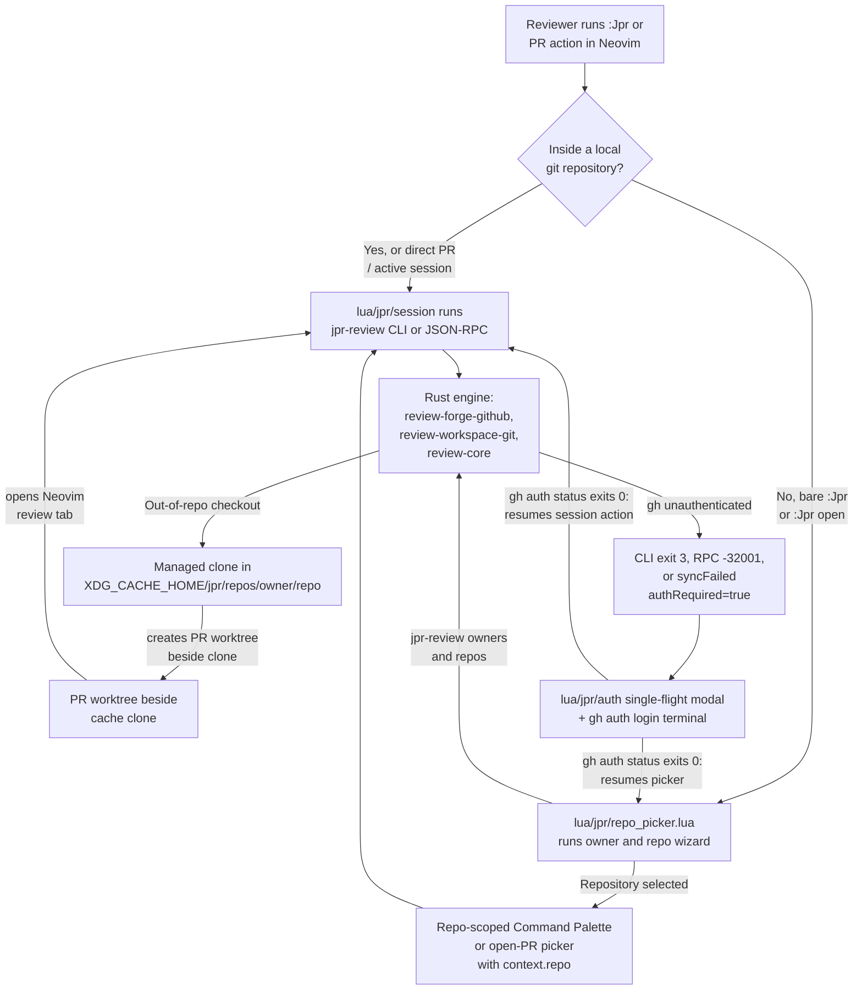
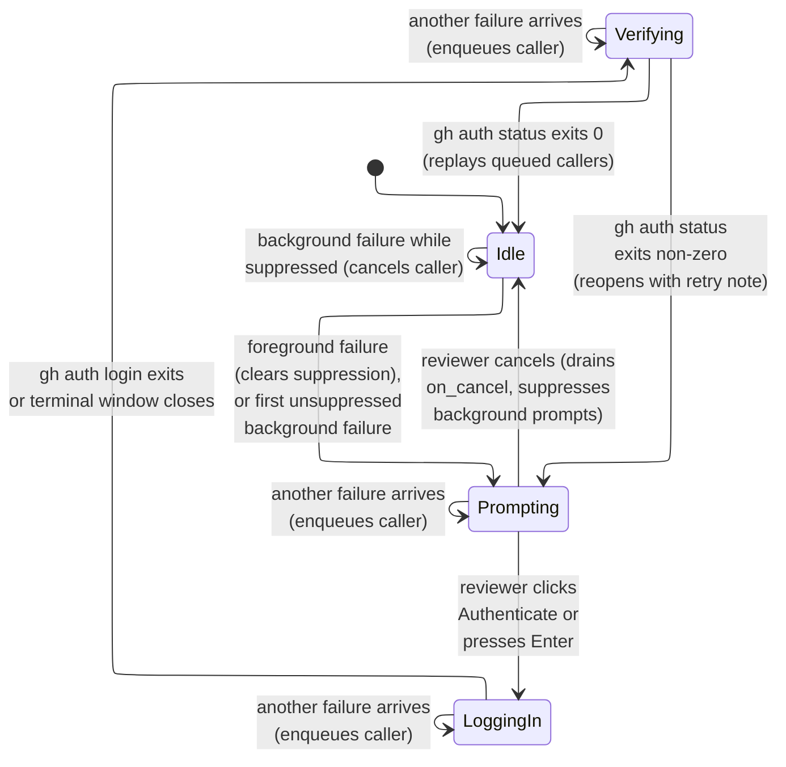

# Non-repository GitHub picker, managed clone cache, and global `gh` authentication recovery

<small>

> <table border="0">
> <tr><th colspan="2">Files</th><th colspan="2">Lines</th></tr>
> <tr><td>Changed (total)</td><td>75</td><td>Insertions (+)</td><td>4,380</td></tr>
> <tr><td>Added</td><td>17</td><td>Deletions (-)</td><td>801</td></tr>
> <tr><td>Deleted</td><td>1</td><td>Net change</td><td>+3,579</td></tr>
> </table>

</small>

## 1. Purpose

Opening a pull request with `:Jpr` or `:Jpr open` when Neovim was started outside a local git repository failed because pull request listing and checkout assumed an enclosing git checkout. Separately, whenever the GitHub CLI (`gh`) was logged out or its token expired during pull request discovery, checkout, local branch probing, syncing, or review mutations, the plugin surfaced raw stderr text and stopped instead of letting the reviewer sign in and continue. Reviewers had to leave Neovim, locate or clone a repository, run `gh auth login`, and re-enter their command.

This change:

- Classifies missing or expired `gh` authentication once in the Rust engine and reports it explicitly across CLI commands, RPC requests, and background sync notifications (§4).
- Prompts once in Neovim with a floating modal and `gh auth login` terminal, verifies sign-in, and resumes interrupted actions without losing unsent comment text (§5).
- Opens GitHub account and repository pickers when `:Jpr` or `:Jpr open` runs outside a git repository, then scopes the Command Palette<sup>G3</sup> to the chosen repository (§6).
- Clones repositories on demand into a local XDG cache when opening pull requests outside a git checkout, and keeps buffer names unique across repositories (§7).

## 2. Background technical context

```text
crates/
├── review-core/          (changed)
├── review-forge-github/  (changed)
├── review-workspace-git/ (changed)
├── review-rpc/           (changed)
└── jpr-review/           (changed)
lua/jpr/
├── init.lua              (changed)
├── auth/                 (new)
├── repo_picker.lua       (new)
├── commands/
│   └── schema.lua        (changed)
├── tui/                  (changed)
├── session/              (changed)
├── comments/
│   └── compose.lua       (changed)
└── views/                (changed)
```

<small>

| Unit | What it is |
| --- | --- |
| `review-core` | UI-free Rust review engine (`ReviewSession`) that owns pull request state, viewed marks<sup>G16</sup>, comment queues, and shared `gh` authentication classification (`auth.rs`). Both `review-rpc` and `jpr-review` call into it. |
| `review-forge-github` | GitHub adapter that runs the `gh` CLI to read pull requests, send GraphQL review mutations, and list GitHub accounts and repositories (`discovery.rs`). Called by `review-core` and `jpr-review`. |
| `review-workspace-git` | Git adapter that checks out pull request worktrees (`checkout.rs`), runs `git` and `gh` subprocesses (`process.rs`), and manages cached clones (`cache.rs`). Called by `jpr-review checkout` and `review-core`. |
| `review-rpc` | Newline-delimited JSON-RPC stdio server and background poller<sup>G1</sup> (`ticker/`) that expose `ReviewSession` to Neovim over protocol v9<sup>G9</sup>. Spawned per review tab by `jpr-review serve`. |
| `jpr-review` | Rust CLI binary that wires the engine crates together for subcommands (`owners`, `repos`, `prs`, `checkout`, `local`, `serve`) and its own terminal palette (`tui_schema/`). Neovim runs it for one-shot commands and long-lived review daemons. |
| `lua/jpr/init.lua` | Neovim plugin entry point that registers user configuration and dispatches `:Jpr` commands, including bare `:Jpr` and `:Jpr open`. Routes non-repository invocations to `lua/jpr/repo_picker.lua`. |
| `lua/jpr/auth` | Single-flight<sup>G12</sup> GitHub login recovery controller (`init.lua`), confirmation modal (`modal.lua`), and floating `gh auth login` terminal (`terminal.lua`). Every GitHub-backed CLI call and JSON-RPC handler in Neovim routes auth failures through it. |
| `lua/jpr/repo_picker.lua` | Detects whether Neovim's working directory is a git checkout and runs the two-stage GitHub account and repository picker when it is not. Calls `jpr-review owners` and `jpr-review repos`, then opens a repo-scoped palette or PR picker. |
| `lua/jpr/commands/schema.lua` | Declarative catalog of `:Jpr` subcommands, step wizards<sup>G17</sup> (including the open-PR picker), and per-command flags such as `requires_git_repo`. Read by `lua/jpr/init.lua` and `lua/jpr/tui` to build the Command Palette<sup>G3</sup>. |
| `lua/jpr/tui` | Floating Command Palette<sup>G3</sup> and multi-step wizard<sup>G17</sup> modal (`render.lua` formats frames; `wizard/` manages floating windows and keyboard navigation). Shared by `:Jpr` command wizards and `lua/jpr/repo_picker.lua`. |
| `lua/jpr/session` | Per-tab pull request review controller in Neovim (`open.lua`, `open_local.lua`, `init.lua`, `commands.lua`, `events.lua`). Runs `jpr-review` checkouts, talks to `jpr-review serve` through `lua/jpr/rpc.lua`, and assigns per-tab buffer keys<sup>G2</sup>. |
| `lua/jpr/comments/compose.lua` | Floating text editor where a reviewer writes or edits a pull request comment, reply, or thread promotion<sup>G14</sup>. Submits drafts through `lua/jpr/session` and reopens with the unsent text if login is canceled. |
| `lua/jpr/views` | Neovim buffers and windows (`loading.lua`, `diff/`, plus unchanged `panel.lua`, `stream/`, and `conversation.lua`) that draw engine read models<sup>G10</sup> inside a review tab. Names buffers with `session.buf_key` to prevent collisions across tabs. |

</small>

## 3. Shape of the solution

This change connects two user-facing workflows through one shared engine boundary: structured authentication recovery (strands §4 and §5) and non-repository discovery plus managed cloning<sup>G8</sup> (strands §6 and §7). The two workflows meet whenever `jpr-review owners`, `jpr-review repos`, or out-of-repo `jpr-review checkout` hits an unauthenticated `gh` CLI and routes through the same global recovery controller as in-repo sessions.



> *Every GitHub-backed CLI call and JSON-RPC request shares one structured authentication signal from Rust and one single-flight<sup>G12</sup> recovery controller in Neovim; non-repository picking feeds a chosen repository into the same checkout and session pipeline.*
>
> **Diagram key**
>
> | | |
> | --- | --- |
> | **context.repo** | Selected `owner/name` repository passed into the Command Palette<sup>G3</sup> and open-PR picker. |
> | **CLI exit 3** | Exit code `3` (`AUTH_EXIT_CODE`) returned by `jpr-review` subcommands when `gh` is unauthenticated. |
> | **RPC -32001** | JSON-RPC error code `AUTH_REQUIRED` returned by `jpr-review serve` on unauthenticated GitHub requests. |
> | **syncFailed** | Server notification carrying `authRequired` and `isBackground` flags when a sync, viewed-mark write, or queued flush fails. |
> | **XDG_CACHE_HOME** | Base cache directory (defaulting to `$HOME/.cache`) where managed clones<sup>G8</sup> are stored under `jpr/repos/<owner>/<repo>`. |

## 4. The Rust engine classifies `gh` authentication failures once and reports them over three explicit channels

This strand is the Rust half of authentication recovery: it establishes how the engine distinguishes missing or expired GitHub credentials from ordinary network or validation errors and reports them over three explicit channels consumed by Neovim (§5) and future frontends.

### 4.1 Every `gh` subprocess error is classified once into a typed authentication error

Every `gh` invocation in `review-forge-github` (combining GraphQL/REST stdout errors and stderr) and `review-workspace-git` (stderr) passes failure text through `is_gh_auth_failure_text` and wraps matching failures in `review-core`'s typed `ForgeAuthError` struct. Downstream layers (`review-core`, `review-rpc`, and `jpr-review`) detect authentication failures by downcasting the error chain through `is_auth_error` rather than re-matching strings.

**File: `crates/review-core/src/auth.rs`**

```rust {2-4,9-34}
pub fn is_auth_error(error: &anyhow::Error) -> bool {
    error
        .chain()
        .any(<dyn std::error::Error + 'static>::is::<ForgeAuthError>)
}

pub fn is_gh_auth_failure_text(text: &str) -> bool {
    let lower = text.to_ascii_lowercase();
    if [
        "is the github cli installed",
        "no such file or directory",
        "program not found",
    ]
    .iter()
    .any(|excluded| lower.contains(excluded))
    {
        return false;
    }
    if lower.contains("token in") && lower.contains("is invalid") {
        return true;
    }
    [
        "gh auth login",
        "not logged into any github hosts",
        "not authenticated",
        "authentication required",
        "failed to authenticate",
        "bad credentials",
        "http 401",
        "no oauth token",
        "requires authentication",
    ]
    .iter()
    .any(|needle| lower.contains(needle))
}
```

Checking the typed `anyhow` error chain lets callers add `.context(...)` layers (for example `"syncing pull request #7"`) without hiding the underlying `ForgeAuthError`. The exclusion check rejects uninstalled-`gh` spawn messages first, and the matcher deliberately excludes HTTP `403` (missing permission or rate limit), HTTP `422` (validation), HTTP `5xx`, timeouts, and `"no pull requests found for branch"`, so non-auth failures never misroute into a login prompt. In `crates/review-workspace-git/src/process.rs`, auth wrapping applies only when `program == "gh"`, preventing a `git` command whose stderr happens to mention `"gh auth login"` from triggering GitHub auth recovery.

### 4.2 Mid-session authentication failures leave comment queues replayable while keeping file viewed marks queued

Normally, `review-core` handles transient offline errors on GitHub writes by assigning temporary `tmp-*` IDs and queueing operations in `queued_ops`, while recording validation rejections as `MessageSync::Failed` so the reviewer can edit or retry them later. When authentication fails mid-session, foreground writes triggered by user actions must not mutate that queue in ways that break post-login replay:

- **Foreground comment and review mutations fail immediately without creating queued placeholders.** New comments, replies, edits, deletions, thread resolution toggles, reactions, thread promotion<sup>G14</sup> (`promoteThread`), and submitting a review all match `ForgeWriteError::AuthRequired` and return `Err(ForgeAuthError)` before allocating `tmp-*` IDs or pushing to `queued_ops`.
- **Retrying or editing a previously failed comment rolls back its queue entry if authentication fails.** Calling `retry_message` or `edit_unflushed_message` (for an unflushed `tmp-*` comment) temporarily enqueues the message so `send_queued_comments` can replay it, then restores its previous `body`, `MessageSync::Failed` status, and `sync_error` if replay stops on `ReplayOutcome::AuthRequired`.

**File: `crates/review-core/src/session/comments/helpers.rs`**

```rust {9-26}
impl ReviewSession {
    ...
    pub(super) fn retry_failed_message_with_auth_rollback(
        &mut self,
        message_id: &str,
        new_body: Option<&str>,
    ) -> Result<()> {
        let (previous_body, previous_sync, previous_sync_error) = ...;
        self.enqueue_failed_message(message_id, new_body)?;
        let (has_progressed, auth_error) = self.send_queued_comments();
        if let Some(reason) = auth_error {
            let is_still_queued = find_message_mut(&mut self.threads, message_id)
                .is_some_and(|message| message.sync == Some(MessageSync::Queued));
            if is_still_queued {
                let _ = self.saved.registry.queued_ops.pop();
                if let Some(target) = find_message_mut(&mut self.threads, message_id) {
                    target.body = previous_body;
                    target.sync = previous_sync;
                    target.sync_error = previous_sync_error;
                }
            }
            if has_progressed {
                let _ = self.save_and_announce_threads()?;
            }
            return Err(anyhow::Error::new(crate::ForgeAuthError::new(reason)));
        }
        Ok(())
    }
    ...
}
```

Without this rollback, replaying the exact `retryMessage` JSON-RPC request after `gh auth login` would fail with `"message <id> is not in a failed state"`, because the message would already be stuck in `Queued`. Because `send_queued_comments` drains `queued_ops` in FIFO order, earlier queued operations may succeed before credentials expire (`has_progressed == true`); checking `is_still_queued` ensures the rollback restores only the retried message if it did not land while still persisting any earlier progress. For a concrete traversal: start with one failed code-comment message `tmp-m-1` (`sync = Failed`, `queued_ops = []`). Calling `retry_message("tmp-m-1")` while logged out pushes a retry op, hits `ReplayOutcome::AuthRequired`, sees `tmp-m-1` is still `Queued`, pops that op, restores `sync = Failed`, and returns `ForgeAuthError`. After `gh auth login`, the client replays `retry_message("tmp-m-1")`, which finds `tmp-m-1` still in `Failed` and turns it into a GitHub pending-review `Draft` comment with a permanent ID.

- **Marking a file viewed or unviewed still updates local state immediately and queues the write for post-login sync.** When `set_viewed` fails with `ForgeAuthError`, the chosen `VIEWED` or `UNVIEWED` viewed mark<sup>G16</sup> stays applied locally and remains in `queued_viewed` (returning `Ok(view)` with the updated `SessionView` read model<sup>G10</sup>), while `ReviewSession` emits `Event::SyncFailed { auth_required: true, is_background: false }` (§4.3). After the reviewer completes `gh auth login`, Neovim runs `sync`, which flushes `queued_viewed` cleanly to GitHub.

### 4.3 Authentication errors cross the Rust-to-Neovim boundary via CLI exit code `3`, RPC `-32001`, and `syncFailed` flags

`review-rpc` and `jpr-review` expose `ForgeAuthError` over three explicit wire channels, advancing `PROTOCOL_VERSION` from `8` to protocol v9<sup>G9</sup> alongside the lockstep plugin/binary release version from `0.7.0` to `0.8.0`:

1. **JSON-RPC requests return error `-32001` (`RpcError::AUTH_REQUIRED`) on authentication failure.** `engine_result_to_rpc` in `crates/review-rpc/src/server.rs` inspects `is_auth_error(&error)` and emits `-32001` instead of the generic engine error code `-32000`.
2. **`syncFailed` notifications carry `authRequired` and `isBackground` flags.** `Event::SyncFailed` adds `auth_required: bool` and `is_background: bool` (both `#[serde(default)]`, serialized on the wire as `authRequired` and `isBackground`). Foreground `sync()` and `set_viewed()` set `is_background: false`; the background poller<sup>G1</sup> (`crates/review-rpc/src/server/ticker/mod.rs`) calls `sync_background()` and `flush_queued_background()`, setting `is_background: true` so Neovim (§5.1) can suppress repeated background poll prompts after a decline without hiding explicit foreground failures.
3. **CLI subcommands exit with code `3` (`AUTH_EXIT_CODE`) when `gh` authentication fails.** `crates/jpr-review/src/main.rs` calls `commands::exit_code_for_error(&error)`, exiting `3` for any `ForgeAuthError` and `1` for other failures. In `crates/jpr-review/src/commands/local.rs`, `resolve_local_output` re-raises `ForgeAuthError` immediately instead of warning and falling back to an unlinked local session<sup>G15</sup>, so bare `:Jpr local` prompts the reviewer to authenticate rather than silently missing an open PR.

## 5. Neovim coalesces authentication failures into one login flow and resumes interrupted actions

This strand is the Neovim consumer paired with §4: it turns every CLI exit code `3`, JSON-RPC `-32001`, and `syncFailed { authRequired = true }` signal into one shared interactive login flow without spawning stacked modals or losing user input.

### 5.1 Overlapping authentication failures share one login flow and declining suppresses repeated background poll prompts

`lua/jpr/auth/init.lua` holds the active login phase (`active_modal`, `active_terminal`, `is_verifying`), a queue of waiting callers (`pending_queue`), and a background-suppression flag (`is_background_suppressed`) so simultaneous failures (for example a `sync` request returning `-32001` at the same instant `syncFailed` arrives, or two tabs failing together) coalesce in single-flight<sup>G12</sup> fashion into one modal and one `gh auth login` session.



> *Only one authentication modal or login terminal exists at a time; overlapping failures enqueue behind the active flow, and declining suppresses later background poll prompts until an explicit foreground action or successful login clears suppression.*
>
> **Diagram key**
>
> | | |
> | --- | --- |
> | **on_cancel** | Callback supplied by an interrupted caller to clean up or restore local UI state (such as reopening an unsent comment draft) if login is canceled. |

Each caller invokes `prompt_and_resume` with `on_authenticated` and optional `on_cancel(reason)` callbacks. Before opening any modal, `prompt_and_resume` checks `vim.fn.executable("gh") == 1`; if `gh` is missing, it notifies an installation error and calls `on_cancel("missing_gh")` immediately. While a flow is already active, additional callers are appended to `pending_queue` without opening another window; if a caller supplies a non-empty `key` matching an already-queued entry (such as `"sync:" .. tostring(session.tab)`, shared by the `syncFailed` event handler and the `-32001` `sync` response handler), the newer entry replaces the earlier one so only one retry runs. Before draining the queue on either outcome, focus returns to the pre-modal window if it is still valid on the current tab; on success every queued `on_authenticated` callback runs, and on cancel every queued `on_cancel` runs with `"declined"` (or `"incomplete"` after a failed verification) while background prompts stay suppressed until a foreground failure or successful login clears the flag.

### 5.2 Reviewers authenticate through a keyboard-and-mouse confirmation modal and a floating `gh auth login` terminal

`lua/jpr/auth/modal.lua` renders a centered rounded floating window titled `GitHub Authentication Required` with two actionable rows (`Authenticate with GitHub` and `Cancel`, shown in §8.1). It binds Neovim-conventional keys (`j`/`k`/`<Down>`/`<Up>`, `<CR>`/`l`/`<Tab>`, `q`/`<Esc>`) and `<LeftMouse>`, using `vim.fn.getmousepos()` to verify the click landed inside the modal window on a selectable row before triggering the action.

When confirmed, `lua/jpr/auth/terminal.lua` opens a centered floating terminal buffer (`80%` width by `75%` height, clamped to the viewport, shown in §8.2) running `vim.fn.jobstart({ "gh", "auth", "login" }, { term = true })` and enters terminal-insert mode. Because both `jobstart`'s `on_exit` callback and a `WinClosed`/`BufWipeout` autocmd can fire when the reviewer closes the terminal window manually, a `create_terminal_settler` closure guards completion with `state.is_settled` so the running job is stopped (`vim.fn.jobstop`) and `gh auth status` verification runs exactly once.

### 5.3 Every GitHub-backed call site routes through authentication recovery and reopens the comment editor with unsent text on cancel

Every GitHub-backed call site in Neovim routes through `jpr.auth.prompt_and_resume`:

- **CLI subcommands prompt on exit code `3` and replay after login.** `lua/jpr/repo_picker.lua` (`owners`, `repos`), `lua/jpr/session/open.lua` (`prs`, `checkout`), and `lua/jpr/session/open_local.lua` (`local`) all check for exit code `3`. On checkout exit code `3`, `on_checkout_exit` closes the loading tab<sup>G7</sup> cleanly before prompting and re-invokes `session.open(number, repo)` on login.
- **JSON-RPC requests and `syncFailed` events coalesce into the recovery flow unless the tab is closing.** `lua/jpr/session/init.lua` (`M.request`), `lua/jpr/session/commands.lua` (`sync_session`), and `lua/jpr/session/events.lua` (`handle_sync_failed`) route `-32001` and `authRequired` failures into `prompt_and_resume`. Both `M.request` and `sync_session` bail out immediately when `session.closing` is true so tearing down a tab never pops a stale auth prompt.
- **Canceled authentication reopens the comment editor with the unsent draft intact.** `lua/jpr/comments/compose.lua` wraps `comment`, `reply`, `editMessage`, and thread promotion<sup>G14</sup> (`promoteThread`) with `submit_with_draft_recovery`. When a reviewer submits from the compose float<sup>G4</sup> and then cancels the auth modal, the `on_error` callback receives the `-32001` error and reopens the compose float pre-filled with the exact unsent text (and, for new comments, the chosen `github` vs `local` destination) so unsent review text is not lost.

## 6. Opening `:Jpr` outside a git repository discovers GitHub accounts and repositories before showing the Command Palette

This strand covers the branch's second workflow, independent of in-repo sessions except that its GitHub lookups reuse §4 and §5's authentication recovery: it explains how bare `:Jpr` and bare `:Jpr open` (invoked without a PR number or URL) behave when Neovim is opened outside any git repository.

### 6.1 `jpr-review owners` and `repos` list GitHub accounts, organizations, and repositories

`crates/review-forge-github/src/discovery.rs` implements two GitHub discovery operations (listing user/organization accounts and listing repositories) exposed by `jpr-review owners` and `jpr-review repos [--owner <login>] [--limit <n>]`. Both subcommands are also registered in `crates/jpr-review/src/tui_schema/` so the standalone CLI Command Palette<sup>G3</sup> stays in lockstep with the flag surface (the Schema-to-TUI invariant<sup>G11</sup>):

- **`GhForge::list_owners`** paginates GraphQL `viewer { login name organizations(first: 100, after: $after) }` until `hasNextPage` is false, then `assemble_owners` places the viewer first (`kind: "user"`) followed by organizations (`kind: "organization"`) deduplicated and sorted case-insensitively.
- **`GhForge::list_repos`** validates any optional `--owner` with `validate_owner_login` (rejecting empty strings, `.`, `..`, leading `-`, path separators, `?`, `#`, whitespace, and control bytes) and runs `gh repo list [owner] --limit <n> --json nameWithOwner,description,isPrivate,isArchived,updatedAt`, normalizing blank descriptions to `None` (omitted from the JSON output).

### 6.2 Neovim detects non-git directories synchronously and opens a repo-scoped Command Palette after repository selection

When bare `:Jpr` or bare `:Jpr open` runs in `lua/jpr/init.lua` with no active review session in the current tab, `repo_picker.is_git_repo()` checks `vim.fs.find(".git", { path = cwd, upward = true, limit = 1 })`. Running this lookup synchronously takes under a millisecond, matches both standard `.git/` directories and linked `.git` worktree files, and keeps in-repo Command Palette<sup>G3</sup> opening instantaneous and synchronous. Direct PR URLs (`:Jpr open https://github.com/owner/repo/pull/42`) bypass the picker and proceed straight to checkout (§7).

Outside a git repository, `repo_picker.pick(on_selected)` runs a two-stage wizard<sup>G17</sup> flow (§8.3):

1. Fetches accounts via `jpr-review owners` inside an async loading wizard<sup>G17</sup> step (`Loading GitHub Accounts`).
2. If the viewer belongs to zero organizations (`#owner_options == 1`), skips account selection and opens **Select Repository** directly for the viewer; if `#owner_options > 1`, shows **Select Account or Organization** (`[you]` first, then `[org]` entries) followed by **Select Repository** (`[private]`/`[archived]` badges and description + updated date on hover).
3. On selecting `owner/name`:
   - Bare `:Jpr` opens the Command Palette<sup>G3</sup> with `context = { repo = chosen_repo, is_git_repo = false, on_back = reopen_picker }`. The title displays `Jpr Commands · <owner>/<repo>` (§8.4), the footer inserts `[h] repos` (`lua/jpr/tui/render.lua`), `h`/`<Left>`/`<S-Tab>` reopens the repository picker (`lua/jpr/tui/wizard/palette.lua`), and `:Jpr local` (marked `requires_git_repo = true` in `lua/jpr/commands/schema.lua`) is visually muted and reports an error if executed.
   - Bare `:Jpr open` jumps straight into the open-PR picker scoped to `context.repo`. Typing a manual PR number (`42`) inherits `context.repo`, while typing a full GitHub PR URL for another repository overrides `context.repo`.

Both `repo_picker.lua` (`pick_generation`) and `commands/schema.lua` (`open_pr_load_generation`) stamp each async discovery request with a monotonic generation counter<sup>G6</sup> and pass an `is_active` predicate to their async `vim.system` callbacks (`run_discovery_cli` and `list_open_prs_from_cli`), so canceling a slow picker with `q` discards both late results and late exit-code-3 auth prompts.

## 7. Out-of-repo checkouts clone on demand into an XDG cache and keep multi-repo tabs isolated

This strand completes the non-repository workflow from §6: it explains how a pull request picked outside any local git repository gets a real local worktree for diffs and coding agents, and how multiple repositories stay isolated inside one Neovim instance.

### 7.1 Out-of-repo checkouts clone through a temporary sibling directory into `$XDG_CACHE_HOME/jpr/repos/<owner>/<repo>`

When `jpr-review checkout --pr <n> --repo <owner/name>` runs outside a git repository (`main_repo_root(&cwd).is_err()`), `crates/jpr-review/src/commands/checkout.rs` requires `--repo <owner/name>`, fetches the pull request metadata from GitHub first, and resolves the managed clone<sup>G8</sup> directory under `$XDG_CACHE_HOME/jpr/repos/<owner>/<repo>` (falling back to `$HOME/.cache/jpr/repos/<owner>/<repo>` when `XDG_CACHE_HOME` is unset or relative) using GitHub's canonical `pr.owner` and `pr.repo` casing so case-sensitive filesystems never create duplicate clones for `--repo Octo/Widgets` vs `--repo octo/widgets`.

**File: `crates/review-workspace-git/src/cache.rs`**

```rust {7-11,14-29}
pub fn ensure_managed_clone_with(
    repo_dir: &Path,
    owner: &str,
    repo: &str,
    clone_fn: impl FnOnce(&str, &Path) -> Result<()>,
) -> Result<PathBuf> {
    validate_path_segment("owner", owner)?;
    validate_path_segment("repository", repo)?;
    if repo_dir.symlink_metadata().is_ok() {
        return verify_existing_clone(repo_dir, owner, repo);
    }
    ...
    let slug = format!("{owner}/{repo}");
    let staging_dir = create_staging_clone_dir(parent, repo);
    if let Err(error) = clone_fn(&slug, &staging_dir) {
        if staging_dir.symlink_metadata().is_ok() {
            let _ = fs::remove_dir_all(&staging_dir);
        }
        return Err(error.context(format!("cloning {slug} into {}", repo_dir.display())));
    }
    if let Err(rename_error) = fs::rename(&staging_dir, repo_dir) {
        if staging_dir.symlink_metadata().is_ok() {
            let _ = fs::remove_dir_all(&staging_dir);
        }
        if repo_dir.symlink_metadata().is_ok() {
            return verify_existing_clone(repo_dir, owner, repo);
        }
        return Err(anyhow::Error::new(rename_error).context(...));
    }
    Ok(repo_dir.to_path_buf())
}
```

Four safety invariants hold across every invocation:

- **Owner and repository path segments are validated before touching disk or invoking `gh`.** `validate_path_segment` rejects empty strings, `.`, `..`, leading `-` (preventing `gh repo clone` flag injection), path separators, whitespace, and control bytes.
- **Existing cache paths are verified for broken symlinks, nested repositories, and matching `origin` remotes without deleting unrelated files.** Checking `symlink_metadata().is_ok()` catches broken symlinks that `Path::exists()` would ignore. `verify_existing_clone` verifies that canonicalized `main_repo_root(repo_dir)` equals canonicalized `repo_dir` (rejecting subdirectories nested inside another git repository) and that its `origin` remote parses (via `parse_owner_repo_from_remote_url`) to the requested `owner/repo` case-insensitively, refusing unrelated directories without ever deleting them.
- **Fresh clones run in a temporary sibling directory and rename atomically into place.** Cloning into a PID-and-counter sibling staging directory<sup>G13</sup> (`.<repo>.cloning-<pid>-<seq>`) and renaming atomically into `repo_dir` ensures a failed or concurrent clone never deletes another process's live checkout.
- **Managed clones<sup>G8</sup> reuse the standard pull request worktree layout.** Once `ensure_managed_clone` returns `$XDG_CACHE_HOME/jpr/repos/<owner>/<repo>`, `checkout_in_root` runs the unchanged PR worktree machinery beside it (`$XDG_CACHE_HOME/jpr/repos/<owner>/<repo>-worktrees/pr-<n>`).

### 7.2 Concurrent pull requests with the same number in different repositories get distinct tracking keys and buffer names

Outside a local repository, a reviewer can open PR `#7` in `org-a/widgets` and PR `#7` in `org-b/widgets` at the same time (even concurrently while both checkouts are cloning):

- `lua/jpr/session/open.lua` tracks in-flight checkouts in `pending_by_key` (so a second `:Jpr open` switches to the loading tab<sup>G7</sup> instead of spawning a duplicate checkout) keyed by `<lower-repo>#<number>` instead of bare `<number>`, and `find_existing_tab` guards `type(existing.repo) == "string"` before calling `:lower()` so an unlinked local session<sup>G15</sup> (`existing.repo == nil`) never crashes tab lookup.
- Neovim raises `E95: Buffer with this name already exists` if two tabs assign the same scratch buffer URI (such as `jpr://panel/7` or `jpr://loading/7`). To prevent collisions, `lua/jpr/session/init.lua` computes a buffer key<sup>G2</sup> via `session.buf_key(session)` once per session, checking both active tabs (`M.by_tab`) and in-flight checkouts (`M.is_pending_buf_key_taken`): the first PR `#7` keeps the suffix `"7"`, while a colliding PR `#7` from `org-b/widgets` receives `"org-b-widgets-7"` (falling back to `"7-tab<tab>"`). `views/loading.lua` and `views/diff/init.lua` use `session.buf_key(session)` alongside panel, stream, and conversation views.
- `session.open_tab_numbers(repo)` filters `[open]` badges in the PR picker to matching repositories when `repo` is provided.

## 8. Interface changes

Live screenshots are omitted because `jpr-nvim` is a headless Neovim and terminal CLI plugin with no browser or GUI window to capture.

### 8.1 Authentication prompt modal and retry state (`lua/jpr/auth/modal.lua`)

```text
╭──────────── GitHub Authentication Required ────────────╮
│ Jpr cannot work without an authenticated GitHub CLI    │
│ (gh).                                                  │
│                                                        │
│ ▸ Authenticate with GitHub  [auth]                     │
│     Run `gh auth login` here and continue              │
│     automatically once signed in.                      │
│   Cancel  [cancel]                                     │
│                                                        │
│ [j/k] move  [Enter/Click] select  [q/Esc] cancel       │
╰────────────────────────────────────────────────────────╯

Retry state (when `gh auth status` exits non-zero):
╭──────────── GitHub Authentication Required ────────────╮
│ Jpr cannot work without an authenticated GitHub CLI    │
│ (gh).                                                  │
│                                                        │
│ GitHub authentication did not complete. Select         │
│ Authenticate to try again or Cancel.                   │
│                                                        │
│ ▸ Authenticate with GitHub  [auth]                     │
│     Run `gh auth login` here and continue              │
│     automatically once signed in.                      │
│   Cancel  [cancel]                                     │
│                                                        │
│ [j/k] move  [Enter/Click] select  [q/Esc] cancel       │
╰────────────────────────────────────────────────────────╯
```

### 8.2 Floating `gh auth login` terminal (`lua/jpr/auth/terminal.lua`)

```text
╭────────────── GitHub CLI Login (gh auth login) ──────────────╮
│ ? Where do you use GitHub? GitHub.com                        │
│ ? What is your preferred protocol for Git ops? HTTPS         │
│ ...                                                          │
╰─ Complete sign-in in terminal · resumes automatically when done ─╯
```

### 8.3 Non-repository GitHub account and repository pickers (`lua/jpr/repo_picker.lua`)

```text
Step 1 of 2 (multi-org account; skipped when user has zero orgs):
╭─────────────── Select GitHub Repository ───────────────╮
│ Step 1 of 2 · Select Account or Organization  ● ○      │
│ Choose your personal profile or an organization to     │
│ browse its repositories.                               │
│                                                        │
│ ▸ pablo  [you]                                         │
│     Pablo · Your personal GitHub repositories          │
│   acme  [org]                                          │
│                                                        │
│ [j/k] move  [Enter/l] next  [q/Esc] close              │
╰────────────────────────────────────────────────────────╯

Step 2 of 2 (repository selection):
╭─────────────── Select GitHub Repository ───────────────╮
│ Step 2 of 2 · Select Repository  ● ●                   │
│ Choose the GitHub repository you want to inspect.      │
│                                                        │
│ ▸ acme/widgets  [private]                              │
│     Core widgets · updated 2026-11-24                  │
│   acme/legacy  [archived]                              │
│                                                        │
│ [j/k] move  [h] back  [Enter/l] run  [q/Esc] close     │
╰────────────────────────────────────────────────────────╯

Empty state (when an organization has zero repositories):
│ No repositories found for empty-org. Press h to choose │
│ another account.                                       │
```

### 8.4 Repo-scoped Command Palette (`lua/jpr/tui/render.lua`)

```text
╭────────────── Jpr Commands · acme/widgets ─────────────╮
│ ▸ Open Pull Request  [open]                            │
│     Pick an open pull request or enter a PR number or  │
│     URL to start reviewing.                            │
│   Review Current Worktree  [local]                     │
│   ...                                                  │
│                                                        │
│ [j/k] move  [h] repos  [Enter/l] select  [q/Esc] close │
╰────────────────────────────────────────────────────────╯

Key:
- `Review Current Worktree [local]` renders in dim `JprMuted`
  highlight because `requires_git_repo = true` and `is_git_repo`
  is false.
```

## 9. Decisions

- **Keep GitHub discovery and auth classification in the Rust engine rather than in Lua.** An alternative was running `gh api` / `gh repo list` directly from Lua and matching stderr strings in Lua. Putting discovery (`jpr-review owners`, `repos`) and `ForgeAuthError` classification in UI-free `review-*` crates preserves the dependency rule<sup>G5</sup> (generic `review-*` crates never depend on Neovim, Lua, or a terminal UI) so any future TUI frontend shares identical discovery, caching, and exit-code/RPC contracts; this choice would reverse only if `jpr-nvim` dropped non-Neovim frontends.
- **Clone out-of-repo repositories into `$XDG_CACHE_HOME/jpr/repos/<owner>/<repo>` via a temporary sibling staging directory<sup>G13</sup> rather than cloning into cwd or `/tmp`.** Cloning into cwd pollutes whatever directory Neovim was opened in, while `/tmp` loses clones on reboot and re-clones large repos repeatedly. XDG cache keeps checkouts reusable and cleanly separated from user directories, and sibling staging avoids concurrent-clone deletion races; this would reverse if reviewers needed custom clone roots via config.
- **Check git repository membership synchronously with `vim.fs.find(".git", { upward = true, limit = 1 })` instead of spawning an async `git rev-parse` subprocess.** An async subprocess adds latency on every bare `:Jpr` press and breaks synchronous palette-open contracts. Walking upward for `.git` detects standard repos and linked worktrees in under a millisecond; this would reverse if users routinely run `:Jpr` inside bare repositories or with a custom `GIT_DIR` environment variable.
- **Show the first background poll auth failure once, then suppress further background modals on decline until a foreground action runs.** Silently ignoring all background auth failures hides expired tokens indefinitely, while prompting every 60 seconds interrupts editing. One prompt with decline suppression and foreground reset balances visibility and interruption; this would reverse if reviewers prefer a statusline-only indicator for background auth expiry.
- **Keep failed file viewed marks<sup>G16</sup> queued locally on authentication error, while failing foreground comment and review mutations immediately without queueing them (and rolling back temporary retry queue entries).** Returning an RPC error from `setViewed` would break its documented optimistic UX, whereas queueing an unauthenticated comment would create duplicate drafts or stuck `Queued` state when `session.request` replays the RPC call after login. Splitting the two preserves both contracts; this would reverse only if `setViewed` became strictly synchronous.
- **Detect colliding PR buffer suffixes by checking active review tabs (`M.by_tab`) and in-flight checkouts (`pending_by_key`) rather than scanning every Neovim buffer name.** Scanning all Neovim buffers would silently work around pre-existing stray buffers named `jpr://panel/<n>`, which would prevent `tests/lua/session_lifecycle_spec.lua` from pre-creating `jpr://panel/11` to verify that `panel.open` rolls back cleanly on an `E95` name collision. Checking both active and pending Jpr sessions eliminates concurrent multi-repo `E95` crashes without masking real startup failures; this would reverse if users routinely created manual buffers under the `jpr://` URI scheme.

## 10. Deliberately not handled

- Multi-host GitHub Enterprise support (`GH_HOST` selector, per-host cache namespaces, and `gh auth login --hostname`).
- Automatic pruning or a `:Jpr cache clean` subcommand for managed clones<sup>G8</sup> under `$XDG_CACHE_HOME/jpr/repos/`.
- Scanning local directories for existing clones on disk before cloning into the managed cache.
- Auto-installing the `gh` CLI binary when it is missing from `PATH`.

## 11. Open questions

1. Should `:Jpr` in non-repo mode eventually remember the last-picked repository per Neovim session (for example offering it preselected at the top of the repo picker), or is always starting fresh from the account/org list preferred?
2. Should a follow-up add a `:Jpr cache clean` command (or `jpr-review cache clean`) to inspect and prune managed clones<sup>G8</sup> under `$XDG_CACHE_HOME/jpr/repos/`?

<div style="page-break-before: always"></div>

## Appendix A. Manual testing

<small>

1. Build the release engine binary and confirm the full automated check suite passes from the repository root:

   ```sh
   cargo build --release -p jpr-review && just check
   ```

2. Open Neovim in a directory outside any git repository (for example `/tmp`) and run `:Jpr`:
   - **Before this change:** `:Jpr` opened the normal palette, and selecting **Open Pull Request** or running `:Jpr open` failed with a git-repository error.
   - **Now:** if your GitHub account belongs to one or more organizations, **Select Account or Organization** opens first with your personal login marked `[you]` and organizations marked `[org]`; with zero organizations, **Select Repository** opens directly.
3. Choose an account, then choose a repository (confirm `[private]`/`[archived]` badges and hover descriptions render):
   - Confirm the Command Palette<sup>G3</sup> opens titled **Jpr Commands · <owner>/<repo>** with `[h] repos` in the footer and **Review Current Worktree** (`[local]`) visually muted.
   - Press `h` and confirm Neovim returns to the repository picker.
4. Re-select a repository, choose **Open Pull Request**, pick an open PR, and confirm `jpr-review checkout` clones into `$XDG_CACHE_HOME/jpr/repos/<owner>/<repo>` (default `~/.cache/jpr/repos/<owner>/<repo>`), checks out its worktree beside it, and opens the review tab.
5. Test global `gh` authentication recovery using an empty `GH_CONFIG_DIR` so your real `gh` login is untouched:

   ```sh
   GH_CONFIG_DIR=$(mktemp -d) nvim
   ```

   - Run `:Jpr` and confirm the **GitHub Authentication Required** floating modal appears.
   - Click **Authenticate with GitHub** (or press `<CR>`), confirm the floating `gh auth login` terminal opens, complete login (or close it early to test the retry prompt), and confirm the flow resumes automatically once `gh auth status` succeeds.
6. Run the targeted Rust and Lua suites for edge paths that are hard to trigger manually (retry rollback, concurrent multi-repo checkouts, compose draft recovery on cancel, and background poll suppression); each command exits `0` with all tests passing:

   ```sh
   cargo test -p review-core auth_tests
   ```

   ```sh
   nvim --headless -u NONE -l tests/lua/auth_spec.lua
   ```

   ```sh
   nvim --headless -u NONE -l tests/lua/auth_integration_spec.lua
   ```

   ```sh
   nvim --headless -u NONE -l tests/lua/repo_picker_spec.lua
   ```

</small>

<div style="page-break-before: always"></div>

## Appendix B. Glossary

<small>

| Term | Meaning |
| --- | --- |
| **G1** Background poller | Periodic loop inside `jpr-review serve` that syncs an open pull request with GitHub every 60 seconds and retries queued viewed marks<sup>G16</sup> and comment operations every 20 seconds between syncs. It flags authentication failures with `isBackground: true` so Neovim can suppress repeated unsolicited prompts after the reviewer declines. |
| **G2** Buffer key | The short suffix appended to a review tab's internal Neovim scratch buffer URIs (such as `jpr://panel/<key>` and `jpr://loading/<key>`), computed once by `session.buf_key`. The first open tab for a pull request number keeps the bare number, while a colliding pull request from another repository gets `<owner>-<repo>-<number>` (or `<number>-tab<tab>`) to avoid Neovim `E95` duplicate-name errors. |
| **G3** Command Palette | The centered floating menu opened by bare `:Jpr` in Neovim (or bare `jpr-review` in an interactive terminal) listing every subcommand with a human-readable label, `[<id>]` badge, and hover helper text. Outside a git repository, it scopes commands to the picked repository and lets `h` step back to the repository picker. |
| **G4** Compose float | The centered floating Markdown window (`lua/jpr/comments/compose.lua`) where a reviewer writes or edits a pull request comment, reply, suggestion, or promoted local thread before submitting with `<C-s>`. If GitHub authentication is canceled after submission, it reopens pre-filled with the unsent text. |
| **G5** Dependency rule | The architecture rule requiring generic Rust engine crates (`crates/review-*`) never to depend on Neovim, Lua, or a terminal UI library. Keeping GitHub discovery and authentication classification inside `review-*` lets any future frontend share the same behavior. |
| **G6** Generation counter | A monotonically increasing integer (`pick_generation` or `open_pr_load_generation`) attached to each asynchronous GitHub lookup in a Neovim picker. When a slow subprocess finishes after the reviewer closed or restarted the picker, a mismatched counter discards both its results and any late authentication prompt. |
| **G7** Loading tab | The temporary Neovim tab showing a 4-stage progress buffer (`jpr.views.loading`) while `jpr-review checkout` prepares a worktree and starts `jpr-review serve`. If checkout exits with code `3`, Neovim closes the loading tab before prompting for login and reopens the pull request once sign-in completes. |
| **G8** Managed clone | An on-demand local git clone created by `jpr-review checkout` under `$XDG_CACHE_HOME/jpr/repos/<owner>/<repo>` (default `$HOME/.cache/jpr/repos/<owner>/<repo>`) when reviewing a pull request outside any local git repository. Standard pull request worktrees are created beside it at `<repo>-worktrees/pr-<n>`. |
| **G9** Protocol v9 | Version 9 of the newline-delimited JSON-RPC 2.0 wire protocol between Neovim (`lua/jpr/rpc.lua`) and `jpr-review serve` (`crates/review-rpc`), paired with release `0.8.0`. It adds error code `-32001` (`AUTH_REQUIRED`) and the `authRequired` and `isBackground` fields on `syncFailed` notifications. |
| **G10** Read model | A UI-free view struct computed by the Rust engine (such as `SessionView`, `FileDiffView`, or `StreamView`) that Neovim draws into windows and buffers without re-implementing review rules in Lua. |
| **G11** Schema-to-TUI invariant | The project rule requiring every `:Jpr` subcommand and `jpr-review` CLI option to be registered in its declarative Command Palette<sup>G3</sup> schema with human-readable labels, hover helper text, smart defaults, and full non-interactive flag parity. |
| **G12** Single-flight | A coordination pattern in `lua/jpr/auth/init.lua` that collapses concurrent authentication failures from multiple tabs, CLI calls, or RPC handlers into one active confirmation modal and one `gh auth login` terminal, then replays or cancels every queued caller together. |
| **G13** Staging directory | A temporary sibling directory (`.<repo>.cloning-<pid>-<seq>`) where `ensure_managed_clone` runs `gh repo clone` before atomically renaming it to the final cache path. Staging prevents a failed or concurrent clone from deleting an existing checkout. |
| **G14** Thread promotion | Turning a local-only review thread (`origin = "local"`, used with a coding agent) into a GitHub pull request draft or comment via `promoteThread`, stripping its anchored code snapshot and recording the new GitHub thread ID in `promotedTo`. |
| **G15** Unlinked local session | A `:Jpr local` review tab opened against a local git worktree and base ref without a linked GitHub pull request (`pr` is `null` and `existing.repo` may be `nil`). Running `:Jpr sync` probes GitHub and upgrades it in place once an open pull request exists for the branch. |
| **G16** Viewed mark | The per-file `VIEWED`, `UNVIEWED`, or `DISMISSED` review status synchronized with GitHub's pull request file checklist. Toggling a file updates local state immediately and stores the change in `queued_viewed` when GitHub is unreachable or unauthenticated. |
| **G17** Wizard | The centered floating multi-step modal controller (`lua/jpr/tui/wizard/`) used by both `:Jpr` command steppers (such as the open-PR picker) and the non-repository GitHub account and repository pickers. |

</small>
