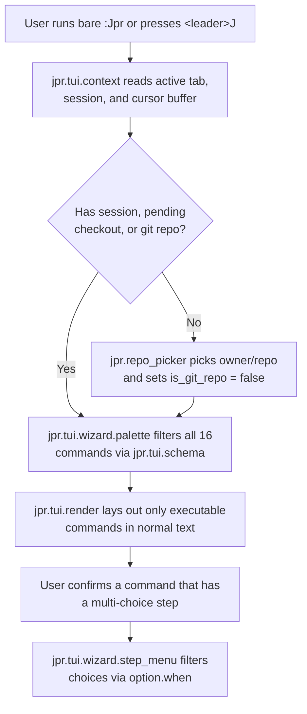
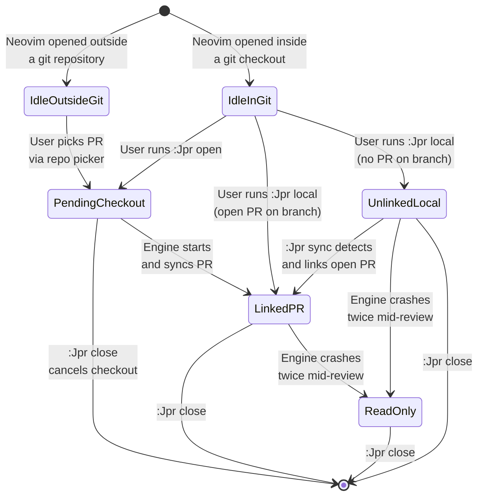

# Executable-Only Neovim Command Palette

<small>

> <table border="0">
> <tr><th colspan="2">Files</th><th colspan="2">Lines</th></tr>
> <tr><td>Changed (total)</td><td>18</td><td>Insertions (+)</td><td>1,081</td></tr>
> <tr><td>Added</td><td>4</td><td>Deletions (-)</td><td>297</td></tr>
> <tr><td>Deleted</td><td>0</td><td>Net change</td><td>+784</td></tr>
> </table>

</small>

## 1. Purpose

Pressing `<leader>J` or running bare `:Jpr` outside an active review tab displayed all sixteen subcommands in one floating list, dimming thirteen session-gated labels with the muted comment highlight while leaving three available labels in normal floating-window text and highlighting the hovered row with the title highlight. To a reviewer scanning the menu, the muted-versus-normal contrast read as unexplained typographic hierarchy rather than disabled commands, and selecting an unavailable command still launched it only to fail with a runtime error. Inside an active review tab, commands that could not run in the sidebar panel<sup>G13</sup>, on a diff stream<sup>G7</sup> file header, in an unlinked local worktree review<sup>G16</sup>, or in a read-only crashed session<sup>G10</sup> were not even dimmed and failed only after selection.

This change:

- Removes non-executable commands and comment-scope choices from the floating Command Palette<sup>G4</sup> and step menus<sup>G14</sup> instead of dimming them (§4).
- Matches each of the sixteen `:Jpr` commands to the active tab's review state and the buffer under the cursor (§5).

## 2. Background technical context

```text
lua/jpr/
├── init.lua                (changed)
├── repo_picker.lua
├── commands/
│   └── schema/             (changed)
├── session/
│   └── open.lua            (changed)
├── tui/
│   ├── context.lua         (new)
│   ├── schema.lua          (changed)
│   ├── render.lua          (changed)
│   └── wizard/             (changed)
├── render/
│   └── stream.lua
└── views/
    ├── diff/
    └── stream/
        └── anchors.lua
```

<small>

| Unit | What it is |
| --- | --- |
| `init.lua` | Top-level plugin entry point that handles `:Jpr` commands and the `<leader>J` shortcut. Calls `tui/context.lua` to inspect the active tab, then opens `repo_picker.lua` or `tui/wizard/`. |
| `repo_picker.lua` | Checks whether Neovim's working directory is inside a git repository and shows a floating picker to select a GitHub `owner/repo` when it is not. Called by `init.lua` before opening the Command Palette<sup>G4</sup> outside a repository. |
| `commands/schema/` | Declarative catalog of all sixteen `:Jpr` subcommands, their wizard steps, and their executability predicates (`init.lua`, `open.lua`, `predicates.lua`). Read by `init.lua` to populate the floating palette and `:Jpr` command-line completion. |
| `session/open.lua` | Runs `:Jpr open` pull-request checkouts in new pending checkout tabs<sup>G9</sup> and tracks in-flight checkouts before the review engine<sup>G12</sup> starts. Registers its checkout helpers on `jpr.session`, which stores one active pull-request or local review session per Neovim tab. |
| `tui/context.lua` | Reads the active Neovim tab, its review session, and the cursor's current buffer into one plain Lua table when `:Jpr` runs. Passed from `init.lua` into `tui/wizard/` and `tui/schema.lua` to evaluate command visibility. |
| `tui/schema.lua` | Pure validator and filter for command and wizard-step specs, with no Neovim window or buffer calls. Called by `tui/wizard/` and `tui/render.lua` to drop commands and select options that cannot run. |
| `tui/render.lua` | Pure layout builder that turns filtered commands and wizard steps into floating-window lines and highlight spans. Called by `tui/wizard/` before painting each modal buffer. |
| `tui/wizard/` | Floating modal controller for the Command Palette<sup>G4</sup> (`palette.lua`) and step-by-step command menus (`step_menu.lua`). Handles keyboard navigation and calls `tui/schema.lua` and `tui/render.lua` on every redraw. |
| `render/stream.lua` | Pure layout builder for the multi-file diff stream<sup>G7</sup> buffer that displays all changed pull-request files in one view. Queried by `tui/context.lua` to find which changed file owns the cursor's line. |
| `views/diff/` | Renders individual changed worktree files<sup>G2</sup> as inline diff overlays or side-by-side splits beside a read-only base buffer<sup>G1</sup>. Queried by `tui/context.lua` to check whether the cursor is in a changed worktree file. |
| `views/stream/anchors.lua` | Maps cursor lines inside a diff stream<sup>G7</sup> buffer to line, range, or file-level comment anchors<sup>G5</sup>. Called by `tui/context.lua` through `jpr.views.stream` to tell diff lines apart from file headers. |

</small>

## 3. Shape of the solution

This change separates the rules that decide whether a command can run from the code that draws and navigates the floating menus. When a reviewer presses `<leader>J` or runs bare `:Jpr`, the plugin reads the active tab's session state and cursor position once into a plain Lua TUI context<sup>G15</sup> table, runs the predicate attached to each command and multi-choice step option, and passes only executable entries to the floating modal controller and layout renderer.



> *Active tab and cursor state flows one way into `jpr.tui.schema`, so the floating Command Palette<sup>G4</sup> and step menus<sup>G14</sup> only render and navigate commands that can run.*
>
> **Diagram key**
>
> | | |
> | --- | --- |
> | **pending checkout** | A loading tab<sup>G9</sup> whose `:Jpr open` checkout process has not yet started the review engine<sup>G12</sup>. |
> | **`is_git_repo = false`** | Context flag set after picking a repository outside a local git checkout, hiding worktree-only commands. |
> | **`jpr.tui.schema`** | Pure validator and filter module that evaluates command and step-option predicates. |
> | **`option.when`** | Optional predicate function on a multi-choice step option that hides choices invalid at the cursor. |

The two strands meet at the TUI context<sup>G15</sup> table: §4 filters commands and multi-choice step options inside the TUI schema, wizard controller, and layout renderer, while §5 builds that context table from the active tab and cursor buffer and defines each command's availability rule in the command schema.

## 4. The Command Palette and multi-choice step menus filter out unavailable entries before rendering

This first strand covers how the floating Command Palette<sup>G4</sup> and multi-choice step menus<sup>G14</sup> decide which commands and choices can run and keep keyboard navigation aligned with the visible rows.

### 4.1 A command appears in the Command Palette only when its session, repository, and custom predicate checks all pass

To ensure the palette controller and layout renderer agree on which commands are available, both delegate to `is_command_executable` in `lua/jpr/tui/schema.lua`, a pure module that validates command specs and filters them without touching Neovim windows or buffers.

**File: `lua/jpr/tui/schema.lua`**

```lua {6-15}
function M.is_command_executable(command, context)
    if type(command) ~= "table" then
        return false
    end
    local current_context = context or {}
    if command.requires_session == true and current_context.has_session ~= true then
        return false
    end
    if command.requires_git_repo == true and current_context.is_git_repo == false then
        return false
    end
    if type(command.when) == "function" and command.when(current_context) ~= true then
        return false
    end
    return true
end
```

All three conditions must pass for a command to appear in the Command Palette<sup>G4</sup>. `requires_session` requires an explicit `true` on `context.has_session`, whereas `requires_git_repo` fails only when `context.is_git_repo` is explicitly `false`. Treating an omitted `is_git_repo` as allowed keeps callers and tests that pass a partial context table from silently hiding git-repository commands unless Neovim was explicitly detected outside a git checkout. The helper `get_active_commands(commands, context)` applies `is_command_executable` across the full command list in order, and `validate_command_specs` checks in the Lua schema test suite that every `command.when` and select `option.when` field is a function so misconfigured predicates fail tests before shipping.

Consider **Review Current Worktree** (`requires_session = false`, `requires_git_repo = true`) and **Submit Review** (`requires_session = true`, `when = is_live_linked_pr_session`, which requires a writable session linked to a GitHub pull request) evaluated under two inputs:

1. Context `{ has_session = false, is_git_repo = false }` (idle outside a git repository): **Review Current Worktree** fails `requires_git_repo` and returns `false`; **Submit Review** fails `requires_session` and returns `false`. Neither appears in the list returned by `get_active_commands`.
2. Context `{ has_session = true, is_git_repo = true, is_read_only = false, is_linked_pr = false }` (an unlinked local worktree review<sup>G16</sup> with no linked GitHub PR): **Review Current Worktree** passes all three checks and returns `true`; **Submit Review** passes `requires_session` and `requires_git_repo` but fails `is_live_linked_pr_session` because `is_linked_pr` is `false`, returning `false`.

### 4.2 The palette controller, layout renderer, and multi-choice step menus all filter through the TUI schema module

Once `is_command_executable` defines which commands are eligible, both the floating palette controller and the layout renderer must agree on the filtered list. `palette.open_at` filters commands through `schema.get_active_commands` when opening the window so its stored command list, `j`/`k`/`gg`/`G` wrap-around movement, `CursorMoved` hover selection, `<CR>` execution, and returning to the palette with `h` from Step 1 of a command step menu<sup>G14</sup> all index into the exact same visible rows. `render.create_palette_layout_from_commands` runs the same filter idempotently so unit tests and any direct callers that pass the unfiltered 16-command list to the renderer produce the same layout. Without filtering in `palette.open_at`, pressing `j` in an idle palette would step onto an index that no longer matches the rendered rows, and pressing `h` from Step 1 would highlight the wrong command.

**File: `lua/jpr/tui/render.lua`**

```lua {1,4-7}
local function append_palette_command(layout, command, command_index, is_selected, max_width)
    ...
    layout.item_for_line[row_number] = command_index
    if is_selected then
        layout.cursor_line = row_number
        append_highlight(layout.highlights, line_index, 0, #prefix + #label, "JprTitle")
    end
    local id_col_start = #prefix + #label + 2
    append_highlight(layout.highlights, line_index, id_col_start, id_col_start + #id_tag, "JprMuted")
    ...
end
```

Because `create_palette_layout_from_commands` filters `commands` through `schema.get_active_commands` before iterating, `append_palette_command` no longer accepts `has_session` or `is_git_repo` and carries no `JprMuted` dimming branch for labels. Every visible unselected label renders in the colorscheme's normal text foreground, while `[id]` tags, hover helper text, and footer hints continue to use `JprMuted`. If every command is filtered out, the existing `(no commands available)` empty-state path handles navigation as a safe no-op.

Multi-choice step menus<sup>G14</sup> (`kind = "select"`) follow the same model: `step_menu.lua` filters each step's choices with `schema.get_active_options_from_step(step, answers, context)` - passing prior step answers and the TUI context<sup>G15</sup> table to each option's `when` predicate - instead of reading `step.options` unfiltered. Meanwhile, `subcommand_arg_completions` in `lua/jpr/commands/schema/init.lua` still reads `step.options` directly so `:Jpr comment <Tab>` command-line completion continues to offer every argument.

## 5. Each command's availability depends on the active tab's session state and the buffer under the cursor

This second strand builds the TUI context<sup>G15</sup> table that §4 consumes by inspecting the active Neovim tab, its review session, and the buffer under the cursor, and defines the availability rule for each of the sixteen `:Jpr` commands.

### 5.1 Six tab and session states determine which commands can execute

Before inspecting the cursor's buffer, the plugin classifies the active Neovim tab into one of six session states that govern which commands appear in the Command Palette<sup>G4</sup>.



> *Each tab state enables a different subset of commands in the Command Palette<sup>G4</sup>: pending checkouts expose `:Jpr close` before the review engine<sup>G12</sup> starts, unlinked local reviews<sup>G16</sup> omit GitHub PR-only commands, and read-only sessions<sup>G10</sup> keep only local view and close commands that do not talk to the review engine.*
>
> **Diagram key**
>
> | | |
> | --- | --- |
> | **IdleOutsideGit** | No review session and Neovim's working directory is not a git repository (`is_git_repo = false`). |
> | **IdleInGit** | No review session inside a local git checkout (`is_git_repo = true`). |
> | **PendingCheckout** | Loading tab<sup>G9</sup> running `jpr-review checkout` before the review engine<sup>G12</sup> starts (`has_pending_tab = true`). |
> | **UnlinkedLocal** | Local worktree review with no linked GitHub PR (`has_session = true`, `is_linked_pr = false`). |
> | **LinkedPR** | Active review linked to a GitHub pull request (`has_session = true`, `is_linked_pr = true`). |
> | **ReadOnly** | Review session downgraded after the review engine<sup>G12</sup> crashes twice mid-review (`is_read_only = true`); engine requests are blocked. |

`create_context_from_session(session, cmd_opts)` in `lua/jpr/tui/context.lua` reads these tab and session states from `session.current()`: `has_session`, `is_read_only`, `is_linked_pr` (`true` for PR-mode sessions or local sessions once `view.pr` is populated), `local_unsent_count` (copied from `view.localUnsentCount`), `has_cached_conversation` (whether the session holds a valid conversation buffer<sup>G6</sup>), and `has_live_agent` (from `jpr.agent`). When no session has started yet, it calls `session.has_pending_tab(tab)` in `lua/jpr/session/open.lua` to check whether an in-flight `:Jpr open` checkout is running in the current tab. In `lua/jpr/init.lua`, `open_palette_with_repo_picker` checks `context.has_session or context.has_pending_tab or is_in_git_repo` before invoking `repo_picker.pick`; without `has_pending_tab`, pressing `<leader>J` inside a loading tab<sup>G9</sup> started from outside a git repository would detour into the repository picker<sup>G11</sup> instead of letting the reviewer reach **Close Review Session** (`[close]`).

### 5.2 Diff stream cursor inspection separates commentable diff lines from file headers and file-level thread rows

To decide whether comment and code-suggestion actions can run from the cursor's current location, `create_context_from_session(session, cmd_opts)` in `lua/jpr/tui/context.lua` (where `cmd_opts` is Neovim's `:Jpr` command-options table, carrying any visual line range) inspects the active window once and delegates diff stream<sup>G7</sup> buffers to `inspect_stream_cursor`.

**File: `lua/jpr/tui/context.lua`**

```lua {2-7}
local function inspect_stream_cursor(current_session, win)
    local line = vim.api.nvim_win_get_cursor(win)[1]
    local anchor = require("jpr.views.stream").anchor_at_range(current_session, win, line, line)
    local is_on_diff_line = anchor ~= nil and (anchor.kind == "line" or anchor.kind == "range")
    local layout = current_session.stream and current_session.stream.layout
    local can_comment_file = (anchor ~= nil and anchor.kind == "file")
        or (layout ~= nil and require("jpr.render.stream").find_file_at_line(layout, line) ~= nil)
    return {
        is_on_diff_line = is_on_diff_line,
        can_comment_file = can_comment_file,
        is_in_changed_worktree_file = false,
    }
end
```

In the diff stream<sup>G7</sup>, two non-diff rows still belong to a file: file-header rows (and hunk headers) have no entry in `layout.anchors` so `anchor_at_range` returns `nil` while `find_file_at_line(layout, line)` resolves the enclosing file, and file-level thread badge rows store `{ file = ..., kind = "file", side = "RIGHT" }` in `layout.anchors` so `anchor_at_range` returns a non-nil `kind = "file"` comment anchor<sup>G5</sup>. Checking `anchor ~= nil` alone would misclassify a file-level thread row as a commentable diff line, exposing **Line / Selection Comment** (`[line]`) and the comment wizard's **Code Suggestion** option (`[suggest]`) where only file-level anchoring works. Restricting `is_on_diff_line` to `anchor.kind == "line" or anchor.kind == "range"` and deriving `can_comment_file` from either `anchor.kind == "file"` or `find_file_at_line` handles every buffer kind:

- Cursor on row 1 of the stream (a file header, `▾   lua/app.lua  +1 -0`): `anchor_at_range` returns `nil`, while `find_file_at_line` finds `lua/app.lua`, so `is_on_diff_line = false`, `can_comment_file = true`, and `is_in_changed_worktree_file = false`. The palette shows `:Jpr comment` (whose step menu<sup>G14</sup> offers only **File-Level Comment** `[file]`) and hides the top-level `:Jpr suggest` (**Suggest Code Change**) command.
- Cursor on a file-level thread badge row in the stream: `anchor_at_range` returns `{ file = "lua/app.lua", kind = "file", side = "RIGHT" }`, producing the same flags (`is_on_diff_line = false`, `can_comment_file = true`, `is_in_changed_worktree_file = false`) and the same `[file]`-only comment menu.
- Cursor on row 3 of the stream (a diff line, `          1 + local x = 1`): `anchor_at_range` returns `{ file = "lua/app.lua", kind = "line", side = "RIGHT", start = 1, end = 1 }` and `find_file_at_line` finds `lua/app.lua`, so `is_on_diff_line = true`, `can_comment_file = true`, and `is_in_changed_worktree_file = false`. The palette shows `:Jpr comment` (offering all three choices: `[line]`, `[file]`, and the **Code Suggestion** `[suggest]` draft option) while still hiding the top-level `:Jpr suggest` command, which extracts uncommitted worktree edits and works only inside changed worktree file<sup>G2</sup> buffers.
- Cursor in a read-only base buffer<sup>G1</sup> (the base-commit pane of a side-by-side file diff, identified by `vim.b[buf].jpr_base_path`): `is_on_diff_line = true`, `can_comment_file = true`, and `is_in_changed_worktree_file = false`.
- Cursor in a changed worktree file<sup>G2</sup> (`jpr.views.diff.buffer_to_changed_path` non-nil): all three booleans are `true`, exposing both `:Jpr comment` and `:Jpr suggest` (in linked PR sessions<sup>G8</sup>).
- Cursor in the sidebar panel<sup>G13</sup>, conversation buffer<sup>G6</sup>, coding-agent terminal<sup>G3</sup>, or an unchanged file: all three booleans are `false`, so both `:Jpr comment` and `:Jpr suggest` are omitted from the palette.

### 5.3 Each of the sixteen :Jpr commands declares its palette rule with a predicate in lua/jpr/commands/schema/

Each of the sixteen `:Jpr` commands declares its palette availability rule using predicates from `lua/jpr/commands/schema/predicates.lua`. To keep every Lua module under 400 lines while preserving `require("jpr.commands.schema")` as the sole public import path, the former single-file `lua/jpr/commands/schema.lua` was split into `init.lua`, `open.lua`, and `predicates.lua`. The table below summarizes the palette rule for every subcommand:

| Command | Palette executability rule in `predicates.lua` / `init.lua` |
| --- | --- |
| `open`, `keys` | Always executable (`requires_session = false`) |
| `local` | Inside a git repository (`requires_git_repo = true`) |
| `close` | Active session or pending checkout tab<sup>G9</sup> (`has_session or has_pending_tab`) |
| `toggle`, `expand` | Active session (`requires_session = true`) |
| `stream`, `sync`, `prepass` | Active writable session (`has_session and not is_read_only`) |
| `conversation` | Active writable session, or read-only session<sup>G10</sup> with a cached conversation buffer<sup>G6</sup> |
| `agent` | Active writable session, or read-only session<sup>G10</sup> with a live agent process |
| `send` | Active writable session with `local_unsent_count > 0` |
| `submit`, `push` | Active writable session linked to a GitHub PR (`is_linked_pr`) |
| `comment` | Active writable session with `is_on_diff_line or can_comment_file` (the Comment Scope step menu<sup>G14</sup> filters `[line]` and the Code Suggestion `[suggest]` option to `is_on_diff_line`, and `[file]` to `can_comment_file`) |
| `suggest` | Active writable linked PR session<sup>G8</sup> with `is_in_changed_worktree_file` |

## 6. Interface changes

Live GUI screenshots are omitted because `jpr-nvim` is a Neovim terminal plugin with no browser interface and headless verification runs without a GUI terminal renderer. The wireframes below show the exact floating window layouts rendered by `lua/jpr/tui/render.lua`.

Idle in a git checkout (no active review session):

```text
BEFORE (16 items: 3 normal, 13 muted)              AFTER (3 items: all executable, uniform text)
╭─────────────── Jpr Commands ────────────────╮    ╭─────────────── Jpr Commands ────────────────╮
│ ▸ Open Pull Request  [open]                 │    │ ▸ Open Pull Request  [open]                 │
│     Pick an open pull request or enter a    │    │     Pick an open pull request or enter a    │
│     PR number or URL to start reviewing.    │    │     PR number or URL to start reviewing.    │
│   Review Current Worktree  [local]  (normal)│    │   Review Current Worktree  [local]  (normal)│
│   Sync with GitHub  [sync]           (muted)│    │   Keyboard Shortcuts  [keys]        (normal)│
│   Switch Diff View  [toggle]         (muted)│    │                                             │
│   ... 11 more muted session rows ...        │    │ [j/k] move  [Enter/l] select  [q/Esc] close │
│   Keyboard Shortcuts  [keys]        (normal)│    ╰─────────────────────────────────────────────╯
│                                             │
│ [j/k] move  [Enter/l] select  [q/Esc] close │    Key: ▸ row = JprTitle (Title);
╰─────────────────────────────────────────────╯    unselected labels = NormalFloat (normal);
                                                   [id]/help/footer = JprMuted (Comment)
```

Opening **Add Review Comment** (`[comment]`) when the cursor is on a diff stream<sup>G7</sup> file header:

```text
BEFORE (3 options; [line]/[suggest] fail/mismatch) AFTER (only [file] shown and preselected)
╭──────────── Add Review Comment ─────────────╮    ╭──────────── Add Review Comment ─────────────╮
│ Step 1 of 1 · Comment Scope  ●              │    │ Step 1 of 1 · Comment Scope  ●              │
│ Choose whether to comment on the current    │    │ Choose whether to comment on the current    │
│ line, the whole file, or suggest code.      │    │ line, the whole file, or suggest code.      │
│                                             │    │                                             │
│   Line / Selection Comment  [line]          │    │ ▸ File-Level Comment  [file]                │
│ ▸ File-Level Comment  [file]                │    │     Attach a review comment to the current  │
│     Attach a review comment to the current  │    │     file without anchoring to a line.       │
│     file without anchoring to a line.       │    │                                             │
│   Code Suggestion  [suggest]                │    │ [j/k] move  [h] palette  [Enter/l] run ...  │
│                                             │    ╰─────────────────────────────────────────────╯
│ [j/k] move  [h] palette  [Enter/l] run ...  │
╰─────────────────────────────────────────────╯
```

## 7. Decisions

- **Hide unavailable commands from the Neovim Command Palette<sup>G4</sup> using per-command predicate functions instead of dimming them with the muted `JprMuted` highlight.** Filtering only on coarse `requires_session` and `requires_git_repo` flags was rejected because it would leave PR-only commands (`submit`, `push`, `suggest`), commands that need a live review engine<sup>G12</sup> during a read-only crashed session<sup>G10</sup>, and cursor-gated commands (`comment`, `suggest`) visible where selecting them fails. This choice would be reversed only if reviewers request an explicit palette toggle to inspect disabled commands alongside inline explanations of why each is unavailable.
- **Hide `:Jpr send` when there are no unsent local comments<sup>G17</sup>, while keeping `:Jpr push` visible in all linked PR sessions<sup>G8</sup>.** Hiding `:Jpr push` when the engine's ahead-commit count (`worktreeStatus.ahead`) is zero was rejected because the review engine<sup>G12</sup> polls git status every 2 seconds, so `:Jpr push` could briefly disappear right after a reviewer commits in a terminal; by contrast, `view.localUnsentCount` (copied to `context.local_unsent_count`) updates synchronously on every local comment mutation. If `worktreeStatus` becomes event-driven on git commits, gating `:Jpr push` on `ahead > 0` becomes safe.
- **Filter commands inside the floating palette controller and its layout renderer instead of pre-filtering them in the `:Jpr` entry point.** Running `schema.get_active_commands` in `palette.open_at` and idempotently in `render.create_palette_layout_from_commands` (rather than imperatively in `lua/jpr/init.lua`) keeps keyboard navigation, returning from Step 1 to the right palette row, and direct unit tests of `render` and `wizard` consistent with the command schema rules. This choice would be reversed only if a caller needed to pass a custom pre-filtered command list whose items bypass their declared predicates.
- **Keep direct `:Jpr <subcommand>` dispatch and command-line tab completion unfiltered for all sixteen subcommands.** Hiding subcommands from Neovim command-line completion was rejected because scripts, keymaps, and direct `:Jpr` typing must stay predictable and preserve full parity between non-interactive commands and the interactive palette. This choice would be reversed only if reviewers prefer context-sensitive `:Jpr` command-line completion that hides session-only subcommands when idle.
- **Open the Command Palette<sup>G4</sup> directly in tabs with an in-flight pull-request checkout instead of routing through the repository picker<sup>G11</sup>.** Skipping `repo_picker.pick` when `has_pending_tab` is `true` ensures a reviewer who started a checkout outside a git repository can still cancel it through **Close Review Session** (`[close]`). This choice would be reversed only if pending loading tabs receive their own dedicated cancel keybinding and reviewers want `<leader>J` to start a second checkout in another repository while the first loads.

## 8. Deliberately not handled

- **Rust CLI `jpr-review` Command Palette<sup>G4</sup>:** The standalone CLI palette has no Neovim tab, buffer, or active-session state, so every CLI subcommand remains unconditionally visible.
- **Gating `:Jpr suggest` on whether the current line specifically contains an uncommitted edit:** Checking whether the cursor's line has uncommitted hunks against the pull request's head commit (`pr.head_sha`) requires an asynchronous diff request to the Rust review engine<sup>G12</sup> (the `suggestFromEdit` RPC method handled by `suggest_from_edit` in `review-core`), so the palette gates `:Jpr suggest` only on synchronous checks (a writable linked PR session<sup>G8</sup> and a changed worktree file<sup>G2</sup> buffer).
- **Hiding `:Jpr stream` or `:Jpr conversation` when the cursor is already in that buffer:** Re-running either command focuses or refreshes the view without error, so both remain visible inside active sessions.

<div style="page-break-before: always"></div>

## Appendix A. Manual testing

<small>

1. Launch Neovim inside this worktree with the plugin on `runtimepath`:

   ```sh
   nvim --clean --cmd "set rtp+=."
   ```

2. Outside any review tab, press `<leader>J` (or run `:Jpr`).
   - **Before this change:** all 16 commands appeared, with 13 session-only labels dimmed via `JprMuted` (`Comment`) and 3 available labels in normal floating-window text.
   - **Now:** only **Open Pull Request** (`[open]`), **Review Current Worktree** (`[local]`), and **Keyboard Shortcuts** (`[keys]`) appear, with uniform normal text on unselected labels and the colorscheme's `JprTitle` (`Title`) highlight on the hovered row.
3. Exit Neovim and open a session from a non-git directory (such as `/tmp`) with this worktree on `runtimepath`:

   ```sh
   REPO_DIR="$(pwd)" && (cd /tmp && nvim --clean --cmd "set rtp+=$REPO_DIR")
   ```

4. Run `:Jpr` and choose a repository in the picker.
   - **Before this change:** **Review Current Worktree** (`[local]`) and all 13 session commands still appeared dimmed in the palette opened for the selected repository.
   - **Now:** only **Open Pull Request** (`[open]`) and **Keyboard Shortcuts** (`[keys]`) appear.
5. Back in a git repository, open an unlinked local review<sup>G16</sup> (`:Jpr local`) and a linked PR review (`:Jpr open`), then run `:Jpr` from:
   - the sidebar panel<sup>G13</sup> (confirm **Add Review Comment** and **Suggest Code Change** are hidden, and **Send Local Threads to Agent** appears only once an unsent local comment<sup>G17</sup> exists),
   - a diff stream<sup>G7</sup> file header (confirm **Add Review Comment** opens with only **File-Level Comment** (`[file]`), and **Suggest Code Change** is hidden),
   - a changed worktree file<sup>G2</sup> buffer (confirm **Add Review Comment** and **Suggest Code Change** appear in a linked PR, while **Submit Review**, **Push Head Branch**, and **Suggest Code Change** stay hidden in an unlinked local review<sup>G16</sup>).
6. Run the automated verification suite covering all state combinations (including pending checkout tabs<sup>G9</sup> and read-only sessions<sup>G10</sup>, which are easiest to trigger deterministically via headless specs):

   ```sh
   just check
   ```

   Confirm formatting, clippy, Rust workspace tests, and all Lua specs pass with exit code 0.

</small>

<div style="page-break-before: always"></div>

## Appendix B. Glossary

<small>

| Term | Meaning |
| --- | --- |
| **G1** Base buffer | A read-only Neovim buffer holding a changed file's contents at the pull request's base commit, shown beside the working file in side-by-side split diff view and marked with `vim.b[buf].jpr_base_path`. |
| **G2** Changed worktree file | A real file on disk inside the checked-out review worktree that differs from the base commit, opened in Neovim for editing or diffing and recognized by `jpr.views.diff.buffer_to_changed_path`. |
| **G3** Coding-agent terminal (agent terminal) | A Neovim terminal split launched by `:Jpr agent` that runs an interactive coding agent CLI (such as Claude Code or Codex) inside the review worktree. |
| **G4** Command Palette | The centered floating Neovim menu opened by `<leader>J` or bare `:Jpr` that lists currently executable `:Jpr` commands with hover-only helper text. |
| **G5** Comment anchor | The target a review comment attaches to in a pull request diff: a single line (`line`), a multi-line selection (`range`), or an entire file (`file`). |
| **G6** Conversation buffer | The Neovim review buffer opened by `:Jpr conversation` that displays and posts top-level pull request issue comments (or local notes during an unlinked local review<sup>G16</sup>). |
| **G7** Diff stream | A scrollable Neovim view opened by `:Jpr stream` (one buffer in unified mode, or two scroll-bound buffers in split mode) that stacks every changed file's diff continuously, with collapsible file headers, hunk headers, diff lines, and inline review threads. |
| **G8** Linked PR session (linked pull request session) | An active review session attached to a GitHub pull request (`context.is_linked_pr = true`), enabling GitHub-backed actions such as `:Jpr submit`, `:Jpr push`, and `:Jpr suggest`. |
| **G9** Pending checkout tab (loading tab) | A Neovim tab opened by `:Jpr open` while `jpr-review checkout` is still fetching and creating the pull request worktree before the review engine<sup>G12</sup> starts (`context.has_pending_tab = true`). |
| **G10** Read-only session (read-only crashed session) | A review tab downgraded after the background review engine<sup>G12</sup> crashes twice mid-review (`context.is_read_only = true`); open buffers stay readable, but commands that require the engine are disabled. |
| **G11** Repository picker (repo picker) | The floating menu (`jpr.repo_picker`) shown when bare `:Jpr` runs outside a git repository so the reviewer can choose a GitHub `owner/repo` before opening the Command Palette<sup>G4</sup>. |
| **G12** Review engine | The background `jpr-review serve` Rust process attached to a review tab that syncs pull request data with GitHub, computes diffs, and persists viewed marks and local comments. |
| **G13** Sidebar panel | The side window in a review tab that displays pull request metadata and the navigable tree of changed files, separate from diff and stream buffers. |
| **G14** Step menu (stepper) | A floating modal screen shown after choosing a command with follow-up choices (such as choosing **Line / Selection Comment**, **File-Level Comment**, or **Code Suggestion** for `:Jpr comment`). |
| **G15** TUI context | The plain Lua table built once by `jpr.tui.context` when `:Jpr` runs, holding the current tab's session mode, pending checkout flag, read-only state, unsent comment count, and cursor diff position for predicate checks. |
| **G16** Unlinked local review (unlinked local worktree review) | A review session started with `:Jpr local` against a local git worktree whose branch has no open GitHub pull request yet (`context.is_linked_pr = false`); GitHub PR actions stay hidden until `:Jpr sync` links a pull request. |
| **G17** Unsent local comment | A review comment stored locally in the session that has not yet been dispatched to the coding agent via `:Jpr send`, tracked synchronously by `view.localUnsentCount` (`context.local_unsent_count`, which counts open local threads awaiting dispatch). |

</small>
