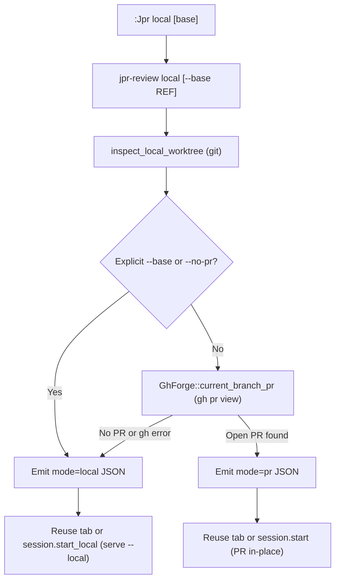

# Track 2 (0.7.0): Local Worktree Review, Active PR Auto-Detection, and Mid-Session PR Linking

<small>

> <table border="0">
> <tr><th colspan="2">Files</th><th colspan="2">Lines</th></tr>
> <tr><td>Changed (total)</td><td>81</td><td>Insertions (+)</td><td>4,148</td></tr>
> <tr><td>Added</td><td>12</td><td>Deletions (-)</td><td>754</td></tr>
> <tr><td>Deleted</td><td>0</td><td>Net change</td><td>+3,394</td></tr>
> </table>

</small>

## 1. Purpose

Previously, reviewers could only start a `jpr-nvim` review session after a GitHub pull request already existed, and `:Jpr open` always checked the pull request out into a separate worktree. Reviewing local branch work before opening a pull request required leaving Neovim, and publishing a branch mid-review left no way to carry local viewed marks, local review notes, or a running coding-agent terminal onto the newly opened pull request.

This change:

- Adds `:Jpr local [base]` and `jpr-review local` to review the current worktree in-place against its auto-detected or explicit base branch (§3).
- Auto-attaches bare `:Jpr local` to an open GitHub pull request on the current branch when one exists, while keeping explicit `--base` local-only (§3).
- Unifies local and pull-request sessions inside `ReviewSession`, gating GitHub-only mutations and background GitHub polling while unlinked (§4).
- Upgrades a live local session into a linked pull-request session when `:Jpr sync` detects a newly opened pull request, preserving `JPR_SOCKET` and pushing locally viewed files to GitHub (§5).
- Updates the Neovim command palette, panel, statusline, compose float, conversation buffer, and protocol version 8 lockstep for local and upgraded sessions (§6).

## 2. Background technical context

`jpr-nvim` splits review logic from editor presentation across a Rust workspace (`crates/review-*`, `crates/cli-tui`, `crates/jpr-review`) and a thin Lua Neovim frontend (`lua/jpr/`). Generic `crates/review-*` crates never depend on Neovim, Lua, or terminal UI libraries; `crates/jpr-review/tests/dependency_rule.rs` enforces this boundary against `cargo metadata`.

| Component | Path | Role before this change |
| --- | --- | --- |
| Domain read models | `crates/review-model/src/view/mod.rs` | Defines `SessionView`, `FileRow` (including `is_local_only`), `WorktreeStatus`, and `Event`. |
| Session facade | `crates/review-core/src/session/mod.rs` | Owns one PR's state (`number: u64`), `Ports` (`Forge`, `ReviewStore`, `Workspace`, `Clock`), and event subscribers. |
| Local worktree merging | `crates/review-core/src/session/local_files.rs` | Merges local worktree changes since merge base with GitHub files and persists `local_viewed` in `local.json`. |
| Filesystem store | `crates/review-store-fs/src/lib.rs` | Writes `session.json`, `viewed.json`, `github.json`, `local.json`, and `rounds.jsonl` inside `<state>/jpr/<owner>/<repo>/pr-<N>/`. |
| GitHub adapter | `crates/review-forge-github/src/lib.rs` | Runs `gh pr view` and GraphQL/REST mutations with a 30-second timeout. |
| Git adapter | `crates/review-workspace-git/src/workspace.rs` | Computes merge bases, diffs, worktree status, pushes, and fast-forwards inside a git worktree. |
| JSON-RPC server | `crates/review-rpc/src/server/ticker.rs` | Serves stdio JSON-RPC plus an allowlisted Unix socket (`JPR_SOCKET`) and runs 60s sync, 20s retry, and 2s worktree-watch ticks. |
| Neovim session manager | `lua/jpr/session/init.lua` | Manages one review tab per PR, spawns `jpr-review serve`, and renders `SessionView` into panel, stream, and diff windows. |

## 3. Starting a review in the current worktree without creating a checkout worktree

Running `:Jpr local [base]` (or `jpr-review local [--base <REF>] [--repo <OWNER/NAME>] [--no-pr]`) inspects the current worktree in-place instead of checking out a second worktree.



### 3.1 Base-branch auto-detection follows `dif` precedence with safe ref validation

`crates/review-workspace-git/src/local_ref.rs` validates any caller-supplied git ref (`validate_git_ref` rejects empty strings, leading `-`, ASCII control characters, whitespace, `..`, and `@{`) before passing it to git. When no `--base` ref is supplied, `resolve_default_base_branch` probes local and remote-tracking refs in deterministic order: `develop`, `origin/develop`, `main`, `origin/main`, `origin/HEAD` (symbolic ref), `master`, and `origin/master`. `inspect_local_worktree` resolves the worktree's canonical root, reads the checked-out branch (or `detached-<short-sha>` when `HEAD` is detached), and resolves `base_ref` to its full commit SHA (`base_sha`).

### 3.2 Bare `:Jpr local` auto-attaches to an open PR while explicit `--base` stays local-only

In `crates/jpr-review/src/commands/local.rs`, `resolve_local_output` checks `base_override.is_none() && !no_pr`:

- **Bare `:Jpr local`:** calls `GhForge::current_branch_pr()` (`gh pr view --json ...` with no PR number). `parse_optional_open_pr` accepts only `OPEN` pull requests (`MERGED` and `CLOSED` return `Ok(None)`). `is_no_pr_for_branch_stderr` classifies expected "no pull request", "not on any branch", and non-GitHub-remote stderr messages as `Ok(None)`, while network or auth failures return `Err` and fall back to local mode with a stderr warning.
- **Explicit `--base <REF>` (such as `:Jpr local HEAD`):** bypasses `current_branch_pr()` entirely and emits `{"mode":"local",...}`, guaranteeing an unlinked local review against that exact ref even if the branch has an open PR.
- **Fork and non-GitHub safety:** `GhForge::new` receives `Some(repo)` only when the user explicitly supplied `--repo`, never the `origin`-inferred `owner/name`. That lets `gh` resolve upstream pull requests on forks and cleanly report non-GitHub remotes as `Ok(None)`.

### 3.3 Canonical worktree tab reuse prevents conflicting sessions in one worktree

`lua/jpr/session/open_local.lua` resolves the canonical realpath of `info.worktree` and checks all open review tabs in `session.by_tab`. If a tab is already open for the same worktree, Neovim focuses that tab without closing any buffers; if the existing tab has a different mode or `baseRef`, Neovim emits an informational notice telling the reviewer to run `:Jpr close` to switch.

## 4. Running `ReviewSession` without a linked pull request

`ReviewSession` replaces its `number: u64` field with `target: SessionTarget` (`SessionTarget::Pr { number }` or `SessionTarget::Local(Box<LocalReviewContext>)`).

```mermaid
stateDiagram-v2
    [*] --> LocalUnlinked: ReviewSession::open_local
    [*] --> PrLinked: ReviewSession::open
    LocalUnlinked --> LocalUnlinked: set_viewed / local comment / send / prepass / refresh_worktree
    LocalUnlinked --> PrLinked: sync() finds open PR (in-place upgrade)
    PrLinked --> PrLinked: sync() / push() / submit_review() / promote_thread()
```

### 4.1 Local state paths avoid collisions across branches and remote-less repositories

`crates/review-store-fs/src/paths.rs` adds `local_state_dir`:

- When `origin` yields `owner/name`: `<state>/jpr/<owner>/<name>/local-<branch-slug>-<8hex>`.
- When no remote exists: `<state>/jpr/_local/<dir-slug>-<8hex>/local-<branch-slug>-<8hex>`.

The 8-hex-digit FNV-1a suffix hashes the canonical worktree path and exact branch name, preventing case-insensitive collisions (such as `feat/Auth` vs `feat/auth`) and separating multiple worktrees checked out on the same branch name.

### 4.2 GitHub-only operations refuse cleanly while local review and bulk agent dispatch work normally

- **Immediate diffs and viewed state:** `ReviewSession::open_local` immediately populates `local_files` and `disk_digests` against `active_base_sha()` (which re-resolves `base_ref` via `Workspace::resolve_ref` on refresh so moving `develop`/`main` updates the merge base). `set_viewed` persists marks in `local.json` (`local_viewed`) and emits `Event::ViewedChanged` without calling `Forge`, and disk edits transition `Viewed` to `Dismissed`.
- **GitHub-only refusals:** `comment(Origin::Github)`, `promote_thread`, `suggest_from_edit`, `submit_preview`, `submit_review`, `push`, `retry_message`, and `prepare_conflict_resolution` all route through `require_linked_pr()`, returning `"this review is not linked to a GitHub pull request yet; run :Jpr sync once a PR is open"`. `mentions()` returns an empty slice.
- **Bulk agent dispatch:** `prepare_agent_launch`, `prepare_send`, `confirm_send`, `agent_reply`, `prepare_prepass`, and `prepass_write` work in local mode. `crates/review-core/src/agent.rs` adds `build_local_send_prompt_from_threads` and `build_local_prepass_prompt_from_context`, instructing the coding agent to keep edits unstaged in the current worktree.
- **Background ticker gating:** `crates/review-rpc/src/server/ticker.rs` skips `PollStep::Sync` and `PollStep::Retry` while `!guard.is_linked()`, while keeping the 2-second `poll_worktree_files()` watcher active so edits and re-anchoring stay live.

## 5. Upgrading a live local session to a GitHub pull request in-place

When `:Jpr sync` runs in an unlinked local session, `ReviewSession::sync` dispatches to `sync_or_link_local` in `crates/review-core/src/session/link.rs`.

### 5.1 Fetch-before-retarget ordering keeps failures side-effect free

`sync_or_link_local` executes in strict order:

1. Calls `forge.current_branch_pr()`. If `Ok(None)`, returns an informational error (`"no open pull request found for branch <branch>; staying in local review mode"`) without setting `SyncState::Failed` or emitting `Event::SyncFailed`.
2. Calls `forge.fetch(&pr)` **before** touching the store. A network or auth failure aborts here with the local session and `local-*` directory untouched.
3. Calls `store.retarget_to_pr(&pr.owner, &pr.repo, pr.number)`. In `crates/review-store-fs/src/retarget.rs`, `prepare_retarget_to_pr` checks that `pr-<N>/` does not already have a live daemon socket (`"already serving PR #<N>"`) or newer schema files, copies `rounds.jsonl` into `pr-<N>/`, switches `FsStore`'s `RwLock<PathBuf>` directory to `pr-<N>/`, and records `pending_retired_dir = Some(old_dir)` without deleting `old_dir` files yet.
4. If `pr-<N>/` already held a prior `StoreSnapshot`, `merge_preexisting_pr_snapshot` merges its GitHub registry and local threads, renumbering any colliding `loc-*` / `loc-m-*` IDs on the incoming prior threads so live UI/agent IDs stay stable, preserving the live daemon's `pid`/`socket`/`worktree`/`agent_session_id`, and removing any stale `queued_viewed` entries for files currently marked `VIEWED` locally.
5. Calls `forge.pin_repo(&pr.owner, &pr.repo)` and switches `self.target = SessionTarget::Pr { number: pr.number }`.
6. Calls `apply_pull(pr, snapshot, now)`. Because `self.saved.session.pr` was `None`, `handle_head_moved` does not fire on first link. `promote_adopted_local_viewed` moves every locally `VIEWED` file present in the PR into `queued_viewed[path] = true` and `send_queued()` pushes `setViewed(path, true)` to GitHub (keeping it queued on transient failure). Unpushed files remain `is_local_only == true` with their local viewed state intact.
7. Calls `store.finalize_retarget()` **only after** `apply_pull` durably saved `pr-<N>/`. `retire_old_local_dir` deletes the migrated JSON/rounds/lock files from `old_dir` while preserving the still-bound `old_dir/s.sock` so any running `:Jpr agent` terminal keeps talking over `JPR_SOCKET`.
8. On clean daemon shutdown, `crates/jpr-review/src/commands/serve/mod.rs` reads `store_handle.current_dir()` so `clear_owned_socket_record` clears `socket` from `pr-<N>/session.json` and best-effort removes the now-empty retired local directory.

## 6. Neovim plugin local UI and protocol v8 lockstep

- **Protocol and version lockstep:** `PROTOCOL_VERSION` advances from `7` to `8` in `crates/review-rpc/src/protocol.rs` and `lua/jpr/rpc.lua`; workspace and plugin `VERSION` advance to `0.7.0`.
- **16th `:Jpr` subcommand:** `lua/jpr/commands/schema.lua` registers `local` (`Review Current Worktree [local]`) right after `open` with discriminant-first `base_mode` (`auto` | `custom`) and conditional `base` ref validation. `lua/jpr/init.lua` routes direct `:Jpr local` and `:Jpr local <ref>` straight to `session.open_local`.
- **Buffer naming and env safety:** `session.buf_key(session)` returns `tostring(session.number)` for PR sessions (preserving `jpr://panel/7`, `jpr://stream/7`, `jpr://conversation/7`, `jpr://loading/7`) and `"local-" .. tostring(session.tab)` for local sessions. `lua/jpr/binary.lua` omits `JPR_PR` when `pr_number == nil` instead of exporting `"nil"`.
- **Local-mode rendering and live upgrade:**
  - `lua/jpr/render/panel.lua` renders `LOCAL <branch> vs <baseRef>`, `local only · :Jpr sync to link PR`, `  💬 Local Notes`, and suppresses redundant `[local]` per-file badges while unlinked.
  - `lua/jpr/render/statusline.lua` renders `LOCAL <branch> · ...` while unlinked and switches to `PR #<N> · ...` once linked.
  - `lua/jpr/comments/compose.lua` locks new comments to `"local"` with footer ` <C-s> save · local review (no linked PR) · q cancel ` while unlinked; `popup.lua` and `views/conversation.lua` guard `p` (promote) with an informational notice.
  - When `session.show(session, view)` receives a `view` with `view.pr` on a local session, `upgrade_local_session_to_pr` updates `session.mode`, `session.number`, and `session.repo`, notifies `Linked to PR #<N>`, and redraws panel, stream, and diffs.

## 7. Decisions

- **Unified in-place `ReviewSession` with two-phase `FsStore` retargeting over spawning a new daemon on link.** Preserves the live `JPR_SOCKET` Unix domain socket so an active `:Jpr agent` terminal never disconnects when a branch is published as a PR. Revisit if multi-PR switching from one worktree becomes a requirement.
- **Explicit `--base <REF>` stays local-only instead of probing GitHub.** Lets a reviewer inspect uncommitted changes (`:Jpr local HEAD`) or compare against a custom branch even when an open PR exists, while bare `:Jpr local` auto-attaches. Revisit if users want an explicit `--pr` flag to force PR lookup alongside `--base`.
- **Explicit-only `--repo` passed to `GhForge` rather than `origin`-inferred `owner/name`.** Allows `gh pr view` to resolve upstream PRs on forks and return `Ok(None)` on non-GitHub remotes without false errors. Revisit if `gh` requires explicit repository disambiguation in multi-remote enterprise setups.

<div style="page-break-before: always"></div>

## Appendix A. Manual testing

<small>

1. Run the full formatting, lint, Rust test, and headless Neovim Lua test suite from the repository root:

   ```sh
   just check
   ```

2. Build the release binary so Neovim runs the `0.7.0` engine:

   ```sh
   cargo build --release -p jpr-review
   ```

3. Verify the CLI inspection command in a git worktree on a branch without an open PR:

   ```sh
   ./target/release/jpr-review local
   ```

   Confirm stdout prints JSON with `"mode":"local"`, `"baseRef"`, and `"baseSha"`.

4. Open Neovim in that worktree and run `:Jpr`. Select **Review Current Worktree [local]** -> **Auto-detect base branch**.
   - Confirm the left panel header reads `LOCAL <branch> vs <baseRef>`, line 4 reads `local only · :Jpr sync to link PR`, and the notes row reads `  💬 Local Notes`.
   - Confirm no redundant `[local]` badge appears on file rows.

5. Press `v` on a changed file to mark it viewed, then open a diff and press `gc` to open the compose float.
   - Confirm the compose footer reads ` <C-s> save · local review (no linked PR) · q cancel ` and saving creates a local note.
   - Confirm `:Jpr submit` and `:Jpr push` report that the review is not linked to a GitHub pull request yet.

6. Open `:Jpr agent` and run `:Jpr send`. Confirm the agent terminal launches without `JPR_PR=nil` and receives the local review prompt instructing it to keep edits unstaged.

7. Open a GitHub pull request for the branch and run `:Jpr sync` inside the same Neovim tab.
   - Confirm Neovim notifies `Linked to PR #<N>`.
   - Confirm the panel header switches to `#<N> <title>`, the previously viewed file stays marked viewed locally and on GitHub, and `:Jpr agent` continues communicating over the existing `JPR_SOCKET`.

</small>

<div style="page-break-before: always"></div>

## Appendix B. Glossary

<small>

| Term | Meaning |
| --- | --- |
| `SessionTarget` | Discriminated enum on `ReviewSession` holding either `Pr { number }` (linked GitHub PR) or `Local(Box<LocalReviewContext>)` (unlinked local worktree review). |
| `LocalReviewContext` | Read-model metadata (`branch`, `baseRef`, `baseSha`, optional `repo`) carried on `SessionView.localContext` while a session is unlinked. |
| `local_state_dir` | Collision-free state directory (`<state>/jpr/<owner>/<repo>/local-<slug>-<8hex>` or `_local/...`) storing local review state before a PR exists. |
| Two-phase retargeting | `FsStore::retarget_to_pr` copies `rounds.jsonl` and switches the active directory to `pr-<N>/`, while `FsStore::finalize_retarget` retires old local files only after `pr-<N>/` is durably saved. |
| Authoritative local viewed promotion | On first link to a PR, every file marked `VIEWED` locally in `local.json` is promoted into `queued_viewed` and sent to GitHub via `setViewed(path, true)` so local progress is never lost. |
| `buf_key` | Stable Neovim buffer-name suffix (`<number>` for PR sessions, `local-<tab>` for unlinked local sessions) used for panel, stream, conversation, and loading buffers. |

</small>
