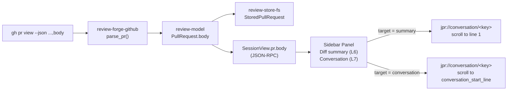

# Unified Diff Summary and Conversation View

<small>

> <table border="0">
> <tr><th colspan="2">Files</th><th colspan="2">Lines</th></tr>
> <tr><td>Changed (total)</td><td>25</td><td>Insertions (+)</td><td>436</td></tr>
> <tr><td>Added</td><td>0</td><td>Deletions (-)</td><td>129</td></tr>
> <tr><td>Deleted</td><td>0</td><td>Net change</td><td>+307</td></tr>
> </table>

</small>

## 1. Purpose

Reviewers previously had no way to read a pull request's description or high-level diff stats inside Neovim: the sidebar jumped directly from the PR header to `Conversation` (issue comments only) and the file tree, and the Rust engine did not fetch `body` from GitHub. This change adds a `Diff summary` entry directly above `Conversation` in the sidebar and registers `:Jpr summary` in the Command Palette. Both `Diff summary` and `Conversation` open the same unified buffer (`jpr://conversation/<buf_key>`) containing the summary above a horizontal divider and the conversation comments below; the only difference is where the window scrolls on open (line 1 for `Diff summary`, the `Conversation` heading for `Conversation`).

## 2. Architecture and Data Flow



- **Additive Rust data model:** `crates/review-model/src/pr.rs` adds `#[serde(default)] pub body: String` to `PullRequest`. `crates/review-forge-github/src/pr.rs` appends `body` to `PR_FIELDS` and reads `value["body"].as_str().unwrap_or_default().to_owned()` so `null` or omitted fields decode to `""`. `crates/review-store-fs/src/format.rs` adds `body` to `StoredPullRequest` (covered by the struct-level `#[serde(default)]`). Because missing fields default to `""`, existing `session.json` files and RPC clients remain compatible without bumping `SESSION_VERSION` or `protocolVersion`.
- **Single-buffer UI design:** `lua/jpr/views/conversation.lua` renders both sections in one read-only Markdown buffer (`jpr://conversation/<buf_key>`). For linked PRs, the top section renders `#<number> <title>`, `@<author> · <headRef> -> <baseRef>`, `<N> files changed · +<adds> -<dels> · <viewed>/<N> viewed`, the PR description with `\r\n` and `\r` normalized to `\n` (falling back to `(no PR description)` when blank), and a muted horizontal divider. For unlinked local reviews (`mode == "local"` and `view.pr == nil`), the top section renders `LOCAL <branch> vs <baseRef>`, the diffstat, and a muted hint to run `:Jpr sync` once a PR is open.
- **Scroll targeting without disrupting background refreshes:** `create_layout_from_threads` records `layout.conversation_start_line` on the `Conversation` / `Local Notes` heading. `M.show(session, opts)` sets `state.pending_target` (`"summary"` or `"conversation"`), scrolls immediately via `winrestview({ lnum = target_line, col = 0, topline = target_line })` if a cached layout already exists (covering read-only cached sessions and instant target switching), and re-applies then clears `state.pending_target` when `fetch_and_draw` repaints. Background `M.refresh(session)` leaves `pending_target` unset so the user's scroll position stays intact.
- **Boundary guard on message actions:** `render.find_message_at_line` snaps cursors above the first message to message 1 for thread popups. In `lua/jpr/views/conversation.lua`, `current_entry` returns `nil` whenever `cursor_line < state.layout.conversation_start_line`, so pressing `e`, `d`, `r`, `p`, `s`, `+`, or `X` inside the Diff summary section safely no-ops instead of mutating the first conversation comment, while `c` still composes a new PR comment.
- **Sidebar and Command Palette integration:** `lua/jpr/render/panel.lua` inserts `"  📄 Diff summary"` (`kind = "summary"`, `summary_line = 6`) directly above `"  💬 Conversation"` / `"  💬 Local Notes"` (`conversation_line = 7`). `lua/jpr/views/panel.lua` defaults initial focus to `summary_line`, preserves cursor selection on `kind == "summary"` across redraws, and routes `<CR>`, `o`, and `<LeftMouse>` to `session.summary_current()`. `lua/jpr/init.lua` and `lua/jpr/commands/schema/init.lua` register `:Jpr summary` (`Open Diff Summary`) with `predicates.is_conversation_executable`.

## 3. Manual Verification

1. Run the full verification suite:
   ```sh
   just check
   ```
2. Open a pull request with `:Jpr open`, select `Diff summary` in the sidebar (or run `:Jpr summary`), and verify the buffer opens at line 1 with the PR title, metadata, diffstat, description, divider, and conversation comments below.
3. Press `e`, `d`, `r`, `p`, `s`, and `+` on line 1 and confirm they no-op without errors; press `c` and confirm PR comment compose opens.
4. Select `Conversation` in the sidebar (or run `:Jpr conversation`) and verify the same buffer scrolls to the `Conversation` heading.
5. Open a local worktree review with `:Jpr local` and verify `Diff summary` renders branch metadata, diffstat, and the `:Jpr sync` hint above `Local Notes`.
