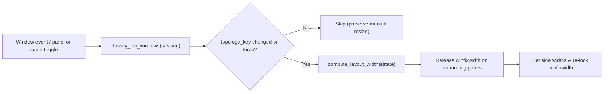
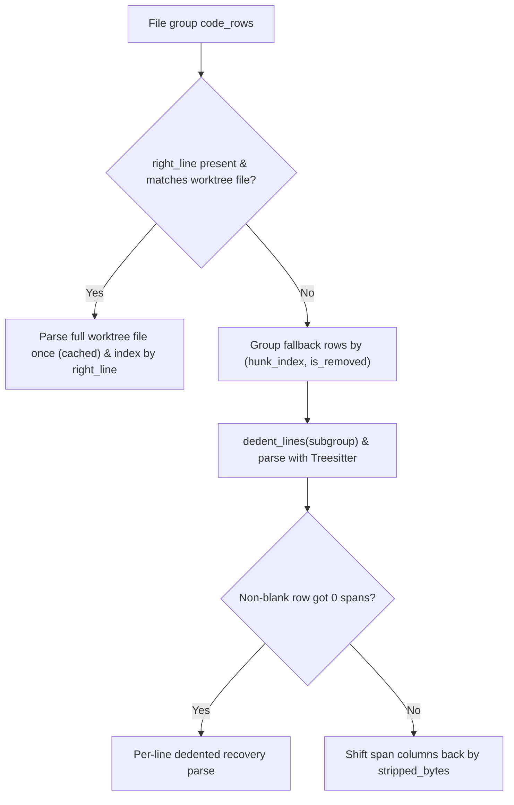

# Review-Tab Layout Manager, Termius 256-Color Diffs, and Mid-File Stream Syntax

<small>

> <table border="0">
> <tr><th colspan="2">Files</th><th colspan="2">Lines</th></tr>
> <tr><td>Changed (total)</td><td>27</td><td>Insertions (+)</td><td>950</td></tr>
> <tr><td>Added</td><td>2</td><td>Deletions (-)</td><td>88</td></tr>
> <tr><td>Deleted</td><td>0</td><td>Net change</td><td>+862</td></tr>
> </table>

</small>

## 1. Purpose

This branch fixes three review-session ergonomics bugs in the Neovim Lua frontend (`lua/jpr/`) with no Rust engine or protocol changes:

1. **Automatic review-tab layout widths and `:Jpr panel` (`gp`) toggle:** Closing the main editor window previously let the diff sidebar expand to full width; reopening a file split the expanded sidebar 50/50 and locked it at half the screen (`winfixwidth = true`), and closing the sidebar left no shortcut to bring it back.
2. **Green and red diff backgrounds on Termius (iPad):** Running Neovim without `termguicolors` (such as over SSH/tmux from Termius on iPad) left `+` and `-` lines without background color and stripped syntax foreground colors on diff lines because `JprDiff*` and derived contrast groups only set 24-bit RGB `bg`/`fg` attributes.
3. **Mid-file YAML hunk syntax highlighting in `gF` (full stream):** Stream syntax highlighting concatenated only the visible hunk rows and parsed that fragment with Treesitter. When a mid-file YAML hunk started deeply indented and later dedented, `tree-sitter-yaml` emitted an `ERROR` node and dropped all syntax highlighting for the rest of the hunk.

## 2. Background Technical Context

A `jpr-nvim` review session owns one Neovim tab (`session.tab`) with up to three vertical columns: the diff sidebar (`lua/jpr/views/panel.lua`), the main editor area (`lua/jpr/views/main_window.lua`, which hosts files, split diffs, PR conversation, or the full diff stream `lua/jpr/views/stream/init.lua`), and an optional coding-agent terminal (`lua/jpr/agent/terminal.lua` + `window.lua`). Diff line/word tints and OKLCH foreground contrast companion groups live in `lua/jpr/highlights/init.lua`, while per-file Treesitter extmarks for the full stream live in `lua/jpr/views/stream/syntax.lua`.

## 3. Automatic Review-Tab Layout and `:Jpr panel` (`gp`)

`lua/jpr/views/layout.lua` introduces a pure width calculator (`compute_layout_widths`) and a topology-keyed window reconciler (`reconcile`) attached to each review tab via `WinNew`, `WinClosed`, `BufWinEnter`, and `VimResized` autocmds (in both `session/init.lua` and `session/open_local.lua`, detached in `forget`).

| Active Windows in Tab | Diff Sidebar | Main Editor | Vertical AI Agent |
| --- | --- | --- | --- |
| Sidebar + Editor + AI | `panel_width` (`winfixwidth`) | Remaining middle | `agent_width` (`winfixwidth`) |
| Sidebar + AI (Editor closed) | `panel_width` (`winfixwidth`) | Closed | Remaining main (`winfixwidth = false`) |
| Editor + AI (Sidebar closed) | Closed | Remaining main | `agent_width` (`winfixwidth`) |
| Sidebar + Editor (AI closed) | `panel_width` (`winfixwidth`) | Remaining main | Closed |
| Single window only | Unfixed | Unfixed | Unfixed |

Key implementation details:
- **Vertical-only agent classification:** `agent/window.lua` marks vertical agent splits with `vim.w[win].jpr_agent_vertical = true`, so floating, horizontal, and breakout-tab agent windows are never mistaken for a vertical right side panel.
- **Narrow-terminal clamping:** When all three panes are open on a narrow screen (such as an iPad in portrait), `clamp_side_pair` scales side widths proportionally while keeping at least 15 columns per side pane and 20 columns for the editor.
- **Reopening the sidebar (`:Jpr panel` / `gp`):** `panel.toggle(session)` closes the sidebar (refusing to close the last non-floating window in the tab) while saving `collapsed_dirs` on `session.panel_collapsed_dirs`, and reopens it on the far left via `topleft vsplit`. `:Jpr panel` is registered in `lua/jpr/commands/schema/init.lua` (17th command), `<Plug>(jpr-toggle-panel)` in `plugin/jpr.lua`, `keys.toggle_panel = "gp"` in `lua/jpr/init.lua`, `agent/terminal.lua` (Normal mode), `views/diff/init.lua` (immediate binding before async `fileDiff` completes, plus tab-aware binding on non-changed worktree files), and `views/cheatsheet.lua`.

## 4. Termius 256-Color Diff Highlights

`lua/jpr/highlights/init.lua` now emits both 24-bit RGB and xterm-256 terminal color attributes:
- **Curated chromatic `ctermbg` palettes:** `create_diff_highlights` attaches explicit chromatic xterm-256 indices rather than nearest-RGB quantization, because subtle dark RGB tints (`#274932`, `#542b2d`) are closer in Euclidean RGB space to neutral xterm grey (`237`/`238`) than to chromatic green/red:
  - Dark background: `JprDiffAdd = 22`, `JprDiffAddText = 28`, `JprDiffDelete = 52`, `JprDiffDeleteText = 88`.
  - Light background: `JprDiffAdd = 194`, `JprDiffAddText = 157`, `JprDiffDelete = 224`, `JprDiffDeleteText = 217`.
- **Contrast-adjusted `ctermfg`:** `rgb_to_cterm256(rgb)` maps each OKLCH-adjusted foreground RGB value to the nearest xterm-256 color across the 6x6x6 color cube (16..231) and 24-step greyscale ramp (232..255). Setting `ctermfg` alongside `fg` on `JprDiffAddFg_*` / `JprDiffDeleteFg_*` prevents contrast extmarks from erasing syntax colors in `notermguicolors` terminals.
- **Override preservation:** `should_update_diff_highlight` and `last_applied_diff_bg` track `{ bg, ctermbg }` pairs and verify `ctermfg == nil`, preserving user overrides of either `bg` or `ctermbg` across `ColorScheme` events.

## 5. Mid-File Stream Syntax Highlighting (`gF`)

`lua/jpr/render/stream.lua` now records `left_line`, `right_line`, and `hunk_index` on every `code_rows` entry, and `lua/jpr/views/stream/init.lua` forwards `{ worktree = session.worktree }` to `syntax.apply(buf, column, opts)`.

- **Full-file context for added and context rows:** `read_worktree_file_lines` validates the path through `diff.name_to_relative_path` (blocking symlinks and `..` traversal) and caps reads at `MAX_FILE_ROWS` (5,000). Indexing full-file captures by `right_line` gives mid-file YAML hunks, Python blocks, and multiline strings exact syntax context with zero RPC changes.
- **Hunk-safe fallback for removed rows and missing files:** Remaining rows are grouped by `(hunk_index, is_removed)` so separate hunks or interleaved `-`/`+` rows cannot corrupt one another. Each subgroup is dedented via `dedent_lines`, parsed, and shifted back; if a dedenting mid-hunk YAML fragment triggers a Treesitter `ERROR` node and leaves a non-blank row uncovered, single-line dedented recovery highlights that line individually.

## 6. Key Decisions

- **Topology-keyed layout reconciliation over manual reset shortcut:** Reconciling only when `(panel_win, agent_win, has_editor, vim.o.columns)` changes fixes every open/close transition automatically without fighting manual `<C-w>>` / `<C-w><` resizes.
- **`gp` as default `keys.toggle_panel`:** Matches the existing `g<letter>` review session key family (`ga`, `gF`, `gs`, `gS`, `gv`) and stays configurable or disableable via `setup({ keys = { toggle_panel = ... } })`.
- **Curated `ctermbg` palettes over RGB quantization for diff backgrounds:** Prevents dark green/red diff tints from quantizing to indistinguishable greys on 256-color terminals.
- **Worktree disk parse over RPC base-text fetches:** Covers all added/context stream lines at zero protocol cost while hunk dedent + per-line recovery handles removed lines.

---

## Appendix A. Manual Testing

1. Open a review tab (`:Jpr local` or `:Jpr open <n>`), close the main editor (`:q`), then open a file from the sidebar (`<CR>`); verify the sidebar snaps back to `panel_width`.
2. Toggle the vertical AI agent (`ga`), close the editor (`:q`), verify the sidebar stays at `panel_width` and the AI panel expands to fill the main width; reopen a file from the sidebar and verify both side panels return to side widths.
3. Press `gp` (or run `:Jpr panel`) to hide and reopen the diff sidebar; verify collapsed directories persist and closing the sole remaining window in the tab is refused cleanly.
4. Test with `:set notermguicolors` (or on Termius on iPad) and verify green/red diff backgrounds and syntax foregrounds appear in both single-file diffs and `gF`.
5. Open a mid-file YAML hunk in `gF` and verify nested and dedented lines keep full syntax highlighting.
6. Run `just check` and verify formatting, clippy, Rust tests, and all Lua specs pass.

---

## Appendix B. Glossary

| Term | Meaning |
| --- | --- |
| `topology_key` | String encoding `(panel_win, agent_win, has_editor, vim.o.columns)` used by `layout.reconcile` to skip redundant resizing when only manual width drags occurred. |
| `jpr_agent_vertical` | Window-local flag (`vim.w[win].jpr_agent_vertical`) set on vertical coding-agent splits so `layout.classify_tab_windows` ignores floating, horizontal, and breakout-tab agents. |
| `ctermbg` / `ctermfg` | 256-color terminal highlight attributes read by Neovim when `termguicolors` is off (such as Termius over SSH/tmux). |
| `code_rows` | Per-column list of non-header, non-hunk source lines emitted by `render.stream` with `left_line`, `right_line`, and `hunk_index` metadata for `views/stream/syntax.lua`. |
