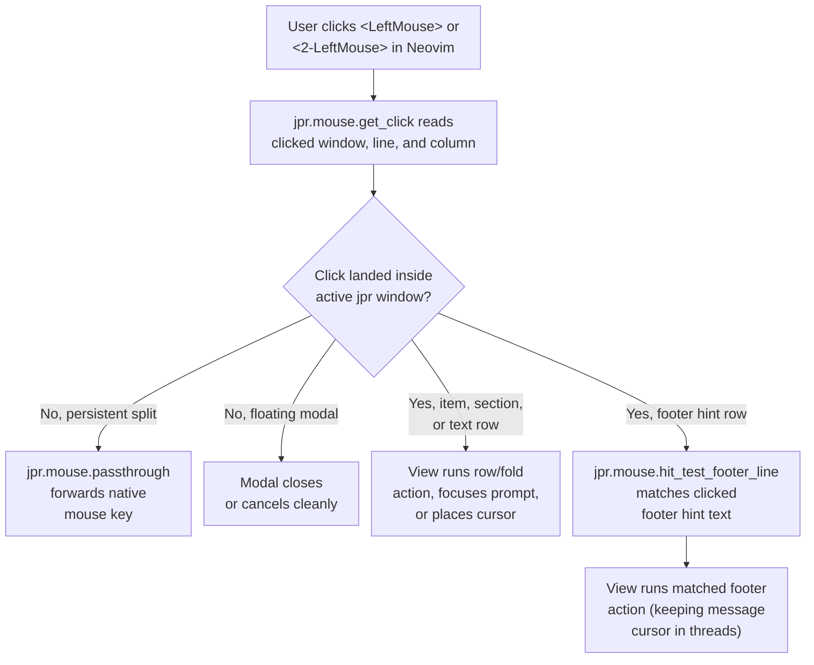

# Neovim Mouse & Point-and-Click Support

<small>

> <table border="0">
> <tr><th colspan="2">Files</th><th colspan="2">Lines</th></tr>
> <tr><td>Changed (total)</td><td>24</td><td>Insertions (+)</td><td>1,093</td></tr>
> <tr><td>Added</td><td>3</td><td>Deletions (-)</td><td>41</td></tr>
> <tr><td>Deleted</td><td>0</td><td>Net change</td><td>+1,052</td></tr>
> </table>

</small>

## 1. Purpose

In `jpr-nvim`, only two floating prompts (the confirmation dialog and the GitHub authentication prompt) handled mouse clicks. With Neovim mouse reporting enabled (`mouse=a`), clicking a file or directory in the review sidebar<sup>G12</sup>, a command in the floating Command Palette<sup>G2</sup>, an option in a multi-step wizard, a review action or draft in the Submit Review modal<sup>G14</sup>, or a footer hint<sup>G4</sup> in a thread popup<sup>G15</sup> either moved the cursor without acting or did nothing at all. In the full branch diff stream<sup>G5</sup>, double-clicking a folded viewed file<sup>G16</sup> or a diff line did not expand the fold or jump to the source file.

This change:

- Shares click validation, clickable footer matching, and outside-click forwarding across every review window so clicks outside splits never trap focus (§4).
- Adds single-click activation to the review sidebar<sup>G12</sup>, Command Palette<sup>G2</sup>, and wizard menu steppers<sup>G17</sup>, plus double-click fold and file-open actions to the diff stream<sup>G5</sup> (§5).
- Makes Submit Review sections, thread popup<sup>G15</sup> and PR conversation<sup>G8</sup> footers, and confirmation and authentication modals clickable, and dismisses the cheatsheet on outside clicks (§6).

## 2. Background technical context

```text
lua/jpr/
├── mouse.lua             (new)
├── auth/
│   └── modal.lua         (changed)
├── comments/
│   └── popup.lua         (changed)
├── render/
│   ├── submit.lua        (changed)
│   └── threads.lua
├── tui/
│   ├── render.lua
│   └── wizard/           (changed)
└── views/
    ├── cheatsheet.lua    (changed)
    ├── confirm.lua       (changed)
    ├── conversation.lua  (changed)
    ├── main_window.lua
    ├── panel.lua         (changed)
    ├── stream/           (changed)
    └── submit.lua        (changed)
```

<small>

| Unit | What it is |
| --- | --- |
| `mouse.lua` | Shared click helper that checks window bounds, matches footer hints<sup>G4</sup> to actions, clamps cursor clicks, and forwards outside clicks to Neovim. Imported by every updated view and modal. |
| `auth/modal.lua` | Floating GitHub authentication prompt letting the reviewer start `gh auth login` or cancel. Uses `mouse.lua` for option, footer, and outside clicks. |
| `comments/popup.lua` | Floating thread inspector opening at the cursor to show review messages and run message actions. Calls `render/threads.lua` to build lines and resolve the selected message. |
| `render/submit.lua` | Pure layout builder<sup>G9</sup> turning pending drafts, review action, and summary text into buffer lines and clickable row maps. Consumed by `views/submit.lua`. |
| `render/threads.lua` | Pure layout builder<sup>G9</sup> formatting review threads and resolving which message sits at a cursor line. Called by `comments/popup.lua` and `views/conversation.lua`. |
| `tui/render.lua` | Pure layout builder<sup>G9</sup> formatting the Command Palette<sup>G2</sup> and wizard steps into buffer lines, footer hints<sup>G4</sup>, and item-to-line maps. Consumed by `tui/wizard/`. |
| `tui/wizard/` | Floating Command Palette<sup>G2</sup> and multi-step wizard modal (`palette.lua`, `step_menu.lua`, and controller `init.lua`). Paints layouts from `tui/render.lua`. |
| `views/cheatsheet.lua` | Floating keyboard shortcuts modal (`:Jpr keys` and `?`) with a Neovim window-border footer. Uses `mouse.lua` to place the cursor inside and close on outside clicks. |
| `views/confirm.lua` | Reusable centered confirmation dialog shown before publishing or agent dispatch. Uses `mouse.lua` for option selection, footer clicks, and outside-click cancellation. |
| `views/conversation.lua` | Persistent split<sup>G7</sup> view in the main window displaying top-level PR comments and footer hints<sup>G4</sup>. Calls `render/threads.lua` to resolve the selected comment. |
| `views/main_window.lua` | Manages the main editor window beside the review sidebar<sup>G12</sup> where changed files, the diff stream<sup>G5</sup>, and PR comments open. Called by `panel.lua`, `stream/`, `conversation.lua`, and `submit.lua`. |
| `views/panel.lua` | Persistent review sidebar<sup>G12</sup> split listing collapsible directories, changed files, and Conversation. Opens files in `views/main_window.lua` and PR comments via `views/conversation.lua`. |
| `views/stream/` | Persistent full branch diff view (`init.lua` and `navigation.lua`) in unified mode or side-by-side split mode<sup>G13</sup> (`buffers.left` and `buffers.main`) with folds for viewed files<sup>G16</sup>. |
| `views/submit.lua` | Floating `:Jpr submit` modal for picking a review action, jumping to drafts, editing the summary, and confirming via `views/confirm.lua`. Consumes `render/submit.lua`. |

</small>

## 3. Shape of the solution

Every clickable `jpr-nvim` review view and modal buffer binds a buffer-local mouse mapping<sup>G1</sup> (`<LeftMouse>`, or `<2-LeftMouse>` in the full branch diff stream<sup>G5</sup>) that delegates click validation and routing to `jpr.mouse`. Because Neovim invokes a buffer-local `<LeftMouse>` mapping on the previously focused buffer before switching windows, each handler first checks whether the click landed inside its own window: floating modals<sup>G3</sup> dismiss cleanly on outside clicks, while persistent split<sup>G7</sup> buffers forward outside clicks back to Neovim natively so window focus changes, split-border drags, and tabline clicks still work.



> *All click handlers share one decision tree through `jpr.mouse`: clicks outside a persistent split<sup>G7</sup> pass through to Neovim, clicks outside a floating modal<sup>G3</sup> dismiss it, and clicks inside run the clicked row, move the cursor, or match a footer shortcut hint.*
>
> **Diagram key**
>
> | | |
> | --- | --- |
> | **persistent split<sup>G7</sup>** | A non-floating review window that stays open beside code (`panel`, `stream`, or `conversation`). |
> | **floating modal<sup>G3</sup>** | A temporary overlay window (`palette`, `step_menu`, `submit`, `popup`, `confirm`, `auth`, or `cheatsheet`). |
> | **`jpr.mouse.get_click`** | Safely calls Neovim's `getmousepos()` and returns the clicked window ID, 1-based line, and 1-based column. |
> | **`jpr.mouse.passthrough`** | Feeds the original mouse key back to Neovim without remapping so built-in focus and split-resize behavior runs. |
> | **`jpr.mouse.hit_test_footer_line`** | Scans the footer line for exact shortcut hint text and returns the action whose column range contains the click. |

The three strands build in order: §4 introduces the shared `jpr.mouse` helper that checks click bounds, forwards outside clicks to Neovim, and matches clicked footer hints<sup>G4</sup>; §5 wires clicks across navigation views (the review sidebar<sup>G12</sup>, two-window Command Palette<sup>G2</sup>, wizard menu steppers<sup>G17</sup>, and full branch diff stream<sup>G5</sup>); §6 wires clicks across review modals and comment views (Submit Review sections, thread popup<sup>G15</sup> and PR conversation<sup>G8</sup> footers without moving the selected message, plus confirmation, authentication, and cheatsheet modals).

## 4. A shared Lua mouse helper centralizes click routing across every review window

Every view in §§5-6 delegates mouse coordinate reads, clamped cursor placement, outside-click forwarding, and footer hint<sup>G4</sup> matching to one shared module (`lua/jpr/mouse.lua`) so views do not duplicate Neovim mouse edge cases.

### 4.1 Forwarding outside clicks back to Neovim prevents buffer-local `<LeftMouse>` maps from trapping focus

When a reviewer's cursor sits in a persistent split<sup>G7</sup> buffer such as the review sidebar<sup>G12</sup> and they click into an adjacent code split or drag a split border, Neovim fires the sidebar buffer's `<LeftMouse>` mapping before changing windows. Returning early without action swallows the click and traps focus inside the sidebar.

**File: `lua/jpr/mouse.lua`**

```lua {4-6,10}
function M.is_click_in_window(mouse, win)
    return type(mouse) == "table"
        and win ~= nil
        and mouse.winid == win
        and type(mouse.line) == "number"
        and mouse.line >= 1
end
...
function M.passthrough(key)
    vim.api.nvim_feedkeys(vim.keycode(key or "<LeftMouse>"), "n", false)
end
```

Each click handler starts by calling `mouse.get_click()` (a `pcall` wrapper around `vim.fn.getmousepos()`) to read the clicked `winid`, 1-based `line`, and 1-based `column`. Persistent split<sup>G7</sup> views (`views/panel.lua`, `views/stream/navigation.lua`, and `views/conversation.lua`) verify that `click.winid` belongs to their window (or buffer, in `conversation.lua` and `stream`) and call `mouse.passthrough` whenever it does not. Passing mode `"n"` to `nvim_feedkeys` disables remapping, so Neovim runs its native mouse handler instead of re-entering the buffer-local mapping<sup>G1</sup>. Floating modals<sup>G3</sup> take the opposite branch on an outside click and close or cancel themselves. When an inside click needs to move the window cursor, handlers call `mouse.set_cursor_from_click(win, click)`, which clamps the 1-based `line` to the buffer's line count and converts and clamps the 1-based `column` to a 0-based byte offset within the line before calling `nvim_win_set_cursor`.

### 4.2 Plain-text search matches clicks on footer shortcut hints without Lua pattern escaping bugs

Modal and popup footers contain characters that have special meaning in Lua patterns (`[`, `]`, `+`, `-`), such as `[+]react`, `[<C-s>] submit`, and `[C-u] clear`.

**File: `lua/jpr/mouse.lua`**

```lua {5-12,22-27}
function M.parse_footer_actions(line_text, specs)
    ...
    for _, spec in ipairs(specs) do
        if type(spec) == "table" and type(spec.token) == "string" and spec.token ~= "" then
            local col_start, col_end = line_text:find(spec.token, 1, true)
            if col_start and col_end then
                spans[#spans + 1] = {
                    action = spec.action,
                    col_start = col_start,
                    col_end = col_end,
                }
            end
        end
    end
    return spans
end
...
function M.hit_test_footer_line(lines, specs, click, footer_line)
    if type(lines) ~= "table" or #lines == 0 or type(click) ~= "table" then
        return nil
    end
    local target_line = type(footer_line) == "number" and footer_line or #lines
    if click.line ~= target_line then
        return nil
    end
    local spans = M.parse_footer_actions(lines[target_line], specs)
    return M.hit_test_footer_action(target_line, spans, click.line, click.column)
end
```

Each view defines a list of `{ token, action }` specs pairing each printed footer hint<sup>G4</sup> with an internal action name (for example `{ token = "[q]uit", action = "close" }`). `parse_footer_actions` scans the footer line using plain-text `line_text:find(spec.token, 1, true)` so every token matches literally, skipping any token absent from the current footer variant (such as `[p]romote` when no local thread<sup>G6</sup> is shown). `hit_test_footer_action` then checks whether `click.column` falls inside any span's 1-based inclusive byte-column range (`col_start <= click.column <= col_end`) and returns that span's action name, or `nil` for gaps between hints.

Worked example: given the thread popup<sup>G15</sup> footer `"[r]eply  [e]dit  [d]elete  [R]esolve  [+]react  [X]retry  [q]uit"` on line 10 and the popup spec list (which also includes `[p]romote` and `[s]end`), `parse_footer_actions` skips `[p]romote` and `[s]end` and emits seven 1-based inclusive spans: `reply` at `1..7`, `edit` at `10..15`, ..., `react` at `39..46`, ..., and `close` at `59..64`. A click at `(line = 10, column = 7)` returns `"reply"`, a click in the two-space gap at `(line = 10, column = 8)` returns `nil`, and a click at `(line = 9, column = 4)` returns `nil` immediately before parsing.

## 5. Navigation views activate menus on single-click while preserving native selection in the diff stream

Building on `jpr.mouse` (§4), this strand wires click handling across `jpr-nvim`'s navigation windows so menus and file trees activate on a single click while the read-only diff stream<sup>G5</sup> preserves cursor placement and Visual selection.

### 5.1 Sidebar panel clicks open files, toggle directories, and ignore non-selectable header rows

In `lua/jpr/views/panel.lua`, `handle_left_click` forwards clicks outside `panel.win` via `mouse.passthrough("<LeftMouse>")`. For inside clicks, it looks up `click.line` in `panel.rows` (the 1-based line-to-row map built during render), ignores non-selectable header or blank lines where that entry is `nil`, moves the panel cursor to `click.line`, and invokes `handle_enter_key`. Clicking a directory row toggles its entry in `panel.collapsed_dirs` and redraws; clicking a file row opens that file in the main window through `main_window.edit`; clicking the Conversation row opens the PR conversation view<sup>G8</sup>.

### 5.2 Command Palette and wizard menu steppers handle clicks without shifting rows under the pointer

The Command Palette<sup>G2</sup> (`lua/jpr/tui/wizard/palette.lua`), coordinated by the wizard controller (`tui/wizard/init.lua`), displays two stacked floating windows stored on the active modal `state`: a 1-line Insert-mode filter prompt (`state.prompt_win`) above a read-only results list (`state.win`). Because focus starts in Insert mode inside `state.prompt_buf`, `<LeftMouse>` is bound in both `"n"` and `"i"` modes on `state.prompt_buf` and in `"n"` mode on `state.buf`.

**File: `lua/jpr/tui/wizard/palette.lua`**

```lua {6-16}
local function handle_palette_click(controller, state, actions)
    local click = mouse.get_click()
    if not click then
        return
    end
    if mouse.is_click_in_window(click, state.win) then
        local clicked_index = state.layout and state.layout.item_for_line[click.line]
        if clicked_index ~= nil then
            pcall(vim.cmd, "stopinsert")
            state.selected_index = clicked_index
            activate_palette_command(controller, state)
            return
        end
        dispatch_palette_footer_click(controller, state, actions, click)
        return
    end
    if mouse.is_click_in_window(click, state.prompt_win) then
        pcall(vim.api.nvim_set_current_win, state.prompt_win)
        mouse.set_cursor_from_click(state.prompt_win, click)
        pcall(vim.cmd, "startinsert")
        return
    end
    controller.close()
end
```

Unlike keyboard actions such as `move_down` and `confirm`, which call `sync_filter_from_prompt` first, the highlighted branch hit-tests `click.line` against the currently rendered `state.layout`. Prompt edits already re-filter via `TextChangedI`, `TextChanged`, and `on_lines`; re-filtering again on click could shrink the results list and shift item or footer rows away from the exact line the reviewer clicked. Clicking inside `state.prompt_win` focuses the prompt, places the cursor at the clicked column, and enters Insert mode; clicking outside both windows closes the palette. Wizard menu steppers<sup>G17</sup> (`lua/jpr/tui/wizard/step_menu.lua`, covering `select`, `toggle`, and `async_select` steps) follow the same pattern in one floating window: clicking an option row selects and confirms it once async options finish loading (`not state.step_state.is_loading`), clicking `[h] palette` / `[h] back`, `[Enter/l] next` / `[Enter/l] run`, or `[q/Esc] close` dispatches that action, and clicking outside closes the wizard.

### 5.3 Full branch diff stream keeps single-click native and maps `<2-LeftMouse>` to fold toggle or file open

In `lua/jpr/views/stream/navigation.lua`, single `<LeftMouse>` is deliberately left unbound so reviewers can click to place the cursor, drag Visual selections for range comments<sup>G10</sup>, and switch splits natively. Double-clicking (`<2-LeftMouse>`) inside either stream buffer (`buffers.main`, or `buffers.left` for the base half in split mode<sup>G13</sup>) focuses that window, moves the cursor to the clicked line, toggles a closed viewed-file fold in place via `stream_mod.toggle_fold(session, "za")` when `vim.fn.foldclosed(click.line) ~= -1`, and otherwise calls `stream_mod.open_target(session)` to open the checked-out PR file in the worktree<sup>G18</sup> at that line. Double-clicks outside the stream windows forward via `mouse.passthrough("<2-LeftMouse>")`.

## 6. Review modals, comment views, and the keyboard cheatsheet route clicks through the shared mouse helper

Building on `jpr.mouse` (§4), this strand wires click handling across review modals and comment views: structured section and footer clicks in the Submit Review modal<sup>G14</sup>, message-preserving footer clicks in the thread popup<sup>G15</sup> and PR conversation view<sup>G8</sup>, unified option and footer clicks in confirmation and authentication modals, and outside-click dismissal in the keyboard cheatsheet.

### 6.1 Submit Review builds line-to-target maps during rendering so clicks never reparse buffer text

`lua/jpr/render/submit.lua` stays a pure layout builder<sup>G9</sup> (no Neovim window or buffer calls) and extends the table returned by `M.build` alongside its existing `draft_anchors` map with three new click-target fields: `event_lines` (`table<integer, string>` mapping 1-based buffer lines to `"COMMENT"`, `"APPROVE"`, or `"REQUEST_CHANGES"`), `summary_lines` (`table<integer, boolean>` covering the Summary Body header and body/placeholder rows), and `footer_line` (the 1-based line number of the footer hint<sup>G4</sup> row).

In `lua/jpr/views/submit.lua`, `handle_modal_click` dispatches in order: outside click closes the modal; clicking an `event_lines` row calls `select_event` (preserving own-PR approval restrictions); clicking a `draft_anchors` row jumps to that file and line (or PR conversation<sup>G8</sup>) and closes the modal; clicking a `summary_lines` row opens the summary sub-editor; and clicking `[e] summary`, `[<C-s>] submit`, or `[q] cancel` on `footer_line` invokes the matching action.

### 6.2 Thread popup and PR conversation preserve the selected message when a footer shortcut hint is clicked

Both `lua/jpr/comments/popup.lua` and `lua/jpr/views/conversation.lua` find which comment a reviewer is acting on from the active review session's<sup>G11</sup> window cursor via `current_entry(session)`. If clicking a footer hint<sup>G4</sup> moved the cursor to the footer line first, `render.find_message_at_line` would fall back to the last message in the buffer instead of the message the reviewer previously selected.

**File: `lua/jpr/comments/popup.lua`**

```lua {10-19}
local function handle_popup_click(session)
    local popup = session and session.popup
    local click = mouse.get_click()
    if not popup or not click then
        return
    end
    if not mouse.is_click_in_window(click, popup.win) then
        return M.close(session)
    end
    local lines = popup.layout and popup.layout.lines or {}
    if click.line == #lines then
        local action = mouse.hit_test_footer_line(lines, POPUP_FOOTER_SPECS, click)
        local handler = action and POPUP_FOOTER_HANDLERS[action]
        if handler then
            handler(session)
        end
        return
    end
    mouse.set_cursor_from_click(popup.win, click)
end
```

Checking `click.line == #lines` before calling `mouse.set_cursor_from_click` keeps the cursor on the reviewer's chosen message when they click `[r]eply`, `[e]dit`, `[d]elete`, `[R]esolve`, `[+]react`, `[X]retry`, `[p]romote`, `[s]end`, or `[q]uit`. `views/conversation.lua` uses the same guard for its footer hints<sup>G4</sup> (`[c]omment`, `[r]eply`, `[e]dit`, `[d]elete`, `[p]romote`, `[s]end`, `[+]react`, `[X]retry`, and `[q]uit`) while forwarding outside clicks via `mouse.passthrough("<LeftMouse>")` because PR conversation<sup>G8</sup> is a persistent split<sup>G7</sup> buffer rather than a floating popup.

### 6.3 Confirmation, authentication, and cheatsheet modals dismiss on outside clicks, and the first two add clickable footers

`lua/jpr/views/confirm.lua` and `lua/jpr/auth/modal.lua` replace their inline `getmousepos()` handlers with `jpr.mouse`: clicking an option row still selects and activates that option, clicking `[Enter/Click] select` or `[q/Esc] cancel` on the footer line runs the matching action, and clicking outside the modal window cancels cleanly. `lua/jpr/views/cheatsheet.lua` closes on outside clicks, places the cursor on inside clicks (its footer lives on the Neovim window border rather than a buffer line), and documents `<LeftMouse>` and `<2-LeftMouse>` under the PR Sidebar Panel<sup>G12</sup>, Diff & Stream Views, and Command Palette<sup>G2</sup> & Steppers sections.

## 7. Interface changes

Terminal UI screenshots are blocked in this headless environment because Neovim runs without a GUI display; the wireframes below show the clickable regions across the updated views.

```text
┌─ PR Sidebar (single-click) ───────┐┌─ Full Branch Diff Stream (double-click) ─────────┐
│ #42 Add auth checks               ││ ▸ ✓ README.md  +2 -1      [2-LeftMouse: unfold]  │
│ ████████░░░░░░░░  2/4 (50%)       ││ ▾   src/auth.rs  +8 -2                           │
│ viewed 2/4 · threads 3            ││ @@ -10,3 +10,5 @@                                │
│   Conversation [3]     [click]    ││   10    10   fn verify() { [1-click: cursor]     │
│ ▾ src/                 [toggle]   ││         11 + check_token() [2-click: open :11]   │
│   ✓ auth.rs  +8 -2     [open]     ││                                                  │
│   ● session.rs  +3 -1  [open]     ││ (Split mode: buffers.left + buffers.main)        │
└───────────────────────────────────┘└──────────────────────────────────────────────────┘
  Outside click from either split -> forwarded natively to Neovim (focus / resize)
```

```text
╭────────────────────────────────── Jpr Commands ─────────────────────────────────╮
│ > syn█                                                        [click: focus+i]  │
╰─────────────────────────────────────────────────────────────────────────────────╯
╭─────────────────────────────────────────────────────────────────────────────────╮
│ ▸ Sync with GitHub  [sync]                                       [click: run]   │
│     Sync with GitHub (or detect and link an open PR when reviewing              │
│     locally).                                                                   │
│                                                                                 │
│ [type] filter  [C-j/k] move  [C-u] clear  [Enter] select  [Esc] normal/close    │
╰─────────────────────────────────────────────────────────────────────────────────╯
  Clickable footer hints: [S-Tab] repos (when enabled), [C-u] clear,
  [Enter] select, [Esc] normal/close. Outside click -> closes palette.
  Wizard menu steppers use the same single-window option + footer layout.
```

```text
╭─────────────────────────────────── Submit Review ───────────────────────────────────╮
│ Review Action (press 1/2/3):                                                        │
│   [x] 1. Comment                                                    [click: select] │
│   [ ] 2. Approve                                                    [click: select] │
│   [ ] 3. Request changes                                            [click: select] │
│                                                                                     │
│ Pending Drafts (1):                                                                 │
│   • README.md:2: Fix typo                                           [click: jump]   │
│                                                                                     │
│ Summary Body (press e to edit):                                     [click: edit]   │
│   (optional for Approve / Drafts; required for empty Comment)                       │
│                                                                                     │
│ [1/2/3] action  [e] summary  [<CR>] open draft / submit  [<C-s>] submit  [q] cancel │
╰─────────────────────────────────────────────────────────────────────────────────────╯
  Clickable footer hints: [e] summary, [<C-s>] submit, [q] cancel.
  Outside click -> closes modal.
```

```text
╭─────────────────────────────────── Review Thread ───────────────────────────────────╮
│ Thread (Open) [local · unsent]                                                      │
│ @pablo · 2026-11-26                                       [click: select message]   │
│   Check nil guard here.                                                             │
│                                                                                     │
│ [r]eply  [e]dit  [d]elete  [R]esolve  [+]react  [X]retry  [p]romote  [s]end  [q]uit │
╰─────────────────────────────────────────────────────────────────────────────────────╯
  Clicking a footer hint runs that action on the previously selected message.
  Outside click closes the thread popup (PR conversation forwards outside clicks).
```

## 8. Decisions

- **Single-click activates sidebar, palette, wizard, and modal controls, while the full diff stream<sup>G5</sup> reserves file opening and fold toggling for double-click (`<2-LeftMouse>`).** The rejected alternative was single-click file jumping inside the diff stream or double-click file opening inside the sidebar. Single-click jumping in the stream prevents clicking to position the cursor or dragging Visual selections for range comments<sup>G10</sup>, while double-click in the sidebar adds friction compared to standard editor file trees. Reversal evidence: user feedback reporting accidental clicks in the sidebar or wanting single-click jumps in the stream.
- **Clicks outside a persistent split<sup>G7</sup> view pass through to Neovim (via `vim.api.nvim_feedkeys(..., "n", false)`) so window focus and split resizing still work, while clicks outside a floating modal<sup>G3</sup> dismiss the modal.** The rejected alternative was returning early on `mouse.winid ~= current_win` in all views. Returning early swallows clicks aimed at other windows, split borders, and tablines because Neovim runs buffer-local `<LeftMouse>` mappings before switching windows. Reversal evidence: any Neovim version change that switches window focus before firing buffer-local mouse mappings.
- **`jpr.mouse` matches clicks on modal and popup footers against each view's literal shortcut hint text instead of storing button coordinates in every layout builder.** The rejected alternative was updating all six layout builders (`tui/render.lua`, `render/threads.lua`, `render/submit.lua`, `views/confirm.lua`, `auth/modal.lua`, and `views/conversation.lua`) to emit per-button column metadata. Literal matching keeps existing footer layouts untouched and avoids adding per-button column metadata to those six modules while supporting conditional footer hints<sup>G4</sup> cleanly. Reversal evidence: adding localized, wrapped, or multi-line footers where hints could span lines or duplicate text.
- **When a reviewer clicks a row in the Command Palette<sup>G2</sup>, `jpr-nvim` matches the click against the currently displayed results instead of re-filtering the prompt first.** The rejected alternative was running `sync_filter_from_prompt` at the start of `handle_palette_click`. Running a synchronous repaint before reading `click.line` could shrink the results list underneath the row the user saw and clicked. Reversal evidence: a prompt input path where buffer edits bypass `TextChangedI`, `TextChanged`, and `on_lines` before a click arrives.

## 9. Deliberately not handled

- The Rust CLI interactive palette (`crates/cli-tui`) is unchanged because terminal mouse support in this branch is scoped to the Neovim plugin frontend.
- Editable text-input floats (`lua/jpr/tui/wizard/step_text.lua`, comment compose floats, the Submit Review summary sub-editor, and inline sidebar rename/create inputs) intentionally leave `<LeftMouse>` unbound so native Neovim cursor positioning and text selection work inside editable buffers.
- Custom scroll-wheel mappings are omitted because native Neovim `mouse=a` scrolling already works in every split and floating window once mouse reporting is enabled.
- Right-click context menus (`<RightMouse>`) are not bound so Neovim's configured `mousemodel` (`popup_setpos` or `extend`) continues to work unchanged.

<div style="page-break-before: always"></div>

## Appendix A. Manual testing

<small>

1. Open Neovim inside this worktree<sup>G18</sup> with `jpr-nvim` loaded and verify Neovim mouse reporting is enabled:

   ```vim
   :set mouse?
   ```

   Expect `mouse=a`.
2. Start a review session<sup>G11</sup> (use `:Jpr open <number>` for an open GitHub PR, or `:Jpr local` for a local branch review):

   ```vim
   :Jpr local
   ```

3. In the left review sidebar<sup>G12</sup>, single-click a directory row to collapse and expand it, single-click a changed file row to open it beside the panel, and single-click **Conversation** (labelled **Local Notes** in an unlinked local session) to open the PR conversation view<sup>G8</sup>.
4. Click directly from the review sidebar<sup>G12</sup> into the main diff window and drag the vertical split border to confirm focus switches and splits resize normally.
5. Open the full branch diff stream<sup>G5</sup> (`gF` or `:Jpr stream`), single-click a diff line to place the cursor without jumping, double-click a closed viewed-file fold to toggle it open in place, and double-click an expanded diff line to open the real file at that line.
6. Press `<leader>J` to open **Jpr Commands**, type:

   > syn

   Then click `[C-u] clear` in the footer to clear the filter, click a multi-step command row such as **Switch Diff View** `[toggle]` while in Insert mode to open its wizard menu stepper<sup>G17</sup>, click an option or `[h] palette`, and click outside the modal to close it.
7. Open a thread popup<sup>G15</sup> (`gt` on a commented line) or **PR Conversation<sup>G8</sup>** / **Local Notes** (press `c` first if no comments exist yet), click a message line to select it, click a footer hint<sup>G4</sup> such as `[r]eply` or `[q]uit`, and confirm the action targets the selected message.
8. In a session linked to a GitHub PR (`:Jpr open <number>` or a linked `:Jpr local`), open `:Jpr submit`, click the **Comment**, **Approve**, and **Request changes** rows (note: on your own PR, **Approve** and **Request changes** show a restriction notice instead of selecting), click **Summary Body** to open the summary editor, click a pending draft row to jump to its file, and click `[q] cancel` or outside the modal to dismiss it.
9. Run the full automated verification suite from the worktree<sup>G18</sup> root:

   ```sh
   just check
   ```

   Expect `cargo fmt`, `cargo clippy`, all Rust tests, and all 49 Lua specs (including `mouse_spec: ok`) to pass.

</small>

<div style="page-break-before: always"></div>

## Appendix B. Glossary

<small>

| Term | Meaning |
| --- | --- |
| **G1** Buffer-local mapping (buffer-local mouse mapping) | A Neovim key or mouse binding attached to one specific buffer rather than the whole editor. Neovim runs the currently focused buffer's mapping before switching windows on a click, which is why persistent split<sup>G7</sup> views must forward outside clicks back to Neovim. |
| **G2** Command Palette | The floating filterable menu opened by bare `:Jpr` or `<leader>J` that lets a reviewer search and launch plugin commands. It stacks a 1-line Insert-mode filter prompt above a read-only results list. |
| **G3** Floating modal | A temporary overlay window drawn above the editor layout, such as the Command Palette<sup>G2</sup>, wizard menu steppers<sup>G17</sup>, Submit Review modal<sup>G14</sup>, thread popup<sup>G15</sup>, confirmation dialog, authentication prompt, or cheatsheet. Clicking outside a floating modal closes or cancels it. |
| **G4** Footer hint | A keyboard shortcut label printed on the bottom line of a modal, popup, or PR conversation<sup>G8</sup> buffer, such as `[r]eply` or `[q]uit`. In the code, each clickable hint is paired in a spec list with an action name and matched against the clicked column. |
| **G5** Full branch diff stream (diff stream) | The scrollable review view (`:Jpr stream` or `gF`) that displays every changed file in the pull request in one unified buffer or two aligned side-by-side buffers, folding files marked viewed. Double-clicking unfolds a closed file or opens the real file at the clicked line. |
| **G6** Local thread | A review comment thread saved only in the local review session<sup>G11</sup> for discussion with a coding agent rather than published on GitHub. In thread popups<sup>G15</sup> and PR conversation<sup>G8</sup>, local threads unlock the `[p]romote` and `[s]end` footer hints<sup>G4</sup>. |
| **G7** Persistent split | A non-floating review window that stays open alongside code buffers in the Neovim tab: the review sidebar<sup>G12</sup>, the full branch diff stream<sup>G5</sup>, or the PR conversation view<sup>G8</sup>. Unlike a floating modal<sup>G3</sup>, clicking outside a persistent split forwards the click to Neovim instead of closing the window. |
| **G8** PR conversation view (PR conversation) | The persistent split<sup>G7</sup> buffer in the main editor window (`:Jpr conversation` or clicking Conversation in the sidebar) that lists top-level pull request comments and provides footer hints<sup>G4</sup> for replying, editing, reacting, or posting new comments. |
| **G9** Pure layout builder | A Lua module under `lua/jpr/render/` or `lua/jpr/tui/render.lua` that turns review data into buffer lines, highlight spans, and line-to-item lookup maps without calling any Neovim window or buffer APIs. |
| **G10** Range comment | A multi-line review comment anchored to a span of lines that the reviewer highlights with a Neovim Visual selection. Single-clicking is left unbound in the full branch diff stream<sup>G5</sup> so dragging a Visual selection for a range comment keeps working. |
| **G11** Review session | The active `jpr-nvim` workspace for one pull request or local branch, tracked in Lua as a `session` table that holds the open sidebar, diff stream<sup>G5</sup>, conversation buffer, popups, and PR state. |
| **G12** Review sidebar (sidebar panel) | The persistent vertical split on the left of the review tab that lists the PR progress header, the Conversation row, collapsible directories, and changed files. Single-clicking a directory collapses or expands it, and single-clicking a file or Conversation opens it in the main window. |
| **G13** Split mode | The side-by-side display option for the full branch diff stream<sup>G5</sup>, which shows base lines in a left scroll-bound buffer (`buffers.left`) beside the changed lines in the main buffer (`buffers.main`). |
| **G14** Submit Review modal | The floating window opened by `:Jpr submit` where a reviewer chooses Comment, Approve, or Request changes, inspects or jumps to pending draft comments, edits an optional review summary, and submits the review to GitHub. |
| **G15** Thread popup | The floating window opened at the cursor (`gt`) to display full messages in one or more review comment threads anchored to that line, with a footer row of actions such as reply, edit, delete, resolve, and react. |
| **G16** Viewed file | A changed file that the reviewer has marked as already reviewed (mirroring GitHub's Viewed checkbox). In the full branch diff stream<sup>G5</sup>, viewed files start folded to a single header line that expands on double-click. |
| **G17** Wizard menu stepper | A single-window floating prompt opened after picking a Command Palette<sup>G2</sup> command that needs extra inputs, presenting selectable options, toggles, or asynchronously loaded lists step by step. |
| **G18** Worktree | The checked-out Git working directory that `jpr-nvim` opens for the pull request or local branch so clicking a file in the sidebar or double-clicking a diff line opens the real source file on disk. |

</small>
