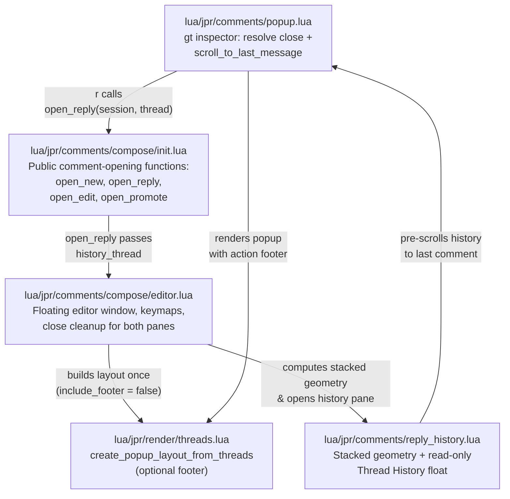
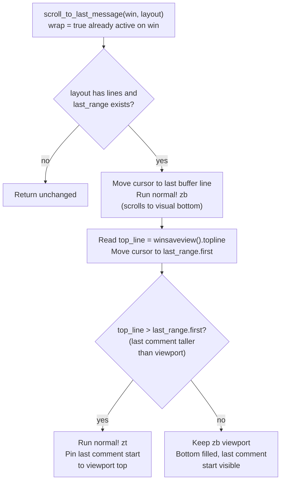
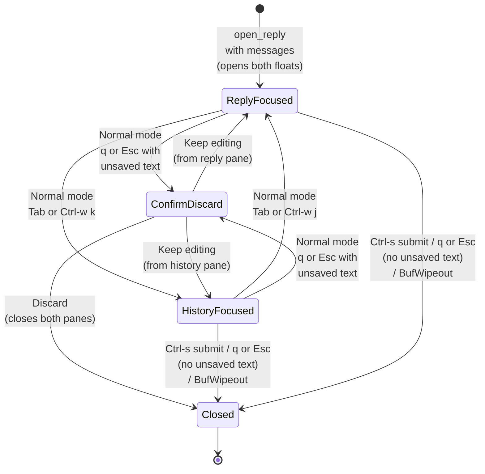

# Thread Popup Resolve Auto-Close, Last-Comment Scroll, and Docked Reply History

<small>

> <table border="0">
> <tr><th colspan="2">Files</th><th colspan="2">Lines</th></tr>
> <tr><td>Changed (total)</td><td>10</td><td>Insertions (+)</td><td>873</td></tr>
> <tr><td>Added</td><td>4</td><td>Deletions (-)</td><td>407</td></tr>
> <tr><td>Deleted</td><td>1</td><td>Net change</td><td>+466</td></tr>
> </table>

</small>

## 1. Purpose

Inspecting a pull-request review thread in Neovim with `gt` introduced three points of friction during routine code review. Pressing `R` to resolve a thread left the floating<sup>G3</sup> popup open so the reviewer had to press `q` immediately afterward; pressing `r` to reply closed the popup and opened an empty compose modal<sup>G1</sup> with no thread context visible; and opening a multi-comment thread always started at the top of the first message instead of the latest response, forcing manual scrolling down.

This change:

- Auto-closes the review thread popup<sup>G6</sup> when `R` resolves a thread and opens `gt` at the start of the last comment (§4).
- Docks a read-only, scrollable thread history<sup>G9</sup> window directly above the reply editor when replying to a thread with `r` (§5).

## 2. Background technical context

```text
lua/jpr/
├── comments/
│   ├── compose/           (changed)
│   ├── popup.lua          (changed)
│   └── reply_history.lua  (new)
├── render/
│   └── threads.lua        (changed)
├── session/
└── views/
    └── conversation.lua
```

<small>

| Unit | What it is |
| --- | --- |
| `compose/` | The floating<sup>G3</sup> markdown editor where a reviewer writes a new comment, reply, edit, or GitHub promotion<sup>G4</sup> of a local thread<sup>G5</sup> (`require("jpr.comments.compose")`). This branch splits `compose.lua` into comment-opening functions (`init.lua`) and floating-editor management (`editor.lua`), called by `popup.lua`, `session/`, and `conversation.lua`. |
| `popup.lua` | The floating<sup>G3</sup> review-thread inspector opened at the cursor when a reviewer presses `gt` on a file diff or review-stream<sup>G7</sup> line. It formats messages through `render/threads.lua`, sends resolve mutations through `session/`, and opens `compose/` when the reviewer presses `r`. |
| `reply_history.lua` | The read-only floating<sup>G3</sup> pane docked directly above the reply editor so the reviewer can read and scroll earlier thread messages while typing a reply. Opened by `compose/` (`editor.lua`), it computes the two-pane stacked geometry and reuses `render/threads.lua` and `popup.lua` to paint and pre-scroll the thread. |
| `render/threads.lua` | A pure Lua layout module (no Neovim windows or buffers) that formats review threads from the Rust engine into buffer lines, highlight spans, and 1-based line ranges for each message. Both `popup.lua` and `reply_history.lua` call `create_popup_layout_from_threads` to build their buffer contents. |
| `session/` | Owns one active pull-request review per Neovim tab (`require("jpr.session")`), storing active float<sup>G3</sup> handles (`session.popup`, `session.compose`) and routing JSON-RPC requests such as `setResolved` and `reply` to the Rust `jpr-review serve` process. Its `comments.lua` submodule handles `gt` and `gc` keymaps to open `popup.lua` and `compose/`, and `init.lua` closes both floats on teardown. |
| `conversation.lua` | The main-window buffer (`:Jpr conversation`) that lists top-level pull-request conversation comments beside the left file-tree panel. Like `popup.lua`, it calls `compose/` (`open_reply`, `open_edit`, `open_promote`, `open_new`) directly for top-level PR comments and top-level local threads<sup>G5</sup> (labelled as local notes in an unlinked local review<sup>G10</sup>). |

</small>

## 3. Shape of the solution

This branch introduces two cooperating changes to the Neovim comment UI, with no Rust engine or JSON-RPC protocol modifications. First, `lua/jpr/comments/popup.lua` closes the review thread popup<sup>G6</sup> when resolving a thread (while keeping it open on unresolve) and exposes a shared viewport-positioning helper (`scroll_to_last_message`). Second, `lua/jpr/comments/compose/` separates the four public comment-opening functions (`init.lua`) from floating<sup>G3</sup> window creation, keymaps, and close cleanup (`editor.lua`), and pairs with a new `lua/jpr/comments/reply_history.lua` module that reuses both `jpr.render.threads` and `popup.scroll_to_last_message` to render a read-only thread history<sup>G9</sup> float directly above the reply buffer.



> *The two strands meet at `popup.scroll_to_last_message` and `render.create_popup_layout_from_threads`: `compose/editor.lua` builds the thread layout without the popup key-hint footer once and hands it to `reply_history.lua`, which reuses the same scroll helper as the `gt` review thread popup<sup>G6</sup>.*
>
> **Diagram key**
>
> | | |
> | --- | --- |
> | **gt** | Keymap on a diff or review-stream<sup>G7</sup> line that opens the floating<sup>G3</sup> review thread popup<sup>G6</sup>. |
> | **r** | Keymap inside the review thread popup<sup>G6</sup> that opens the reply compose modal<sup>G1</sup>. |
> | **history_thread** | The thread table passed by `open_reply` so `compose/editor.lua` can render its messages in the docked history pane. |
> | **include_footer = false** | Option on `create_popup_layout_from_threads` that omits the `[r]eply [e]dit ...` key-hint line shown at the bottom of the `gt` popup. |

## 4. Closing and positioning the review thread popup

This section covers the two behavior changes inside the `gt` floating<sup>G3</sup> thread inspector (`lua/jpr/comments/popup.lua`): dismissing the popup when a reviewer resolves a thread and landing the viewport at the start of the latest comment when the popup opens.

### 4.1 Pressing R in the review thread popup closes it on resolve and refreshes in place on unresolve

When a reviewer resolves a thread from the `gt` popup, the review work on that thread is finished, whereas unresolving a thread usually precedes reading or replying to it. `toggle_resolved` now branches on `next_resolved` inside the `setResolved` RPC success callback rather than refreshing unconditionally.

**File: `lua/jpr/comments/popup.lua`**

```lua {15-17}
local function toggle_resolved(session)
    ...
    local entry, popup = current_entry(session)
    if not entry then
        return
    end
    local next_resolved = entry.thread.state ~= "resolved"
    require("jpr.session").request(session, "setResolved", {
        threadId = entry.thread_id,
        resolved = next_resolved,
    }, function(result)
        if session.popup ~= popup then
            return
        end
        if next_resolved then
            return M.close(session)
        end
        if result and result.thread then
            M.refresh_from_thread(session, result.thread)
        end
    end)
end
```

Because a single `gt` popup can display multiple threads stacked on the same line, `current_entry(session)` identifies the thread under the popup cursor (`entry`) and captures the current `popup` handle before the async RPC runs. The close runs inside the `setResolved` success callback rather than optimistically before the RPC completes: if the RPC fails (for example due to a network or authentication error), `jpr.session.request` reports the error or opens the auth prompt without invoking the callback, leaving the popup open. If the reviewer already closed this popup and opened another before the response arrives, the `session.popup ~= popup` guard returns early so the newer popup is left untouched. Resolving any thread closes the entire popup (including when multiple threads share a line), whereas when `next_resolved` is `false`, `M.refresh_from_thread` keeps the popup open and updates that thread's header from `Thread (Resolved)` back to `Thread (Open)` in place.

### 4.2 Pressing gt opens the review thread popup at the start of the last comment without hiding tall or wrapped replies

Independently of resolve handling, reviewers opening a multi-comment thread with `gt` want to read the most recent response from its beginning rather than starting at message 1 or landing at the bottom of a long reply. `M.scroll_to_last_message(win, layout)` runs inside `M.open` right after `wrap = true` is enabled on the floating<sup>G3</sup> window, reading `layout.lines` and `layout.message_ranges` (each entry records the 1-based `first` and `last` buffer lines of one formatted message, beginning at its `@author` header) produced by `jpr.render.threads`, and is reused by `lua/jpr/comments/reply_history.lua` for the docked reply history pane.

**File: `lua/jpr/comments/popup.lua`**

```lua {9-17}
function M.scroll_to_last_message(win, layout)
    ...
    local lines = layout.lines or {}
    local ranges = layout.message_ranges or {}
    local last_range = ranges[#ranges]
    if #lines == 0 or not last_range then
        return
    end
    vim.api.nvim_win_call(win, function()
        vim.api.nvim_win_set_cursor(win, { #lines, 0 })
        vim.cmd("normal! zb")
        local top_line = vim.fn.winsaveview().topline
        vim.api.nvim_win_set_cursor(win, { last_range.first, 0 })
        if top_line > last_range.first then
            vim.cmd("normal! zt")
        end
    end)
end
```

Using Neovim's `normal! zb` followed by a conditional `normal! zt` delegates soft-wrap accounting directly to Neovim's window renderer once `wrap = true` is enabled, avoiding manual line-width arithmetic. Running `zb` first ensures short trailing comments fill the bottom of the popup instead of leaving empty `~` rows below them; the conditional `zt` catches any final comment whose logical lines or soft-wrapped visual rows exceed the window height and pulls its author header (`last_range.first`) back to the top of the viewport.



> *`zb` runs before checking `top_line > last_range.first`, so short trailing comments fill the popup while tall or line-wrapped final comments snap their start to the top.*
>
> **Diagram key**
>
> | | |
> | --- | --- |
> | **wrap = true** | Local Neovim window option that soft-wraps long lines across visual rows. |
> | **last_range.first** | 1-based buffer line of the last comment's `@author` header. |
> | **normal! zb** | Neovim command that scrolls the cursor's line to the bottom row of the window. |
> | **winsaveview().topline** | 1-based buffer line currently displayed at the top row of the window. |
> | **normal! zt** | Neovim command that scrolls the cursor's line to the top row of the window. |

Four concrete cases from `tests/lua/popup_spec/scroll.lua` illustrate how the invariant holds (`clamp_popup_height` clamps popup height to `6..22` rows, and popup width caps at 84 columns):

- **Short thread (8 total lines, 2 one-line comments, 8-row popup, `last_range.first = 5`):** `zb` on line 8 leaves `top_line = 1`. Because `1 <= 5`, `zt` does not run; the cursor sits at line 5 with the entire thread visible.
- **Tall thread with short last comment (33 total lines, 25-line first comment, 2-line second comment starting at `last_range.first = 29`, 22-row popup):** `zb` puts line 33 at row 22, yielding `top_line = 12`. Because `12 <= 29`, `zt` does not run; the cursor lands on line 29 with the end of message 1 still visible above it.
- **Tall multi-line last comment (39 total lines, 3-line first comment, 30-line second comment starting at `last_range.first = 7`, 22-row popup):** `zb` puts line 39 at row 22, yielding `top_line = 18`. Because `18 > 7`, `zt` snaps `top_line = 7` so the reviewer reads the last comment from its author header downward.
- **Soft-wrapped single-line last comment (8 logical lines, 1-line first comment, `@bob` header on `last_range.first = 5`, single 2,640-character body on line 6, 8-row popup):** At most 84 columns wide, line 6 (2,642 characters with its two-space indent) wraps across more than 30 visual rows. Under Neovim's default `smoothscroll = false`, Neovim cannot start a window partway through a wrapped line that exceeds the remaining rows, so `zb` on line 8 pushes both lines 5 and 6 off the top (`top_line = 7`); with `smoothscroll = true`, `zb` starts partway through line 6 (`top_line = 6`). In either case `top_line > 5`, so `zt` snaps `top_line = 5` back to `@bob`.

## 5. Docking a read-only thread history pane above the reply editor

This section explains how pressing `r` from the review thread popup<sup>G6</sup> keeps the thread visible while composing a reply without mixing earlier thread messages into the editable compose buffer<sup>G1</sup>. It covers the `compose/` directory split, layout reuse and stacked two-pane geometry, and paired window lifecycle management.

### 5.1 lua/jpr/comments/compose.lua splits into comment-opening functions and floating-editor management without changing callers

To add the docked history pane without growing `lua/jpr/comments/compose.lua` past 400 lines, the single file is split into a directory module (keeping `require("jpr.comments.compose")` unchanged for callers) alongside the new history module:

- `lua/jpr/comments/compose/init.lua` owns the four public comment-opening functions (`open_new`, `open_reply`, `open_edit`, `open_promote`), `M.close`, checks that lock comments to local mode for unlinked sessions<sup>G10</sup> or unpushed files, suggestion prefill<sup>G8</sup> (fetching anchored diff lines for a GitHub `suggestion` block), and reopening a draft if an RPC fails with an authentication error.
- `lua/jpr/comments/compose/editor.lua` owns floating<sup>G3</sup> window creation, buffer keybindings, toggling a new comment's destination between GitHub and local agent mode (`<C-g>`), suggestion fence<sup>G8</sup> insertion (`<C-g>s`), attaching the docked history pane, and closing both panes together if either buffer is wiped (§5.3).
- `lua/jpr/comments/reply_history.lua` owns the stacked window-geometry calculation (§5.2) and the read-only **Thread History<sup>G9</sup>** float<sup>G3</sup>.

### 5.2 The reply editor formats the thread once without popup key hints and sizes both stacked panes to fit the terminal

To avoid showing the `gt` popup's `[r]eply [e]dit ...` footer inside the reply history pane, `render.create_popup_layout_from_threads(threads, opts)` accepts `opts.include_footer = false` (defaulting to `true` so existing callers are unaffected). Inside `compose/editor.lua`, `create_editor_geometry_from_thread` builds this footerless layout once to measure `#history_layout.lines` and returns it to `M.open`, which forwards `history_layout` through `attach_docked_history` into `reply_history.open` so the thread is never formatted twice. When `history_thread` has missing, empty, or `vim.NIL` (decoded JSON `null`) `messages`, `create_editor_geometry_from_thread` returns `nil` for `history_layout` and falls back to the standard centered single-pane reply float<sup>G3</sup>.

When `history_thread` (the thread table passed by `compose.open_reply`) has messages, `create_editor_geometry_from_thread` passes `vim.o.lines`, `vim.o.columns`, and `#history_layout.lines` to `reply_history.compute_stacked_geometry(total_lines, total_columns, history_line_count)` so both floating<sup>G3</sup> panes plus four rounded-border rows fit between the top edge and Neovim's command line, centered as one stacked modal.

**File: `lua/jpr/comments/reply_history.lua`**

```lua {2-10}
function M.compute_stacked_geometry(total_lines, total_columns, history_line_count)
    local width = math.min(86, math.max(54, total_columns - 12))
    local col = math.max(2, math.floor((total_columns - width) / 2))
    local usable_rows = math.max(8, total_lines - 6)
    local reply_height = math.min(10, math.max(4, math.floor(usable_rows * 0.4)))
    local max_history_height = math.max(4, usable_rows - reply_height)
    local history_height = math.min(max_history_height, math.max(4, history_line_count))
    local total_height = history_height + reply_height + 4
    local history_row = math.max(1, math.floor((total_lines - total_height) / 2))
    local reply_row = history_row + history_height + 2
    ...
end
```

Reserving 6 rows (`total_lines - 6`) accounts for 4 border rows (top and bottom for each rounded float<sup>G3</sup>) plus 1 row of top margin and 1 row at the bottom for Neovim's command line. Giving the reply box 40% of `usable_rows` (clamped to `4..10`) ensures the compose area never collapses on short terminals while granting remaining vertical space to thread history<sup>G9</sup>. Because `reply_row = history_row + history_height + 2`, the reply window's top border sits immediately below the history window's bottom border with no gap and identical `width` and `col`.

On a small 20x80 terminal with a 30-line thread (`compute_stacked_geometry(20, 80, 30)`):

- `width = 68`, `col = 6`, `usable_rows = 14`
- `reply_height = min(10, max(4, floor(5.6))) = 5`
- `max_history_height = max(4, 14 - 5) = 9`, `history_height = min(9, max(4, 30)) = 9`
- `total_height = 9 + 5 + 4 = 18`, `history_row = max(1, floor((20 - 18) / 2)) = 1`
- `reply_row = 1 + 9 + 2 = 12`, so the reply pane occupies 0-based rows 12 through 18 (top border at 12, 5 interior rows at 13-17, bottom border at 18; `12 + 5 + 2 = 19 <= 20`, leaving row 19 for Neovim's command line).

### 5.3 The reply editor and docked history pane share focus switching, cancel prompts, submission, and wipeout cleanup

Once both panes are sized and opened, `compose/editor.lua` keeps them synchronized as one modal while preserving the existing `session.compose` handle layout: `session.compose.buf` and `session.compose.win` still point to the editable reply buffer and window (so existing callers, `@mention` completion, `<C-g>s` suggestion insertion, and tests work unchanged), and companion history handles live at `session.compose.history_buf` and `session.compose.history_win`.

Focus starts in the reply pane (`compose.win`). Both panes share the same `on_cancel` and `on_submit` closures created in `compose/editor.lua`, so pressing `q` or `<Esc>` in Normal mode from **Thread History<sup>G9</sup>** still checks whether `compose.buf` has unsaved text before discarding, and pressing `<C-s>` from either pane submits only `compose.buf` and closes both floats<sup>G3</sup>.



> *Both floating<sup>G3</sup> panes share one cancel, submit, and wipeout lifecycle so neither window can outlive the other.*
>
> **Diagram key**
>
> | | |
> | --- | --- |
> | **open_reply** | `compose.open_reply(session, thread)` entrypoint that opens the docked reply modal. |
> | **BufWipeout** | Neovim event fired when a window or buffer is closed externally while `bufhidden = "wipe"`. |

Closing a window whose buffer has `bufhidden = "wipe"` fires `BufWipeout` while Neovim is still tearing down that buffer. Calling `nvim_buf_delete` on the same buffer inside its own `BufWipeout` handler raises `E937: Attempt to delete a buffer that is in use`. `compose/editor.lua` registers `register_wipeout_guard` on both buffers: once on `compose.buf` inside `M.open` and once on `history.buf` inside `attach_docked_history`. Each guard avoids `E937` by clearing `session.compose = nil` first (preventing recursive entry) and closing only the companion window and buffer whose buffer handle differs from `wiped_buf`.

**File: `lua/jpr/comments/compose/editor.lua`**

```lua {9-15}
local function register_wipeout_guard(session, compose, wiped_buf)
    vim.api.nvim_create_autocmd("BufWipeout", {
        buffer = wiped_buf,
        once = true,
        callback = function()
            if session.compose ~= compose then
                return
            end
            session.compose = nil
            if wiped_buf ~= compose.buf then
                close_window_and_buffer(compose.win, compose.buf)
            end
            if wiped_buf ~= compose.history_buf then
                close_window_and_buffer(compose.history_win, compose.history_buf)
            end
        end,
    })
end
```

## 6. Interface changes

Screenshot capture is blocked because `jpr-nvim` is a terminal-only Neovim plugin with no web UI or browser to drive; the ASCII wireframes below depict the changed floating<sup>G3</sup> layouts.

Opening `gt` on a thread whose final comment is taller than the 22-row popup lands at the start of that final comment (row 1 of the viewport is `@bob`, not the bottom of bob's reply):

```text
╭─────────────── Review Thread ───────────────╮
│ @bob · 2026-11-20T00:01:00Z                 │  <-- cursor & viewport top (last_range.first)
│   long reply 1                              │
│   long reply 2                              │
│   ...                                       │
│   long reply 20                             │
╰─────────────────────────────────────────────╯
Key:
  gt opens at @bob so a tall or wrapped final comment is read from its start.
  The Thread (Open) header sits above this scrolled viewport and the [r]eply ... footer sits below it.
  Pressing R on an open thread resolves it and closes this float immediately.
```

Pressing `r` from the popup opens the docked two-pane reply modal with **Thread History<sup>G9</sup>** read-only above and the editable reply box focused below:

```text
╭────────────────────────── Thread History ───────────────────────────╮
│ Thread (Open)                                                       │  <-- read-only, scrollable, pre-scrolled
│ @alice · 2026-11-20T00:00:00Z                                       │      to last comment via scroll_to_last_message
│   Original question                                                 │
│                                                                     │
│ @bob · 2026-11-20T00:01:00Z                                         │
│   Latest response                                                   │
╰────────────────── <Tab>/<C-w>j reply · q cancel ────────────────────╯
╭─────────────────────── [GitHub reply] Reply ────────────────────────╮
│ Sounds good, I will update this branch.                             │  <-- focused editable markdown buffer
│                                                                     │      <Tab> / <C-w>k switches up to history
╰─ <C-s> save · <Tab> thread · <C-g>s suggest · @ mention · q cancel ─╯
Key:
  Top pane:    jpr.comments.reply_history (nofile, modifiable = false, no popup action footer)
  Bottom pane: jpr.comments.compose/editor (editable markdown, @mentions, <C-g>s suggestions)
  Lifecycle:   q / <Esc> checks unsaved reply text from either pane; <C-s> closes both panes
```

## 7. Decisions

- **Replying renders earlier thread messages in a docked read-only floating<sup>G3</sup> pane above the reply editor rather than prepending thread text above a separator line inside one editable buffer.** Separating the buffers preserves thread extmark<sup>G2</sup> highlights, prevents the reviewer from accidentally editing or submitting quoted history, and avoids delimiter stripping on `<C-s>`, at the trade-off of pressing `<Tab>` or `<C-w>k` in Normal mode before scrolling up. Reverse this if real-world review shows switching panes feels slower than scrolling a single buffer with `k`/`<C-u>`.
- **Pressing `R` auto-closes the review thread popup<sup>G6</sup> only when marking a thread resolved, keeping it open and refreshed in place when unresolving.** Resolving finishes work on the thread, while unresolving typically means the reviewer intends to inspect or reply to the thread right away. Reverse this if reviewers want symmetric close behavior for both transitions.
- **Opening the review thread popup<sup>G6</sup> or docked thread history<sup>G9</sup> pane positions the viewport using Neovim's built-in bottom- and top-scroll commands (`normal! zb` then conditional `normal! zt`) rather than computing wrapped-line heights in Lua.** Soft-wrapped lines (`wrap = true`) can make a single-line comment exceed the popup height; querying `winsaveview().topline` after `zb` handles both multi-line and soft-wrapped comments accurately without reimplementing display-width calculation. Reverse this if a future popup disables line wrapping or requires off-screen geometry calculation before window creation.
- **Splitting `lua/jpr/comments/compose.lua` into `compose/init.lua` and `compose/editor.lua` keeps every compose and reply-history module under 300 lines while keeping `require("jpr.comments.compose")` unchanged.** Folding docked history window management into the single file pushed it past 450 lines and mixed comment-opening functions (which validate session state and dispatch submit RPCs) with floating<sup>G3</sup> window management; the directory module matches existing `lua/jpr/views/diff/` and `lua/jpr/session/` structure.

## 8. Deliberately not handled

- **Dynamic re-layout when the terminal resizes (`VimResized`):** None of `jpr-nvim`'s floating<sup>G3</sup> modals (`popup`, `compose`, `submit`, `cheatsheet`, `confirm`) reposition on terminal resize, so the docked reply modal does not add a resize listener.
- **Overriding the user's Neovim `scrolloff` setting when positioning thread panes:** If a user configures global `scrolloff > 0`, `normal! zt` inside `scroll_to_last_message` respects it and shows up to `scrolloff` context lines above the start of the last comment (`last_range.first`), matching standard Neovim behavior.
- **Single-pane comment editors (`open_new`, `open_edit`, `open_promote`):** Only `open_reply` attaches a thread history<sup>G9</sup> pane; other compose entrypoints retain their centered single-pane layout.
- **Rust engine and JSON-RPC protocol:** All three improvements live entirely in the Neovim Lua UI layer.

<div style="page-break-before: always"></div>

## Appendix A. Manual testing

<small>

1. From the repository root, run the full verification suite to confirm Rust formatting, clippy, Rust tests, and all headless Neovim Lua specs pass:

   ```sh
   just check
   ```

2. Open Neovim in a repository with an open pull request (or start a local review<sup>G10</sup> with `:Jpr local`), navigate to a diff line with a multi-comment review thread, and press `gt`.
   - **Before this change:** The **Review Thread** popup opened at line 1 (the top of the first comment).
   - **Now:** The cursor lands on the author header of the last comment. For a short trailing comment, the popup fills from the bottom; for a tall or line-wrapped final comment exceeding the popup's height (clamped to 6-22 rows), the author header of that comment sits at the top of the popup.

3. From the open **Review Thread** popup, press `r` to reply.
   - **Before this change:** The popup closed and a standalone empty reply modal opened with no earlier thread messages visible.
   - **Now:** A read-only **Thread History<sup>G9</sup>** float<sup>G3</sup> opens directly above the focused reply float, pre-scrolled to the last comment.

4. Type a draft reply in the bottom pane:

   > Checking the earlier comments above before sending.

   Press `<Esc>` to enter Normal mode, then press `<Tab>` (or `<C-w>k`) to focus **Thread History<sup>G9</sup>** and scroll with `k` / `<C-u>`.

5. While focused in **Thread History<sup>G9</sup>**, press `q` to test the shared discard prompt, choose **Keep editing** to confirm both panes remain open, then press `<Tab>` (or `<C-w>j`) to return to the reply box and press `<C-s>` (or press `<C-s>` directly from **Thread History**).
   - Verify both panes close and only the reply text is submitted.

6. Re-open the thread with `gt` and press `R` to resolve it.
   - **Before this change:** The popup stayed open displaying `Thread (Resolved)` until manually closed with `q`.
   - **Now:** The popup closes automatically once resolved.

7. Re-open the resolved thread with `gt` and press `R` again to unresolve it.
   - Verify the popup stays open and refreshes its header to `Thread (Open)`.

8. To run the targeted popup and compose specs individually without running the Rust workspace:

   ```sh
   nvim --headless -u NONE -i NONE -l tests/lua/popup_spec.lua
   ```

   ```sh
   nvim --headless -u NONE -i NONE -l tests/lua/compose_spec.lua
   ```

</small>

<div style="page-break-before: always"></div>

## Appendix B. Glossary

<small>

| Term | Meaning |
| --- | --- |
| **G1** Compose modal (compose buffer, compose window) | The floating<sup>G3</sup> markdown editor (`jpr.comments.compose`) where a reviewer types a new comment, reply, edit, or promoted local thread<sup>G5</sup>. Pressing `<C-s>` submits its text and `q` or `<Esc>` in Normal mode cancels. |
| **G2** Extmark | A Neovim marker attached to a range in a buffer that applies UI highlights or virtual text without changing the buffer's lines. Both the review thread popup<sup>G6</sup> and **Thread History<sup>G9</sup>** paint author, status, and reaction colors with extmarks. |
| **G3** Float (floating pane) | A Neovim floating window drawn on top of regular editor splits with its own border, title, and optional footer. Both the `gt` inspector and the stacked reply modal are built from floats. |
| **G4** GitHub promotion | Copying a local thread's<sup>G5</sup> root comment to GitHub as a PR comment or pending review draft (`open_promote` / `promoteThread`) and recording the created GitHub thread ID in `promotedTo`. |
| **G5** Local thread | A review comment thread stored only on disk in `local.json` (`origin = "local"`) for the local coding-agent workflow or an unlinked local review<sup>G10</sup>, never sent to GitHub unless explicitly promoted. |
| **G6** Review thread popup | The floating<sup>G3</sup> inspector (`jpr.comments.popup`) opened at the cursor with `gt` on a diff or review-stream<sup>G7</sup> line to read messages and run actions such as `r` (reply) and `R` (resolve or unresolve). |
| **G7** Review-stream | The full-branch diff view opened by `:Jpr stream` (one scrolling buffer in unified mode, or two scroll-bound buffers in split mode) that renders every changed file's hunks and attached review threads continuously. |
| **G8** Suggestion fence (suggestion prefill) | A markdown `suggestion` code block pre-filled with the anchored diff lines fetched from the Rust engine, either automatically when starting a suggested comment or on demand with `<C-g>s` in Insert mode. |
| **G9** Thread History | The read-only, scrollable floating<sup>G3</sup> pane (`jpr.comments.reply_history`) docked directly above the reply editor when replying to a thread with existing messages, pre-scrolled to the last comment and rendered without the popup's key-hint footer. |
| **G10** Unlinked session (local review) | A `:Jpr local` review session running on a local git branch that has no linked GitHub pull request yet, which locks new comments to local mode until a PR is linked. |

</small>
