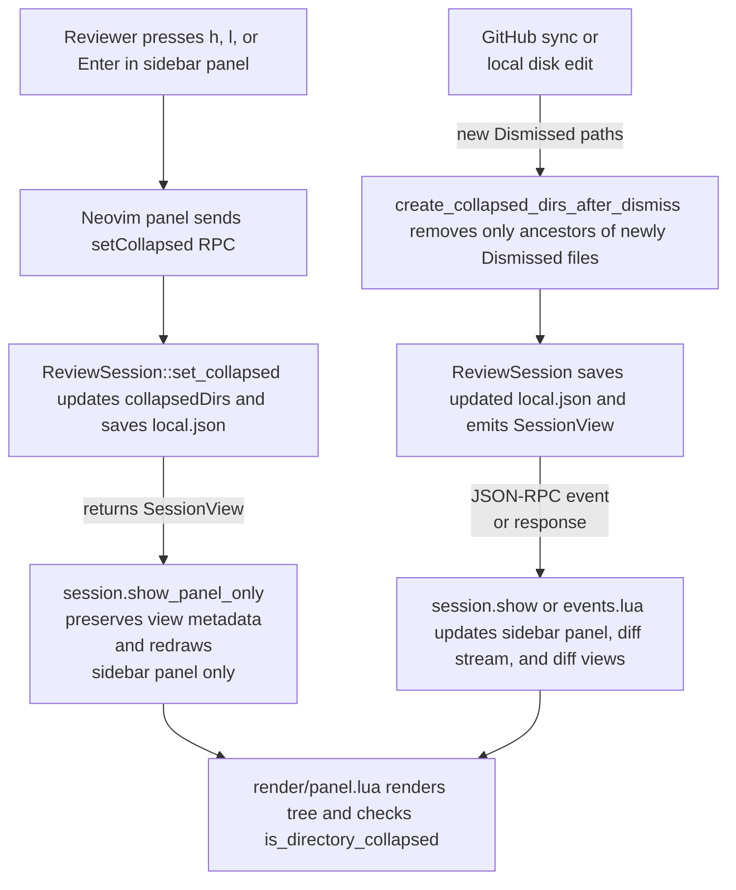
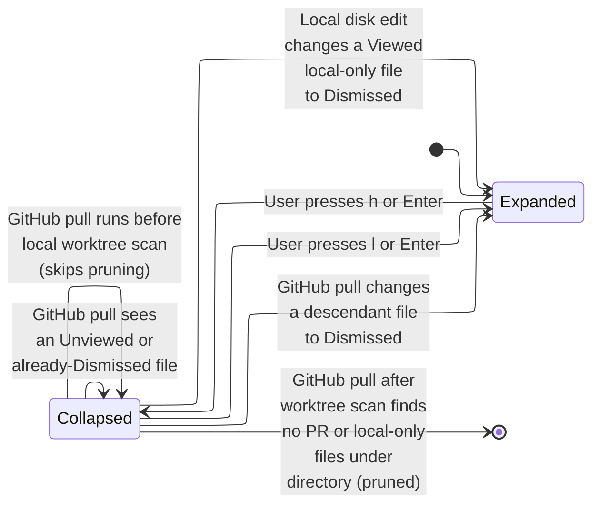
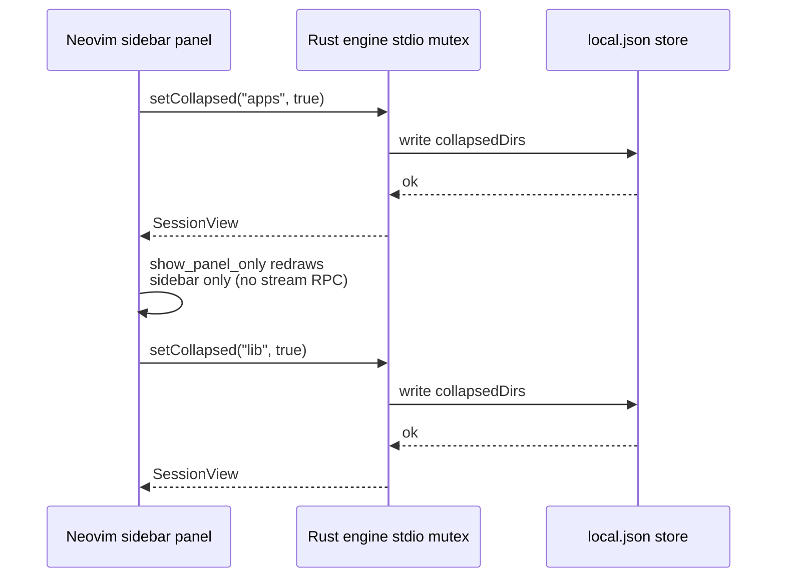

# Persisting Collapsed Sidebar Directories and Restricting Auto-Expansion to New Dismissals

<small>

> <table border="0">
> <tr><th colspan="2">Files</th><th colspan="2">Lines</th></tr>
> <tr><td>Changed (total)</td><td>13</td><td>Insertions (+)</td><td>512</td></tr>
> <tr><td>Added</td><td>0</td><td>Deletions (-)</td><td>69</td></tr>
> <tr><td>Deleted</td><td>0</td><td>Net change</td><td>+443</td></tr>
> </table>

</small>

## 1. Purpose

A reviewer opened a large pull request in Neovim, collapsed several directories in the left sidebar panel, quit Neovim, and reopened the same pull request to find none of those directories stayed collapsed. Six defects caused saved collapse choices to stall, disappear, or reopen unexpectedly: toggling a directory triggered a full-PR diff stream<sup>G1</sup> rebuild that blocked later toggles on large pull requests, GitHub syncs reopened collapsed directories for unviewed<sup>G10</sup> files instead of only newly dismissed<sup>G2</sup> files, initial syncs dropped collapsed directories whose files existed only in the local worktree, editing a viewed local-only file<sup>G6</sup> on disk failed to reopen its collapsed parent directories, linking a local worktree review<sup>G5</sup> into an existing pull request discarded previously saved file viewed states<sup>G11</sup>, and directories combined onto one joined directory row<sup>G4</sup> (such as `docs/x/`) ignored a collapsed parent path. Reviewers could not trust the sidebar to remember which subtrees they had already set aside across sessions.

This change:

- Keeps collapsed directories closed across restarts, GitHub syncs, and local-to-PR links, auto-expanding only parent directories of newly dismissed<sup>G2</sup> files (§4).
- Keeps parent and child directory collapse states independent, including when single-child directories are combined onto one sidebar row (§5).
- Redraws only the sidebar panel after a directory toggle so saving collapsed directories never waits behind the main-window diff stream<sup>G1</sup> (§6).

## 2. Background technical context

```text
crates/
├── review-model/
├── review-core/src/
│   ├── collapsed.rs     (changed)
│   ├── tree.rs
│   └── session/         (changed)
├── review-rpc/src/
│   └── server.rs
└── review-store-fs/
lua/jpr/
├── render/
│   └── panel.lua        (changed)
├── session/
│   └── init.lua         (changed)
└── views/
    ├── panel.lua        (changed)
    └── stream/
```

<small>

| Unit | What it is |
| --- | --- |
| `review-model` | Shared Rust data types for a pull request's changed files, viewed states<sup>G11</sup>, and sidebar tree rows, including the `SessionView` payload returned to frontends. Built by `review-core` and serialized over JSON-RPC by `server.rs`. |
| `collapsed.rs` | Pure Rust rules deciding which sidebar directory paths stay collapsed after a GitHub pull, a local worktree file edit, or a user expand. Called by `review-core/session` before it saves `local.json` (the per-PR local state file). |
| `tree.rs` | Pure Rust builder that turns changed file paths into ordered sidebar `TreeRow`s, combining any directory whose only child is another directory into one joined directory row<sup>G4</sup> (for example `docs/x`). Used by `review-core/session` when expanding directories and by `review-core`'s `SessionView` presenter (`presenter.rs`). |
| `review-core/session` | The `ReviewSession` facade holding one review's in-memory state and saving updates through the `ReviewStore` port (`review-store-fs`). Its submodules (`session/collapsed.rs`, `sync.rs`, `local_files.rs`, `link.rs`) handle directory toggles, GitHub pulls, local worktree file edits, and linking an unlinked local worktree review<sup>G5</sup> into an existing pull request. |
| `server.rs` | The `jpr-review serve` JSON-RPC stdio server that reads requests from Neovim sequentially in one loop and locks a single `Mutex<ReviewSession>` shared across the running review (including the background watcher and Unix socket server). Because each stdio request runs to completion while holding that mutex, a long `stream` request blocks later `setCollapsed` requests. |
| `review-store-fs` | File-backed store that reads and atomically writes each review's per-PR JSON files on disk: `session.json` (daemon metadata and last-synced pull request), `local.json` (collapsed directories, local threads, and viewed states<sup>G11</sup> for local-only files<sup>G6</sup>), `viewed.json` (PR changed files and their viewed states), and `github.json` (queued viewed marks<sup>G7</sup> and GitHub thread sync state). Implements the `ReviewStore` port that `review-core/session` saves through. |
| `render/panel.lua` | Pure Lua formatter that turns a `SessionView`'s file tree and collapsed-directory list into sidebar text lines, icons, and counts. Called by `views/panel.lua` on every sidebar redraw. |
| `session/init.lua` | Neovim tab session coordinator that owns one review tab's latest `SessionView` and sends JSON-RPC requests to `jpr-review serve`. Routes view updates to `views/panel.lua`, `views/stream`, and per-file diff views. |
| `views/panel.lua` | Neovim window controller for the left PR sidebar panel and its directory keys (`h`, `l`, `<CR>`). Sends `setCollapsed` requests through `session/init.lua` and redraws the sidebar buffer via `render/panel.lua`. |
| `views/stream` | Controller for the full-PR diff stream<sup>G1</sup> buffer in Neovim's main window beside the sidebar, showing all changed files in unified or split layout. Refreshed by `session/init.lua` via a `stream` JSON-RPC request to the engine. |

</small>

## 3. Shape of the solution

This section maps how a reviewer's directory collapse choices move from Neovim key presses to the persisted `collapsedDirs` set in `local.json`, and how GitHub syncs, local worktree edits, and sidebar renders read or update that set. The three strands below cover separate paths touching `collapsedDirs`: §4 controls when the engine automatically expands or prunes directories on GitHub sync, local disk edits, and linking a local review<sup>G5</sup> to a pull request; §5 keeps parent and child directory entries independent and handles joined directory rows<sup>G4</sup>; and §6 decouples Neovim sidebar toggles from the main-window diff stream<sup>G1</sup>.



> *Manual directory toggles and automatic expansions for newly dismissed<sup>G2</sup> files both update the single persisted `collapsedDirs` set in `local.json` and send an updated `SessionView` to Neovim, while toggle redraws skip the diff stream<sup>G1</sup>.*
>
> **Diagram key**
>
> | | |
> | --- | --- |
> | **setCollapsed** | JSON-RPC request that inserts or removes one sidebar directory path in `local.json`. |
> | **collapsedDirs** | Sorted set of repo-relative directory paths persisted per review in `local.json`. |
> | **local.json** | Per-PR JSON state file on disk storing `collapsedDirs` and local-only review state. |
> | **SessionView** | JSON-RPC snapshot of the pull request's files, tree rows, and `collapsedDirs` sent from Rust to Neovim. |
> | **Dismissed<sup>G2</sup>** | Viewed state<sup>G11</sup> indicating a previously viewed file changed and requires re-review. |

## 4. Saved directory collapses survive restarts and syncs, auto-expanding only when a file newly becomes Dismissed

This strand defines when the review engine may automatically remove a directory path from `collapsedDirs` and when it must leave the reviewer's saved collapses untouched. Following the flow in §3, the four subsections cover every automatic write path that updates `collapsedDirs`: reconciling GitHub pull viewed states<sup>G11</sup> (§4.1), dismissing viewed local-only files<sup>G6</sup> after disk edits (§4.2), deferring empty-directory pruning<sup>G3</sup> until the local worktree has been scanned (§4.3), and linking an unlinked local worktree review<sup>G5</sup> into an existing pull request (§4.4).



> *A collapsed directory is removed from `collapsedDirs` automatically only when a descendant file newly changes to `Dismissed` (auto-expanding it) or when a post-scan GitHub pull confirms no files remain under it (pruning it).*
>
> **Diagram key**
>
> | | |
> | --- | --- |
> | **Viewed** | File already marked reviewed by the user. |
> | **Unviewed<sup>G10</sup>** | Changed file not yet marked viewed; never auto-expands a collapsed directory. |
> | **Dismissed<sup>G2</sup>** | Previously viewed file invalidated by new commits or local edits; triggers ancestor expansion on transition. |
> | **Local-only file<sup>G6</sup>** | Changed file in the local worktree that is not yet part of the pull request on GitHub. |

### 4.1 GitHub pulls auto-expand only parent directories of files whose viewed state newly becomes Dismissed

#### The Problem

When a reviewer collapsed a directory and a later GitHub sync pulled a newly added Unviewed<sup>G10</sup> file or a file unmarked back to Unviewed, the sidebar reopened that directory even though no previously viewed file had been invalidated. In code, `create_collapsed_dirs_after_pull` checked whether a file's pulled viewed state<sup>G11</sup> was Unviewed or Dismissed<sup>G2</sup> and differed from its previously saved viewed state in `viewed.json` (`previous`).

#### The Solution

`file_became_dismissed_from_forge` compares three viewed-state sources for each pull-request file: `previous` (the previously saved state from `viewed.json`), `forge` (GitHub's pull response), and `file.viewed` (the reconciled state<sup>G8</sup> after overlaying any locally queued viewed marks<sup>G7</sup> from `github.json` waiting to reach GitHub).

**File: `crates/review-core/src/collapsed.rs`**

```rust {6-8}
fn file_became_dismissed_from_forge(
    file: &ChangedFile,
    previous: &BTreeMap<String, ViewedState>,
    forge: &BTreeMap<String, ViewedState>,
) -> bool {
    file.viewed == ViewedState::Dismissed
        && forge.get(&file.path) == Some(&ViewedState::Dismissed)
        && previous.get(&file.path) != Some(&ViewedState::Dismissed)
}
```

Only files that match all three highlighted predicates flow into `create_collapsed_dirs_after_dismiss`, which removes only directories matching `is_path_in_directory(path, dir)` (strict parent directories of the dismissed<sup>G2</sup> file). Checking `previous.get(&file.path) != Some(&ViewedState::Dismissed)` guarantees that a state change is required: if a file is already Dismissed, and the reviewer intentionally collapses its directory, quits Neovim, and reopens or syncs again, `previous` already records Dismissed from `viewed.json`, so the predicate returns `false` and the directory stays collapsed. Likewise, when a locally queued viewed mark<sup>G7</sup> overrides a remote Dismissed state, `file.viewed` is `Viewed`, so the directory stays collapsed.

Worked example:

- Input `collapsed`: `{"apps", "apps/cli", "apps/cli/sub", "apps/cli/other", "apps/web", "lib"}`.
- `previous`: all four files (`apps/cli/sub/a.rs`, `apps/cli/other/b.rs`, `apps/web/c.rs`, `lib/d.rs`) are `Viewed`.
- `forge` and `file.viewed` (reconciled state<sup>G8</sup>): `apps/cli/sub/a.rs` changes to Dismissed<sup>G2</sup>; the other three stay `Viewed`.
- `dismissed_paths` collects `["apps/cli/sub/a.rs"]`.
- `create_collapsed_dirs_after_dismiss` drops `"apps"`, `"apps/cli"`, and `"apps/cli/sub"` because `is_path_in_directory` returns `true` for each.
- Output `collapsed`: `{"apps/cli/other", "apps/web", "lib"}`. Unrelated directories and collapsed sibling subdirectories stay collapsed.

### 4.2 Editing a viewed local-only worktree file on disk expands only its collapsed parent directories

#### The Problem

When a reviewer marked a local-only worktree file<sup>G6</sup> as `Viewed`, collapsed its directory, and then edited that file on disk (directly or via an AI agent), `dismiss_edited_local_viewed` updated that file's entry in `local.json`'s `local_viewed` map to Dismissed<sup>G2</sup> without updating `collapsed_dirs`. The file needed re-review, yet stayed hidden inside its collapsed directory.

#### The Solution

`dismiss_edited_local_viewed` now collects every local-only worktree file<sup>G6</sup> path that transitions from `Viewed` to Dismissed<sup>G2</sup> and passes those paths to `create_collapsed_dirs_after_dismiss` before saving `local.json`. Both the 2-second background worktree watcher (`poll_worktree_files`) and explicit frontend refreshes (`refresh_worktree`) call this method.

**File: `crates/review-core/src/session/local_files.rs`**

```rust {13,16-22}
impl ReviewSession {
    ...
    pub(super) fn dismiss_edited_local_viewed(&mut self, changed_paths: &[String]) -> Result<bool> {
        let mut dismissed_paths = Vec::new();
        for path in changed_paths {
            if self.is_local_only_file(path)
                && self.saved.local.local_viewed.get(path) == Some(&ViewedState::Viewed)
            {
                self.saved
                    .local
                    .local_viewed
                    .insert(path.clone(), ViewedState::Dismissed);
                dismissed_paths.push(path.clone());
            }
        }
        if dismissed_paths.is_empty() {
            return Ok(false);
        }
        self.saved.local.collapsed_dirs = crate::collapsed::create_collapsed_dirs_after_dismiss(
            &self.saved.local.collapsed_dirs,
            &dismissed_paths,
        );
        self.ports.store.save(&self.saved)?;
        Ok(true)
    }
}
```

Because the guard requires `local_viewed.get(path) == Some(&ViewedState::Viewed)`, only the first edit after marking a file viewed triggers auto-expansion. If the reviewer re-collapses the directory while the file is already Dismissed<sup>G2</sup> and edits the file again, `dismissed_paths` stays empty, the early return executes, and the directory remains collapsed.

### 4.3 GitHub sync skips pruning empty collapsed directories until the local worktree has been scanned

#### The Problem

When a reviewer collapsed a directory holding only local-only worktree files, quit Neovim, and reopened the pull request, that directory reopened on startup. Normally, `create_collapsed_dirs_after_pull` runs empty-directory pruning<sup>G3</sup> to remove directories from `collapsed_dirs` once they contain no remaining pull-request or local-only files<sup>G6</sup> so stale paths do not accumulate. On reopen, however, the first GitHub `sync` runs before the engine has computed the git merge base or scanned the worktree into `self.local_files`, so `self.local_files` was still empty and unconditional pruning deleted every collapsed local-only directory.

#### The Solution

Right before calling `apply_collapsed_dirs_after_pull`, `reconcile_viewed_and_local_files` checks `self.base_cache.merge_base` (the cached git merge base between the pull request's base commit and checked-out `HEAD`): if `merge_base` is empty, it skips `self.refresh_local_files()`; once `poll_worktree_files`, `refresh_worktree`, or a diff request (`prepare_base`) has populated `merge_base`, it refreshes `self.local_files` on every sync. `apply_collapsed_dirs_after_pull` now uses the same guard, passing `should_prune_empty = !self.base_cache.merge_base.is_empty()` to `create_collapsed_dirs_after_pull` so empty-directory pruning<sup>G3</sup> runs only after `self.local_files` has been scanned.

**File: `crates/review-core/src/session/sync.rs`**

```rust {5,12}
impl ReviewSession {
    ...
    fn apply_collapsed_dirs_after_pull(&mut self, ...) {
        ...
        let should_prune_empty = !self.base_cache.merge_base.is_empty();
        self.saved.local.collapsed_dirs = crate::collapsed::create_collapsed_dirs_after_pull(
            &self.saved.local.collapsed_dirs,
            previous,
            forge,
            &self.saved.files,
            &local_only_paths,
            should_prune_empty,
        );
    }
}
```

### 4.4 Linking a local worktree review into an existing PR preserves prior file viewed states

#### The Problem

A reviewer can start a local worktree review<sup>G5</sup> with `:Jpr local` before opening a pull request, then run `:Jpr sync` to link that local review into an existing pull request that already has a store snapshot<sup>G9</sup> on disk (`viewed.json`, `github.json`, and `local.json`). Previously, `merge_preexisting_pr_snapshot` unioned `prior.local.collapsed_dirs` into `self.saved.local.collapsed_dirs` but left `self.saved.files` empty. When `apply_pull` ran immediately afterward, it built `previous` from the empty `self.saved.files`, so every file already Dismissed<sup>G2</sup> on GitHub looked newly dismissed and expanded its collapsed directory.

#### The Solution

`merge_preexisting_pr_snapshot` now copies `prior.files` (from the preexisting PR's `viewed.json`) into `self.saved.files` alongside its existing load of `prior.registry` (from `github.json`, including its `queued_viewed` map of pending viewed toggles). After removing any path the reviewer already marked `Viewed` in the active local review<sup>G5</sup> (`self.saved.local.local_viewed`) from `queued_viewed`, it now overlays the remaining queued viewed marks<sup>G7</sup> onto `self.saved.files` via `crate::viewed::apply_queued`, so an older queued unviewed<sup>G10</sup> mark cannot overwrite `self.saved.files` or the local `Viewed` state that `apply_pull` is about to promote to GitHub. `apply_pull` then compares GitHub's snapshot against accurate prior viewed states<sup>G11</sup>.

**File: `crates/review-core/src/session/link.rs`**

```rust {5,12}
impl ReviewSession {
    ...
    fn merge_preexisting_pr_snapshot(&mut self, prior: StoreSnapshot) {
        ...
        self.saved.files = prior.files;
        self.saved.registry = prior.registry;
        for (path, state) in &self.saved.local.local_viewed {
            if *state == ViewedState::Viewed {
                self.saved.registry.queued_viewed.remove(path);
            }
        }
        crate::viewed::apply_queued(&mut self.saved.files, &self.saved.registry.queued_viewed);
        ...
    }
}
```

## 5. Parent and child directories keep independent collapse states, including across joined single-child rows

Separate from the automatic sync and edit rules in §4, this strand explains how independent parent and child entries in `collapsedDirs` work alongside joined directory rows<sup>G4</sup> (where the sidebar combines a directory whose only child is another directory into one row, such as `docs` and `x` rendered as `docs/x/`). Collapsing a parent never writes child directory paths into `collapsedDirs`; instead, the sidebar renderer hides all descendants beneath any collapsed directory so expanding the parent later restores every subdirectory's own saved state.

### 5.1 The sidebar renderer treats a joined single-child directory row as collapsed if any combined parent path is collapsed

#### The Problem

`create_file_tree_from_paths` combines chains of directories that contain only one child directory into a single joined directory row<sup>G4</sup> (for example `docs/x`). If a reviewer collapsed `docs` while `docs/root.md` existed, and a later commit removed `docs/root.md`, the tree combined `docs` and `x` into one row whose full path became `docs/x`. Because `collapsed_dirs` held `"docs"` rather than `"docs/x"`, the renderer treated `docs/x` as expanded.

#### The Solution

`is_directory_collapsed` in `lua/jpr/render/panel.lua` checks exact membership for the row's full `dir_path` first. When the row's display `segment` contains `"/"` (for example, under `parent_dir = "apps"`, a joined directory row<sup>G4</sup> with `segment = "docs/x"` and `dir_path = "apps/docs/x"`), it walks each intermediate path built from `parent_dir` plus each slash-delimited part of `segment` (`"apps/docs"`, then `"apps/docs/x"`). If any prefix is `true` in `collapsed_dirs`, the joined directory row renders collapsed (`▸ docs/x/ (0/1)`) and hides its descendants.

**File: `lua/jpr/render/panel.lua`**

```lua {8-14}
local function is_directory_collapsed(collapsed_dirs, parent_dir, segment, dir_path)
    if collapsed_dirs[dir_path] == true then
        return true
    end
    if segment:find("/", 1, true) == nil then
        return false
    end
    local current_path = parent_dir
    for part in segment:gmatch("[^/]+") do
        current_path = current_path and (current_path .. "/" .. part) or part
        if collapsed_dirs[current_path] == true then
            return true
        end
    end
    return false
end
```

When `segment` has no `"/"` (normal unjoined directory rows such as `other` under `apps`), the early return ensures `is_directory_collapsed` checks only `collapsed_dirs[dir_path]`. A child directory therefore never inherits its parent's collapse state once the parent is expanded.

### 5.2 Expanding a joined single-child directory row clears combined collapsed parent paths without expanding separate parent rows

#### The Problem

With `is_directory_collapsed` honoring `"docs"` on a joined directory row<sup>G4</sup> `docs/x`, pressing `l` or `<CR>` on `docs/x` sent `setCollapsed("docs/x", false)`. Removing only `"docs/x"` left `"docs"` in `collapsed_dirs`, so the row rendered collapsed again on the next redraw.

#### The Solution

When `collapsed == false`, `ReviewSession::set_collapsed` builds the current tree rows via `create_file_tree_from_paths` and delegates to `create_collapsed_dirs_after_expand`. That pure function removes `path` and then drops any strict parent path `dir` of `path` that does not appear as its own directory row in `tree_dir_paths`.

**File: `crates/review-core/src/collapsed.rs`**

```rust {11-15}
pub fn create_collapsed_dirs_after_expand(
    collapsed: &BTreeSet<String>,
    path: &str,
    tree: &[TreeRow],
) -> BTreeSet<String> {
    let mut remaining = collapsed.clone();
    remaining.remove(path);
    if tree.is_empty() {
        return remaining;
    }
    let tree_dir_paths = collect_tree_dir_paths(tree);
    if !tree_dir_paths.contains(path) {
        return remaining;
    }
    remaining.retain(|dir| !is_path_in_directory(path, dir) || tree_dir_paths.contains(dir));
    remaining
}
```

Two boundary cases verify why the `tree_dir_paths.contains(dir)` guard is required:

1. **Joined directory row<sup>G4</sup> (`docs/x/y.md` is the only file):** `tree_dir_paths` is `{"docs/x"}`, and `collapsed` is `{"docs"}`. Expanding `"docs/x"` evaluates `is_path_in_directory("docs/x", "docs") == true` and `tree_dir_paths.contains("docs") == false`, so `"docs"` is removed and the row expands.
2. **Separate parent row (`docs/root.md` and `docs/x/y.md` both exist):** `tree_dir_paths` is `{"docs", "docs/x"}`, and `collapsed` is `{"docs", "docs/x"}`. Expanding `"docs/x"` removes `"docs/x"`, but retains `"docs"` because `tree_dir_paths.contains("docs") == true`. Expanding a child never clears a separately rendered parent row.

## 6. Toggling a sidebar directory redraws only the sidebar panel so toggles never trigger a full-PR diff stream request

Independent of the collapse-set rules in §4 and §5, this strand explains why rapid directory collapses on a large pull request appeared to disappear after quitting Neovim even though `ReviewSession::set_collapsed` writes `local.json` synchronously.

### The Problem

After a `setCollapsed` JSON-RPC request returned an updated `SessionView`, `request_set_collapsed` in `lua/jpr/views/panel.lua` called `require("jpr.session").show(session, updated_view)`. Before the main-window diff stream<sup>G1</sup> had opened (`session.stream_opened == false`), `session.show` set `session.stream_opened = true` and unconditionally called `stream.show`, firing a `stream` JSON-RPC request; on later calls, it ran `stream.refresh` (which fires a `stream` request whenever the stream buffer is visible and its view or mode key differs from the last drawn stream) plus `diff.reconcile` or `diff.redraw_all`. Inside `crates/review-rpc`, `answer_requests` handles stdio JSON-RPC lines sequentially in one loop while `handle_stream_with_progress` holds the single `Mutex<ReviewSession>`. Building a diff stream for a pull request with hundreds of files held that loop and mutex until every file diff finished computing, queueing subsequent `setCollapsed` requests behind it so they were aborted (`vim.fn.jobstop` on `VimLeavePre`) before reaching disk when the reviewer quit Neovim while the stream was still building.

### The Solution

`lua/jpr/session/init.lua` extracts `normalize_session_view` and adds `M.show_panel_only(session, view)`, which stores the normalized view on `session.view` and redraws only `panel.render`. `normalize_session_view` copies the incoming view when modifying it instead of mutating it in place, keeping two client-side fields intact: `isReadOnly` (so a tab that fell back to read-only mode after engine crashes keeps its `[read-only]` badge) and any pre-sync placeholder `pr` metadata (the pull request number and title shown in the sidebar before the first sync populates commit SHAs). `request_set_collapsed` now calls `session.show_panel_only` instead of `session.show`, leaving the main-window diff stream<sup>G1</sup> (`views/stream`) and per-file diff views (`views/diff`) untouched. Calling `session.show_panel_only` eliminates `stream` requests caused by directory toggles; a `setCollapsed` sent while an unrelated `stream` request (such as initial startup loading or `:Jpr stream`) is already in flight still waits behind that request on the engine's stdio loop.

**File: `lua/jpr/session/init.lua`**

```lua {2-4}
function M.show_panel_only(session, view)
    local normalized_view = normalize_session_view(session, session.view, view)
    session.view = normalized_view
    panel.render(session, normalized_view)
end
```



> *Because `show_panel_only` never issues a `stream` request, directory toggles do not trigger diff-stream rebuilds, so back-to-back `setCollapsed` calls run without self-inflicted stream contention and flush to `local.json`.*
>
> **Diagram key**
>
> | | |
> | --- | --- |
> | **setCollapsed** | JSON-RPC request persisting one directory's collapsed state in `local.json`. |
> | **collapsedDirs** | Sorted set of collapsed directory paths saved in `local.json`. |
> | **SessionView** | Updated review view returned to Neovim over stdio JSON-RPC. |
> | **show_panel_only** | `lua/jpr/session/init.lua` entry point that updates `session.view` and redraws only the sidebar panel. |
> | **stream RPC** | JSON-RPC `stream` request that builds the full-PR diff stream<sup>G1</sup> buffer. |

## 7. Interface changes

`jpr-nvim` runs exclusively inside a terminal Neovim session with no browser or GUI screenshot harness, so automated screenshots are blocked by the absence of a browser rendering surface; the ASCII wireframes below show the Neovim split layout and the exact rendered sidebar rows verified by `tests/lua/panel_render_spec.lua`.

```text
Neovim review tab layout:
+-----------------------------------+---------------------------------------------+
| Left sidebar panel                | Main window: diff stream (or per-file diff) |
|  #330 Example PR                  | ▾ ● apps/cli/a.rs  +1 -0                    |
|  ▾ apps/                          |   @@ -1,2 +1,3 @@                           |
|    ▾ cli/                         |   +fn updated() {}                          |
|      ● a.rs  +1 -0                | ▸ ✓ apps/other/b.rs  +1 -0                  |
|      ✓ ok.rs  +1 -0               |                                             |
|        todo.rs  +1 -0 [local]     |                                             |
|    ▸ other/ (0/1)                 |                                             |
+-----------------------------------+---------------------------------------------+

Independent parent and child collapse state:

Before expanding apps/ (collapsedDirs = {"apps", "apps/other"}):
  ▸ apps/ (0/2)

After expanding apps/ (collapsedDirs = {"apps/other"}):
  ▾ apps/
    ▾ cli/
        a.rs  +1 -0
    ▸ other/ (0/1)

Joined directory row with collapsed parent prefix (collapsedDirs = {"docs"}):
  ▸ docs/x/ (0/1)

Key:
  ▸        collapsed directory row (shows viewed/total descendant files)
  ▾        expanded directory row (descendants shown below)
  ✓        file marked Viewed
  ●        file marked Dismissed (changed since last viewed; needs re-review)
  [local]  local-only worktree file not yet in the pull request on GitHub
```

## 8. Decisions

- **Auto-expand a collapsed directory only when a file's viewed state<sup>G11</sup> changes to Dismissed<sup>G2</sup>, never for Unviewed<sup>G10</sup> files.** The rejected alternative was keeping the earlier `Unviewed | Dismissed` check, which reopened collapsed directories whenever a pull introduced or unmarked an Unviewed file. Reversing this choice would require reviewer feedback that newly added files inside an already-collapsed directory should expand automatically.
- **Skip removing empty directories from `collapsedDirs` during a GitHub sync until the local worktree has been scanned (`base_cache.merge_base` is populated).** The rejected alternative was pruning unconditionally on every sync, which deleted collapsed local-only directories on the first sync after reopening because `refresh_worktree` had not scanned `local_files` yet. Reversing this choice is safe only if local worktree file scanning runs before the first GitHub pull.
- **Redraw only the sidebar panel after a directory toggle through a dedicated `session.show_panel_only` helper that preserves read-only and placeholder PR metadata, rather than adding a skip-stream flag to `session.show` or duplicating that logic in `views/panel.lua`.** The rejected alternative was calling `session.show` (which could trigger blocking `stream` RPCs on large PRs) or duplicating `isReadOnly` and placeholder-`pr` handling inside `views/panel.lua`. Reversing this choice would only make sense if sidebar directory collapse also filtered sections inside the diff stream<sup>G1</sup> buffer.
- **Treat a joined single-child directory row (such as `docs/x/`) as collapsed if any combined parent path is collapsed, and clear those combined parent paths on expand without expanding separately rendered parent rows.** The rejected alternative was disabling lone-child directory compression or writing child paths when collapsing a parent, which would violate independent per-directory collapse state. Reversing this choice is appropriate only if lone-child path compression is removed from `create_file_tree_from_paths`.

## 9. Deliberately not handled

- Newly added Unviewed<sup>G10</sup> files pushed to a pull request do not auto-expand a directory that the reviewer already collapsed.
- Collapsing a directory in the sidebar does not collapse or filter file folds inside the main-window diff stream<sup>G1</sup> buffer.
- Plugin installations managed by Lazy.nvim must be updated (`:Lazy update jpr-nvim`) or rebuilt (`:Lazy build jpr-nvim` or `cargo build --release -p jpr-review`) after merging so Neovim runs the rebuilt `jpr-review` binary.

<div style="page-break-before: always"></div>

## Appendix A. Manual testing

<small>

1. Run the full verification suite (Rust formatting, clippy pedantic and nursery lints, Rust workspace tests, and headless Neovim Lua specs) and confirm every check exits 0:

   ```sh
   just check
   ```

2. Build the release `jpr-review` binary so Neovim launches the updated engine:

   ```sh
   cargo build --release -p jpr-review
   ```

3. Open a multi-directory pull request in Neovim with `:Jpr open <number>` (or its alias `:Jpr review <number>`). In the left sidebar panel, move to a nested subdirectory such as `apps/other/`, press `h` to collapse it, move to its parent `apps/`, press `h` to collapse it, and collapse a second top-level directory such as `lib/`.
   - **Before this change:** On large pull requests before the diff stream<sup>G1</sup> had opened (or while the visible stream needed a refresh), the first `h` triggered a `stream` RPC request that stalled subsequent `setCollapsed` calls behind the engine's stdio loop and session mutex so collapses were lost on quit.
   - **Now:** Each `h` updates the sidebar immediately without issuing a `stream` request and writes `collapsedDirs` to `local.json`.
4. Quit Neovim with `:qa` and reopen the same pull request.
   - **Before this change:** Collapsed directories reopened on restart when stalls prevented saves, when local-only directories were pruned before worktree scanning, or when Unviewed<sup>G10</sup> files triggered auto-expansion.
   - **Now:** Both `apps/` and `lib/` remain collapsed (`▸`).
5. Press `l` or `<CR>` on `apps/`. Confirm previously expanded child directories (such as `apps/cli/`) render expanded (`▾`) while `apps/other/` remains collapsed (`▸`).
6. With `apps/` still expanded from step 5, mark a file inside `apps/cli/` as viewed, then collapse `apps/`. Next, either edit a local-only worktree file<sup>G6</sup> under `apps/cli/` on disk or push a commit so GitHub marks a PR file under `apps/cli/` as Dismissed<sup>G2</sup>, and run `:Jpr sync`.
   - **Before this change:** Local disk edits left collapsed parent directories closed, and GitHub syncs also reopened collapsed directories for Unviewed<sup>G10</sup> files.
   - **Now:** Only the direct parent directories leading to the newly dismissed<sup>G2</sup> file (`apps/` and `apps/cli/`) open; `apps/other/` and `lib/` stay collapsed.
7. Re-collapse `apps/` while that file is still Dismissed<sup>G2</sup>, quit Neovim, reopen the pull request, and run `:Jpr sync`. Confirm `apps/` stays collapsed because no new transition to Dismissed occurred.
8. To verify the joined directory row<sup>G4</sup> and local-to-PR link edge cases without manual git fixture setup, run each targeted unit spec and confirm every test passes:

   ```sh
   cargo test -p review-core collapsed
   ```

   ```sh
   cargo test -p review-core link
   ```

   ```sh
   ./scripts/test-lua.sh
   ```

</small>

<div style="page-break-before: always"></div>

## Appendix B. Glossary

<small>

| Term | Meaning |
| --- | --- |
| **G1** Diff stream | The continuous full-pull-request diff buffer shown in Neovim's main window beside the sidebar, containing hunks for all changed files in unified or split layout. Built by the review engine in response to a `stream` JSON-RPC request. |
| **G2** Dismissed | The viewed state<sup>G11</sup> assigned when a file the reviewer previously marked viewed changes afterward, either from new commits on GitHub or a local disk edit to a local-only file<sup>G6</sup>. Signals that the file needs re-review (`ViewedState::Dismissed` in Rust, `DISMISSED` in JSON). |
| **G3** Empty-directory pruning | Removing a directory path from the saved collapsed list (`collapsedDirs`) during a GitHub sync once no pull-request or local-only changed files remain under that directory. Prevents stale paths from accumulating after files are deleted or reverted. |
| **G4** Joined directory row | A single sidebar tree row that combines a chain of directories where each outer directory contains only one child directory and no direct files, such as `docs` and `x` rendered together as `docs/x/`. Built by `create_file_tree_from_paths` so single-child directory chains occupy one line. |
| **G5** Local review (local worktree review) | A review session opened directly on a local git branch (`:Jpr local`) before it is attached to a GitHub pull request. Running `:Jpr sync` links it in place to an open pull request on that branch once one exists. |
| **G6** Local-only file (local-only worktree file) | A file changed in the local git worktree relative to the merge base that is not yet in the pull request's file list on GitHub. Its viewed state<sup>G11</sup> is stored in `local.json` (`localViewed`) rather than synced to GitHub. |
| **G7** Queued viewed mark | A viewed or unviewed<sup>G10</sup> toggle made by the reviewer that has not yet been accepted by GitHub (for example while offline or after a transient error), saved in `github.json` (`queuedViewed`) for automatic retry. Until GitHub accepts it, the queued mark overrides what a pull returns. |
| **G8** Reconciled state | A pull-request file's effective viewed state<sup>G11</sup> (`file.viewed`) after a GitHub sync overlays any locally queued viewed marks<sup>G7</sup> from `github.json` on top of the states returned by GitHub. |
| **G9** Store snapshot | The in-memory bundle of a review's persisted per-PR JSON files on disk (`session.json`, `viewed.json`, `github.json`, and `local.json`), loaded and saved together as `StoreSnapshot`. |
| **G10** Unviewed | The default viewed state<sup>G11</sup> of a changed file that the reviewer has not yet marked viewed (`ViewedState::Unviewed` in Rust, `UNVIEWED` in JSON). Unlike Dismissed<sup>G2</sup>, an Unviewed file never auto-expands an already-collapsed directory. |
| **G11** Viewed state | The per-file review progress status tracked by GitHub for pull-request files (cached in `viewed.json`) and locally in `local.json` for local-only files<sup>G6</sup>: `Viewed`, `Unviewed`, or `Dismissed`. |

</small>
