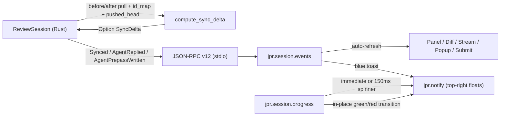
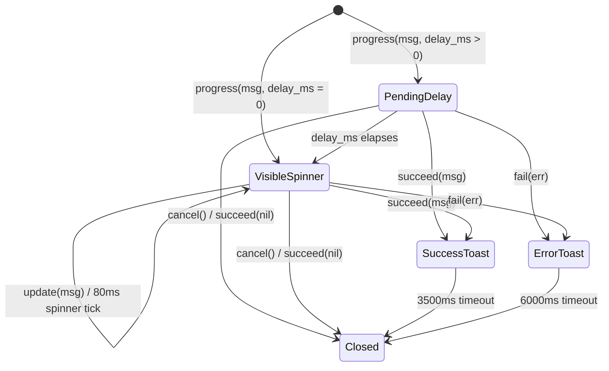

# Top-Right Color-Coded Toasts, In-Progress Indicators, and Sync/Agent Alerts

<small>

> <table border="0">
> <tr><th colspan="2">Files</th><th colspan="2">Lines</th></tr>
> <tr><td>Changed (total)</td><td>53</td><td>Insertions (+)</td><td>2,309</td></tr>
> <tr><td>Added</td><td>9</td><td>Deletions (-)</td><td>141</td></tr>
> <tr><td>Deleted</td><td>0</td><td>Net change</td><td>+2,168</td></tr>
> </table>

</small>

## 1. Purpose

Slow GitHub requests in a pull-request review left the Neovim UI silent and seemingly frozen while waiting for a response, and automatic 60-second background syncs or local coding-agent replies updated state without summarizing what changed or refreshing all open views. This change introduces a unified top-right notification system and engine-level change tracking so the reviewer always sees in-progress feedback, color-coded outcomes, and accurate summaries of external updates.

- Adds a `jpr`-owned top-right floating toast stack with red (error), green (success), blue (automatic update), amber (warning), and animated spinner states.
- Adds centralized in-progress indicators across all engine requests (immediate for GitHub calls, 150 ms delay for fast local calls) and an inline submitting banner inside the Submit Review modal.
- Computes remote sync deltas in the Rust engine while filtering out the reviewer's own local actions (own comments, optimistic IDs, viewed marks, and pushes).
- Auto-refreshes open diffs, thread markers, stream, conversation, and thread popups when remote sync changes or local agent replies arrive, showing blue summary toasts.

## 2. Background technical context

```text
crates/
  review-model/src/view/mod.rs       # SessionView, SyncDelta, and Event wire shapes
  review-core/src/
    sync_delta/mod.rs                # Pure pre/post sync comparison with self-action filtering
    session/sync.rs                  # Pulls from GitHub, reconciles state, emits Synced
    session/local.rs                 # Local thread mutations and agent_reply
    session/agent_loop.rs            # Agent dispatch and prepass_write
  review-rpc/src/protocol.rs         # JSON-RPC 2.0 wire version (PROTOCOL_VERSION = 12)
lua/jpr/
  notify/                            # Top-right color-coded floating toast stack
    init.lua                         # Toast stack state, progress lifecycle, listener, clear
    layout.lua                       # Pure text wrapping, sizing, highlight mapping
    window.lua                       # Floating window creation, painting, reflow, timers
  session/
    progress.lua                     # Per-RPC-method progress label and delay policy
    init.lua                         # Centralized session.request wrapper and teardown
    commands.lua                     # User-facing :Jpr sync, push, toggle handlers
    events.lua                       # Engine event notification handlers and auto-refresh
  views/
    submit.lua                       # Submit Review modal controller
    main_window.lua                  # Main editor window lookup (excludes side/floating windows)
  comments/popup.lua                 # Floating thread popup with live reload
```

| Module | Role |
| --- | --- |
| `review-model::Event` | Tagged JSON-RPC notification variants forwarded from `ReviewSession` to Neovim over stdout. |
| `review-core::ReviewSession` | Owns persisted PR files, GitHub and local threads, `id_map` optimistic ID mappings, and `pushed_head` tracking. |
| `jpr.session` | Owns the Neovim tab's RPC client, view state, and request lifecycle. |
| `jpr.highlights` | Registers semantic `Jpr*` highlight links (`default = true`) refreshed on `ColorScheme`. |

## 3. Shape of the solution

This branch connects two cooperating layers across JSON-RPC protocol version 12. The Rust engine owns all remote-change classification and event emission so any future frontend (such as a terminal UI) inherits the exact same rules without Neovim dependencies. The Neovim plugin owns the visual top-right toast stack, per-request progress lifecycles, and view refreshes.



## 4. The Rust engine computes external sync deltas while excluding locally originated actions

This strand establishes protocol version 12 in `crates/review-model`, `crates/review-core`, and `crates/review-rpc`. It answers how the engine distinguishes external GitHub updates from the reviewer's own actions so background polling never alerts on self-authored work.

### 4.1 Pure `SyncDelta` comparison filters out initial syncs, own pushes, and optimistic `id_map` comments

`compute_sync_delta` in `crates/review-core/src/sync_delta/mod.rs` compares a pre-pull `SyncComparisonSnapshot` against a post-pull snapshot using four explicit exclusions:

1. **Initial sync (`before.had_pr == false`):** Returns `None` immediately so opening a PR never fires a "12 files changed" toast.
2. **Own `:Jpr push` (`was_own_push == true`):** Checked in `ReviewSession::apply_pull` when `self.pushed_head.pushed_sha == pr.head_sha`. Suppresses `files_changed` and `head_moved`, while still counting external `new_comments` that arrived concurrently.
3. **Own viewed marks:** `count_remote_file_changes` counts newly added files, removed files, files with changed `additions`/`deletions`, and `Viewed -> Dismissed` transitions (GitHub invalidating a viewed mark on new commits). It ignores `Unviewed -> Viewed` transitions.
4. **Own comments and queued `tmp-*` comments:** `build_before_github_maps` indexes every pre-sync GitHub thread and message under both its original ID and its canonical ID from `self.saved.registry.id_map` (following up to 8 hops). When an offline queued comment (`tmp-m-1`) lands on GitHub and returns as `PRRC_99` on the next sync, `id_map` maps `tmp-m-1 -> PRRC_99`, so `PRRC_99` is recognized as already seen and `new_comments` stays `0`. Local threads (`Origin::Local`) are skipped entirely.

**Worked example:** Suppose before sync the reviewer had one queued GitHub comment `tmp-m-1` on thread `tmp-t-1` and `id_map` recorded `tmp-m-1 -> PRRC_99` when the queue replayed. On pull, GitHub returns `PRRC_99` (reviewer's comment) plus `PRRC_100` (a teammate's reply) and one new file `src/new.rs`. `build_before_github_maps` inserts both `tmp-m-1` and `PRRC_99`. Scanning the post-pull threads finds `PRRC_99` in the known map with an unchanged body (ignored) and `PRRC_100` absent (counted), producing `SyncDelta { files_changed: 1, new_comments: 1, .. }`.

### 4.2 Dedicated agent notification events preserve existing `ThreadsChanged` contracts

Both `ReviewSession::agent_reply` (`crates/review-core/src/session/local.rs`) and `ReviewSession::prepass_write` (`crates/review-core/src/session/agent_loop.rs`) emit `Event::ThreadsChanged` first and immediately follow it with `Event::AgentReplied` (carrying `thread_id`, `author`, `file`, and `line`) or `Event::AgentPrepassWritten` (carrying `count`). Emitting a separate event after `ThreadsChanged` keeps all existing thread-redraw subscribers working unchanged while giving frontends typed location metadata for toast notifications.

## 5. A dedicated top-right toast stack provides consistent color coding and live spinners

This strand replaces `vim.notify` calls in `jpr` with `lua/jpr/notify/` (`init.lua`, `layout.lua`, `window.lua`) and `JprNotify*` semantic highlight links in `lua/jpr/highlights/init.lua`.

### 5.1 Color semantics, non-focusable stacking, and window-layout isolation

Every toast opens as a non-focusable (`focusable = false`), rounded floating window anchored at the top-right (`relative = "editor"`, `anchor = "NE"`, `zindex = 250`) and stacks downward with 1-row gaps, capped at 6 visible toasts (evicting the oldest non-progress toast first). Highlight links (`default = true`) map each kind to standard Neovim diagnostics:

| Kind | Border & Title Link | Default Timeout | Use |
| --- | --- | --- | --- |
| `error` | `DiagnosticError` (red) | 6000 ms | Failed requests, validation errors, crashes |
| `success` | `DiagnosticOk` (green) | 3500 ms | User-initiated completions (`review submitted`, `pushed <sha>`, `<mode> view`) |
| `info` | `DiagnosticInfo` (blue) | 4500 ms | Automatic sync deltas, agent replies, pre-pass findings |
| `warn` | `DiagnosticWarn` (amber) | 5000 ms | Non-fatal warnings (diverged head, resync failure after push) |
| `progress` | `DiagnosticInfo` (blue spinner) | None (explicit) | In-flight engine/GitHub operations |

Each toast sets `vim.w[win].jpr_side = true`, and `lua/jpr/views/main_window.lua` (`M.is_side`) also treats any floating window (`config.relative ~= ""`) as a non-editor window. Without that guard, `main_window.find` could mistake an open toast window for the tab's editor window when the editor split is closed.

### 5.2 Progress toast lifecycle prevents flicker on fast calls and double-notifications on failure



A single shared 80 ms `vim.uv` timer drives the Braille spinner frames only while at least one visible progress toast exists, and stops as soon as the last spinner transitions or closes. `notify.clear()` (registered on `VimLeavePre`) stops all delay and spinner timers and closes all toast windows cleanly.

## 6. Centralized RPC progress tracking and inline Submit Review status eliminate silent waits

This strand wires `lua/jpr/session/progress.lua` into `lua/jpr/session/init.lua`, `lua/jpr/session/commands.lua`, `lua/jpr/render/submit.lua`, `lua/jpr/views/submit.lua`, and `lua/jpr/session/events.lua`.

- **Immediate (`delay_ms = 0`) vs delayed (`delay_ms = 150`):** `progress.get_spec_from_request` marks all GitHub-bound calls (`submitReview`, `sync`, `push`, `submitPreview`, `promoteThread`, `suggestFromEdit`, GitHub `comment`, `reply`, `editMessage`, `deleteMessage`, `setResolved`, `toggleReaction`, `retryMessage`) as immediate so the user sees feedback at once. Fast/local calls (`setViewed`, `fileDiff`, `stream`, `threads`, local `comment`, `refreshWorktree`, `setCollapsed`) wait 150 ms before opening a window so sub-150 ms responses never flicker.
- **Single-toast failure handling:** When `session.request` fails, it calls `progress_handle:fail(error_message)` instead of a separate `jpr.error()`, transitioning the spinner toast to red in place with no duplicate error box. On `AUTH_REQUIRED`, the spinner cancels cleanly before opening the auth modal. On `:Jpr close` (`forget`), `progress.cancel_all(session)` cancels every active handle for that tab.
- **Inline Submit Review state:** `lua/jpr/views/submit.lua` repaints the modal immediately when `state.in_flight = true`, causing `lua/jpr/render/submit.lua` to show `"Submitting review to GitHub..."` at the top of the modal while disabling action hints. On success the modal closes and the progress toast turns green (`"review submitted"`); on error the modal re-enables with the summary body preserved and the toast turns red.
- **Stream progress:** Outside initial loading (`session.loading`), `streamProgress` notifications update `session.stream_progress_handle` in place instead of echoing to the command line, and close it when `completed >= total`.

## 7. Sync auto-refresh and blue notifications surface external changes and agent replies

In `lua/jpr/session/events.lua`:

- When `synced` arrives with a non-empty `delta`, `handle_synced_notification` runs `diff.redraw_all(session)` on file/head changes, `diff.redraw_threads(session)` plus `conversation.refresh` and `popup.refresh_open` on comment/thread changes, forces `stream.refresh(session, true)`, and emits a blue toast via `jpr.info` (e.g. `"PR #42 updated: 3 files changed, 2 new comments"`). When `delta` is nil (initial sync or no external changes), no change-summary toast is shown.
- When `agentReplied` arrives, Neovim emits a blue toast with author and location (`"claude replied on src/a.rs:42"` or `"claude replied on PR conversation"`) and calls `popup.refresh_open(session, params.threadId)` to silently reload the thread popup if it is currently showing that thread.
- When `agentPrepassWritten` arrives with `count > 0`, Neovim emits a blue toast (`"Agent added 3 pre-pass findings"`).

## 8. Decisions

- **Build a `jpr`-owned top-right floating toast stack instead of delegating to `vim.notify`.** Standard `vim.log.levels` cannot distinguish green (user-initiated success) from blue (automatic update) or render in-place animated spinners across Neovim setups, and calling both would produce duplicate popups for users running `snacks.notifier` or `noice.nvim`. Reversed if Neovim adds standardized color-coded/progress notification APIs adopted by major notifier plugins.
- **Compute `SyncDelta` in pure Rust (`review-core`) rather than diffing `SessionView` counts in Lua.** `SessionView` holds only aggregate counts, not message IDs, `id_map`, or `pushed_head`, so Lua cannot filter out the reviewer's own newly landed comments or own pushes. Reversed only if `SessionView` ever exposed full thread/ID-map state.
- **Emit `AgentReplied` and `AgentPrepassWritten` alongside `ThreadsChanged` rather than replacing `ThreadsChanged`.** Preserves existing thread-redraw contracts in both Rust tests and Neovim event handlers without duplicating redraw logic.
- **Use a 150 ms delay threshold for fast/local RPCs and 0 ms for GitHub-bound RPCs.** Prevents visual flicker on instant local actions while guaranteeing that even a slow local diff or worktree refresh displays a spinner.

## 9. Deliberately not handled

- Toast history drawer or interactive click-to-dismiss on toasts (toasts are non-focusable and auto-dismiss).
- Changing the background sync polling interval (remains 60 seconds via `--poll`).
- Replacing `vim.notify` for third-party Neovim plugins outside `jpr`.

<div style="page-break-before: always"></div>

## Appendix A. Manual testing

1. Rebuild the release engine binary so Neovim matches protocol version 12:
   ```sh
   cargo build --release -p jpr-review
   ```
2. Open a PR in Neovim (`:Jpr open <n>`), press `gs` (`:Jpr submit`), choose a review action, and confirm. Verify the modal shows `"Submitting review to GitHub..."` inline and a top-right blue spinner toast appears immediately, then transitions in place to a green `"review submitted"` toast.
3. Trigger a validation error (such as submitting an empty Comment review with zero drafts) and verify a single red top-right toast appears.
4. From GitHub web UI, add a comment or push a commit to the PR branch, then wait for the 60-second background poll or run `:Jpr sync`. Verify open diffs, stream, and conversation auto-refresh and a blue top-right toast summarizes the external changes.
5. Post a comment from Neovim and run `:Jpr sync`. Verify no blue "new comment" toast appears for your own comment.
6. Run `jpr-review reply <loc-id> "Checked"` from the agent terminal while the thread popup is open. Verify a blue top-right toast announces the reply and the popup refreshes live.

<div style="page-break-before: always"></div>

## Appendix B. Glossary

1. **SyncDelta**: A structured summary of external GitHub changes detected during a sync (`filesChanged`, `newComments`, `updatedComments`, `resolvedThreads`, `reopenedThreads`, `headMoved`), excluding actions originated locally by the reviewer.
2. **`id_map`**: Persisted map in `github.json` linking temporary optimistic IDs (`tmp-*`) created for queued offline comment operations to their real GitHub node IDs once replayed.
3. **`pushed_head`**: In-memory record on `ReviewSession` storing the local commit SHA pushed by `:Jpr push` so the follow-up sync recognizes that `headSha` as the reviewer's own push.
4. **Progress handle**: Lifecycle object (`{ update, succeed, fail, cancel }`) returned by `jpr.notify.progress` that manages a deferred or visible spinner toast and transitions it in place on completion.
5. **Toast stack**: Non-focusable rounded floating windows managed by `lua/jpr/notify/` anchored at the top-right (`anchor = "NE"`) that stack downward and reflow automatically.
